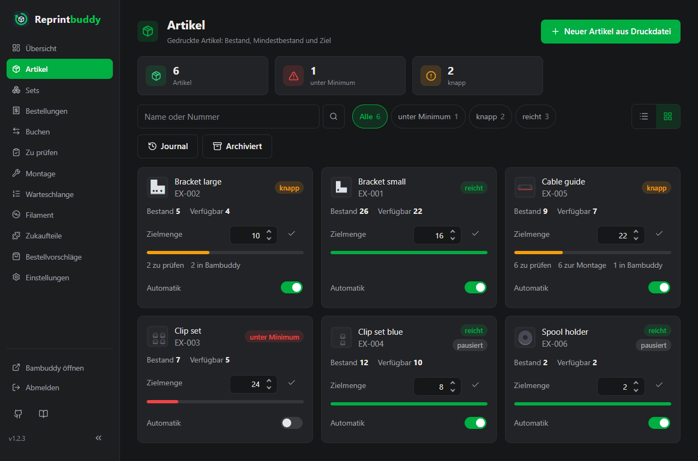
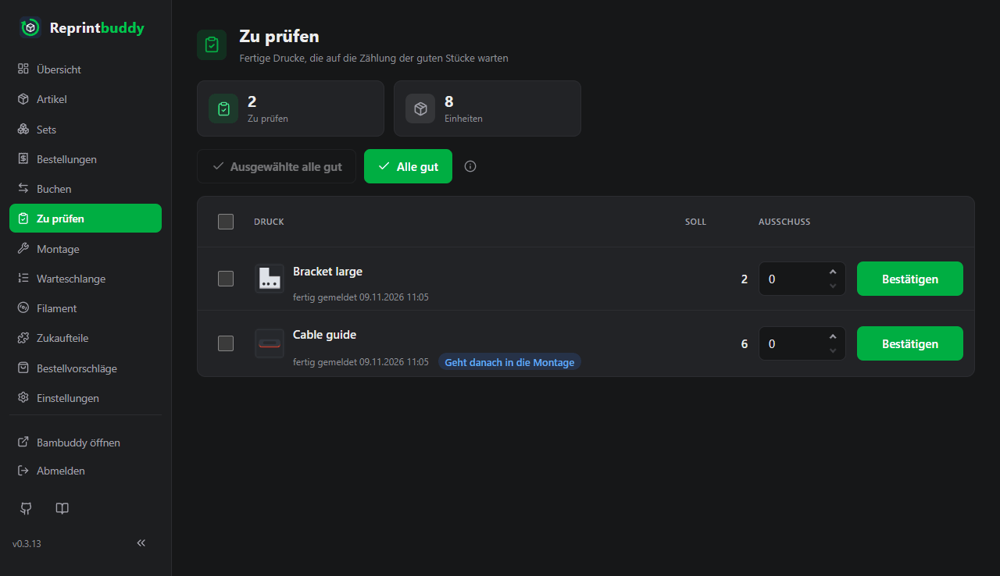
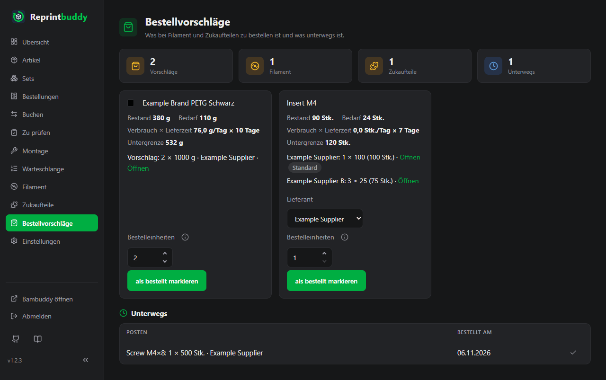

<p align="center">
  
</p>

<h1 align="center">Reprintbuddy</h1>

<p align="center">
  <strong>Dein Regal bleibt voll. Bambuddy druckt.</strong><br>
  Selbst gehostete Lagerführung für 3D-gedruckte Teile, Nachdrucke über die Warteschlange von Bambuddy.
</p>

<p align="center">
  <a href="https://github.com/Eifel-Joe/reprintbuddy/releases"></a>
  <a href="https://github.com/Eifel-Joe/reprintbuddy/actions/workflows/ci.yml"></a>
  <a href="https://github.com/Eifel-Joe/reprintbuddy/blob/main/LICENSE"></a>
  <a href="https://github.com/Eifel-Joe/reprintbuddy/stargazers"></a>
  <a href="https://github.com/Eifel-Joe/reprintbuddy/issues"></a>
</p>

[English: README.md](README.md)

**Dokumentation:** <https://eifel-joe.github.io/reprintbuddy/> – Installation, Einrichtung und Bedienung, auf Deutsch und Englisch.

Reprintbuddy führt den Lagerbestand von 3D-gedruckten Teilen. Was knapp wird,
druckt es nach, indem es Druckaufträge in die Warteschlange von
Bambuddy stellt. Fertige Drucke prüfst
du in Reprintbuddy, und es zeigt dir, was nachzubestellen ist. Es läuft als
kleine Webanwendung im lokalen Netzwerk (LAN) und ist von außen nur über ein VPN erreichbar.


> **Stand:** in Entwicklung, noch nicht einsatzbereit.

Reprintbuddy ist ein eigenständiges Projekt und nicht mit Bambuddy oder Bambu Lab verbunden.

## Was es ist und was nicht

- **Es ist** ein Lagerbuch je Artikel mit Mindestbestand und Puffer, eine eigene
  Warteschlange für Nachdrucke, eine Prüfliste für fertige Drucke, Buchungen
  für die Montage und Bestellvorschläge für Filament und Zukaufteile.
- **Es steuert nie Drucker.** Bambuddy bleibt dein Drucksystem. Reprintbuddy legt
  nur Aufträge in Bambuddys Warteschlange und liest den Status. Es startet,
  stoppt und pausiert nichts und schreibt nie in Spoolman.
- Es bringt keine eigenen Artikel mit: Artikel, Sets, Zukaufteile und Regeln
  legst du in der Weboberfläche an.

## Bildschirmfotos

Erfundene Beispieldaten. Weitere Bilder stehen auf den [Doku-Seiten](https://eifel-joe.github.io/reprintbuddy/).







## Voraussetzungen

- Bambuddy 1.3 oder neuer, mit eigener Spulenverwaltung oder mit Spoolman (**Spoolman ist
  optional**). Reprintbuddy liest den Filamentbestand über Bambuddy und spricht nie selbst
  mit Spoolman.
- **Druckdateien direkt in Bambuddys Dateimanager**, hochgeladen und geslict (`.3mf` oder `.gcode.3mf`).
  Extern eingebundene Ordner reichen nicht: Für ihre Dateien führt Bambuddy keine Prüfsumme
  und liest Platten und Filament beim erneuten Einlesen nicht neu, eine geänderte Fassung
  bliebe unbemerkt (so eine Datei lässt sich trotzdem wählen; die Auswahl zeigt eine Warnung). Neue Druckdateien lassen sich auch aus Reprintbuddy hochladen (optional,
  siehe *Druckdateien hochladen*), aber nicht in einen externen Ordner.
- Ein **eigener Bambuddy-Benutzer** `reprintbuddy` in einer **eigenen Bambuddy-Gruppe** mit den
  Rechten, die unter *Erster Aufruf* stehen, und ein **API-Schlüssel** dieses Benutzers. Der
  eigene Benutzer macht Reprintbuddys Aufträge in Bambuddy erkennbar. Die Einrichtung
  führt dich Schritt für Schritt durch.
- Ein Rechner, eine VM oder ein Container (z. B. Proxmox-LXC, unprivilegiert genügt) mit
  **Debian 13** oder neuer. Reprintbuddy braucht Python 3.13 oder neuer; Debian 12 hat nur
  Python 3.11, deshalb bricht das Installationsskript dort ab. **Auf einem Debian-12-System:** das
  System auf Debian 13 aktualisieren (das Debian-Release-Upgrade), danach den Installationsbefehl
  erneut ausführen. Er erkennt, dass die Python-Umgebung nicht mehr zum System-Python passt, baut sie neu und behält die
  installierte Version, die Datenbank und alle Einstellungen. Eine auf Debian 12 gemachte Installation
  kann vorher nicht auf diese Version aktualisieren: das Update scheitert mit der Meldung von pip
  („requires a different Python“), wird zurückgerollt, und die laufende Version bleibt. Vorher eine
  Sicherung ziehen (*Sicherung und Export*).
  Ein CPU-Kern, 1 GB RAM und 8 GB Platte reichen. Docker ist nicht nötig.
- Ausgehender Netzzugang dieses Rechners zu den Debian-Paketquellen (`apt`),
  `github.com` und `raw.githubusercontent.com` (Installation und Updates), `api.github.com` (die
  Versionshinweise auf der Update-Karte),
  `pypi.org` und `files.pythonhosted.org` (Python-Pakete, bei der Installation und
  bei jedem Update) und zu deinem Bambuddy.
- Wahlweise: [Home Assistant](https://www.home-assistant.io/) mit seiner Handy-App für
  Push-Nachrichten (siehe *Push-Nachrichten über Home Assistant*); dann auch Zugang zu Home Assistant.

## Installation

```bash
apt-get update && apt-get install -y curl && bash -c "$(curl -fsSL https://raw.githubusercontent.com/Eifel-Joe/reprintbuddy/v0.4.7/install/install.sh)"
```

Als root auf diesem System ausführen. Frische Debian-Systeme bringen oft kein curl mit; der erste Teil installiert es.
Das Skript legt das Release auf, dessen Tag in der Adresse steht (hier `v0.4.7`): Skript und Release sind eine
Version.
Ohne Rückfrage nach der Sprache, mit angehängter Sprache:

```bash
apt-get update && apt-get install -y curl && bash -c "$(curl -fsSL https://raw.githubusercontent.com/Eifel-Joe/reprintbuddy/v0.4.7/install/install.sh)" _ --language de
```

Willst du eine andere Version installieren, setzt du ihren Tag anstelle von `<tag>` in die Adresse (ab v0.3.14; die
Skripte früherer Tags legen das neueste Release auf). Mehr braucht es nicht: eine Option für die Version gibt es nicht.
Ist Reprintbuddy schon installiert, behält das Skript diese Version und bessert nur den Rest aus; unterscheiden sich
die Systemdateien des Skripts von denen der installierten Version, bricht es ab und nennt den Tag, den du nehmen musst:

```bash
apt-get update && apt-get install -y curl && bash -c "$(curl -fsSL https://raw.githubusercontent.com/Eifel-Joe/reprintbuddy/<tag>/install/install.sh)"
```

Das Skript

- installiert die nötigen Pakete (`python3`, `python3-venv`, `git`, `curl`, `sudo`,
  `ca-certificates`),
- legt den Systembenutzer `reprintbuddy` an,
- legt Reprintbuddy auf dem Release-Tag des Skripts nach `/opt/reprintbuddy` und die
  Python-Umgebung nach `/opt/reprintbuddy/.venv`,
- legt `/var/lib/reprintbuddy` (Rechte 700) mit Datenbank, Sicherungen und Update-Stand an,
- richtet die systemd-Einheiten `reprintbuddy.service` und `reprintbuddy-update.service` ein,
- installiert eine sudoers-Regel in `/etc/sudoers.d/reprintbuddy`, die dem Dienstbenutzer genau
  genau diese Befehle als root erlaubt und nichts sonst (die letzten beiden braucht der Rückfall eines
  gescheiterten Updates, der die Datenbank bei gestopptem Dienst zurückspielt):

  ```text
  /usr/bin/systemctl restart --no-block reprintbuddy.service
  /usr/bin/systemctl restart reprintbuddy.service
  /usr/bin/systemctl start --no-block reprintbuddy-update.service
  /usr/bin/systemctl stop reprintbuddy.service
  /usr/bin/systemctl start reprintbuddy.service
  ```

- installiert den Befehl `/usr/local/bin/reprintbuddy` (siehe *Kommandozeile*),
- startet den Dienst und nennt die Adresse für die Ersteinrichtung.

**Schließe die Einrichtung sofort ab** unter `http://<server-ip>:8080/setup`: Bis das
Admin-Konto existiert, kann es jeder in deinem Netz anlegen.

Das Skript erneut auszuführen ist sicher: Version und Datenbank bleiben, es repariert Pakete,
Benutzer, Rechte, Einheiten und den Dienst. Die Version wechselt nur das Update (siehe
*Update*). Mit `--dry-run` zeigt das Skript, was es täte, ohne etwas zu ändern.

Für die Entwicklung:

```bash
python -m venv .venv
.venv/bin/pip install -e ".[dev]"
.venv/bin/python -m pytest
.venv/bin/python -m reprintbuddy serve --db ./dev.db
```

## Erster Aufruf

Öffne die Adresse, die das Installationsskript nennt. Solange die Einrichtung
nicht abgeschlossen ist, kann jeder in deinem Netz die Seite benutzen, also
erledige sie gleich. Bei der Ersteinrichtung öffne Reprintbuddy über seine IP-Adresse (oder einen
lokalen Namen); Namen aus öffentlichen Domains, z. B. VPN-DNS-Namen, werden erst nach der
Einrichtung akzeptiert.

1. **Admin-Konto:** Benutzername, Passwort und Sprache wählen.
2. **Gruppe und Benutzer in Bambuddy:** Lege in Bambuddy unter *Einstellungen → Benutzer* eine
   eigene Gruppe `Reprintbuddy` an. Keine Systemgruppe passt: *Operators* sieht nur eigene
   Dateien und Aufträge, *Administrators* darf alles. Gib der Gruppe diese Rechte (in Klammern
   der interne Name). Bambuddy zeigt die Rechte nur auf Englisch, deshalb stehen sie hier wie dort:

   - Read All Library (`library:read_all`): damit Reprintbuddy deine Druckdateien sieht
   - Read All Queue (`queue:read_all`): damit Reprintbuddy die ganze Warteschlange sieht
   - Create Queue (`queue:create`): damit Reprintbuddy Nachdrucke einreihen kann
   - Print Without Review (`queue:start_unreviewed`): damit Nachdrucke ohne Freigabe starten
   - Read Printers (`printers:read`): damit Reprintbuddy die Drucker und ihren Zustand sieht
   - Read Inventory (`inventory:read`): damit Reprintbuddy den Filamentbestand liest
   - Read Filaments (`filaments:read`): um zu erkennen, ob Bambuddy die Spulen selbst führt oder
     in Spoolman
   - Read Settings (`settings:read`): damit Nachdrucke mit Bambuddys Standard-Druckoptionen laufen

   Empfohlen, nicht nötig – nur zum Hochladen von Druckdateien aus Reprintbuddy:

   - Upload Library (`library:upload`)

   Ohne dieses Recht geht alles andere; nur das Hochladen nicht.

   Nur zum Erzeugen des Schlüssels im nächsten Schritt braucht die Gruppe zusätzlich diese zwei
   Rechte; Reprintbuddy prüft sie nicht, und sie dürfen danach wieder weg: Read Api Keys
   (`api_keys:read`) und Create Api Keys (`api_keys:create`).

   Lege dann den Benutzer `reprintbuddy` in dieser Gruppe an. Sein Passwort brauchst du nur
   einmal, um den Schlüssel zu erzeugen; Reprintbuddy fragt es nicht ab und speichert es nicht.
   Ein fehlendes Recht kannst du in der Gruppe jederzeit ergänzen; einen neuen Schlüssel brauchst
   du dafür nicht.
3. **API-Schlüssel:** Melde dich in Bambuddy ab und als `reprintbuddy` an (ein Schlüssel gehört
   immer dem angemeldeten Benutzer). Öffne *Einstellungen → API-Schlüssel → Schlüssel erstellen*
   und stelle ihn genau so ein: Name „Reprintbuddy“; *Status lesen* (*Read Status*) **an**;
   *Warteschlange verwalten* (*Manage Queue*) **an**; *Bibliothek verwalten* (*Manage Library*)
   **an** (nur zum Hochladen von Druckdateien; am Schlüssel wirkt es nur, soweit die Gruppe es
   erlaubt, und die Gruppe bekommt dafür nur *Upload Library*); alle anderen **aus**
   (*Control Printer*, *Manage Inventory*, *Manage Maintenance*, *Manage Archives*,
   *Manage Projects*, *Allow Cloud Access*, *Update Electricity Price*, *Send Notifications*).
   Kopiere den Schlüssel
   sofort (Bambuddy zeigt ihn nur einmal) und melde dich wieder ab. Die Rechte eines Schlüssels
   lassen sich in Bambuddy nicht nachträglich ändern (die Oberfläche kann Schlüssel nur erzeugen
   und löschen): fehlt ein Recht am Schlüssel, zum Beispiel *Status lesen*, erzeuge einen neuen
   Schlüssel und trage ihn unter *Einstellungen → Bambuddy* ein.
4. **Bambuddy anbinden:** Trage die Adresse von Bambuddy und den Schlüssel ein. Reprintbuddy
   fragt Bambuddy (`GET /api/v1/auth/me`), wem der Schlüssel gehört und welche Rechte er wirklich
   hat, und zeigt Besitzer und jedes nötige Recht mit Haken oder Kreuz. Die Oberfläche öffnet
   sich erst, wenn kein Recht fehlt. Ein Schlüssel eines Administrators wird angenommen, mit der
   Warnung, dass er mehr darf als nötig. Dieselbe Prüfung gibt es unter *Einstellungen*. Ein
   fehlendes Recht der Gruppe `Reprintbuddy` wird in Bambuddy (*Einstellungen → Benutzer*)
   ergänzt, ein neuer Schlüssel ist nicht nötig. Fehlt ein Recht am Schlüssel selbst, ist ein
   neuer Schlüssel nötig.

   Die beiden Felder sind so gekennzeichnet, dass Passwort-Manager sie nicht mit deinen eigenen
   Zugangsdaten füllen.

## Druckdateien hochladen

Unter *Artikel → Neuer Artikel aus Druckdatei* legt der Knopf *Druckdatei hochladen* eine
geslicte 3MF-Datei (`.3mf` oder `.gcode.3mf` mit G-Code darin, höchstens 200 MB) in den gerade geöffneten Ordner in
Bambuddys Dateimanager; danach wählst du wie gewohnt die Platte und legst den Artikel an.
Reprintbuddy prüft die Datei, bevor er etwas schickt, weil er eine Datei in Bambuddy nicht
wieder löschen kann: nur eine geslicte 3MF, Bambuddys Regeln für den Namen und keine Datei
gleichen Namens in diesem Ordner (überschrieben oder umbenannt wird nie). Externe Ordner
bekommen keinen Knopf.

Hochladen braucht *Upload Library* (`library:upload`) in der Gruppe `Reprintbuddy` und
*Manage Library* am API-Schlüssel. Beides ist optional. Eine Installation, die vor dieser
Version eingerichtet wurde, ergänzt das Recht in der Gruppe und erzeugt, weil Bambuddy die
Rechte eines Schlüssels nicht ändern kann, einen neuen Schlüssel mit *Read Status*,
*Manage Queue* und *Manage Library*, trägt ihn unter *Einstellungen → Bambuddy* ein und löscht
den alten.

## Push-Nachrichten über Home Assistant

Wahlweise: Reprintbuddy kann Ereignisse an [Home Assistant](https://www.home-assistant.io/) melden,
das sie über seine App als Push-Nachricht aufs Handy bringt. Ohne Eintrag wird nichts gesendet und
Home Assistant nie angesprochen. Melden kann es, jedes Ereignis einzeln abschaltbar: Druck fertig
und wartet auf Prüfung, Druck in Bambuddy fehlgeschlagen, Artikel durch die Automatik pausiert,
Artikel unter Mindestbestand, neuer Bestellvorschlag, Störung (eine rote Warnung bei zwei regulären
Abfragen hintereinander) und fehlendes Recht in Bambuddy. Jedes meldet sich einmal und erst wieder,
wenn es sich erledigt hat; was zusammen anfällt, kommt als eine Nachricht.

1. In Home Assistant einen eigenen Benutzer **ohne Admin-Recht** anlegen (empfohlen), als dieser
   Benutzer anmelden und unter Profil → *Sicherheit* ein *langlebiges Zugriffstoken* erstellen.
   Kopieren: Home Assistant zeigt es nur einmal.
2. Den Benachrichtigungsdienst des Handys finden: in Home Assistant unter *Entwicklerwerkzeuge →
   Aktionen* die Aktionen `notify.mobile_app_…` (eine je Handy mit der Home-Assistant-App).
3. In Reprintbuddy unter *Einstellungen → Benachrichtigungen*: einschalten, die Adresse von Home
   Assistant (z. B. `http://homeassistant.local:8123`), das Token und den Dienst eintragen, die
   Ereignisse ankreuzen, dann *Testnachricht senden*. Angenommen werden nur Dienste der Domain `notify`.

Reprintbuddy ruft `POST /api/services/notify/<Dienst>` auf und, um nach einer fehlgeschlagenen Nachricht
zu prüfen, ob Home Assistant wieder antwortet, `GET /api/`; sonst nichts. „Angenommen“ heißt:
Home Assistant hat die Nachricht übernommen; ob das Handy sie bekommt, weiß nur Home Assistant. Geht
eine Nachricht nicht durch, zeigt die Übersicht „Home Assistant nicht erreichbar“; Bestand und Drucke
laufen weiter wie bisher. Lehnt Home Assistant das Token ab (401), hört Reprintbuddy sofort auf zu senden und zu prüfen,
weil jeder weitere Versuch dort als Fehlanmeldung zählt; erneutes Speichern der Karte hebt den Halt auf.

## Einstellungen

Es gibt **keine Konfigurationsdatei**. Jede Einstellung liegt in der Datenbank
und wird in der Weboberfläche unter *Einstellungen* geändert: Sprache, Adresse für QR-Codes,
Bambuddy-Verbindung, Automatik, Etiketten, Push-Nachrichten, Passwort, Adresse, Port, optionales
HTTPS-Zertifikat, Neustart, Update-Prüfung, Update und Sicherung sowie Export. *Einstellungen → Protokoll* zeigt nur, was passiert ist (wer was geändert hat, Anmeldungen, Updates, Nachrichten), siehe die Doku-Seiten.
Nur der Pfad der Datenbank wird auf der Kommandozeile angegeben (`--db`). Zeitpunkte erscheinen in
der Zeitzone des Servers (`timedatectl set-timezone …`, danach neu starten).

## Update

*Einstellungen → Update und Sicherung*: **Nach Updates suchen** drücken; gibt es eine neuere Version, zeigt die Karte, was sie mitbringt, dann
**Auf … aktualisieren**. Reprintbuddy prüft auch von selbst beim Start und einmal täglich und zeigt dann oben auf jeder
Seite einen Balken; der Schalter **Automatisch nach neuen Versionen suchen** auf der Karte schaltet das ab. Die Prüfung fragt GitHub (die Versionshinweise kommen ohne Anmeldung über GitHubs API), dabei sieht GitHub die IP-Adresse deines Servers. Das Update

1. sichert die Datenbank,
2. wechselt auf den neuen Release-Tag,
3. installiert die Pakete,
4. migriert die Datenbank,
5. startet den Dienst neu und
6. prüft, ob die neue Version antwortet.

Scheitert ein Schritt, geht Reprintbuddy auf die vorige Version zurück **und** spielt die
Datenbank aus der Sicherung zurück; die Seite nennt den gescheiterten Schritt. Änderungen aus
der Zeit des Updates gingen dabei verloren, darum sind alle Änderungen gesperrt, bis es fertig ist.

Zeigt die Seite **Update wurde unterbrochen** oder **Update fehlgeschlagen, vorige Version ließ sich nicht wiederherstellen**,
führe das Installationsskript erneut aus: Es repariert Pakete, Einheiten und den Dienst und lässt die Datenbank
stehen. Startet Reprintbuddy danach nicht, spiele die auf der Seite genannte Sicherung zurück (siehe
*Sicherung und Export*) und führe das Skript noch einmal aus. Die Seite zeigt den Git-Tag und, wenn sie sich
unterscheidet, daneben die Paketversion.

Die Sicherungen liegen in `/var/lib/reprintbuddy/backups/` (die letzten 5; eine von einem gescheiterten Rückfall
genannte Sicherung wird nie gelöscht). Ein Update von Hand
startest du mit `systemctl start reprintbuddy-update.service`; das Systemprotokoll steht in
`journalctl -u reprintbuddy-update`.

Versionen sind Git-Tags `vX.Y.Z`, die Paketversion entspricht dem Tag. Ändert eine Version die
systemd-Einheiten oder die sudoers-Regel, steht es in der Release-Notiz; dann das
Installationsskript erneut ausführen.

## Neustart

*Einstellungen → Allgemein → Neustart* startet Reprintbuddy neu. Adresse, Port und HTTPS wirken erst nach
einem Neustart; die Einstellungsseite sagt, wenn eine gespeicherte Änderung noch wartet. Nach
einer Änderung von Adresse oder Port nennt die Neustart-Seite die neue Adresse. Auf dem System:
`systemctl restart reprintbuddy`.

## HTTPS

HTTP genügt im lokalen Netzwerk (LAN) oder über ein VPN. Für HTTPS lädst du unter *Einstellungen* ein Zertifikat und seinen
privaten Schlüssel (ohne Passwort) hoch; Reprintbuddy prüft vor dem Speichern, ob beide
zusammengehören, danach neu starten. Zurück zu HTTP geht über das Häkchen *Zertifikat und
privaten Schlüssel entfernen*.

Alternativ läuft Reprintbuddy hinter einem vorhandenen Reverse-Proxy: Reprintbuddy bleibt bei
HTTP, der Proxy macht TLS. Läuft der Proxy auf demselben System, stelle die Lauschadresse auf
`127.0.0.1`. Gib Reprintbuddy am Proxy eine eigene Adresse oder einen eigenen Port
(`https://reprintbuddy.example.net/` oder `https://example.net:8443/`). Ein Unterpfad
(`https://example.net/reprintbuddy/`) geht nicht: Links und Weiterleitungen würden am Proxy
vorbeizeigen. Wird Reprintbuddy so erreicht, schreibt es eine Warnung ins Systemprotokoll. Eine
Anfrage, die über HTTPS kam, bekommt Cookies mit der Markierung „nur über HTTPS“; hinter einem Proxy
gilt das, wenn er auf demselben System läuft und `X-Forwarded-Proto: https` schickt (von anderen
Adressen wird der Header übergangen).

Ausgesperrt durch ein Zertifikat, das nicht mehr taugt (abgelaufen, falscher Name)? Auf dem System:

```bash
reprintbuddy disable-https && systemctl restart reprintbuddy
```

Bei falschem Port: `reprintbuddy set-port 8080 && systemctl restart reprintbuddy`.

## Sicherung und Export

Reprintbuddy bringt eine eigene vollständige Sicherung mit, unabhängig davon, wie das System
sonst gesichert wird. Unter *Einstellungen → Update und Sicherung*:

- **Vollständige Sicherung** lädt die ganze Datenbank als eine `.zip`-Datei herunter: alle Daten
  und Einstellungen, **auch** den Bambuddy-Schlüssel, den Passwort-Hash, den privaten
  HTTPS-Schlüssel und das Sitzungsgeheimnis. Mit Passwort (8 bis 1024 Zeichen) wird sie
  verschlüsselt (Argon2id und AES-256-GCM); das Passwort wird nirgends gespeichert, ohne es lässt
  sich die Sicherung nicht wiederherstellen. **Ohne Passwort kommt jeder, der die Datei hat, an die
  Schlüssel und kann sich anmelden.** Vor dem Herunterladen fragt Reprintbuddy das Anmelde-Passwort
  erneut ab; ein offener Browser allein reicht also nicht.
- **Wiederherstellen** nimmt so eine Datei (höchstens 128 MB). Reprintbuddy prüft, dass sie eine
  Sicherung von Reprintbuddy in dieser oder einer älteren Version ist (eine ältere Datenbank wird
  beim Start migriert, eine neuere abgelehnt), fragt nach dem Anmelde-Passwort und bei Verschlüsselung
  nach dem Passwort der Sicherung, sichert
  die laufende Datenbank wie vor einem Update, ersetzt sie und startet neu. Danach gelten
  Benutzername und Passwort aus der Sicherung, und alle melden sich neu an. Auch Adresse, Port und
  HTTPS kommen aus der Sicherung; passen sie auf einem neuen Rechner nicht, richten
  `reprintbuddy set-host` und `set-port` (siehe *Kommandozeile*) sie wieder.
- **Export** lädt alle Daten als JSON-Datei herunter, **ohne** API-Schlüssel, Passwörter, den
  privaten HTTPS-Schlüssel und das Sitzungsgeheimnis.

Startet Reprintbuddy nicht mehr, zum Beispiel nach einem misslungenen Wiederherstellen, geht
dieselbe Wiederherstellung auf der Kommandozeile, mit denselben Prüfungen wie in der Oberfläche:

```bash
systemctl stop reprintbuddy
install -m 0600 -o reprintbuddy /root/sicherung.zip /var/lib/reprintbuddy/restore.zip
reprintbuddy restore-backup /var/lib/reprintbuddy/restore.zip
rm /var/lib/reprintbuddy/restore.zip
systemctl start reprintbuddy
```

Der Befehl fragt das Passwort der Sicherung ab, wenn sie verschlüsselt ist (nur am Terminal, nie als
Argument), verweigert sich, solange Reprintbuddy oder sein Update läuft, sichert zuerst die vorhandene
Datenbank (`backups/`, bei unlesbarer Datenbank als `damaged-...`) und sagt, was er wiederhergestellt
hat. Er läuft als Dienstbenutzer aus dem Ordner `/`: den vollen Pfad angeben, und die Datei muss für
diesen Benutzer lesbar sein. Wie oben in den Datenordner kopieren (mit Modus 0600, denn ohne
Verschlüsselung enthält sie deine Schlüssel) und danach löschen. Danach melden sich alle neu an.

Eine Datenbankkopie aus `backups/` von Hand zurückspielen:

```bash
systemctl stop reprintbuddy
runuser -u reprintbuddy -- cp /var/lib/reprintbuddy/backups/<sicherung>.db /var/lib/reprintbuddy/reprintbuddy.db
rm -f /var/lib/reprintbuddy/reprintbuddy.db-wal /var/lib/reprintbuddy/reprintbuddy.db-shm
systemctl start reprintbuddy
```

## Sicherheit

- Reprintbuddy nicht direkt ins Internet stellen (keine Portweiterleitung, kein öffentlicher
  Reverse-Proxy). Für den Zugriff von unterwegs ein VPN in dein Netz nutzen (z. B. das VPN deines
  Routers, WireGuard oder Tailscale).
- API-Schlüssel, der private Schlüssel eines HTTPS-Zertifikats und Passwörter
  sind nur beim Eintippen sichtbar. Gespeichert zeigt die Oberfläche `********`;
  ein leeres Feld behält den gespeicherten Wert, eine neue Eingabe ersetzt ihn.
  Passwörter werden nur als Hash gespeichert.
- Das Token für Home Assistant wird wie die API-Schlüssel behandelt. Es handelt mit allen Rechten
  seines Benutzers in Home Assistant; deshalb für einen Benutzer ohne Admin-Recht anlegen. Es geht
  nur an die Adresse, mit der es eingetragen wurde, samt Pfad; für eine neue Adresse neu eingeben.
  Push-Nachrichten aufs Handy laufen über den Push-Dienst von Google bzw. Apple und nennen
  Artikel, Spulensorten und Zukaufteile beim Namen, solange *Namen in Nachrichten nennen* an ist.
- Jede Änderung braucht eine angemeldete Sitzung und ein CSRF-Token.
- *Einstellungen → Protokoll* zeigt, was außer den Buchungen passiert ist: Anmeldungen (auch
  fehlgeschlagene), geänderte Einstellungen und Stammdaten, Sicherung und Update, die Verbindung
  zu Bambuddy und die Push-Nachrichten, aufbewahrt 90 Tage. Schlüssel, Tokens und Passwörter
  stehen nie darin. Bei Anmeldungen steht die Adresse des Geräts, wie der Server sie sieht;
  hinter einem Reverse-Proxy auf demselben System die Adresse, die der Proxy weitergibt, hinter
  einem auf einem anderen System die des Proxys.
- Die Datenbankdatei ist nur für den Dienstbenutzer lesbar. Wer auf dem Rechner
  Root ist, kann sie lesen.

Sicherheitslücken meldest du wie in [SECURITY.md](SECURITY.md) beschrieben.

## Kommandozeile

Auf dem System läuft der Befehl `reprintbuddy` als Dienstbenutzer `reprintbuddy` (auch als root),
damit die Datenbankdateien ihren Besitzer behalten:

```bash
reprintbuddy set-password --username <name>
reprintbuddy set-port <port>
reprintbuddy set-host <adresse>
reprintbuddy disable-https
reprintbuddy restore-backup <datei>
reprintbuddy --version
```

## Passwort vergessen oder falscher Port

Auf dem Rechner, auf dem Reprintbuddy läuft:

```bash
reprintbuddy set-password --username admin
reprintbuddy set-port 8080
reprintbuddy set-host 0.0.0.0
```

`set-password` benennt das Konto auch um, und zwar in den angegebenen `--username`;
ein vergessener Benutzername ist also kein Hindernis.

Danach den Dienst neu starten (`set-port` und `set-host` wirken erst dann).
`set-host` setzt die Lauschadresse (zum Beispiel `0.0.0.0`), falls dich eine falsche ausgesperrt hat.

## Geplant

Ideen für spätere Versionen. Das ist eine Liste von Richtungen, kein Versprechen: Es gibt keine Termine, und nichts davon ist sicher.

- weitere Etikettendrucker und Etikettenbögen (etwa von Avery) für gewöhnliche Drucker,
- eine Anbindung an Shopify,
- Bestelleingang per E-Mail,
- eine Anzeige am Regal (ein eigenes Gerät), um fertige Drucke zu bestätigen und die Stückzahl zu ändern,
- weitere Wege für Nachrichten: E-Mail und ein allgemeiner Webhook,
- mehrere Benutzer,
- Vorabversionen, die sich im Updater wählen lassen.

## Mitmachen

Siehe [CONTRIBUTING.de.md](CONTRIBUTING.de.md).

## Lizenz

Reprintbuddy steht unter der GNU Affero General Public License, Version 3 oder
später (AGPL-3.0-or-later). Siehe [LICENSE](LICENSE).

Copyright (C) 2026 Eifel-Joe

Bestandteile Dritter mit eigener Lizenz: die Symbole stammen von
[Lucide](https://lucide.dev) (ISC, Lizenztext in `src/reprintbuddy/web/static/icons/`);
die QR-Codes zeichnet [segno](https://github.com/heuer/segno) (BSD-3-Clause), das als
Abhängigkeit von PyPI installiert wird und nicht Teil dieses Repositories ist; die Etiketten
zeichnet [Pillow](https://python-pillow.org) (MIT-CMU), ebenfalls von PyPI, in der Schrift DejaVu Sans
(freie Lizenz, Lizenztext in `src/reprintbuddy/labels/fonts/`), die Teil dieses Repositories ist.
