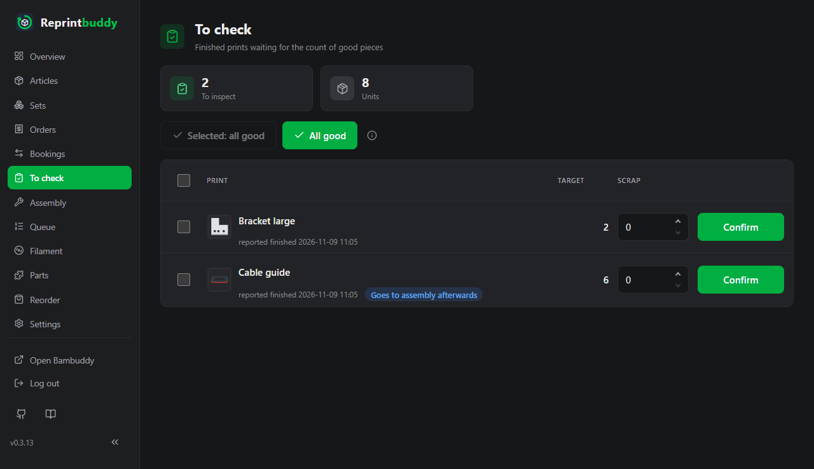
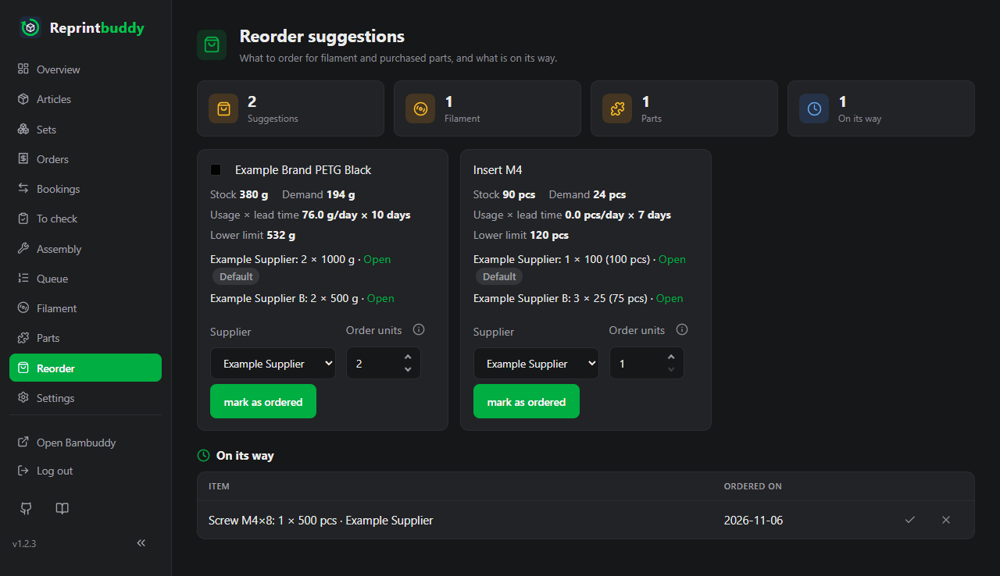

<p align="center">
  
</p>

<h1 align="center">Reprintbuddy</h1>

<p align="center">
  <strong>Your shelf stays stocked. Bambuddy does the printing.</strong><br>
  Self-hosted stock keeping for 3D-printed items, with reprints through Bambuddy's queue.
</p>

<p align="center">
  <a href="https://github.com/Eifel-Joe/reprintbuddy/releases"></a>
  <a href="https://github.com/Eifel-Joe/reprintbuddy/actions/workflows/ci.yml"></a>
  <a href="https://github.com/Eifel-Joe/reprintbuddy/blob/main/LICENSE"></a>
  <a href="https://github.com/Eifel-Joe/reprintbuddy/stargazers"></a>
  <a href="https://github.com/Eifel-Joe/reprintbuddy/issues"></a>
</p>

[Deutsch: README.de.md](README.de.md)

**Documentation:** <https://eifel-joe.github.io/reprintbuddy/> – installation, setup and use, in English and German.

Reprintbuddy keeps the stock of 3D-printed items. It reprints what runs low by
handing print jobs to Bambuddy's queue,
lets you check finished prints, and tells you what to reorder. It runs as a
small web application on your home network, reachable from outside only through a VPN.

> **Status:** under development, not ready for real use yet.

Reprintbuddy is an independent project and is not affiliated with Bambuddy or Bambu Lab.

## What it is, and what it is not

- **It is** a stock book per article with minimum stock and buffer, its own
  reprint queue, a check list for finished prints, assembly bookings and
  reorder suggestions for filament and bought-in parts.
- **It never controls printers.** Bambuddy stays your print system. Reprintbuddy
  only adds jobs to Bambuddy's queue and reads status. It does not start,
  stop or pause anything, and it never writes to Spoolman.
- It contains no articles of its own: you create articles, sets, parts and
  rules in the web interface.

## Screenshots

Invented example data. More pictures are on the [documentation pages](https://eifel-joe.github.io/reprintbuddy/).






## Requirements

- Bambuddy 1.3 or newer, with its own spool management or with Spoolman (**Spoolman is
  optional**). Reprintbuddy reads the filament stock through Bambuddy and never talks to
  Spoolman itself.
- **Print files stored directly in Bambuddy's file manager**, uploaded and sliced
  (`.gcode.3mf`). Linked external folders are not enough: Bambuddy keeps no checksum for
  their files and does not re-read plates and filament when it rescans them, so a changed
  version would go unnoticed. New print files can also be uploaded from Reprintbuddy
  (optional, see *Uploading print files*), though not into an external folder.
- A **dedicated Bambuddy user** `reprintbuddy` in its **own Bambuddy group** with the rights
  listed under *First run*, and an **API key** of that user. The dedicated user makes
  Reprintbuddy's own jobs recognisable in Bambuddy. The setup guides you through it.
- A computer, a VM or a container (for example a Proxmox LXC, unprivileged is fine) with **Debian 13** or
  newer. Reprintbuddy needs Python 3.13 or newer; Debian 12 only has Python 3.11, so the installer
  refuses to run there. **On a Debian 12 system:** upgrade the system to Debian 13 (the Debian release
  upgrade), then run the installation command again. It notices that the Python environment no longer
  fits the system's Python, builds it anew and keeps the installed version, the database and all settings. An installation made on
  Debian 12 cannot update to this version before that: the update fails with pip's message "requires a
  different Python", is rolled back, and the running version stays. Take a backup first (*Backup and
  export*).
  One CPU core, 1 GB RAM and 8 GB disk are enough. No Docker needed.
- Outgoing network access from that machine to the Debian package sources (`apt`),
  `github.com` and `raw.githubusercontent.com` (installation and updates), `api.github.com` (the
  release notes on the update card),
  `pypi.org` and `files.pythonhosted.org` (Python packages, at installation and at
  every update) and to your Bambuddy.
- Optional: [Home Assistant](https://www.home-assistant.io/) with its phone app for push
  messages (see *Push messages through Home Assistant*); then also access to Home Assistant.

## Installation

```bash
apt-get update && apt-get install -y curl && bash -c "$(curl -fsSL https://raw.githubusercontent.com/Eifel-Joe/reprintbuddy/v0.3.12/install/install.sh)"
```

Run it as root on that system. Fresh Debian systems often come without curl; the first part installs it.
The installer puts the newest release in place. The tag in the address (`v0.3.12`) is the version of the installer
script itself, and it belongs to that release. To skip the language question, add the language:

```bash
apt-get update && apt-get install -y curl && bash -c "$(curl -fsSL https://raw.githubusercontent.com/Eifel-Joe/reprintbuddy/v0.3.12/install/install.sh)" _ --language de
```

The script must come from the tag of the release that gets installed. If it does not, it stops with a message that
names the right tag when its system files differ from that release's; run it again with that tag in place of `<tag>`:

```bash
apt-get update && apt-get install -y curl && bash -c "$(curl -fsSL https://raw.githubusercontent.com/Eifel-Joe/reprintbuddy/<tag>/install/install.sh)"
```

What the installer does:

- installs the packages it needs (`python3`, `python3-venv`, `git`, `curl`, `sudo`,
  `ca-certificates`),
- creates the system user `reprintbuddy`,
- puts Reprintbuddy into `/opt/reprintbuddy` on the newest release tag, with its Python
  environment in `/opt/reprintbuddy/.venv`,
- creates `/var/lib/reprintbuddy` (mode 700) with the database, the backups and the update state,
- installs the systemd units `reprintbuddy.service` and `reprintbuddy-update.service`,
- installs a sudoers rule in `/etc/sudoers.d/reprintbuddy` that lets the service user run
  exactly these commands as root, and nothing else (the last two are for the rollback of a failed
  update, which restores the database while the service is stopped):

  ```text
  /usr/bin/systemctl restart --no-block reprintbuddy.service
  /usr/bin/systemctl restart reprintbuddy.service
  /usr/bin/systemctl start --no-block reprintbuddy-update.service
  /usr/bin/systemctl stop reprintbuddy.service
  /usr/bin/systemctl start reprintbuddy.service
  ```

- installs the command `/usr/local/bin/reprintbuddy` (see *Command line*),
- starts the service and prints the address for the first-run setup.

**Finish the setup right away** at `http://<server-ip>:8080/setup`: until the admin
account exists, anyone in your network can create it.

Running the installer again is safe: the installed version and the database stay as they
are; it repairs packages, user, permissions, units and the service. Versions change only
through the update (see *Update*). `--dry-run` shows what it would do without changing anything.

For development:

```bash
python -m venv .venv
.venv/bin/pip install -e ".[dev]"
.venv/bin/python -m pytest
.venv/bin/python -m reprintbuddy serve --db ./dev.db
```

## First run

Open the address printed by the installer. Until you finish the setup, the
page is open to everyone on your network, so do it right away. During first-run setup,
open Reprintbuddy by its IP address (or a local name); names from public domains, e.g. VPN
DNS names, are accepted only after setup.

1. **Admin account:** choose a user name, a password and the language.
2. **Group and user in Bambuddy:** in Bambuddy, under *Settings → Users*, create your own
   group named `Reprintbuddy`. No system group fits: *Operators* only sees its own files and
   queue entries, *Administrators* may do everything. Give the group these rights (the
   internal names are in brackets). Bambuddy shows its rights in English only, so they are
   named here as in Bambuddy:

   - Read All Library (`library:read_all`): so that Reprintbuddy sees your print files
   - Read All Queue (`queue:read_all`): so that Reprintbuddy sees the whole queue
   - Create Queue (`queue:create`): so that Reprintbuddy can queue reprints
   - Print Without Review (`queue:start_unreviewed`): so that reprints start without approval
   - Read Printers (`printers:read`): so that Reprintbuddy sees the printers and their state
   - Read Inventory (`inventory:read`): so that Reprintbuddy reads the filament stock
   - Read Filaments (`filaments:read`): to tell whether Bambuddy keeps the spools itself or in
     Spoolman

   Recommended, not required – only to upload print files from Reprintbuddy:

   - Upload Library (`library:upload`)

   Without it everything else works; only uploading is not possible.

   Only to create the key in the next step, the group also needs these three rights; Reprintbuddy
   does not check them, and they may be removed again afterwards: Read Api Keys
   (`api_keys:read`), Create Api Keys (`api_keys:create`) and Read Settings (`settings:read`;
   without it Bambuddy hides the Settings menu).

   Then create the user `reprintbuddy` in this group. Its password is needed only once, to
   create the key; Reprintbuddy neither asks for it nor stores it. You can add a missing right
   to the group at any time; a new key is not needed for that.
3. **API key:** sign out of Bambuddy and sign in as `reprintbuddy` (a key always belongs to
   the user who is signed in). Open *Settings → API keys → Create key* and set it exactly like this:
   name "Reprintbuddy"; *Read Status* **on**; *Manage Queue* **on**; *Manage Library* **on**
   (only for uploading print files; at the key it works only as far as the group allows, and
   the group gets nothing but *Upload Library*); all others **off** (*Control Printer*,
   *Manage Inventory*, *Manage Maintenance*, *Manage Archives*, *Manage Projects*,
   *Allow Cloud Access*, *Update Electricity Price*, *Send Notifications*). Copy the key at once (Bambuddy shows it only one time) and sign out again.
   The rights of a key cannot be changed afterwards in Bambuddy (its pages only create and
   delete keys): if a right at the key is missing, for example *Read Status*, create a new
   key and enter it under *Settings → Bambuddy*.
4. **Connect Bambuddy:** enter the Bambuddy address and the key. Reprintbuddy asks Bambuddy
   (`GET /api/v1/auth/me`) whom the key belongs to and which rights it can really use, and
   shows the owner and each required right with a check or a cross. The interface opens only
   when no right is missing. A key that belongs to an administrator is accepted, with a
   warning that it may do more than needed. The same check is under *Settings*. A missing
   right of the group `Reprintbuddy` is added in Bambuddy (*Settings → Users*); a new key is not
   needed. A missing right at the key itself needs a new key.

   The two fields are marked so that password managers do not fill in your own credentials.

## Uploading print files

Under *Articles → New article from print file*, the button *Upload print file* puts a sliced
3MF file (`.gcode.3mf`, at most 200 MB) into the folder that is open, in Bambuddy's file
manager; then you choose the plate and create the article as usual. Reprintbuddy checks the
file before it sends anything, because it cannot delete a file in Bambuddy again: only a
sliced 3MF, Bambuddy's rules for the name, and no file of the same name in that folder
(nothing is overwritten or renamed). External folders get no button.

Uploading needs *Upload Library* (`library:upload`) in the group `Reprintbuddy` and
*Manage Library* at the API key. Both are optional. An installation set up before this
version adds the right to the group and, because Bambuddy cannot change the rights of a key,
creates a new key with *Read Status*, *Manage Queue* and *Manage Library*, enters it under
*Settings → Bambuddy* and deletes the old one.

## Push messages through Home Assistant

Optional: Reprintbuddy can report events to [Home Assistant](https://www.home-assistant.io/),
which brings them to your phone as push messages through its app. Without an entry nothing is
sent and Home Assistant is never contacted. What it can report, each event ticked on its own:
a print finished and waits for inspection, a print failed in Bambuddy, an article paused by
the automation, an article below its minimum stock, a new reorder suggestion, a fault (a red
warning seen at two regular queries in a row) and a missing right in Bambuddy. Each one reports
once and again only after it has settled; what comes together goes as one message.

1. In Home Assistant, create a user of its own **without admin rights** (recommended), sign in as
   that user and create a *long-lived access token* under your profile → *Security*. Copy it:
   Home Assistant shows it only once.
2. Find the notification service of your phone: in Home Assistant under *Developer tools →
   Actions*, the actions `notify.mobile_app_…` (one per phone with the Home Assistant app).
3. In Reprintbuddy under *Settings → Notifications*: switch on, enter the address of Home
   Assistant (for example `http://homeassistant.local:8123`), the token and the service, tick
   the events, then *Send test message*. Only services of the `notify` domain are accepted.

Reprintbuddy calls `POST /api/services/notify/<service>` and, to check that Home Assistant answers
again after a failed message, `GET /api/`; nothing else. "Accepted" means Home
Assistant took the message; whether the phone got it, only Home Assistant knows. If a message
does not go through, the overview shows "Home Assistant not reachable"; stock and printing go on
as before. If Home Assistant refuses the token (401), Reprintbuddy stops sending and checking at once, because every
further try would count as a failed login there; saving the card again lifts the stop.

## Settings

There is **no configuration file**. Every setting lives in the database and is
changed under *Settings* in the web interface: language, QR code address, Bambuddy connection,
automation, labels, push messages, password, listen address, port, optional HTTPS certificate,
restart, update check, update and backup, and export. The only thing
given on the command line is the database path (`--db`).

## Update

*Settings → Update and backup*: press **Check for updates**; if a newer release exists, the card lists what it brings and you press
**Update to …**. Reprintbuddy also checks by itself at the start and once a day and then shows a bar at the top
of every page; the switch **Check for new versions automatically** on the card turns that off. The check asks GitHub (the release notes come from GitHub's API without a login), so GitHub sees the address of your installation. The update

1. backs up the database,
2. switches to the new release tag,
3. installs the packages,
4. migrates the database,
5. restarts the service and
6. checks that the new version answers.

If anything fails, Reprintbuddy goes back to the previous version **and** restores the
database from the backup; the page says which step failed. Changes made while the update
runs would be lost in that case, so every change is paused until it has finished.

If the page says **Update was interrupted** or **Update failed and the previous version could not be restored**,
run the installer again: it repairs packages, units and the service and keeps the database. If Reprintbuddy still
does not start, restore the backup named on the page (see *Backup and export*) and run the installer again.
The page shows the Git tag and, if it differs, the package version next to it.

Backups are kept in `/var/lib/reprintbuddy/backups/` (the last 5; a backup named by a failed rollback is never deleted). To start an update by hand:
`systemctl start reprintbuddy-update.service`; its log is `journalctl -u reprintbuddy-update`.

Versions are git tags `vX.Y.Z`, and the package version equals the tag. If a release changes the
systemd units or the sudoers rule, its release notes say so; then run the installer again.

## Restart

*Settings → General → Restart* restarts Reprintbuddy. Address, port and HTTPS take effect only after a
restart; the settings page says when a saved change is still waiting. After a change of
address or port the restart page names the new address. On the system:
`systemctl restart reprintbuddy`.

## HTTPS

HTTP is fine inside your home network or over a VPN. For HTTPS, upload a certificate and its private key
(without a password) under *Settings*; Reprintbuddy checks that they belong together before it
saves them, then restart. To go back to HTTP, tick *Remove certificate and private key*.

Alternatively run Reprintbuddy behind a reverse proxy you already have: Reprintbuddy stays on
HTTP and the proxy does TLS. If the proxy runs on the same system, set the listen address
to `127.0.0.1`. Give Reprintbuddy its own address or its own port on the proxy
(`https://reprintbuddy.example.net/` or `https://example.net:8443/`). A sub-path
(`https://example.net/reprintbuddy/`) does not work: links and redirects would point past the
proxy. Reprintbuddy writes a warning to the log when it is reached that way.

Locked out by a certificate that stopped working (expired, wrong name)? On the system:

```bash
reprintbuddy disable-https && systemctl restart reprintbuddy
```

A wrong port: `reprintbuddy set-port 8080 && systemctl restart reprintbuddy`.

## Backup and export

Reprintbuddy brings its own complete backup, whatever else backs up the system.
Under *Settings → Update and backup*:

- **Full backup** downloads the whole database as one `.zip` file: all data and settings,
  **including** the Bambuddy key, the password hash, the private HTTPS key and the session
  secret. Give it a password (8 to 1024 characters) and it is encrypted (Argon2id and
  AES-256-GCM); the password is stored nowhere, so without it the backup cannot be restored.
  **Without a password, anyone who has the file gets the keys and can sign in.** The download asks
  for your sign-in password again, so an open browser alone is not enough.
- **Restore** takes such a file (at most 128 MB). Reprintbuddy checks that it is a Reprintbuddy
  backup of this or an older version (an older database is migrated at the start, a newer one is
  refused), asks for your sign-in password and, if the file is encrypted, its password, backs up the running database as before an
  update, replaces it and restarts. Afterwards the user name and password of the backup apply
  and everybody signs in again. Listen address, port and HTTPS come from the backup too; on a new
  machine where they do not fit, `reprintbuddy set-host` and `set-port` (see *Command line*) put
  them right.
- **Export** downloads all data as a JSON file, **without** API keys, passwords, the private
  HTTPS key and the session secret.

If Reprintbuddy does not start any more, for example after a restore that went wrong, the same
restore works on the command line, with the same checks as in the interface:

```bash
systemctl stop reprintbuddy
install -m 0600 -o reprintbuddy /root/backup.zip /var/lib/reprintbuddy/restore.zip
reprintbuddy restore-backup /var/lib/reprintbuddy/restore.zip
rm /var/lib/reprintbuddy/restore.zip
systemctl start reprintbuddy
```

The command asks for the password of the backup if it is encrypted (on the terminal only, never as
an argument), refuses while Reprintbuddy or its update is running, saves the database that was there
first (`backups/`, or as `damaged-...` if it could not be read) and says what it restored. It runs as
the service user from the folder `/`, so give the full path, and the file must be readable for that user:
copy it to the data folder as shown (with the mode 0600, because it holds your keys unless it is
encrypted) and delete it afterwards. Everybody signs in again afterwards.

To restore a database copy from `backups/` by hand:

```bash
systemctl stop reprintbuddy
runuser -u reprintbuddy -- cp /var/lib/reprintbuddy/backups/<backup>.db /var/lib/reprintbuddy/reprintbuddy.db
rm -f /var/lib/reprintbuddy/reprintbuddy.db-wal /var/lib/reprintbuddy/reprintbuddy.db-shm
systemctl start reprintbuddy
```

## Security

- Do not expose Reprintbuddy directly to the internet (no port forwarding, no public
  reverse proxy). For remote access, use a VPN into your network (e.g. your router's VPN,
  WireGuard or Tailscale).
- API keys, the private key of an HTTPS certificate and passwords are only
  visible while you type them. Once saved, the interface shows `********`;
  an empty field keeps the stored value, a new entry replaces it. Passwords are
  stored only as hashes.
- The Home Assistant token is treated like the API keys. It acts with all rights of its
  Home Assistant user, so create it for a user without admin rights. It only goes to the
  address entered with it, path included; for a new address, enter it again. Push messages to a phone pass
  through the push service of Google or Apple and name articles, spool sorts and parts as long
  as *Name things in messages* is on.
- Every change needs a signed-in session and a CSRF token.
- The database file is readable only by the service user. Anyone who is root on
  the machine can read it.

Report vulnerabilities as described in [SECURITY.md](SECURITY.md).

## Command line

On the system the command `reprintbuddy` runs as the service user `reprintbuddy` (also when
you are root), so database files keep their owner:

```bash
reprintbuddy set-password --username <name>
reprintbuddy set-port <port>
reprintbuddy set-host <address>
reprintbuddy disable-https
reprintbuddy restore-backup <file>
reprintbuddy --version
```

## Forgotten password or wrong port

On the machine running Reprintbuddy:

```bash
reprintbuddy set-password --username admin
reprintbuddy set-port 8080
reprintbuddy set-host 0.0.0.0
```

`set-password` also renames the account to the given `--username`, so a forgotten
user name is no obstacle.

Restart the service afterwards (`set-port` and `set-host` need it to take effect).
`set-host` sets the listen address (for example `0.0.0.0`) if a wrong one locked you out.

## Contributing

See [CONTRIBUTING.md](CONTRIBUTING.md).

## License

Reprintbuddy is licensed under the GNU Affero General Public License, version 3 or
later (AGPL-3.0-or-later). See [LICENSE](LICENSE).

Copyright (C) 2026 Eifel-Joe

Third-party components with their own licenses: the icons are from
[Lucide](https://lucide.dev) (ISC, license text in `src/reprintbuddy/web/static/icons/`);
the QR codes are drawn with [segno](https://github.com/heuer/segno) (BSD-3-Clause), which is
installed from PyPI as a dependency and not part of this repository; the labels are drawn with
[Pillow](https://python-pillow.org) (MIT-CMU), also installed from PyPI, in the font DejaVu Sans
(free license, license text in `src/reprintbuddy/labels/fonts/`), which is part of this repository.
