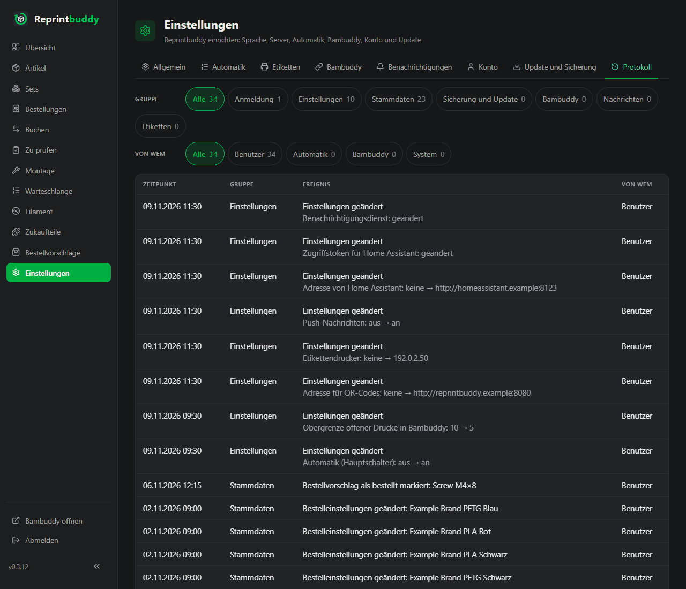

# Protokoll

Der Reiter **Protokoll** unter *Einstellungen → Protokoll* zeigt, was in Reprintbuddy passiert ist, außer dem, was im [Journal](../use/inspection.md#journal) steht (Buchungen und Aktionen der Automatik). Kein Ereignis steht an beiden Stellen. Hier siehst du, wer eine Einstellung geändert hat, ob eine Anmeldung fehlschlug, wann ein Update lief oder warum eine Nachricht nicht hinausging.

## Wie die Seite aufgebaut ist

Neueste zuerst, eine Zeile je Ereignis mit vier Spalten: **Zeitpunkt**, **Gruppe**, **Ereignis** (mit einer kurzen Angabe darunter) und **Von wem**. Eine Zeile mit Link führt zum Artikel, Zukaufteil oder Set, um das es geht. 100 Zeilen stehen auf einer Seite; **Älter** und **Neuer** unter der Tabelle wechseln die Seite.

Über der Tabelle stehen zwei Reihen mit Filterknöpfen, jeweils mit der Anzahl der Zeilen dahinter: **Gruppe** (**Alle** und ein Knopf je Gruppe, siehe unten) und **Von wem** (**Alle**, **Benutzer**, **Automatik**, **Bambuddy**, **System**). Eine Textsuche gibt es nicht. Die Seite folgt live, wie die anderen Seiten: neue Zeilen erscheinen ohne Neuladen.

## Von wem

- **Benutzer**: du, in der Oberfläche, oder ein Befehl auf dem Server (diese Zeilen tragen den Zusatz „Befehl auf dem Server“). Was du anstößt, gehört dir, auch wenn ein anderes System antwortet, zum Beispiel eine Testnachricht, ein Etikett oder ein Hochladen.
- **Automatik**: was Reprintbuddy nach seinen Regeln von sich aus an den Stammdaten ändert, zum Beispiel eine Bestellung als eingetroffen schließen. Alles zu Bestand, Warteschlange, Drucken und Pausen bleibt im Journal.
- **Bambuddy**: was Reprintbuddy an Bambuddy feststellt: die Verbindung und die Rechte.
- **System**: Reprintbuddy selbst: Start, Ergebnis eines Updates, automatische Nachrichten und Änderungen, die niemand von Hand gemacht hat.

Namen von Personen kennt Reprintbuddy nicht, nur diese vier.

## Was protokolliert wird

| Gruppe | Ereignisse |
|---|---|
| **Anmeldung** | Angemeldet; abgemeldet; Anmeldung fehlgeschlagen (dazu zählt eine falsche Passwortabfrage vor einer Sicherung, einer Wiederherstellung oder einem Passwortwechsel); Benutzername oder Passwort geändert, mit dem Hinweis, dass alle Geräte abgemeldet wurden; Konto angelegt (Ersteinrichtung). Fehlversuche von derselben Adresse innerhalb von 10 Minuten sind eine Zeile mit der Anzahl der Versuche und dem Zeitpunkt des ersten. Jede Zeile dieser Gruppe, die über die Oberfläche kam, zeigt die Adresse des Geräts, wie der Server sie sieht (hinter einem Proxy auf demselben Rechner die Adresse, die der Proxy weitergibt, sonst die des Proxys). |
| **Einstellungen** | Eine Zeile je Speichern, mit den Bezeichnungen der geänderten Einstellungen, wie die Seite sie zeigt. Zahlen, Schalter und die Sprache zeigen alt → neu, zum Beispiel „Abfrage-Abstand (Minuten): 15 → 10“ oder „Automatik (Hauptschalter): an → aus“. Ebenso die Namen von Rechnern (der Etikettendrucker, die Lauschadresse). Adressen zeigen nur Schema, Rechner und Port. Freie Texte (die Etikettenrolle, der Benachrichtigungsdienst, der Besitzername des Bambuddy-Schlüssels) zeigen nur „geändert“. Schlüssel, Tokens und Passwörter zeigen nur „geändert“ oder „entfernt“, das HTTPS-Zertifikat nur „hochgeladen“ oder „entfernt“, Listen nur „geändert“. Beim Speichern der Bambuddy-Verbindung steht der Besitzer des Schlüssels dabei. |
| **Stammdaten** | Artikel, Zukaufteil oder Set angelegt, geändert (welche Felder, ohne alte und neue Werte), archiviert, wiederhergestellt; Automatik eines Artikels an oder aus; Zielmenge geändert; Bestelleinstellungen einer Spulensorte geändert; ein Bestellvorschlag als bestellt oder als eingetroffen markiert; eine Bestellung zurückgenommen, mit der bestellten Menge, dem Lieferanten und nach einer Teillieferung dem, was eingetroffen war. Nur die Felder der Bearbeiten-Formulare zählen; Bestand, Pause und Druckdatei stehen im Journal. Spulensorten, die Reprintbuddy beim Lesen von Bambuddy selbst anlegt, stehen nicht im Protokoll. Bei einem Set heißen die Felder **Basisteile** und **Wahlteile**; ein Set, das das Update auf 0.3.18 umgebaut hat, steht einmal da, von **System**, mit den Artikeln, die entfallen sind. „Geändert“ heißt, dass sich nach dem Speichern wirklich etwas unterscheidet. |
| **Sicherung und Update** | Vollständige Sicherung heruntergeladen (verschlüsselt oder nicht); Export heruntergeladen; Wiederherstellen abgelehnt (mit festem Grund), abgebrochen oder ausgeführt (mit Datum und Version der Sicherung); Update gestartet (von → nach), danach je Update einmal das Ergebnis (fertig; fehlgeschlagen, die vorige Version läuft weiter; zurückgerollt; Zurückrollen fehlgeschlagen; unterbrochen); neue Version gefunden (je Version einmal, von Hand oder automatisch); Neustart angefordert; Reprintbuddy gestartet (mit Version). |
| **Bambuddy** | Nicht erreichbar oder Antwort abgelehnt und wieder in Ordnung, je nur als Wechsel, eingetragen bei der ersten regulären Abfrage, die einen anderen Zustand zeigt; ein Pflichtrecht fehlt und wieder vollständig, je nur als Wechsel; Druckdatei an Bambuddy gesendet (Name und Ordner), abgelehnt oder unklar. |
| **Nachrichten** | Jede an Home Assistant gesendete Nachricht mit Ereignisart, Anzahl und Ergebnis (angenommen; abgelehnt, mit festem Grund; nicht erreichbar; unklar). Scheitert dieselbe Nachricht wieder und wieder, steht nur der erste Fehlschlag da und dann der Eintrag, wenn wieder eine angenommen ist. Die Testnachricht mit Ergebnis. Nie mit Titel und Text der Nachricht. |
| **Etiketten** | Etikett gedruckt (Artikel, Anzahl) und Probedruck, mit Ergebnis: fertig, nicht alle gedruckt, Drucker nicht bereit (nichts gedruckt), fehlgeschlagen. |

## Was nie darin steht

- Sensible Daten (Schlüssel, Tokens, Passwörter, das Sitzungsgeheimnis), auch nicht teilweise.
- Der Benutzername, der bei einer fehlgeschlagenen Anmeldung eingegeben wurde.
- Teile einer Adresse außer Schema, Rechner und Port.
- Antworttexte und Fehlermeldungen fremder Systeme: Es steht ein fester Grund aus der Oberfläche da.
- Pfade auf dem Zielsystem und Angaben zum Browser.

## Aufbewahrung und Schreiben

- Einträge bleiben **90 Tage**. Reprintbuddy löscht ältere beim Start und einmal täglich. Von Hand lässt sich nichts löschen oder ändern.
- Einträge zu Einstellungen und Stammdaten entstehen in derselben Speicherung wie die Änderung. Wird die Änderung verworfen, entfällt auch der Eintrag. Kann ein Eintrag nicht zusammengestellt werden, fehlt er, und das Systemprotokoll sagt es; die Änderung gilt trotzdem. Alle anderen Einträge schreibt Reprintbuddy nebenher: Anmeldung, Anfragen und Automatik warten nicht darauf.

## Sicherung, Wiederherstellen und Update

- Das Protokoll gehört zur [vollständigen Sicherung](update-backup.md#vollstandige-sicherung). Nach einer Wiederherstellung gilt das Protokoll aus der Sicherung, und es bekommt einen Eintrag über die Wiederherstellung. Einträge, die nach dem Stand der Sicherung entstanden sind, sind danach nicht mehr zu sehen; eine Kopie der Datenbank bleibt auf dem Server, bis neuere Sicherungen sie verdrängen.
- Zustände, die das Protokoll nur als Wechsel einträgt (Verbindung zu Bambuddy, ihre Rechte, eine gefundene neue Version, das Ergebnis des letzten Updates, scheiternde Push-Nachrichten), behalten den Stand von vor der Wiederherstellung. Ein schon eingetragener Zustand erscheint also nicht erneut, nur weil die Sicherung älter ist.
- Start und Ergebnis jedes [Updates](update-backup.md) stehen im Protokoll. Ein zurückgerolltes Update stellt auch die Datenbank wieder her; Einträge aus der Zeit des Updates gehen dabei verloren, das Ergebnis wird danach eingetragen.

## Protokoll und Systemprotokoll

Zwei verschiedene Dinge haben „Protokoll“ im Namen. Der Reiter **Protokoll**, der hier beschrieben ist, ist Reprintbuddys eigene Aufzeichnung dessen, was passiert ist. Das **Systemprotokoll** ist das, was der Dienst ins System schreibt und was du auf dem Server mit `journalctl` liest, zum Beispiel `journalctl -u reprintbuddy` oder `journalctl -u reprintbuddy-update`. Technische Einzelheiten und Fehler, die nicht für die Oberfläche sind, stehen dort, nie etwas Sensibles. Neben Warnungen und Fehlern schreibt Reprintbuddy dort Hinweise, die bei der Fehlersuche helfen, zum Beispiel dass der Live-Kanal zu Bambuddy verbunden ist, wie Home Assistant eine Nachricht beantwortet hat oder dass die automatische Prüfung auf neue Versionen gescheitert ist. Fehlermeldungen der Datenbank enthalten dort nie die Werte, die gespeichert werden sollten.
