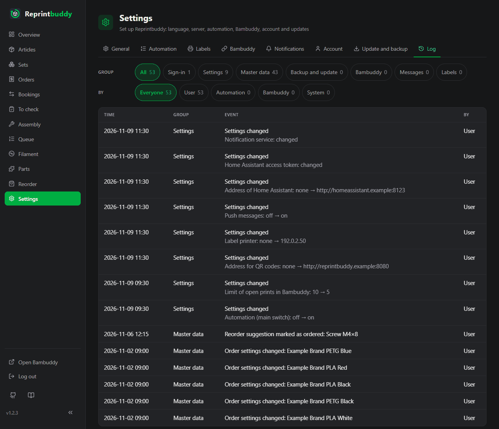

# Log

The tab **Log** under *Settings → Log* shows what happened in Reprintbuddy apart from what stands in the [journal](../use/inspection.md#journal) (bookings and actions of the automation). No event stands in both places. Use it to see who changed a setting, whether a sign-in failed, when an update ran or why a message did not go out.

## How the page is built

Newest first, one line per event with four columns: **Time**, **Group**, **Event** (with a short detail under it) and **By**. A line with a link opens the article, part or set it is about. 100 lines come on a page; **Older** and **Newer** below the table move between pages.

Two rows of filter buttons stand above the table, with the number of lines behind each: **Group** (**All** and one button per group, see below) and **By** (**Everyone**, **User**, **Automation**, **Bambuddy**, **System**). There is no text search. The page follows live, like the other pages: new lines appear without reloading.

## By whom

- **User**: you, in the interface, or a command on the server (those lines carry the note "command on the server"). What you start is yours even if another system answers, for example a test message, a label or an upload.
- **Automation**: what Reprintbuddy changes by its own rules in the master data, for example closing an order as arrived. Everything about stock, queue, prints and pauses stays in the journal.
- **Bambuddy**: what Reprintbuddy notices at Bambuddy: the connection and the rights.
- **System**: Reprintbuddy itself: start, the result of an update, automatic messages, and changes that nobody made by hand.

Reprintbuddy knows no names of people, only these four.

## What is logged

| Group | Events |
|---|---|
| **Sign-in** | Signed in; signed out; sign-in failed (this includes a wrong password at the question before a backup, a restore or a password change); user name or password changed, with the note that all devices were signed out; account created (first setup). Failed attempts from the same address within 10 minutes are one line with the number of attempts and the time of the first. Every line of this group that came through the interface shows the address of the device as the server sees it (behind a proxy on the same machine the address the proxy passes on, otherwise the proxy's). |
| **Settings** | One line per save, with the names of the changed settings as the page shows them. Numbers, switches and the language show old → new, for example "Poll interval (minutes): 15 → 10" or "Automation (main switch): on → off". So do the names of hosts (the label printer, the listening address). Addresses show only scheme, host and port. Free texts (the label roll, the notification service, the owner name of the Bambuddy key) show only "changed". Keys, tokens and passwords show only "changed" or "removed", the HTTPS certificate only "uploaded" or "removed", lists only "changed". Saving the Bambuddy connection adds the owner of the key. |
| **Master data** | Article, part or set created, changed (which fields, without old and new values), archived, restored; automation of an article on or off; target quantity changed; order settings of a spool sort changed; a reorder suggestion marked as ordered or as arrived; an order taken back, with the ordered quantity, the supplier and, after a partial delivery, what had arrived. Only the fields of the edit forms count; stock, pause and print file are in the journal. Spool sorts that Reprintbuddy creates by itself when it reads Bambuddy are not logged. "Changed" means that something really differs after saving. |
| **Backup and update** | Full backup downloaded (encrypted or not); export downloaded; restore refused (with a fixed reason), cancelled or done (with the date and version of the backup); update started (from → to), then once per update its result (finished; failed, the previous version keeps running; rolled back; rolling back failed; interrupted); new version found (once per version, by hand or automatically); restart requested; Reprintbuddy started (with its version). |
| **Bambuddy** | Not reachable or answer refused, and in order again, each only as a change, entered at the first regular query that shows another state; a required right missing and complete again, each only as a change; print file sent to Bambuddy (name and folder), refused or unclear. |
| **Messages** | Every message sent to Home Assistant with the kind of event, the number and the result (accepted; refused, with a fixed reason; not reachable; unclear). If the same message fails again and again, only the first failure is logged, and then the entry when one is accepted again. The test message with its result. Never the title or text of a message. |
| **Labels** | Label printed (article, number) and test print, with the result: done, not all printed, printer not ready (nothing printed), failed. |

## What is never in it

- Sensitive data (keys, tokens, passwords, the session secret), not even in part.
- The user name that was typed at a failed sign-in.
- Any part of an address except scheme, host and port.
- Answer texts and error messages of other systems: a fixed reason from the interface stands instead.
- Paths on the target system and details of the browser.

## Keeping and writing

- Entries are kept for **90 days**. Reprintbuddy deletes older ones at the start and once a day. Nothing can be deleted or changed by hand.
- Entries for settings and master data are written in the same save as the change. If the change is discarded, so is the entry. If an entry cannot be put together, it is missing and the system log says so; the change counts all the same. All other entries are written on the side: signing in, requests and the automation do not wait for them.

## Backup, restore and update

- The log is part of the [full backup](update-backup.md#full-backup). After a restore the log is the one from the backup, and it gets an entry about the restore. Entries made after the backup was taken are no longer visible; a copy of the database stays on the server until newer backups push it out.
- States the log records only as changes (connection to Bambuddy, its rights, a new version found, the result of the last update, failing push messages) keep what the log had before the restore. So a state that was logged before is not logged again just because the backup is older.
- Start and result of every [update](update-backup.md) are logged. A rolled-back update also restores the database, so entries from the time of the update are lost; the result is entered after that.

## Log and system log

Two different things have "log" in their name. The **Log** tab described here is Reprintbuddy's own record of what happened. The **system log** is what the service writes to the system, read with `journalctl` on the server, for example `journalctl -u reprintbuddy` or `journalctl -u reprintbuddy-update`. Technical details and errors that are not for the interface go there, never anything sensitive. Besides warnings and errors, Reprintbuddy writes notes there that help when looking for a fault, for example that the live channel to Bambuddy is connected, how Home Assistant answered a message, or that the automatic check for new versions failed. Database errors there never contain the values that were to be saved.
