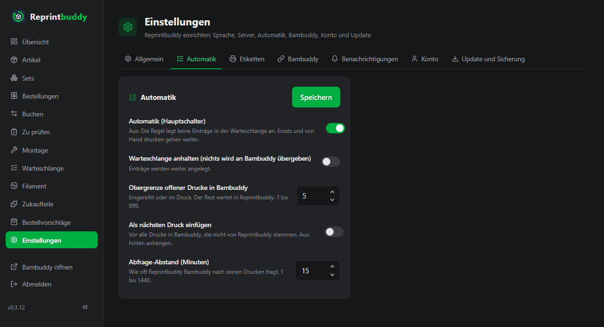
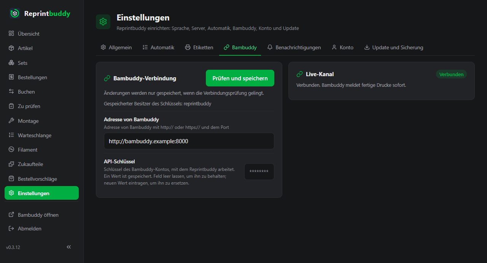

# Einstellungen

Alles, was sich in Reprintbuddy einstellen lässt, steht unter *Einstellungen* in der Weboberfläche. Diese Seite führt jede Einstellung auf, Reiter für Reiter, mit ihrer Wirkung, ihrer Vorgabe und dem, was sie annimmt.

Es gibt **keine Konfigurationsdatei**. Jede Einstellung liegt in der Datenbank. Das Einzige, was auf der Kommandozeile angegeben wird, ist der Pfad der Datenbank (`--db`, siehe [Kommandozeile](cli.md)); der vom Installationsskript eingerichtete Dienst übergibt ihn schon.

## So wird gespeichert

- Die Seite hat acht Reiter: **Allgemein**, **Automatik**, **Etiketten**, **Bambuddy**, **Benachrichtigungen**, **Konto**, **Update und Sicherung** und **Protokoll**. Der letzte hat keine Einstellungen: Er zeigt, was passiert ist, siehe [Protokoll](log.md).
- Jede Karte hat einen eigenen Knopf (**Speichern**, im Reiter Bambuddy **Prüfen und speichern**, beim Passwort **Passwort ändern**). Er speichert nur diese Karte. Ein nicht erlaubter Wert wird mit einer Meldung abgelehnt, und von dieser Karte wird nichts gespeichert.
- Nur die Karte **Server** braucht einen Neustart: Lauschadresse, Port und HTTPS wirken erst nach einem Neustart von Reprintbuddy. Die Seite sagt das, und die Karte **Neustart** im Reiter *Allgemein* zeigt „Gespeicherte Änderungen werden nach einem Neustart wirksam.“, bis du neu startest. Alles andere wirkt sofort.

!!! note "Schlüssel, Passwörter und Token"
    Der API-Schlüssel von Bambuddy, der private HTTPS-Schlüssel, das Token von Home Assistant und Passwörter sind nur bei der Eingabe sichtbar. Nach dem Speichern zeigt das Feld `********` (oder bleibt mit diesem Zeichen leer), und die Karte sagt „Ein Wert ist gespeichert.“ Ein **leeres Feld lässt den gespeicherten Wert**; eine **neue Eingabe ersetzt ihn**. Passwörter werden nur als Hash gespeichert.

    Ein gespeicherter Schlüssel oder ein gespeichertes Token gehört zu einer Adresse, samt Pfad, und geht nie an eine andere: Änderst du die Adresse von Bambuddy oder von Home Assistant, gib Schlüssel bzw. Token neu ein.

## Allgemein

| Karte und Einstellung | Wirkung | Vorgabe | Erlaubt |
|---|---|---|---|
| **Sprache** | Sprache der Seiten. | Englisch (das Installationsskript und die Ersteinrichtung fragen danach) | English, Deutsch |
| **QR-Codes**: **Adresse für QR-Codes (nur für Sonderfälle)** | Der Anfang der Adresse in den QR-Codes. Nur nötig, wenn Reprintbuddy über einen Namen oder einen Proxy erreicht wird, zum Beispiel `https://lager.example.com`. Leer: Reprintbuddy trägt seine eigene Netzwerkadresse mit Port in die Codes ein; die Karte zeigt, welche („Ohne Eintrag tragen die Codes: …“). | leer | Eine Adresse mit `http://` oder `https://`, Rechnername und wahlweise Port. Ohne Benutzername, ohne `?` und `#`. |
| **Neustart**: **Reprintbuddy neu starten** | Startet den Dienst neu, siehe [Update und Sicherung](update-backup.md#neustart). | | |
| **Server**: **Lauschadresse** | Die Adresse, auf der Reprintbuddy lauscht. `0.0.0.0` heißt: alle Adressen des Rechners. | `0.0.0.0` | Eine Adresse, auf der dieser Rechner lauschen kann. Sonst wird das Speichern abgelehnt („Dieser Rechner kann auf dieser Adresse nicht lauschen“), weil es dich aussperren würde. |
| **Server**: **Port** | Der Port der Weboberfläche. | `8080` | 1 bis 65535. Unter 1024 ergänzt die Seite einen Hinweis: Der vom Installationsskript eingerichtete Dienst darf solche Ports belegen, ein anders gestarteter vielleicht nicht. |
| **Server**: **HTTPS (optional)**: **Zertifikat (PEM)** und **Privater Schlüssel (PEM)** | Schaltet HTTPS ein. Text einfügen oder Datei wählen; je höchstens 64 KB. Beide leer lassen, um das Gespeicherte zu behalten. | keins: einfaches HTTP | PEM-Text. Beide sind nötig, sie müssen zusammenpassen, und der Schlüssel darf kein Passwort haben. Siehe [Netz und Sicherheit](network.md#https). |
| **Server**: **Zertifikat und privaten Schlüssel entfernen (einfaches HTTP)** | Schaltet HTTPS wieder aus. Nur sichtbar, solange ein Zertifikat gespeichert ist. | aus | Schalter |

Ein gedruckter QR-Code behält die Adresse, die beim Druck galt. Ändert sich die Adresse des Servers oder die hier eingetragene Adresse, drucke die Etiketten neu.

## Automatik

Alle fünf Einstellungen der Karte **Automatik** werden zusammen gespeichert; eine falsche Zahl speichert keine davon. Wie die Automatik arbeitet, steht unter [Automatik](../use/automation.md).

| Einstellung | Wirkung | Vorgabe | Erlaubt |
|---|---|---|---|
| **Automatik (Hauptschalter)** | Aus: Die Regel legt keine Einträge in der Warteschlange an. Ersatz und von Hand drucken gehen weiter. | aus | Schalter |
| **Warteschlange anhalten (nichts wird an Bambuddy übergeben)** | Einträge werden weiter angelegt, aber nichts geht an Bambuddy. | aus | Schalter |
| **Obergrenze offener Drucke in Bambuddy** | Wie viele Drucke gleichzeitig in Bambuddy eingereiht oder im Druck sein dürfen. Der Rest wartet in Reprintbuddy. | 10 | Ganze Zahl, 1 bis 999 |
| **Als nächsten Druck einfügen** | An: vor alle Drucke in Bambuddy, die nicht von Reprintbuddy stammen. Aus: hinten anhängen. | aus | Schalter |
| **Abfrage-Abstand (Minuten)** | Wie oft Reprintbuddy Bambuddy nach seinen Drucken fragt. Solange der Live-Kanal verbunden ist (siehe Reiter *Bambuddy*), meldet Bambuddy fertige Drucke sofort. | 15 | Ganze Zahl, 1 bis 1440 |

## Etiketten

Der Reiter richtet den Etikettendrucker ein und legt fest, was auf einem Etikett steht. Die Karten **Etikettendrucker** und **Was auf dem Etikett steht** und die **Vorschau** gehören zu einem Formular: **Speichern** in der Karte **Etikettendrucker** speichert Drucker, Rolle und die angehakten Angaben zusammen. Wie Etiketten gedruckt werden, steht unter [Etiketten und QR-Codes](../use/labels.md).

| Einstellung | Wirkung | Vorgabe | Erlaubt |
|---|---|---|---|
| **Adresse des Druckers** | Die IP-Adresse oder der Name des Etikettendruckers im Netz. Leer: kein Drucker, es wird nichts gedruckt. | leer | Eine IP-Adresse oder ein Name. Ohne `http://`, ohne Port und nicht dieser Computer. |
| **Rolle** | Die Rolle, die im Drucker liegt. Vor jedem Druck fragt Reprintbuddy den Drucker, welche Rolle er hat. | die einzige angebotene Rolle: 62 × 29 mm, vorgestanzt | Die Rollen der Liste |
| **Was auf dem Etikett steht** | Der QR-Code des Artikels ist immer dabei. Hake an, was daneben gedruckt wird: **Name**, **Artikelnummer**, **Mindestbestand**, **Puffer**, **Zielmenge**, **Einheiten je Druck**, **Druckziel**, **Etikettentext**, **Druckdatum**. Sind es zu viele Angaben, fallen die letzten weg; die Vorschau nennt sie. | **Name**, **Artikelnummer**, **Etikettentext** | Beliebige der neun |
| **Probedruck** | Druckt ein Probeetikett mit dem, was auf dem Bildschirm angehakt ist, ohne zu speichern. | | |

Stelle den Befehlsmodus des Etikettendruckers einmal am Drucker auf „Raster“. Etiketten werden immer quer gedruckt.

## Bambuddy

Die Karte **Bambuddy-Verbindung** enthält die Adresse und den Schlüssel des Bambuddy-Kontos, mit dem Reprintbuddy arbeitet. Es ist dieselbe Prüfung wie bei der [Ersteinrichtung](../start/setup.md).

| Einstellung | Wirkung | Erlaubt |
|---|---|---|
| **Adresse von Bambuddy** | Adresse von Bambuddy mit `http://` oder `https://` und dem Port, zum Beispiel `http://<bambuddy-host>:8000`. | Eine Adresse mit `http://` oder `https://`, Rechner und Port, ohne Benutzerteil, Abfrage (`?`) oder Anker (`#`) und ohne Leerzeichen oder Zeilenumbrüche. Reprintbuddy hängt den Pfad jedes Aufrufs an, der hinter einem `?` oder `#` landen würde. |
| **API-Schlüssel** | Der Schlüssel des Bambuddy-Kontos. Nur bei der Eingabe sichtbar. | Sichtbare Zeichen ohne Leerzeichen |

**Prüfen und speichern** fragt Bambuddy, wem der Schlüssel gehört und welche Rechte er wirklich hat. Änderungen werden **nur gespeichert, wenn die Prüfung gelingt**. Die Karte zeigt dann den Besitzer des Schlüssels („Gespeicherter Besitzer des Schlüssels: …“); den Benutzernamen tippst du nie ein. Ein Schlüssel, der einem Administrator gehört, wird mit einer Warnung gespeichert, weil er mehr darf als nötig. Ob sich mit dem Schlüssel Druckdateien hochladen lassen, meldet die Seite nach jedem Speichern.

Änderst du die Adresse, gib den Schlüssel neu ein: Ein gespeicherter Schlüssel wird nie an eine neue Adresse geschickt. Ein anderer Pfad zählt als andere Adresse (hinter einem Proxy kann ein anderer Pfad ein anderer Dienst sein), ebenso ein anderer Benutzerteil, eine andere Abfrage oder ein anderer Anker. Anders geschrieben ist dagegen dieselbe Adresse: Groß- oder Kleinschreibung bei Schema und Rechner, ein weggelassener Standardport und ein Schrägstrich am Ende ändern nichts. Eine Adresse, die eine frühere Version gespeichert hat und die einen jetzt abgelehnten Teil enthält, funktioniert weiter, bis du sie erneut speicherst.

Die Karte **Live-Kanal** zeigt, ob Bambuddy fertige Drucke sofort meldet (**Verbunden**) oder ob Reprintbuddy auf die regelmäßige Abfrage zurückgreifen muss (**Wartet**, **Verbindet**, **Recht fehlt**), oder die Karte zeigt **Aus**. Sie ist eine Anzeige, keine Einstellung.

## Benachrichtigungen

Die Karte **Home Assistant** richtet Push-Nachrichten ein, siehe [Push-Nachrichten](../use/notifications.md). Es wird nichts gesendet, und Home Assistant wird nie angesprochen, bevor du sie einschaltest.

| Einstellung | Wirkung | Vorgabe | Erlaubt |
|---|---|---|---|
| **Push-Nachrichten** | An: Nachrichten an [Home Assistant](https://www.home-assistant.io/) senden. Aus: Reprintbuddy spricht Home Assistant nie an. | aus | Schalter. Eingeschaltet sind Adresse, Token und Dienst nötig. |
| **Adresse von Home Assistant** | Mit `http://` oder `https://` und Port, zum Beispiel `http://homeassistant.local:8123`. | leer | Eine schlichte Adresse ohne Benutzername, Abfrage oder Anker |
| **Langlebiges Zugriffstoken** | In Home Assistant unter deinem Profil, *Sicherheit*, angelegt. Nur bei der Eingabe sichtbar. | leer | Sichtbare Zeichen ohne Leerzeichen |
| **Benachrichtigungsdienst** | Der Dienst, der dein Handy erreicht, zum Beispiel `notify.mobile_app_mein_handy`. | leer | Ein Dienst der Domain `notify`, aber nicht `notify.send_message` |
| **Namen in Nachrichten nennen** | An: Nachrichten nennen Artikel, Spulensorten und Zukaufteile beim Namen. Aus: nur Art und Anzahl. | an | Schalter |
| **Ereignisse** | Je ein Kästchen: **Druck fertig, wartet auf Prüfung**, **Druck in Bambuddy fehlgeschlagen**, **Artikel durch die Automatik pausiert**, **Artikel unter Mindestbestand**, **Neuer Bestellvorschlag**, **Störung (rote Warnung bei zwei regulären Abfragen hintereinander)**, **Fehlendes Recht in Bambuddy**. | alle sieben angehakt | Beliebige davon |

**Testnachricht senden** schickt eine Nachricht mit den Angaben, ohne sie zu speichern. Ein eingetipptes Token wird nie zurück in die Seite geschrieben: Zum Speichern gib es noch einmal ein.

## Konto

Die Karte **Passwort ändern** ändert das Passwort, mit dem du dich anmeldest: **Aktuelles Passwort**, **Neues Passwort (mindestens 8 Zeichen)** und **Passwort wiederholen** eingeben, dann **Passwort ändern** drücken. Alle anderen Sitzungen enden; diese bleibt angemeldet.

Den Benutzernamen kannst du hier nicht ändern. Hast du das Passwort vergessen oder willst du einen anderen Benutzernamen, nimm `set-password` auf der Kommandozeile, siehe [Kommandozeile](cli.md).

## Update und Sicherung

Dieser Reiter enthält das Update, die vollständige Sicherung, das Wiederherstellen und den Export. Sie stehen auf einer eigenen Seite, [Update und Sicherung](update-backup.md). Ein Schalter ist eine Einstellung:

| Einstellung | Wirkung | Vorgabe |
|---|---|---|
| **Automatisch nach neuen Versionen suchen** | Beim Start und danach einmal täglich fragt Reprintbuddy, ob es eine neuere Version gibt. Ein Hinweis oben auf jeder Seite zeigt sie an. Der Schalter wird sofort gespeichert. | an |

## Was nicht auf dieser Seite steht

- Der **Pfad der Datenbank** ist keine Einstellung. Der Dienst übergibt ihn mit `--db`.
- Werte, die Reprintbuddy für sich behält, werden nie angezeigt: das Geheimnis, mit dem die Sitzungs-Cookies signiert werden und das Reprintbuddy beim ersten Start selbst erzeugt, und die Merker der Verbindungsprüfung.
- Einstellungen einzelner Artikel, Filamentsorten und Zukaufteile stehen auf deren eigenen Seiten, nicht hier.

## Weiterführende Seiten

- [Update und Sicherung](update-backup.md): Update, vollständige Sicherung, Wiederherstellen, Export.
- [Protokoll](log.md): wer was geändert hat, Anmeldungen, Updates, Nachrichten.
- [Netz und Sicherheit](network.md): HTTPS, Reverse-Proxy, ausgesperrt.
- [Kommandozeile](cli.md): Passwort, Port, Lauschadresse vom System aus.
