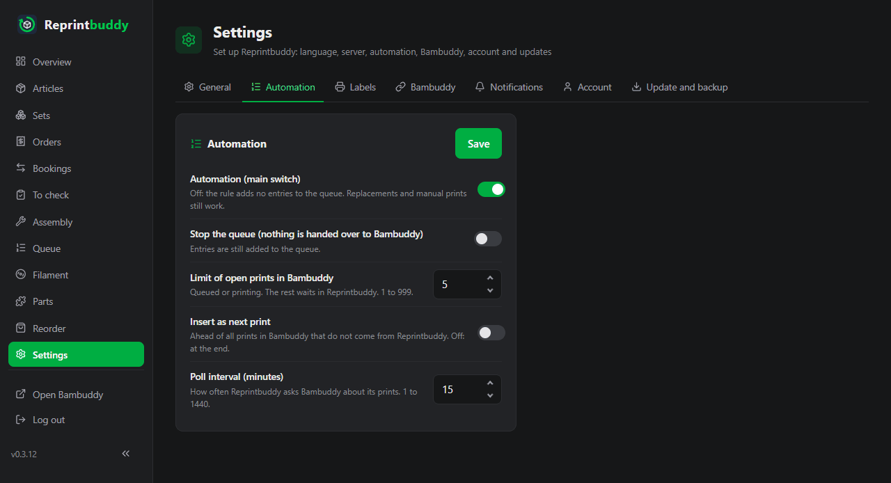
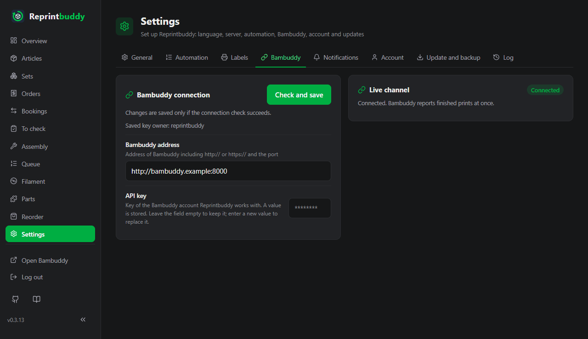

# Settings

Everything you can set in Reprintbuddy is under *Settings* in the web interface. This page lists every setting, tab by tab, with what it does, its default and what it accepts.

There is **no configuration file**. Every setting lives in the database. The only thing given on the command line is the path of the database (`--db`, see [Command line](cli.md)); the service set up by the installer already passes it.

## How saving works

- The page has eight tabs: **General**, **Automation**, **Labels**, **Bambuddy**, **Notifications**, **Account**, **Update and backup** and **Log**. The last one has no settings: it shows what happened, see [Log](log.md).
- Each card has its own button (**Save**, on the Bambuddy tab **Check and save**, for the password **Change password**). It saves that card only. A value that is not allowed is refused with a message, and nothing of that card is saved.
- Only the **Server** card needs a restart: listen address, port and HTTPS take effect after Reprintbuddy has been restarted. The page says so, and the **Restart** card on the *General* tab shows "Saved changes take effect after a restart." until you restart. Everything else takes effect at once.

!!! note "Keys, passwords and tokens"
    The Bambuddy API key, the private HTTPS key, the Home Assistant token and passwords are visible only while you type them. Once saved, the field shows `********` (or stays empty with that sign) and the card says "A value is stored." An **empty field keeps the stored value**; a **new entry replaces it**. Passwords are stored only as hashes.

    A stored key or token belongs to one address, path included, and never travels to another: if you change the address of Bambuddy or of Home Assistant, enter the key or token again.

## General

| Card and setting | What it does | Default | Accepts |
|---|---|---|---|
| **Language** | Language of the pages. | English (the installer and the first setup ask for it) | English, Deutsch |
| **QR codes**: **Address for QR codes (special cases only)** | The start of the address inside the QR codes. Needed only when Reprintbuddy is reached through a name or a proxy, for example `https://stock.example.com`. Empty: Reprintbuddy puts its own network address and port into the codes; the card shows which one ("Without an entry the codes carry: …"). | empty | An address with `http://` or `https://`, host and optional port. No user name, no `?` or `#`. |
| **Restart**: **Restart Reprintbuddy** | Restarts the service, see [Update and backup](update-backup.md#restart). | | |
| **Server**: **Listen address** | The address Reprintbuddy listens on. `0.0.0.0` means every address of the machine. | `0.0.0.0` | An address this machine can listen on. Otherwise the save is refused ("This machine cannot listen on this address"), because it would lock you out. |
| **Server**: **Port** | The port of the web interface. | `8080` | 1 to 65535. Below 1024 the page adds a note: the service set up by the installer has the right to use such ports, a service started another way may not. |
| **Server**: **HTTPS (optional)**: **Certificate (PEM)** and **Private key (PEM)** | Switch HTTPS on. Paste the text or choose the file; at most 64 KB each. Leave both empty to keep what is stored. | none: plain HTTP | PEM text. Both are needed, they must belong together, and the key must have no password. See [Network and security](network.md#https). |
| **Server**: **Remove certificate and private key (serve plain HTTP)** | Switches HTTPS off again. Shown only while a certificate is stored. | off | Switch |

A printed QR code keeps the address it had when it was printed. If the address of the server or the address entered here changes, print the labels again.

## Automation

All five settings of the card **Automation** are saved together; a wrong number saves none of them. How the automation works is described under [Automation](../use/automation.md).

| Setting | What it does | Default | Accepts |
|---|---|---|---|
| **Automation (main switch)** | Off: the rule adds no entries to the queue. Replacements and manual prints still work. | off | Switch |
| **Stop the queue (nothing is handed over to Bambuddy)** | Entries are still added to the queue, but nothing goes to Bambuddy. | off | Switch |
| **Limit of open prints in Bambuddy** | How many prints may be queued or printing in Bambuddy at once. The rest waits in Reprintbuddy. | 10 | Whole number, 1 to 999 |
| **Insert as next print** | On: ahead of all prints in Bambuddy that do not come from Reprintbuddy. Off: at the end. | off | Switch |
| **Poll interval (minutes)** | How often Reprintbuddy asks Bambuddy about its prints. While the live channel is connected (see the *Bambuddy* tab), Bambuddy reports finished prints at once. | 15 | Whole number, 1 to 1440 |

## Labels

The tab sets up the label printer and what is printed on a label. The cards **Label printer** and **What is on the label** and the **Preview** share one form: **Save** in the card **Label printer** saves the printer, the roll and the ticked details together. How to print labels is described under [Labels and QR codes](../use/labels.md).

| Setting | What it does | Default | Accepts |
|---|---|---|---|
| **Address of the printer** | The IP address or name of the label printer in your network. Empty: no printer, nothing is printed. | empty | An IP address or a name. No `http://`, no port, and not this computer. |
| **Roll** | The roll that is in the printer. Before every print Reprintbuddy asks the printer which roll it holds. | the only roll offered: 62 × 29 mm, die-cut | The rolls in the list |
| **What is on the label** | The QR code of the article is always printed. Tick what else is printed next to it: **Name**, **Article number**, **Minimum stock**, **Buffer**, **Target quantity**, **Units per print**, **Print target**, **Label text**, **Print date**. With too many details the last ones are left off; the preview names them. | **Name**, **Article number**, **Label text** | Any of the nine |
| **Trial print** | Prints one sample label with what is ticked on the screen, without saving it. | | |

Set the command mode of the label printer to "Raster" once, at the printer. Labels are always printed in landscape.

## Bambuddy

The card **Bambuddy connection** holds the address and the key of the Bambuddy account Reprintbuddy works with. It is the same check as in the [first setup](../start/setup.md).

| Setting | What it does | Accepts |
|---|---|---|
| **Bambuddy address** | Address of Bambuddy with `http://` or `https://` and the port, for example `http://<bambuddy-host>:8000`. | An address with `http://` or `https://`, host and port, without user name, query (`?`) or fragment (`#`) and without blanks or line breaks. Reprintbuddy appends the path of each call, which would land behind a `?` or `#`. |
| **API key** | The key of the Bambuddy account. Shown only while you type it. | Visible characters without blanks |

**Check and save** asks Bambuddy whom the key belongs to and which rights it really has. Changes are saved **only if the check succeeds**. The card then shows the owner of the key ("Saved key owner: …"); you never type the user name. A key that belongs to an administrator is saved with a warning, because it may do more than needed. Whether print files can be uploaded with this key is reported after every save.

If you change the address, enter the key again: a stored key is never sent to a new address. A different path counts as a different address (behind a proxy another path can be another service), and so does a different user part, query or fragment. Writing the same address differently does not: upper or lower case in scheme and host, a left-out default port and a trailing slash make no difference. An address saved by an earlier version that has a part the rule now refuses keeps working until you save it again.

The card **Live channel** shows whether Bambuddy reports finished prints at once (**Connected**) or Reprintbuddy has to use the regular query (**Waiting**, **Connecting**, **Right missing**), or the card says **Off**. It is a display, not a setting.

## Notifications

The card **Home Assistant** sets up push messages, see [Push messages](../use/notifications.md). Nothing is sent and Home Assistant is never contacted until you switch it on.

| Setting | What it does | Default | Accepts |
|---|---|---|---|
| **Push messages** | On: send messages to [Home Assistant](https://www.home-assistant.io/). Off: Reprintbuddy never contacts it. | off | Switch. When on, address, token and service are needed. |
| **Address of Home Assistant** | With `http://` or `https://` and the port, for example `http://homeassistant.local:8123`. | empty | A plain address without user name, query or fragment |
| **Long-lived access token** | Created in Home Assistant under your profile, *Security*. Shown only while you type it. | empty | Visible characters without blanks |
| **Notification service** | The service that reaches your phone, for example `notify.mobile_app_my_phone`. | empty | A service of the `notify` domain, and not `notify.send_message` |
| **Name things in messages** | On: messages name articles, spool sorts and parts. Off: only kind and number. | on | Switch |
| **Events** | One tick box each: **Print finished, waits for inspection**, **Print failed in Bambuddy**, **Article paused by the automation**, **Article below minimum stock**, **New reorder suggestion**, **Fault (red warning at two regular queries in a row)**, **Missing right in Bambuddy**. | all seven ticked | Any of them |

**Send test message** sends one message with what is entered, without saving it. A typed token is never written back into the page: to save, enter it once more.

## Account

The card **Change password** changes the password you sign in with: enter **Current password**, **New password (at least 8 characters)** and **Repeat password**, then press **Change password**. All other sessions end; this one stays signed in.

The user name cannot be changed here. If you forgot the password or want another user name, use `set-password` on the command line, see [Command line](cli.md).

## Update and backup

This tab holds the update, the full backup, the restore and the export. They are described on their own page, [Update and backup](update-backup.md). One switch is a setting:

| Setting | What it does | Default |
|---|---|---|
| **Check for new versions automatically** | At the start and then once a day Reprintbuddy asks whether a newer version exists. A notice at the top of every page shows it. The switch is saved at once. | on |

## What is not on this page

- The **path of the database** is not a setting. The service passes it with `--db`.
- The **time zone** is not a setting. Every time (journal, log, messages, release notes, the date on a label) is shown in the time zone of the server, with its summer time. To change it, set the zone on the server, for example `timedatectl set-timezone Europe/Vienna`, and restart Reprintbuddy.
- Values Reprintbuddy keeps for itself are never shown: the secret that signs the session cookies, which it creates on the first start, and the marks that follow the connection check.
- Settings of single articles, filament sorts and bought-in parts are on their own pages, not here.

## Related pages

- [Update and backup](update-backup.md): update, full backup, restore, export.
- [Log](log.md): who changed what, sign-ins, updates, messages.
- [Network and security](network.md): HTTPS, reverse proxy, locked out.
- [Command line](cli.md): password, port, listen address from the system.
