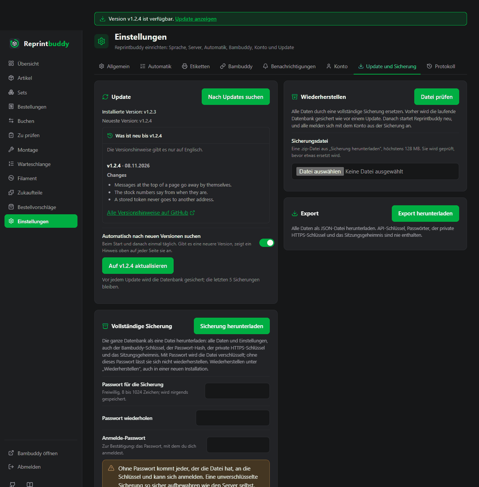

# Update und Sicherung

Reprintbuddy aktualisiert sich aus der Weboberfläche und bringt eine eigene vollständige Sicherung mit. Diese Seite behandelt das Update, was bei einem Fehler zu tun ist, den Neustart, die vollständige Sicherung, das Wiederherstellen und den Export. Alles steht unter *Einstellungen → Update und Sicherung*, außer dem Neustart: Der steht unter *Einstellungen → Allgemein*.

## Update aus der Oberfläche



1. Öffne *Einstellungen → Update und Sicherung* und drücke **Nach Updates suchen**. Die Karte zeigt „Installierte Version: …“ und „Neueste Version: …“.
2. Gibt es eine neuere Version, erscheint ein Knopf **Auf … aktualisieren** (mit der Version). Drücke ihn. Gibt es keine, steht auf der Karte „Reprintbuddy ist aktuell.“
3. Die Karte zeigt den laufenden Schritt. Änderungen sind gesperrt, bis das Update fertig ist.

Das Update macht der Reihe nach:

1. sichert die Datenbank,
2. lädt das Paket der neuen Version und prüft es gegen seine Prüfsumme (passt es nicht, wird nichts installiert),
3. installiert es und die Pakete, die es braucht,
4. migriert die Datenbank,
5. startet den Dienst neu und
6. prüft, ob die neue Version antwortet (es wartet bis zu 90 Sekunden).

Die Karte nennt den Schritt, in dem es gerade ist: **Datenbank wird gesichert**, **Paket wird geladen und geprüft**, **Neue Version wird abgelegt**, **Pakete werden installiert**, **Installierte Version wird geprüft**, **Datenbank wird migriert**, **Neustart**, **Warten, bis die neue Version antwortet**. Ist es fertig, steht dort „Update abgeschlossen“; diese Karte erscheint einmal und ist beim nächsten Öffnen der Seite weg. Ein fehlgeschlagenes oder zurückgerolltes Update bleibt mit dem Pfad der Sicherung auf der Karte stehen, bis du es mit **Ausblenden** wegklickst. Start und Ergebnis jedes Updates stehen außerdem im [Protokoll](log.md) (*Einstellungen → Protokoll*): „Update gestartet“ mit alter und neuer Version, und je Update einmal das Ergebnis. Wird ein Update zurückgerollt, wird auch die Datenbank zurückgespielt; Protokollzeilen aus der Zeit des Updates gehen dabei verloren, das Ergebnis wird danach eingetragen.

!!! note "Updates brauchen das Installationsskript"
    Die Knöpfe funktionieren nur bei einer Installation mit dem Installationsskript. Sonst steht auf der Karte „Updates aus der Oberfläche brauchen eine Installation mit dem Installationsskript.“ Das Update ersetzt das Programm, nicht die systemd-Units und nicht die sudoers-Regel; siehe [Versionen und Release-Notes](#versionen-und-release-notes).

### Wenn ein Schritt fehlschlägt

Reprintbuddy geht auf die vorige Version zurück **und** stellt die Datenbank aus der Sicherung wieder her, die es am Anfang gemacht hat. Die Karte sagt „Update fehlgeschlagen, vorige Version wiederhergestellt“ und nennt den fehlgeschlagenen Schritt und den Grund. Schlägt das Update fehl, bevor etwas umgestellt wurde (die Sicherung oder das Holen der Versionen), sagt die Karte „Update fehlgeschlagen, nichts wurde geändert“.

### Warum Änderungen gesperrt sind

Ein Rückfall setzt die Datenbank auf den Stand vor dem Update zurück. Alles, was du in der Zwischenzeit gebucht hättest, ginge verloren. Deshalb wird während eines Updates jede Änderung abgelehnt mit „Ein Update läuft. Änderungen sind bis zum Ende gesperrt.“; auch die Automatik wartet. Weiter möglich sind **Nach Updates suchen**, der Update-Knopf selbst und das Abmelden. Seiten lesen geht wie immer.

## Was die neueren Versionen mitbringen

Findet die Prüfung eine neuere Version, zeigt die Update-Karte außerdem ein zugeklapptes Feld **Was ist neu bis …** (mit der neuesten Version). Klappe es auf, um die Versionshinweise jeder Version nach der installierten bis zur neuesten zu lesen, die neueste zuerst, jede mit ihrer Versionsnummer und dem Datum. Höchstens 10 Versionen stehen in der Liste; ein Hinweis von mehr als 20.000 Zeichen wird gekürzt und mit „… (gekürzt)“ markiert. Unter den Hinweisen führt der Link **Alle Versionshinweise auf GitHub** zur Seite aller Versionen.

- Die Hinweise gibt es nur auf Englisch. In der deutschen Oberfläche sagt das eine Zeile: „Die Versionshinweise gibt es nur auf Englisch.“
- Sie kommen von GitHub und erscheinen als einfacher formatierter Text: Absätze, Listen, fett, kursiv und Code. Links und Bilder aus dem Text zeigen nur ihre Worte; nichts aus dem Text wird ausgeführt oder nachgeladen.
- Sie kommen mit der Prüfung, aus derselben Anfrage. Hat die neueste Version keinen brauchbaren Text, sagt das Feld „Versionshinweise konnten nicht geladen werden.“ Das Update hängt nicht von ihnen ab.
- Reprintbuddy fragt sie einmal je Prüfung ab, bei `api.github.com`, ohne Anmeldung, ohne Cookie und ohne eine Adresse deiner Installation. GitHub sieht die IP-Adresse deines Servers und begrenzt solche Anfragen auf 60 je Stunde. Ein Seitenaufruf fragt nie; das Ergebnis liegt nur im Arbeitsspeicher.

## Die tägliche Prüfung und der Balken oben

Reprintbuddy fragt beim Start und danach einmal täglich, ob es eine neuere Version gibt. Es ist dieselbe Prüfung wie der Knopf. Gibt es eine, erscheint oben auf jeder Seite ein schmaler Balken: „Version … ist verfügbar.“ mit dem Link **Update anzeigen**, der zur Update-Karte führt.

- Schlägt eine Prüfung fehl, siehst du nichts; Reprintbuddy versucht es nach einer Stunde wieder.
- Die Prüfung fragt GitHubs API nach der Liste der Releases (eine Anfrage, die auch die Versionshinweise bringt); GitHub sieht also die Adresse deines Servers.
- Schalte sie mit **Automatisch nach neuen Versionen suchen** auf der Update-Karte ab. Dann gibt es weder die automatische Prüfung noch den Balken; der Knopf funktioniert weiter.
- Ein Entwicklungsstand zeigt den Balken nie.

## Wenn die Karte ein Problem meldet

| Die Karte sagt | Was passiert ist | Was zu tun ist |
|---|---|---|
| **Update fehlgeschlagen, nichts wurde geändert** | Das Update brach ab, bevor etwas umgestellt wurde, zum Beispiel weil die Versionen nicht geholt werden konnten. | Die auf der Karte genannte Ursache beheben (ist der Server online?) und es erneut versuchen. |
| **Update fehlgeschlagen, vorige Version wiederhergestellt** | Ein späterer Schritt ist fehlgeschlagen. Die vorige Version und die Datenbank sind zurück. | Schritt und Grund auf der Karte lesen, später erneut versuchen. Das Ergebnis steht im [Protokoll](log.md); das Systemprotokoll hat die Einzelheiten (`journalctl -u reprintbuddy-update`). |
| **Update fehlgeschlagen, vorige Version ließ sich nicht wiederherstellen** | Auch der Rückfall ist fehlgeschlagen. Die Karte nennt die Sicherung. | Siehe unten. |
| **Update wurde unterbrochen** | Der Update-Helfer ist mittendrin ohne Endzustand stehen geblieben, zum Beispiel weil das System während des Updates neu gestartet ist. | Siehe unten. |
| **Update wurde nicht gestartet. Bitte erneut starten.** (oder: bitte zuerst nach Updates suchen) | Der Helfer hat gar nicht begonnen; nichts wurde geändert. | **Nach Updates suchen** drücken, dann den Update-Knopf. |
| **Das Update wurde gestartet, konnte seinen Zustand aber nicht speichern, und die neue Version läuft nicht.** | Der Helfer lief, konnte aber seine Zustandsdatei nicht schreiben. | Das Systemprotokoll lesen: `journalctl -u reprintbuddy-update` |

systemd beendet ein Update, das länger als 30 Minuten läuft. Die Karte meldet dann einen Fehlschlag, in dessen Meldung „interrupted“ steht.

Bei **Update fehlgeschlagen, vorige Version ließ sich nicht wiederherstellen** und **Update wurde unterbrochen**:

1. Führe das Installationsskript noch einmal aus, siehe [Installation](../start/install.md). Es repariert Pakete, Units und den Dienst und behält die Datenbank.
2. Startet Reprintbuddy danach immer noch nicht, stelle die auf der Karte genannte Sicherung wieder her, wie unter [Datenbankkopie von Hand wiederherstellen](#datenbankkopie-von-hand-wiederherstellen) gezeigt, und führe das Installationsskript noch einmal aus.

!!! note "Python-Version"
    Braucht eine neue Version ein neueres Python, als das System hat, schlägt das Update im Schritt **Pakete werden installiert** mit einer Meldung fehl, die beide Versionen nennt, und wird zurückgerollt. Siehe [Installation](../start/install.md).

## Sicherungen des Updates

Vor jedem Update wird die Datenbank nach `/var/lib/reprintbuddy/backups/` gesichert. Die Dateien heißen `reprintbuddy-<Version>-<Datum>T<Uhrzeit>Z.db` (UTC). Reprintbuddy behält die letzten 5; die Sicherung, die ein fehlgeschlagener Rückfall nennt, wird nie gelöscht. Die Sicherheitskopie vor einem Wiederherstellen (`reprintbuddy-before-restore-…`) zählt dazu.

Diese Dateien sind einfache Kopien der Datenbank, mit allen Schlüsseln. Behandle sie wie die Datenbank selbst: Nur der Dienstbenutzer kann den Ordner lesen.

## Update von Hand

Auf dem System, als root:

```bash
systemctl start reprintbuddy-update.service
```

Es tut dasselbe wie der Knopf und geht auf die neueste Version. Der Fortschritt erscheint auf der Update-Karte; das Systemprotokoll dazu ist:

```bash
journalctl -u reprintbuddy-update
```

Ein Update und ein Wiederherstellen laufen nie gleichzeitig, egal wie sie gestartet wurden: Was als Zweites kommt, wird abgelehnt. Das gilt auch für `reprintbuddy update`, direkt auf der Kommandozeile eingegeben, und für [`reprintbuddy restore-backup`](#wiederherstellen-auf-der-kommandozeile). Beide sperren dazu die Datei `maintenance.lock` im Datenordner. Das System gibt die Sperre frei, sobald der Vorgang endet, auch nach einem Absturz oder Stromausfall; es bleibt also keine Sperre hängen. Lass die Datei, wo sie ist. Daran erkennt ein Update auch, dass keins läuft: Ist ein früheres Update abgestürzt, beginnt das nächste sofort, statt als „läuft schon“ abgelehnt zu werden.

## Versionen und Release-Notes

Jede Version ist ein veröffentlichtes GitHub-Release `vX.Y.Z` mit seinem Paket (`reprintbuddy-<tag>.tar.gz`, der ganze Stand der Version) und einer Prüfsummen-Datei; ein Workflow auf GitHub hängt beides an, sobald das Release veröffentlicht ist. Die Paketversion entspricht dem Tag. Das Update installiert die neueste Version, die die Karte anbietet; ein Release ohne sein Paket wird nicht angeboten. Vorabversionen haben Tags `vX.Y.Z-beta.N` und sind auf GitHub als Vorabversion markiert; eine Vorabversion ist älter als die Version mit denselben Zahlen (`1.0.1-beta.2` ist älter als `1.0.1`).

Installation und Update laden beide das Paket, darum zählt GitHub die Downloads jeder Version; sonst sendet Reprintbuddy nichts. Eine Installation, die mit git eingerichtet wurde (bis v0.4.9), bekommt v0.4.9 noch per git; ihr nächstes Update lädt das Paket und entfernt danach die alte git-Kopie aus `/opt/reprintbuddy` (nie die Daten). Ändert eine Version die systemd-Units oder die sudoers-Regel, steht das in ihren Release-Notes, und du führst nach dem Update das Installationsskript noch einmal aus. Die Release-Notes stehen auf [GitHub](https://github.com/Eifel-Joe/reprintbuddy/releases) und, für die Versionen einer neueren Version, auf der Update-Karte (siehe [Was die neueren Versionen mitbringen](#was-die-neueren-versionen-mitbringen)).

Die Karte zeigt die installierte Version und, wenn sie abweicht, daneben die Paketversion.

## Stabile Versionen oder auch Vorabversionen

Die Zeile **Angebotene Versionen** auf der Update-Karte wählt zwischen **Nur stabile Versionen** (Vorgabe) und **Auch Vorabversionen**. Ein Klick speichert die Wahl und sucht sofort nach Updates, auch wenn die automatische Prüfung aus ist. Mit Vorabversionen bietet die Karte die neueste Version beider Arten an, und die Hinweise einer Vorabversion tragen den Zusatz „Vorabversion“. Schaltest du zurück auf nur stabile Versionen, bleibt eine installierte Vorabversion; Älteres wird nicht angeboten, die nächste neuere stabile Version schon. Die Karte sagt dann „Installiert ist eine Vorabversion.“ Eine Installation mit dem Installationsbefehl einer Vorabversion beginnt mit eingeschalteten Vorabversionen.

## Neustart

Adresse, Port und HTTPS wirken erst nach einem Neustart. Drücke **Reprintbuddy neu starten** auf der Karte **Neustart** unter *Einstellungen → Allgemein*. Die Seite sagt „Neustart läuft …“ und lädt neu, sobald Reprintbuddy wieder da ist. Nach einer Änderung von Adresse oder Port nennt sie die neue Adresse. Die Karte zeigt „Läuft unter …“ und, solange eine gespeicherte Änderung noch wartet, „Gespeicherte Änderungen werden nach einem Neustart wirksam.“

Schlägt der Neustart fehl, sagt die Karte „Neustart fehlgeschlagen. Ist Reprintbuddy mit dem Installationsskript installiert?“ Auf dem System:

```bash
systemctl restart reprintbuddy
```

## Vollständige Sicherung

Die Karte **Vollständige Sicherung** lädt die ganze Datenbank als eine `.zip`-Datei herunter, benannt `reprintbuddy-backup-<Datum>-<Uhrzeit>.zip` (mit Passwort: `reprintbuddy-backup-<Datum>-<Uhrzeit>-encrypted.zip`): alle Daten und Einstellungen, **auch** der Bambuddy-Schlüssel, das Token von Home Assistant, der Passwort-Hash, der private HTTPS-Schlüssel und das Sitzungsgeheimnis. Nur die Liste der angemeldeten Browser fehlt.

1. Freiwillig: ein **Passwort für die Sicherung** (8 bis 1024 Zeichen) eingeben und wiederholen. Die Datei wird dann mit Argon2id und AES-256-GCM verschlüsselt. Das Passwort wird nirgends gespeichert: **Ohne es lässt sich die Sicherung nicht wiederherstellen.**
2. Dein **Anmelde-Passwort** eingeben. Der Download verlangt es erneut, ein offener Browser allein reicht also nicht.
3. **Sicherung herunterladen** drücken.

!!! warning "Ohne Passwort kein Schutz"
    Ohne Passwort kommt jeder, der die Datei hat, an die Schlüssel und kann sich anmelden. Eine unverschlüsselte Sicherung so sicher aufbewahren wie den Server selbst.

Die Datei enthält ein immer lesbares `manifest.json` (welche Version sie erstellt hat, wann, ob sie verschlüsselt ist) und die Datenbank. Das [Protokoll](log.md) liegt in der Datenbank und damit in der Sicherung.

## Wiederherstellen

Die Karte **Wiederherstellen** ersetzt alle Daten durch eine vollständige Sicherung.

1. Wähle unter *Wiederherstellen* die `.zip`-Datei (höchstens 128 MB) und drücke **Datei prüfen**.
2. Reprintbuddy prüft die Datei, bevor etwas ersetzt wird: dass sie eine Sicherung von Reprintbuddy ist, dass sie nicht beschädigt ist, dass ihre Datenbank brauchbar ist und nicht aus einer neueren Version stammt. Es zeigt, wann die Sicherung erstellt wurde, von welcher Version und ob sie verschlüsselt ist.
3. Gib das **Passwort der Sicherung** (nur wenn sie verschlüsselt ist) und dein **Anmelde-Passwort** ein und drücke **Wiederherstellen und neu starten**. **Abbrechen** verwirft die Datei. Eine geprüfte Datei wartet eine Stunde.
4. Reprintbuddy sichert die laufende Datenbank wie vor einem Update, ersetzt sie und startet neu. Änderungen sind gesperrt, bis es wieder da ist.

Danach gelten Benutzername und Passwort **aus der Sicherung**, und alle melden sich neu an. Das [Protokoll](log.md) der Sicherung gilt ebenfalls, mit einer neuen Zeile über die Wiederherstellung (mit Datum und Version der Sicherung); Zeilen, die nach dem Stand der Sicherung entstanden sind, sind nicht mehr zu sehen. Schon verschickte Push-Nachrichten kommen nicht noch einmal, nur weil die Sicherung älter ist (siehe [Push-Nachrichten](../use/notifications.md#keine-flut-von-nachrichten)). Auch eine abgelehnte oder abgebrochene Wiederherstellung wird protokolliert. Lauschadresse, Port und HTTPS kommen ebenfalls aus der Sicherung; haben sie sich geändert, nennt die Seite die neue Adresse.

- Eine Sicherung aus einer **älteren** Version wird so eingespielt und beim Start migriert.
- Eine Sicherung aus einer **neueren** Version wird abgelehnt („Erst aktualisieren, dann wiederherstellen“).
- Solange ein Update oder ein anderes Wiederherstellen läuft, beginnt keins, auch wenn es auf der Kommandozeile gestartet wurde (siehe [Update von Hand](#update-von-hand)).

!!! note "Auf einem neuen Rechner"
    Die Oberfläche öffnet sich erst, wenn das Konto und die Bambuddy-Verbindung eingerichtet sind, siehe [Ersteinrichtung](../start/setup.md). Willst du vorher wiederherstellen, nimm die Kommandozeile, siehe unten. Passen Adresse oder Port aus der Sicherung nicht zum neuen Rechner, setze sie mit `reprintbuddy set-host` und `reprintbuddy set-port` zurecht, siehe [Kommandozeile](cli.md).

## Export

Die Karte **Export** lädt alle Daten als JSON-Datei herunter, benannt `reprintbuddy-export-<Datum>-<Uhrzeit>.json` (**Export herunterladen**). Sie enthält nie API-Schlüssel, Passwörter, das Token von Home Assistant, den privaten HTTPS-Schlüssel oder das Sitzungsgeheimnis. Ein Export lässt sich nicht wiederherstellen; dafür gibt es die vollständige Sicherung.

## Wiederherstellen auf der Kommandozeile

Startet Reprintbuddy nicht mehr, zum Beispiel nach einem missglückten Wiederherstellen, funktioniert dasselbe Wiederherstellen auf der Kommandozeile, mit denselben Prüfungen wie in der Oberfläche:

```bash
systemctl stop reprintbuddy
install -m 0600 -o reprintbuddy /root/backup.zip /var/lib/reprintbuddy/restore.zip
reprintbuddy restore-backup /var/lib/reprintbuddy/restore.zip
rm /var/lib/reprintbuddy/restore.zip
systemctl start reprintbuddy
```

Der Befehl fragt nach dem Passwort der Sicherung, wenn sie verschlüsselt ist (nur am Terminal, nie als Argument; drei Versuche). Er lehnt ab, solange Reprintbuddy oder ein Update läuft, auch ein Update, das von Hand auf der Kommandozeile gestartet wurde. Die Datenbank, die vorher da war, sichert er zuerst nach `backups/`, oder als `damaged-<Datum>T<Uhrzeit>Z.db`, falls sie sich nicht lesen ließ, und sagt, was er wiederhergestellt hat. Wie die Oberfläche behält er, was Protokoll und Push-Nachrichten schon gemeldet hatten. Er läuft als Dienstbenutzer aus dem Ordner `/`, gib also den vollen Pfad an; der Dienstbenutzer muss die Datei lesen können: Kopiere sie wie gezeigt in den Datenordner, mit dem Modus 0600, weil sie deine Schlüssel enthält, wenn sie nicht verschlüsselt ist, und lösche sie danach. Danach melden sich alle neu an.

## Datenbankkopie von Hand wiederherstellen

Um eine der Kopien aus `backups/` zurückzuspielen:

```bash
systemctl stop reprintbuddy
runuser -u reprintbuddy -- cp /var/lib/reprintbuddy/backups/<backup>.db /var/lib/reprintbuddy/reprintbuddy.db
rm -f /var/lib/reprintbuddy/reprintbuddy.db-wal /var/lib/reprintbuddy/reprintbuddy.db-shm
systemctl start reprintbuddy
```

## Weiterführende Seiten

- [Einstellungen](settings.md): alle Einstellungen.
- [Installation](../start/install.md): das Installationsskript noch einmal ausführen.
- [Kommandozeile](cli.md): `restore-backup`, `set-host`, `set-port`.
