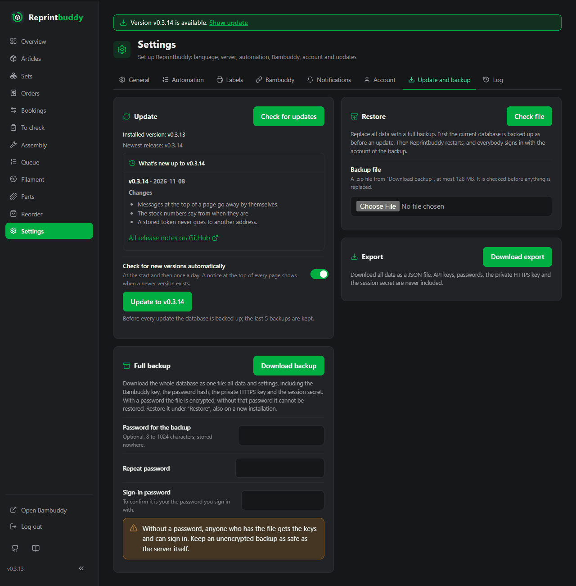

# Update and backup

Reprintbuddy updates itself from the web interface and brings its own complete backup. This page covers the update, what to do when it goes wrong, the restart, the full backup, the restore and the export. All of it is under *Settings → Update and backup*, except the restart, which is under *Settings → General*.

## Update from the interface



1. Open *Settings → Update and backup* and press **Check for updates**. The card shows "Installed version: …" and "Newest release: …".
2. If a newer release exists, a button **Update to …** (with the version) appears. Press it. If there is none, the card says "Reprintbuddy is up to date."
3. The card shows the running step. Changes are paused until the update has finished.

The update does these things, in this order:

1. backs up the database,
2. downloads the package of the new release and checks it against its checksum (nothing is installed if it does not match),
3. installs it and the packages it needs,
4. migrates the database,
5. restarts the service and
6. checks that the new version answers (it waits up to 90 seconds).

The card names the step it is in: **Backing up the database**, **Downloading and checking the package**, **Putting the new version in place**, **Installing packages**, **Checking the installed version**, **Migrating the database**, **Restarting**, **Waiting for the new version to answer**. When it is finished it says "Update finished"; that card is shown once and gone the next time you open the page. A failed or rolled-back update stays on the card, with the path of the backup, until you hide it with **Hide**. Start and result of every update are also written to the [Log](log.md) (*Settings → Log*): "Update started" with the old and the new version, and once per update its result. If an update is rolled back, the database is restored too, so log lines from the time of the update are lost; the result is entered after that.

!!! note "Updates need the installer"
    The buttons work only for an installation made with the install script. Otherwise the card says "Updates from this page need an installation made with the install script." The update replaces the program, not the systemd units or the sudoers rule; see [Versions and release notes](#versions-and-release-notes).

### If a step fails

Reprintbuddy goes back to the previous version **and** restores the database from the backup it made at the start. The card says "Update failed, previous version restored" and names the step that failed and why. If the update fails before anything was switched (the backup, the download or the check of the package), the card says "Update failed, nothing was changed".

### Why changes are paused

A rollback puts the database back as it was before the update. Anything you booked in the meantime would be lost. So while an update runs, every change is refused with "An update is running. Changes are paused until it is finished."; the automation waits too. Still possible: **Check for updates**, the update button itself and signing out. Reading pages works as always.

## What the newer versions bring

When the check finds a newer release, the update card also shows a closed box **What's new up to …** (with the newest version). Open it to read the release notes of every version after the installed one, up to the newest, newest first, each with its tag and its date. At most 10 versions are listed; a note longer than 20,000 characters is cut and marked "… (cut)". Under the notes the link **All release notes on GitHub** leads to the page of all releases.

- The notes are in English only. In the German interface a line says so: "The release notes are available in English only."
- They come from GitHub and are shown as simple formatted text: paragraphs, lists, bold, italic and code. Links and pictures from the text show only their words; nothing from the text is run or loaded.
- They come with the check, from the same request. If the newest version has no usable text, the box says "The release notes could not be loaded." The update does not depend on them.
- Reprintbuddy asks for them once per check, at `api.github.com`, without a login, a cookie or any address of your installation. GitHub sees the IP address of your server, and it limits such requests to 60 an hour. A page view never asks; the result is kept in memory only.

## The daily check and the bar at the top

Reprintbuddy asks at the start and then once a day whether a newer release exists. It is the same check as the button. If there is one, a narrow bar appears at the top of every page: "Version … is available." with the link **Show update**, which leads to the update card.

- If a check fails, you see nothing; Reprintbuddy tries again after an hour.
- The check asks GitHub's API for the list of releases (one request, which brings the release notes too), so GitHub sees the address of your server.
- Switch it off with **Check for new versions automatically** on the update card. Then there is no automatic check and no bar; the button still works.
- A development build never shows the bar.

## When the card reports a problem

| The card says | What happened | What to do |
|---|---|---|
| **Update failed, nothing was changed** | The update stopped before anything was switched, for example the releases could not be fetched. | Fix the cause named on the card (is the server online?) and try again. |
| **Update failed, previous version restored** | A later step failed. The previous version and the database are back. | Read the step and the reason on the card, then try again later. The result is in the [Log](log.md); the system log has the details (`journalctl -u reprintbuddy-update`). |
| **Update failed and the previous version could not be restored** | The rollback failed too. The card names the backup. | See below. |
| **Update was interrupted** | The update helper stopped midway without a final state, for example because the system restarted during the update. | See below. |
| **The update did not start. Please start it again.** (or: please check for updates first) | The helper never began; nothing was changed. | Press **Check for updates**, then the update button. |
| **The update was started but could not save its state, and the new version is not running.** | The helper ran but could not write its state file. | Read the system log: `journalctl -u reprintbuddy-update` |

systemd stops an update that runs longer than 30 minutes. The card then reports a failure whose message says "interrupted".

For **Update failed and the previous version could not be restored** and **Update was interrupted**:

1. Run the installer again, see [Installation](../start/install.md#running-the-installer-again). It repairs packages, units and the service and keeps the database.
2. If Reprintbuddy still does not start, restore the backup named on the card, as shown under [Restore a database copy by hand](#restore-a-database-copy-by-hand), and run the installer again.

!!! note "Python version"
    If a new version needs a newer Python than the system has, the update fails at the step **Installing packages** with a message that names both versions and is rolled back. See [Installation](../start/install.md#on-debian-12).

## Backups made by the update

Before every update the database is backed up to `/var/lib/reprintbuddy/backups/`. The files are named `reprintbuddy-<version>-<date>T<time>Z.db` (UTC). Reprintbuddy keeps the last 5; the backup that a failed rollback names is never deleted. The safety copy made before a restore (`reprintbuddy-before-restore-…`) counts among them.

These files are plain copies of the database, with all keys. Treat them like the database itself: only the service user can read the folder.

## Update by hand

On the system, as root:

```bash
systemctl start reprintbuddy-update.service
```

It does the same as the button and goes to the newest release. The progress shows on the update card; its system log is:

```bash
journalctl -u reprintbuddy-update
```

An update and a restore never run at the same time, however they were started: the one that comes second is refused. This also holds for `reprintbuddy update` typed directly on the command line and for [`reprintbuddy restore-backup`](#restore-on-the-command-line). Both take a lock on the file `maintenance.lock` in the data folder. The system releases it when the process ends, also after a crash or a power cut, so no lock stays behind; leave the file where it is. That is also how an update knows that none is running: if an earlier update crashed, the next one starts right away instead of being refused as "already running".

## Versions and release notes

Every version is a published GitHub release `vX.Y.Z` with its package (`reprintbuddy-<tag>.tar.gz`, the whole state of the version) and a checksum file; a workflow on GitHub attaches both when the release is published. The package version equals the tag. The update installs the newest release the card offers; a release without its package is not offered. Pre-releases are tagged `vX.Y.Z-beta.N` and marked as such on GitHub; a pre-release is older than the release with the same numbers (`1.0.1-beta.2` is older than `1.0.1`).

Installation and update both download the package, so GitHub counts the downloads of each version; Reprintbuddy sends nothing else. An installation made with git (up to v0.4.9) gets v0.4.9 by git; its next update downloads the package and then removes the old git copy from `/opt/reprintbuddy` (never the data). If a release changes the systemd units or the sudoers rule, its release notes say so, and you run the installer again after the update. The release notes are on [GitHub](https://github.com/Eifel-Joe/reprintbuddy/releases) and, for the versions a newer release brings, on the update card (see [What the newer versions bring](#what-the-newer-versions-bring)).

The card shows the installed version and, if it differs, the package version next to it.

## Stable releases or pre-releases too

The switch **Include pre-releases** on the update card, right under the automatic check, is off by default: then only stable releases are offered. Switched on, pre-releases are offered too. A click saves the choice and checks for updates at once, also when the automatic check is off. With pre-releases on, the card offers the newest version of either kind, and the notes of a pre-release say "pre-release". Switched off again, an installed pre-release stays; nothing older is offered, the next newer stable release is. The card then says "A pre-release is installed." An installation made from the install command of a pre-release starts with pre-releases on.

## Restart

Address, port and HTTPS take effect only after a restart. Press **Restart Reprintbuddy** on the card **Restart** under *Settings → General*. The page says "Restarting …" and reloads when Reprintbuddy is back. After a change of address or port, it names the new address. The card shows "Running at …" and, while a saved change still waits, "Saved changes take effect after a restart."

If the restart fails, the card says "Restart failed. Is Reprintbuddy installed with the install script?" On the system:

```bash
systemctl restart reprintbuddy
```

## Full backup

The card **Full backup** downloads the whole database as one `.zip` file named `reprintbuddy-backup-<date>-<time>.zip` (with a password: `reprintbuddy-backup-<date>-<time>-encrypted.zip`): all data and settings, **including** the Bambuddy key, the Home Assistant token, the password hash, the private HTTPS key and the session secret. Only the list of signed-in browsers is left out.

1. Optional: enter a **Password for the backup** (8 to 1024 characters) and repeat it. The file is then encrypted with Argon2id and AES-256-GCM. The password is stored nowhere: **without it the backup cannot be restored.**
2. Enter your **Sign-in password**. The download asks for it again, so an open browser alone is not enough.
3. Press **Download backup**.

!!! warning "No password, no protection"
    Without a password, anyone who has the file gets the keys and can sign in. Keep an unencrypted backup as safe as the server itself.

The file contains a readable `manifest.json` (which version made it, when, whether it is encrypted) and the database. The [Log](log.md) is part of the database and so of the backup.

## Restore

The card **Restore** replaces all data with a full backup.

1. Under *Restore*, choose the `.zip` file (at most 128 MB) and press **Check file**.
2. Reprintbuddy checks the file before anything is replaced: that it is a Reprintbuddy backup, that it is not damaged, that its database is usable and does not come from a newer version. It shows when the backup was created, which version made it, and whether it is encrypted.
3. Enter the **Password of the backup** (only if it is encrypted) and your **Sign-in password**, then press **Restore and restart**. **Cancel** drops the file. A checked file waits for one hour.
4. Reprintbuddy backs up the running database as before an update, replaces it and restarts. Changes are paused until it is back.

Afterwards the user name and password **of the backup** apply, and everybody signs in again. The [Log](log.md) of the backup applies too, with one new line about the restore (with the date and version of the backup); log lines made after the backup was taken are no longer visible. Push messages that were already sent are not sent again just because the backup is older (see [Push messages](../use/notifications.md#no-flood-of-messages)). A refused or cancelled restore is logged as well. Listen address, port and HTTPS come from the backup too; if they changed, the page names the new address.

- A backup from an **older** version is restored as it is and migrated at the start.
- A backup from a **newer** version is refused ("Update first, then restore").
- No restore starts while an update or another restore runs, also one started on the command line (see [Update by hand](#update-by-hand)).

!!! note "On a new machine"
    The interface opens only after the account and the Bambuddy connection are set up, see [First setup](../start/setup.md). To restore before that, use the command line, see below. If the address or port of the backup does not fit the new machine, fix them with `reprintbuddy set-host` and `reprintbuddy set-port`, see [Command line](cli.md).

## Export

The card **Export** downloads all data as a JSON file named `reprintbuddy-export-<date>-<time>.json` (**Download export**). It never contains API keys, passwords, the Home Assistant token, the private HTTPS key or the session secret. An export cannot be restored; for that use the full backup.

## Restore on the command line

If Reprintbuddy does not start any more, for example after a restore that went wrong, the same restore works on the command line with the same checks as in the interface:

```bash
systemctl stop reprintbuddy
install -m 0600 -o reprintbuddy /root/backup.zip /var/lib/reprintbuddy/restore.zip
reprintbuddy restore-backup /var/lib/reprintbuddy/restore.zip
rm /var/lib/reprintbuddy/restore.zip
systemctl start reprintbuddy
```

The command asks for the password of the backup if it is encrypted (on the terminal only, never as an argument; three tries). It refuses while Reprintbuddy or an update is running, also an update typed by hand on the command line. It saves the database that was there first in `backups/`, or as `damaged-<date>T<time>Z.db` if it could not be read, and says what it restored. Like the interface, it keeps what the log and the push messages had already reported. It runs as the service user from the folder `/`, so give the full path, and the service user must be able to read the file: copy it to the data folder as shown, with mode 0600 because it holds your keys unless it is encrypted, and delete it afterwards. Everybody signs in again afterwards.

## Restore a database copy by hand

To put back one of the copies from `backups/`:

```bash
systemctl stop reprintbuddy
runuser -u reprintbuddy -- cp /var/lib/reprintbuddy/backups/<backup>.db /var/lib/reprintbuddy/reprintbuddy.db
rm -f /var/lib/reprintbuddy/reprintbuddy.db-wal /var/lib/reprintbuddy/reprintbuddy.db-shm
systemctl start reprintbuddy
```

## Related pages

- [Settings](settings.md): all settings.
- [Installation](../start/install.md): running the installer again.
- [Command line](cli.md): `restore-backup`, `set-host`, `set-port`.
