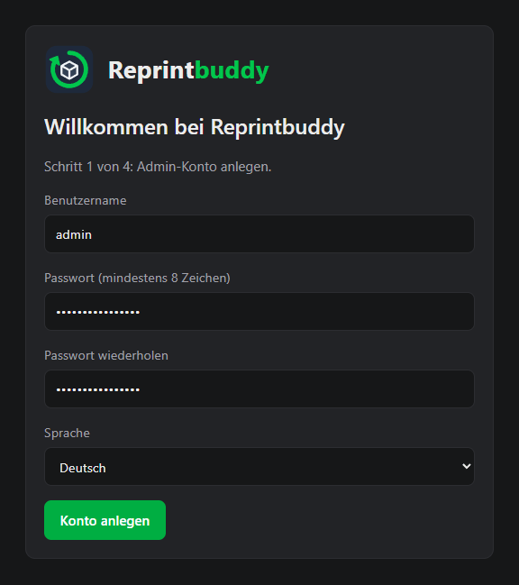
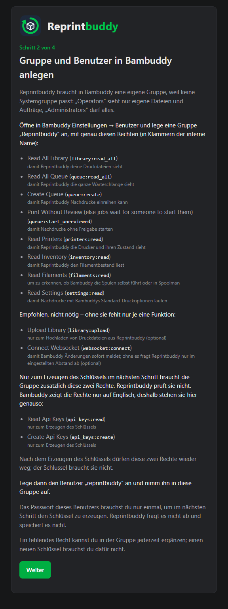
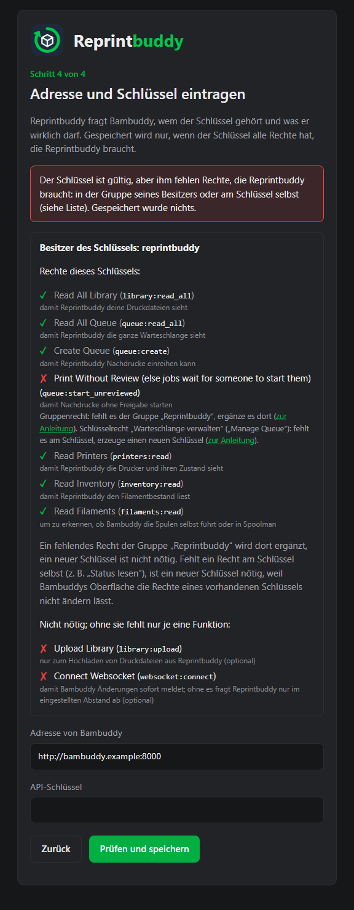

# Ersteinrichtung

Nach der Installation führt Reprintbuddy dich durch vier Schritte: das Admin-Konto und danach drei Seiten, die es mit Bambuddy verbinden. Solange der letzte Schritt nicht gelingt, bleibt die Oberfläche geschlossen.

!!! warning "Erledige es gleich"
    Solange es kein Admin-Konto gibt, ist die Einrichtungsseite für jeden in deinem Netz offen. Öffne sie, sobald das Installationsskript fertig ist. Öffne Reprintbuddy, solange es kein Konto gibt, über seine IP-Adresse, `localhost`, einen Namen ohne Punkt oder einen Namen, der auf `.local`, `.lan`, `.home`, `.internal`, `.localdomain` oder `.home.arpa` endet. Bei jedem anderen Namen (zum Beispiel einem Namen aus einer öffentlichen Domain, etwa einem VPN-DNS-Namen) zeigt die Seite **Adresse nicht erlaubt**; solche Namen gehen nach Schritt 1.

Du brauchst: ein laufendes Bambuddy und ein Bambuddy-Konto, das Gruppen, Benutzer und API-Schlüssel anlegen darf (einen Administrator). Das Installationsskript hat die Adresse genannt, normalerweise `http://<server-ip>:8080/setup`.

## Schritt 1: Admin-Konto

Gib einen **Benutzernamen**, ein **Passwort** (mindestens 8 Zeichen), **Passwort wiederholen** und die **Sprache** der Oberfläche ein (Englisch oder Deutsch). Drücke dann **Konto anlegen**. Das ist das einzige Konto, das Reprintbuddy hat. Die Sprache kannst du später unter *Einstellungen → Allgemein* ändern.

## Schritt 2: Gruppe und Benutzer in Bambuddy

Reprintbuddy braucht in Bambuddy eine eigene Gruppe, weil keine Systemgruppe passt: „Operators“ sieht nur eigene Dateien und Aufträge, „Administrators“ darf alles.

Öffne in Bambuddy *Einstellungen → Benutzer* und lege eine Gruppe `Reprintbuddy` an, mit genau den folgenden Rechten. Bambuddy zeigt seine Rechte nur auf Englisch, deshalb stehen sie hier wie dort; der interne Name steht in der zweiten Spalte.

| Beschriftung in Bambuddy | Interner Name | Wofür |
|---|---|---|
| Read All Library | `library:read_all` | damit Reprintbuddy deine Druckdateien sieht |
| Read All Queue | `queue:read_all` | damit Reprintbuddy die ganze Warteschlange sieht |
| Create Queue | `queue:create` | damit Reprintbuddy Nachdrucke einreihen kann |
| Print Without Review | `queue:start_unreviewed` | damit Nachdrucke ohne Freigabe starten |
| Read Printers | `printers:read` | damit Reprintbuddy die Drucker und ihren Zustand sieht |
| Read Inventory | `inventory:read` | damit Reprintbuddy den Filamentbestand liest |
| Read Filaments | `filaments:read` | um zu erkennen, ob Bambuddy die Spulen selbst führt oder in Spoolman |

Bambuddy hängt an die Beschriftung von *Print Without Review* einen Hinweis an („else jobs wait for someone to start them“); es ist dasselbe Recht.

Ein weiteres Recht ist empfohlen, aber nicht nötig:

| Beschriftung in Bambuddy | Interner Name | Wofür |
|---|---|---|
| Upload Library | `library:upload` | nur zum Hochladen von Druckdateien aus Reprintbuddy |

Ohne dieses Recht geht alles andere; nur das Hochladen nicht.

Außerdem empfohlen, aber nicht verlangt: das Gruppenrecht `websocket:connect`. Mit ihm meldet Bambuddy fertige Drucke sofort über den Live-Kanal; ohne es läuft alles über die regelmäßige Abfrage, und unter *Einstellungen → Bambuddy* steht bei der Karte **Live-Kanal** „Recht fehlt“. Siehe [Automatik](../use/automation.md).

Zum Erzeugen des Schlüssels im nächsten Schritt braucht die Gruppe zusätzlich diese drei Rechte. Reprintbuddy prüft sie nicht, und du kannst sie wieder entfernen, sobald der Schlüssel existiert:

| Beschriftung in Bambuddy | Interner Name | Wofür |
|---|---|---|
| Read Api Keys | `api_keys:read` | nur zum Erzeugen des Schlüssels |
| Create Api Keys | `api_keys:create` | nur zum Erzeugen des Schlüssels |
| Read Settings | `settings:read` | nur zum Erzeugen des Schlüssels; ohne es blendet Bambuddy das Menü Einstellungen aus |

Lege dann den Benutzer `reprintbuddy` an und nimm ihn in diese Gruppe auf. Sein Passwort brauchst du nur einmal, um den Schlüssel zu erzeugen. Reprintbuddy fragt es nicht ab und speichert es nicht. Drücke **Weiter**.

## Schritt 3: API-Schlüssel

Ein Schlüssel gehört immer dem Benutzer, der beim Erzeugen angemeldet ist. Mach es deshalb als der neue Benutzer:

1. Melde dich in Bambuddy ab und als `reprintbuddy` an.
2. Öffne *Einstellungen → API-Schlüssel → Schlüssel erstellen*.
3. Stelle den Schlüssel genau so ein:

    | Einstellung in Bambuddy | Wert |
    |---|---|
    | Name | Reprintbuddy |
    | Read Status | an |
    | Manage Queue | an |
    | Manage Library | an |
    | Control Printer | aus |
    | Manage Inventory | aus |
    | Manage Maintenance | aus |
    | Manage Archives | aus |
    | Manage Projects | aus |
    | Allow Cloud Access | aus |
    | Update Electricity Price | aus |
    | Send Notifications | aus |

    Mit *Read Status* („Status lesen“) kann Reprintbuddy den Zustand von Bambuddy lesen, mit *Manage Queue* („Warteschlange verwalten“) seine Aufträge einreihen. *Manage Library* ist nur zum Hochladen von Druckdateien und wirkt nur, soweit die Gruppe es erlaubt, also *Upload Library* und sonst nichts.
4. Kopiere den Schlüssel sofort. Bambuddy zeigt ihn nur einmal.
5. Melde dich in Bambuddy wieder ab.

!!! note "Die Rechte eines Schlüssels lassen sich nicht nachträglich ändern"
    Bambuddys Oberfläche kann Schlüssel nur erzeugen und löschen. Stimmt ein Recht am Schlüssel nicht, erzeuge nach dieser Anleitung einen neuen und trage ihn unter *Einstellungen → Bambuddy* ein.

Drücke **Weiter**.

## Schritt 4: Bambuddy anbinden

Trage die **Adresse von Bambuddy** (mit `http://` oder `https://` am Anfang und dem Port, zum Beispiel `http://<bambuddy-host>:8000`; ohne Benutzername, `?` und `#`) und den **API-Schlüssel** ein und drücke **Prüfen und speichern**.

Reprintbuddy fragt Bambuddy, wem der Schlüssel gehört und was er wirklich darf. Gespeichert wird nur, wenn der Schlüssel alle Rechte hat, die Reprintbuddy braucht. Fehlt eines, wird nichts gespeichert. Die Seite zeigt den Besitzer des Schlüssels und jedes nötige Recht mit Haken (vorhanden) oder Kreuz (fehlt), und neben jedem fehlenden Recht, wo du es behebst:

- **Gruppenrecht:** fehlt es der Gruppe `Reprintbuddy`, ergänze es dort in Bambuddy (*Einstellungen → Benutzer*). Ein neuer Schlüssel ist nicht nötig.
- **Schlüsselrecht:** fehlt es am Schlüssel (zum Beispiel *Status lesen* oder *Warteschlange verwalten*), erzeuge einen neuen Schlüssel wie in Schritt 3.

Unter der Liste, abgesetzt, zeigt die Seite, ob das wahlweise Recht zum Hochladen von Druckdateien da ist.

Gelingt die Prüfung, speichert Reprintbuddy Adresse und Schlüssel und übernimmt den Namen des Besitzers aus Bambuddys Antwort. Die Seite zeigt dann, was Bambuddy gemeldet hat: den Besitzer des Schlüssels und jedes Pflichtrecht mit einem Haken, dazu in einer Zeile, ob sich mit diesem Schlüssel Druckdateien hochladen lassen. Fehlt dem Schlüssel das Recht zum Hochladen, geht alles andere. Mit **Weiter** öffnest du die Oberfläche (die Seite, die du vor der Einrichtung öffnen wolltest, falls es eine gab).

Ein Schlüssel, der einem Administrator gehört, wird angenommen, mit der Warnung, dass er mehr darf, als Reprintbuddy braucht. Sicherer ist der Benutzer `reprintbuddy` aus Schritt 2.

Die beiden Felder sind so gekennzeichnet, dass Passwort-Manager sie nicht mit deinen eigenen Zugangsdaten füllen.

Misslingt die Prüfung, sagt die Seite warum:

| Meldung | Was zu tun ist |
|---|---|
| Bitte Adresse und API-Schlüssel ausfüllen. | Fülle beide Felder aus. |
| Der Schlüssel ist gültig, aber ihm fehlen Rechte, die Reprintbuddy braucht: in der Gruppe seines Besitzers oder am Schlüssel selbst (siehe Liste). Gespeichert wurde nichts. | Die Seite listet jedes Recht mit Haken oder Kreuz. Ein fehlendes Gruppenrecht ergänzt du in Bambuddy (*Einstellungen → Benutzer*); ein fehlendes Recht am Schlüssel braucht einen neuen Schlüssel. Dann prüfe erneut. |
| Bambuddy hat den API-Schlüssel nicht akzeptiert. | Kopiere den Schlüssel erneut oder erzeuge einen neuen. |
| Der API-Schlüssel hat nicht die Rechte, die Reprintbuddy braucht („Status lesen“, „Warteschlange verwalten“). | Erzeuge einen neuen Schlüssel wie in Schritt 3. |
| Bambuddy ist unter dieser Adresse nicht erreichbar. Prüfe die Adresse und ob Bambuddy läuft. | Prüfe Adresse und Port und ob Bambuddy läuft. |
| Die Adresse antwortet, sieht aber nicht nach Bambuddy aus. | Prüfe, ob Adresse und Port die von Bambuddy sind. |
| Die Adresse muss mit http:// oder https:// beginnen und einen gültigen Rechner und Port (1 bis 65535) haben. | Korrigiere die Adresse. |
| Die Adresse darf keine Leerzeichen oder Zeilenumbrüche enthalten. Bitte in einem Stück eingeben, zum Beispiel http://host:8000. | Gib die Adresse in einem Stück ein. |
| Der API-Schlüssel enthält unzulässige Zeichen (nur sichtbare ASCII-Zeichen, keine Leerzeichen oder Zeilenumbrüche). Bitte erneut kopieren. | Kopiere den Schlüssel erneut, ohne Leerzeichen und Zeilenumbrüche. |

Du kannst die Einrichtung jederzeit verlassen. Solange Bambuddy nicht angebunden ist, führt jede Seite nach der Anmeldung zurück zu Schritt 2.

## Fehlende Rechte später

Eine neue Version von Reprintbuddy kann ein Recht brauchen, das der Schlüssel vorher nicht haben musste. Reprintbuddy prüft den gespeicherten Schlüssel bei jedem Start, also auch nach einem Update. Fehlt ein Recht, öffnet sich über der Seite ein Hinweisfenster **Bambuddy-Recht fehlt**. Es listet die fehlenden Rechte und zu jedem das Gruppenrecht und das Schlüsselrecht, das es abdeckt. Welches von beiden fehlt, kann Reprintbuddy nicht erkennen.

- Drücke **Erneut prüfen**, nachdem du es behoben hast. Sind alle Rechte da, wird das Fenster grün; drücke **Weiter**.
- Drücke **Später**, um weiterzuarbeiten. Oben auf jeder Seite bleibt dann eine Warnzeile mit den fehlenden Rechten, **Erneut prüfen** und einem Link zu den Einstellungen, bis die Prüfung gelingt.

So behebst du es:

- **Ein Recht der Gruppe fehlt:** ergänze es in Bambuddy in der Gruppe `Reprintbuddy` (*Einstellungen → Benutzer*). Der Schlüssel bleibt.
- **Ein Recht des Schlüssels fehlt:** erzeuge einen neuen Schlüssel wie in Schritt 3, trage ihn unter *Einstellungen → Bambuddy* ein und drücke **Prüfen und speichern**; lösche dann den alten Schlüssel in Bambuddy.

Dieselbe Prüfung gibt es unter *Einstellungen → Bambuddy*, wo du Adresse und Schlüssel jederzeit ändern kannst. Das Recht zum Hochladen von Druckdateien ist nicht nötig: Fehlt es, öffnet sich kein Hinweisfenster, und nur der Knopf **Druckdatei hochladen** erklärt, was fehlt.

Ist Bambuddy beim Start nicht erreichbar, prüft Reprintbuddy bei einer späteren Seite erneut und zeigt bis dahin nichts an.
