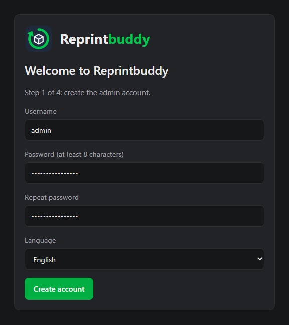
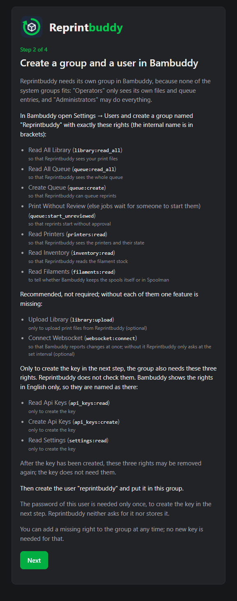
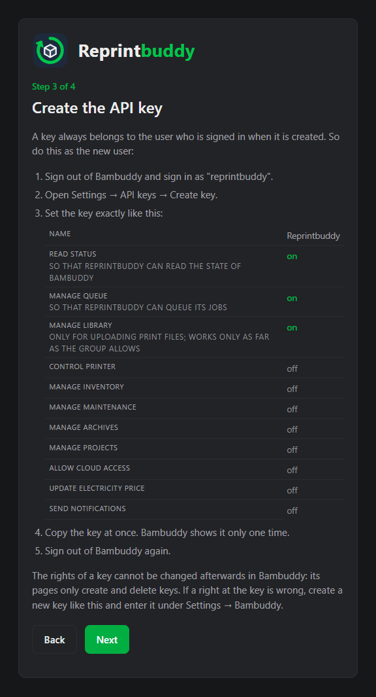
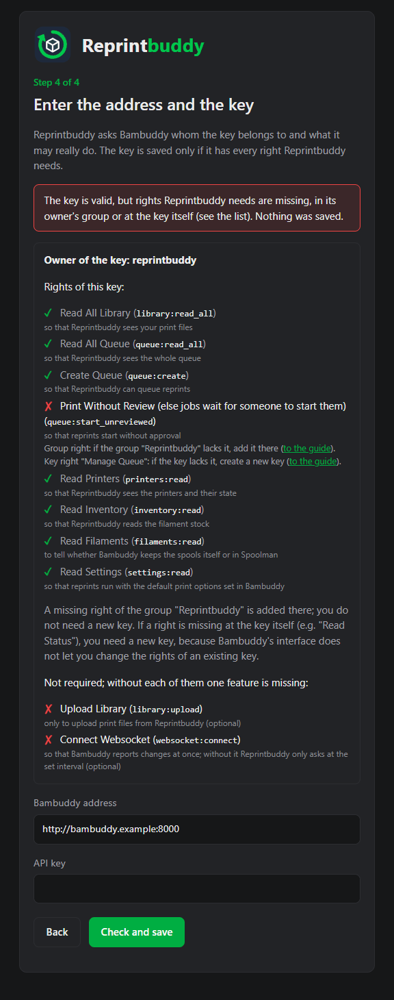

# First setup

After the installation, Reprintbuddy guides you through four steps: the admin account, then three pages that connect it to Bambuddy. Until the last step succeeds, the interface stays closed.

!!! warning "Do it right away"
    Until the admin account exists, the setup page is open to everyone in your network. Open it as soon as the installer has finished. While no account exists, open Reprintbuddy by its IP address, `localhost`, a name without a dot, or a name ending in `.local`, `.lan`, `.home`, `.internal`, `.localdomain` or `.home.arpa`. For any other name (for example a name from a public domain, such as a VPN DNS name) the page says **Address not allowed**; such names work after step 1.

You need: Bambuddy running, and a Bambuddy account that may create groups, users and API keys (an administrator). The installer printed the address, normally `http://<server-ip>:8080/setup`.

## Step 1: Admin account

Enter a **Username**, a **Password** (at least 8 characters), **Repeat password**, and the **Language** of the interface (English or German), then press **Create account**. This is the only account Reprintbuddy has. You can change the language later under *Settings → General*.

## Step 2: Group and user in Bambuddy

Reprintbuddy needs its own group in Bambuddy, because no system group fits: "Operators" only sees its own files and queue entries, and "Administrators" may do everything.

In Bambuddy open *Settings → Users* and create a group named `Reprintbuddy` with exactly the rights below. Bambuddy shows its rights in English only, so they are named here as there; the internal name is in the second column.

| Bambuddy label | Internal name | What it is for |
|---|---|---|
| Read All Library | `library:read_all` | so that Reprintbuddy sees your print files |
| Read All Queue | `queue:read_all` | so that Reprintbuddy sees the whole queue |
| Create Queue | `queue:create` | so that Reprintbuddy can queue reprints |
| Print Without Review | `queue:start_unreviewed` | so that reprints start without approval |
| Read Printers | `printers:read` | so that Reprintbuddy sees the printers and their state |
| Read Inventory | `inventory:read` | so that Reprintbuddy reads the filament stock |
| Read Filaments | `filaments:read` | to tell whether Bambuddy keeps the spools itself or in Spoolman |

Bambuddy adds a hint to the label of *Print Without Review* ("else jobs wait for someone to start them"); it is the same right.

Two more rights are recommended but not required:

| Bambuddy label | Internal name | What it is for |
|---|---|---|
| Upload Library | `library:upload` | only to upload print files from Reprintbuddy |
| Connect Websocket | `websocket:connect` | so that Bambuddy reports changes at once; without it Reprintbuddy only asks at the set interval |

Without *Upload Library* everything else works; only uploading is not possible. Without *Connect Websocket* everything runs through the regular query, and the card **Live channel** under *Settings → Bambuddy* says "Right missing" (see [Automation](../use/automation.md)). At the key, *Read Status* is enough for the live channel; there is nothing more to set.

To create the key in the next step, the group also needs these three rights. Reprintbuddy does not check them, and you can remove them again once the key exists:

| Bambuddy label | Internal name | What it is for |
|---|---|---|
| Read Api Keys | `api_keys:read` | only to create the key |
| Create Api Keys | `api_keys:create` | only to create the key |
| Read Settings | `settings:read` | only to create the key; without it Bambuddy hides the Settings menu |

Then create the user `reprintbuddy` and put it in this group. Its password is needed only once, to create the key. Reprintbuddy neither asks for it nor stores it. Press **Next**.

## Step 3: API key

A key always belongs to the user who is signed in when it is created. So do this as the new user:

1. Sign out of Bambuddy and sign in as `reprintbuddy`.
2. Open *Settings → API keys → Create key*.
3. Set the key exactly like this:

    | Setting in Bambuddy | Value |
    |---|---|
    | Name | Reprintbuddy |
    | Read Status | on |
    | Manage Queue | on |
    | Manage Library | on |
    | Control Printer | off |
    | Manage Inventory | off |
    | Manage Maintenance | off |
    | Manage Archives | off |
    | Manage Projects | off |
    | Allow Cloud Access | off |
    | Update Electricity Price | off |
    | Send Notifications | off |

    *Read Status* lets Reprintbuddy read the state of Bambuddy, *Manage Queue* lets it queue its jobs. *Manage Library* is only for uploading print files and works only as far as the group allows, which is *Upload Library* and nothing else.
4. Copy the key at once. Bambuddy shows it only one time.
5. Sign out of Bambuddy again.

!!! note "A key's rights cannot be changed later"
    Bambuddy's pages only create and delete keys. If a right at the key is wrong, create a new key like this and enter it under *Settings → Bambuddy*.

Press **Next**.

## Step 4: Connect Bambuddy

Enter the **Bambuddy address** (starting with `http://` or `https://`, with the port, for example `http://<bambuddy-host>:8000`; no user name, `?` or `#` in it) and the **API key**, then press **Check and save**.

Reprintbuddy asks Bambuddy whom the key belongs to and what it may really do. The key is saved only if it has every right Reprintbuddy needs. If one is missing, nothing is saved. The page shows the owner of the key and each required right with a check mark (granted) or a cross (missing), and next to each missing right where to fix it:

- **Group right:** if the group `Reprintbuddy` lacks it, add it there in Bambuddy (*Settings → Users*). You do not need a new key.
- **Key right:** if the key lacks it (for example *Read Status* or *Manage Queue*), create a new key as in step 3.

Below the list, apart from it, the page shows the two recommended rights (uploading print files, the live channel), each with a check mark or a cross.

When the check succeeds, Reprintbuddy saves the address and the key, takes the owner's name from Bambuddy's answer and then leads you on to a page of its own. That page shows, once, what Bambuddy reported: the owner of the key and every required right with a check mark, and in one line each whether print files can be uploaded with this key and whether Bambuddy can report changes at once. If the key lacks one of these two rights, everything else works. A check that fails lists the two recommended rights apart from the required ones, also with a check mark or a cross; they never decide whether the key is saved, and a missing one never opens the notice after an update. Press **Continue** to open the interface (the page you wanted to open before the setup, if there was one).

A key that belongs to an administrator is accepted, with the warning that it may do more than Reprintbuddy needs. It is safer to use the user `reprintbuddy` from step 2. With such a key, **Continue** leads to *Settings → Bambuddy* instead of the page you wanted to open. You can reload the result page without sending anything again: it does not show the result a second time, but leads you on to the page you wanted to open before the setup, or to *Settings → Bambuddy* if there was none. The same result, in the same form, appears under *Settings → Bambuddy* after every successful check there.

The two fields are marked so that password managers do not fill in your own credentials.

If the check fails, the page says why:

| Message | What to do |
|---|---|
| Please fill in the address and the API key. | Fill in both fields. |
| The key is valid, but rights Reprintbuddy needs are missing, in its owner's group or at the key itself (see the list). Nothing was saved. | The page lists each right with a check mark or a cross. Add a missing group right in Bambuddy (*Settings → Users*); a missing right at the key needs a new key. Then check again. |
| The API key was not accepted by Bambuddy. | Copy the key again, or create a new one. |
| The API key does not have the rights Reprintbuddy needs ("Read Status", "Manage Queue"). | Create a new key as in step 3. |
| Could not reach Bambuddy at this address. Check the address and that Bambuddy is running. | Check the address, the port and that Bambuddy runs. |
| The address answered, but it does not look like Bambuddy. | Check that the address and port are those of Bambuddy. |
| The address must start with http:// or https:// and have a valid host and port (1 to 65535). | Correct the address. |
| The address must not contain blanks or line breaks. Enter it in one piece, for example http://host:8000. | Enter the address in one piece. |
| The API key contains characters that are not allowed (only visible ASCII characters, no spaces or line breaks). Please copy it again. | Copy the key again, without spaces or line breaks. |

You can leave the setup at any time. As long as Bambuddy is not connected, every page after signing in leads back to step 2.

## Missing rights later

A new version of Reprintbuddy may need a right that the key did not have before. Reprintbuddy checks the stored key at every start, so also after an update. If a right is missing, a dialog **Bambuddy right missing** opens over the page. It lists the missing rights and, for each, the group right and the key right that covers it. Reprintbuddy cannot tell which of the two is missing.

- Press **Check again** after you fixed it. When every right is there, the dialog turns green; press **Continue**.
- Press **Later** to carry on. A warning line stays at the top of every page, with the missing rights, **Check again** and a link to the settings, until the check succeeds.

To fix it:

- **A right of the group is missing:** add it to the group `Reprintbuddy` in Bambuddy (*Settings → Users*). The key stays.
- **A right of the key is missing:** create a new key as in step 3, enter it under *Settings → Bambuddy* and press **Check and save**, then delete the old key in Bambuddy.

The same check is on *Settings → Bambuddy*, where you can change the address and the key at any time. The right to upload print files is not required: if it is missing, no dialog opens, and only the **Upload print file** button explains what is missing.

If Bambuddy cannot be reached at the start, Reprintbuddy checks again on a later page and shows nothing until then.
