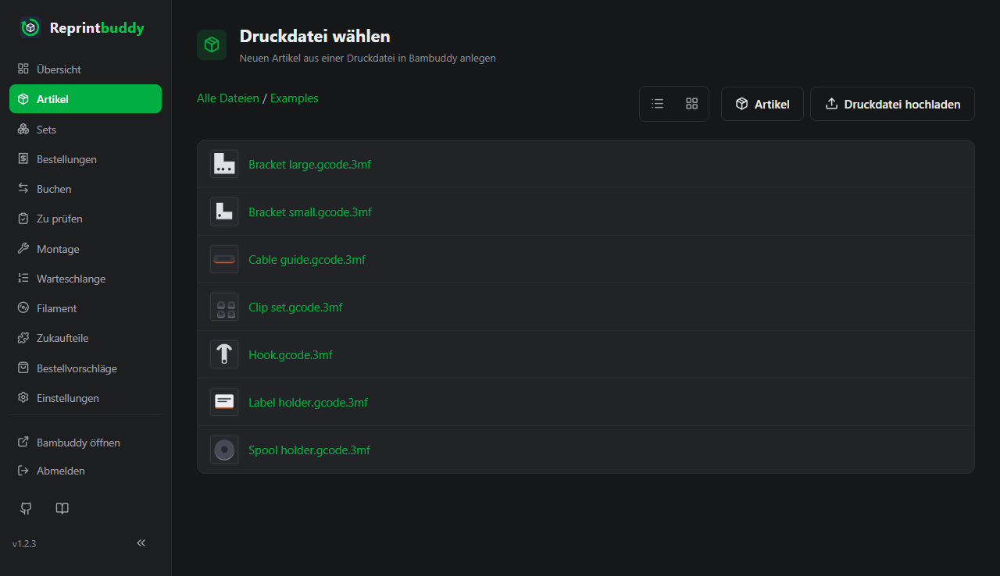
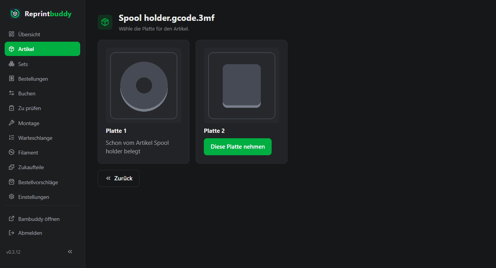
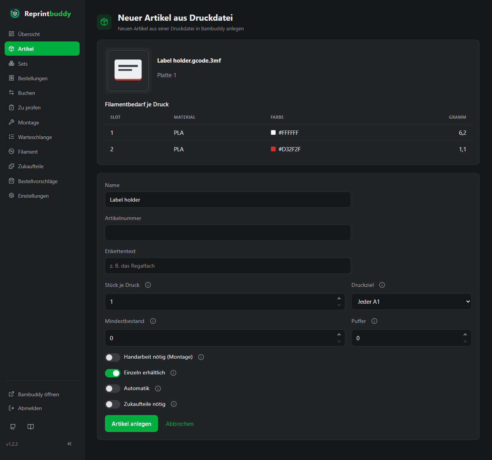
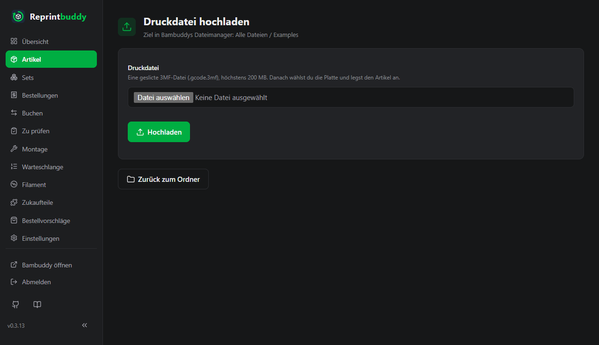
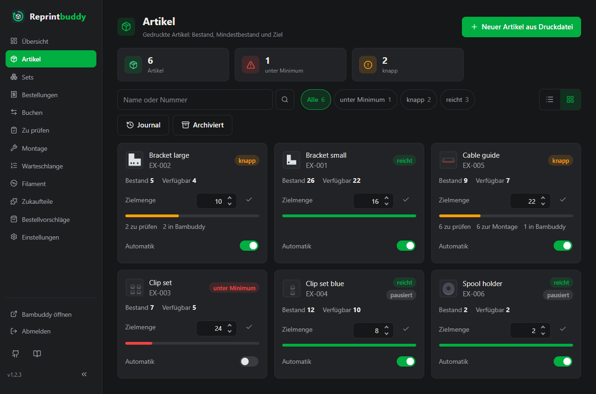
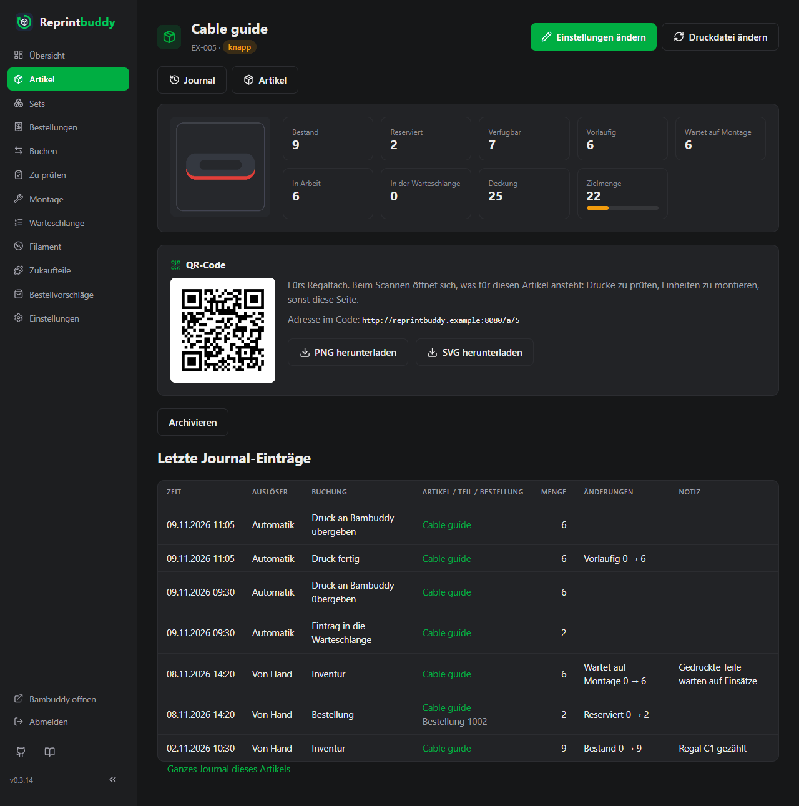

# Artikel

Ein Artikel ist etwas, das du auf Lager hast und verkaufst, zum Beispiel „Example article A“. Jeder Artikel entsteht aus einer Platte einer geslicten Druckdatei in Bambuddy. Reprintbuddy führt seine Zahlen (Bestand, Reserviert, Verfügbar und mehr), seinen Mindestbestand und Puffer sowie die Einstellungen, die die [Automatik](automation.md) zum Nachdrucken braucht.

## Artikel aus einer Druckdatei anlegen

Du brauchst eine geslicte Druckdatei in Bambuddys Dateimanager. Ungeslicte Dateien können kein Artikel werden: erst slicen und die geslicte Datei (`.3mf` oder `.gcode.3mf`) in Bambuddy ablegen, oder [aus Reprintbuddy hochladen](#druckdatei-hochladen).

!!! warning "Druckdateien direkt in Bambuddys Dateimanager verwenden"
    Reprintbuddy arbeitet zuverlässig nur mit Druckdateien, die direkt in Bambuddys Dateimanager liegen. Für Dateien in einem Ordner, der von außen in Bambuddy eingebunden ist (externer Ordner), führt Bambuddy keine Prüfsumme und frischt beim erneuten Einlesen des Ordners nur das Änderungsdatum auf, nicht die Platten und das Filament. Eine neue Fassung so einer Datei bliebe unbemerkt. Du kannst so eine Datei trotzdem wählen; die Seiten der Auswahl zeigen dann eine Warnung. Siehe [Grenzen](../help/limits.md).

1. Öffne *Artikel* und klicke auf **Neuer Artikel aus Druckdatei**.
2. Durchsuche unter **Druckdatei wählen** Bambuddys Ordner. Der Pfad über der Liste (er beginnt mit **Alle Dateien**) führt dich wieder nach oben. Du kannst zwischen **Kacheln** und **Liste** umschalten. Gezeigt werden nur geslicte Dateien; ein Hinweis zählt die ausgeblendeten ungeslicten Dateien des Ordners.
3. Klicke auf eine Datei. Klicke unter **Wähle die Platte für den Artikel.** bei der gewünschten Platte auf **Diese Platte nehmen**. Eine Platte, die schon zu einem Artikel gehört, sagt das und lässt sich nicht zweimal vergeben.
4. Prüfe Vorschaubild, Dateiname, Platte und die Tabelle **Filamentbedarf je Druck** (Slot, Material, Farbe, Gramm), fülle dann das Formular aus (siehe Tabelle unten) und klicke auf **Artikel anlegen**.
5. Als Nächstes öffnet sich die Filamentzuordnung, siehe [Filament](filament.md). Kreuze je Slot die Spulensorten an und speichere, oder klicke auf **Später**, um ohne Zuordnung weiterzumachen; der Artikel zeigt dann **Filament nicht zugeordnet**, bis du es nachholst.

Anlegen ist keine Buchung: ein neuer Artikel hat den Bestand 0. Stücke, die du schon hast, trägst du unter *Buchen* mit einer Inventur-Buchung ein.

Eine Platte gehört zu höchstens einem aktiven Artikel, und ein Artikel hat genau eine Platte.

## Einstellungen eines Artikels

Dasselbe Formular öffnet sich auf der Artikelseite unter **Einstellungen ändern**. Ein Info-Knopf neben vielen Feldern erklärt sie.

| Feld | Bedeutung | Vorgabe |
|---|---|---|
| **Name** | Freier Text, bis 200 Zeichen. | Der Dateiname ohne Endung (`.gcode.3mf` oder `.3mf`) |
| **Artikelnummer** | Freiwillig, bis 64 Zeichen. Muss unter allen Artikeln, Sets und Varianten eindeutig sein; Groß- und Kleinschreibung zählen nicht (EX-1 und ex-1 sind dieselbe Nummer). Gespeichert wird sie, wie du sie schreibst. | leer |
| **Etikettentext** | Freiwilliger Text für das [Etikett](labels.md), zum Beispiel das Regalfach (bis 60 Zeichen). | leer |
| **Stück je Druck** | Wie viele Einheiten ein Druck dieser Platte liefert, 1 bis 1000. Danach rechnet Reprintbuddy aus, wie viele Drucke ein Nachdruck braucht. | 1 |
| **Druckziel** | Wohin Bambuddy den Druck schickt: **Jeder** und ein Druckermodell (jeder freie Drucker dieses Modells druckt), ein bestimmter Drucker oder **Kein Druckziel**. Ein Drucker im Wartungsmodus wird nicht neu angeboten. | Das Druckermodell, für das die Datei geslict ist |
| **Mindestbestand** | Nachgedruckt wird, wenn die Deckung unter diese Zahl fällt (siehe unten). 0 bis 1.000.000. | 0 |
| **Puffer** | Ein Nachdruck füllt bis Mindestbestand plus Puffer auf. 0 bis 1.000.000. | 0 |
| **Handarbeit nötig (Montage)** | Gute Einheiten warten erst auf die Montage und zählen erst nach **Montiert buchen** zum Bestand; dabei werden die Zukaufteile abgezogen. Siehe [Zu prüfen und Montage](inspection.md). | aus |
| **Einzeln erhältlich** | Aus: Der Artikel ist ein Bauteil. Er steht nicht im Bestellformular und in keinem Set, nur in [Artikeln aus Teilen](assembled.md); Nachdruck, Prüfung und Bestand laufen wie bei jedem Artikel. | an |
| **Automatik** | Ob die Automatik Nachdrucke dieses Artikels plant. Sie braucht ein Druckziel und wirkt nur, wenn auch der Hauptschalter an ist. | aus |
| **Zukaufteile nötig** | Erscheint, sobald du Zukaufteile angelegt hast. Wähle je Teil die Menge je fertiger Einheit. | keine |

Die **Zielmenge** ist Mindestbestand plus Puffer. Mindestbestand 0 und Puffer 0 heißt: Reprintbuddy druckt diesen Artikel nie von selbst nach.

## Druckdatei hochladen

Statt eine Datei zu wählen, die schon in Bambuddy liegt, kannst du eine hochladen. Klicke unter **Druckdatei wählen** auf **Druckdatei hochladen**. Die Datei kommt in den Ordner, der gerade geöffnet ist (die oberste Ebene zählt auch). Für einen anderen Ordner gehst du vorher dorthin. Ordner legt Reprintbuddy nicht an; das machst du in Bambuddy.

1. Klicke auf **Druckdatei hochladen**, wähle die Datei und klicke auf **Hochladen**.
2. Reprintbuddy prüft die Datei und schickt sie dann an Bambuddy. Danach geht es weiter wie nach der Wahl einer vorhandenen Datei: Platte wählen und Artikel anlegen. Der Artikel entsteht erst mit **Artikel anlegen**; brichst du vorher ab, bleibt die Datei in Bambuddy und lässt sich später wie jede andere wählen.

Das prüft Reprintbuddy, bevor es etwas sendet (eine hochgeladene Datei lässt sich aus Reprintbuddy nicht wieder löschen):

- Es ist eine geslicte 3MF-Datei (`.3mf` oder `.gcode.3mf`): eine Zip-Datei, die G-Code enthält. Reprintbuddy liest nur ihr Inhaltsverzeichnis und entpackt nichts.
- Sie ist höchstens 200 MB groß. Diese Grenze ist fest.
- Der Name entspricht Bambuddys Regeln: kein `< > : " / \ | ? *`, keine Steuerzeichen, kein Leerzeichen oder Punkt am Ende, höchstens 255 Byte.
- Im Ordner liegt keine Datei gleichen Namens (Groß- und Kleinschreibung zählt nicht). Dann wird nichts hochgeladen, und die Seite bietet **Artikel aus der vorhandenen Datei anlegen** an. Benenne deine Datei um oder nimm die vorhandene. Überschrieben oder automatisch umbenannt wird nie.

Hat Bambuddy denselben Inhalt schon unter anderem Namen, wird die Datei trotzdem hochgeladen, und ein Hinweis nennt die vorhandene Datei.

Geht Bambuddys Antwort verloren, schickt Reprintbuddy die Datei nicht noch einmal. Es sucht die Datei im Ordner: findet es sie, geht es weiter; sonst steht ein Fehler da, der dich bittet, in Bambuddys Dateimanager nachzusehen, bevor du es erneut versuchst.

In einen externen Ordner kannst du nicht hochladen. Dort fehlt der Knopf, und ein Versuch wird abgelehnt, bevor etwas gesendet wird.

!!! note "Hochladen braucht zwei freiwillige Rechte"
    Hochladen braucht **Upload Library** (`library:upload`) in der Bambuddy-Gruppe `Reprintbuddy` und **Manage Library** am API-Schlüssel. Beides ist freiwillig. Fehlt eines, zeigt die Seite hinter dem Knopf statt des Formulars einen Hinweis mit beiden Rechten, denn Reprintbuddy kann nicht erkennen, welches von beiden fehlt. Ein Recht der Gruppe ergänzt du in Bambuddy, der Schlüssel bleibt. Bambuddy kann die Rechte eines vorhandenen Schlüssels nicht ändern; fehlt das Recht am Schlüssel, brauchst du einen neuen Schlüssel, den du unter *Einstellungen → Bambuddy* einträgst, siehe [Ersteinrichtung](../start/setup.md). Alles andere in Reprintbuddy geht ohne diese Rechte.

## Die Artikelliste

*Artikel* listet alle aktiven Artikel.

- Suche nach Name oder Artikelnummer, filtere mit den Knöpfen nach Status (sie zeigen die Anzahl) und schalte zwischen **Kacheln** und **Liste** um. Ohne deine Wahl zeigen kleine Bildschirme Kacheln und breite die Liste; der Browser merkt sich deine Wahl.
- Jede Zeile zeigt Name und Artikelnummer, den Status, **Bestand**, **Verfügbar**, die **Zielmenge** mit einem Balken, der sich zu ihr füllt, und den Schalter **Automatik**. Der Hinweis „N in Bambuddy“ zählt die offenen Drucke des Artikels in Bambuddy. Symbole am Zeilenende öffnen **Einstellungen ändern**, das **Journal** des Artikels und **Archivieren**.
- Die Knöpfe **Journal** und **Archiviert** führen zum ganzen Journal und ins Archiv.

Die Status-Plakette folgt der ersten Zeile, die zutrifft:

| Plakette | Wann | Farbe |
|---|---|---|
| **überbucht** | Verfügbar ist unter 0 | rot |
| **unter Minimum** | Verfügbar und Deckung liegen beide unter dem Mindestbestand | rot |
| **knapp** | Verfügbar liegt unter dem Mindestbestand, die Deckung aber nicht: ein Nachdruck ist schon geplant, im Druck oder wartet auf Prüfung | gelb |
| **reicht** | Verfügbar ist mindestens der Mindestbestand | grün |
| **pausiert** | Die Automatik ist für diesen Artikel pausiert (zusätzlich gezeigt) | grau |

Die Zielmenge setzt du gleich in der Liste oder auf einer Kachel. Tippe eine Zahl und drücke Enter oder klicke auf den Haken. Die Pfeile des Feldes ändern nur die Zahl; gespeichert wird erst mit Enter oder dem Haken. Reprintbuddy setzt den Mindestbestand auf die neue Zielmenge minus Puffer, der Puffer bleibt. Eine Zielmenge unter dem Puffer wird abgelehnt. Genauso geht der Schalter **Automatik** eines Artikels; zum Einschalten braucht der Artikel ein Druckziel.

## Die Artikelseite

Ein Klick auf einen Artikel öffnet seine Seite. Oben stehen die Zahlen:

| Zahl | Bedeutung |
|---|---|
| **Bestand** | Geprüfte, verkaufsfertige Einheiten, im Regal oder auf dem Weg dorthin. Reprintbuddy unterscheidet das nicht. |
| **Reserviert** | Einheiten, die eine offene Bestellung bestellt hat und die noch nicht versandt sind. |
| **Verfügbar** | Bestand minus Reserviert. Nur das kann verkauft werden. Der Wert kann unter 0 fallen (mehr bestellt als da) und wird dann rot gezeigt. |
| **Vorläufig** | Gedruckt, aber noch nicht geprüft. Sie warten in der Liste **Zu prüfen**. |
| **Wartet auf Montage** | Gut geprüft, aber der Artikel braucht noch Handarbeit und Zukaufteile. |
| **In Arbeit** | Einheiten in Drucken, die Reprintbuddy an Bambuddy übergeben hat und die dort eingereiht sind oder drucken. |
| **In der Warteschlange** | Einheiten der Einträge in [Reprintbuddys Warteschlange](queue.md), zurückgehaltene eingeschlossen (Drucke mal Stück je Druck). |
| **Deckung** | Verfügbar + In der Warteschlange + In Arbeit + Vorläufig + Wartet auf Montage. Sie zählt alles, was da oder schon unterwegs ist. |
| **Zielmenge** | Mindestbestand plus Puffer. |

Die Automatik vergleicht die Deckung mit dem Mindestbestand, siehe [Automatik](automation.md). Unter den Zahlen stehen unter anderem ein Pausenhinweis, falls es einen gibt, die Warteschlangen-Einträge und offenen Drucke des Artikels, der QR-Code und das [Etikett](labels.md), die Einstellungen, die Filamenttabelle mit der nachgekauften Spulensorte je Slot (**Filament nicht zugeordnet**, solange nichts angekreuzt ist; **Spulensorten ankreuzen** führt zur Zuordnung), die Zukaufteile, **Archivieren** und die letzten Journal-Einträge.

## Druckdatei ändern

Mit **Druckdatei ändern** auf der Artikelseite wählst du eine andere Datei oder lädst eine neue hoch und wählst dann eine Platte, genau wie beim Anlegen. Bestand, Mindestbestand und alle anderen Einstellungen bleiben. Die alte Datei bleibt in Bambuddy.

- Ein Filament-Slot behält seine Filamentgruppe, wenn er in der neuen Datei dasselbe Material und dieselbe Farbe hat. Für geänderte Slots nennt ein Hinweis sie, und die Filamentseite öffnet sich, damit du sie neu ankreuzt (**Später** überspringt das).
- Einträge in Reprintbuddys Warteschlange, die noch nicht an Bambuddy übergeben sind, drucken danach mit der neuen Datei. Was schon in Bambuddy liegt, bleibt, wie es ist.
- Die Platte, die der Artikel selbst belegt, kannst du wieder wählen; die Platte eines anderen Artikels nicht.

## Wenn sich die Druckdatei ändert oder verschwindet

Bei jeder regelmäßigen Abfrage (siehe [Automatik](automation.md)) vergleicht Reprintbuddy die Datei jedes aktiven Artikels mit Bambuddy. Ist die Datei weg oder haben sich Prüfsumme oder Name geändert, pausiert die Automatik für diesen Artikel. Die Artikelseite, die Übersicht und die [Warteschlange](queue.md) zeigen einen Hinweis mit dem Weg weiter:

- Datei geändert: **Druckdatei bestätigen** übernimmt die Datei, wie sie jetzt ist. Reprintbuddy liest Datei, Platte, Filamentbedarf und Vorschaubild neu; Slots mit geändertem Material oder geänderter Farbe verlieren ihre Filamentgruppe, und du kreuzt sie neu an. Oder wähle mit **Druckdatei neu wählen** eine andere Datei.
- Datei fehlt: **Druckdatei neu wählen**.

Eine Pause wegen der Datei lässt sich nicht mit **Pause aufheben** beenden; sie endet, wenn du die Datei bestätigst oder neu wählst. Lässt sich Bambuddy nicht abfragen, wird nichts geändert. Wegen dieser Prüfung sollen Druckdateien direkt in Bambuddys Dateimanager liegen, siehe den Hinweis ganz oben.

## Archivieren statt Löschen

Artikel werden nie gelöscht, nur archiviert. Ein archivierter Artikel verschwindet aus Listen, Auswahlen, Automatik, Warteschlange und Bestellvorschlägen. Journal und vergangene Bestellungen bleiben, wie sie waren, der Bestand bleibt gespeichert, und der Artikel gibt seine Datei und Platte frei, damit ein neuer Artikel sie belegen kann.

Nimm **Archivieren** auf der Artikelseite oder das Archiv-Symbol in der Liste. Es geht nur, wenn nichts mehr läuft:

- der Artikel steckt in keiner offenen Bestellung,
- er hat keine vorläufigen Einheiten und keine, die auf Montage warten,
- er hat keinen Eintrag in Reprintbuddys Warteschlange (erst entfernen),
- kein Druck von ihm ist in Bambuddy noch offen,
- er steckt in keinem aktiven [Set](inspection.md#sets) (die Meldung nennt die Sets).

Sonst sagt Reprintbuddy, was davon im Weg steht. Ein archivierter Artikel lässt sich nicht bearbeiten.

Archivierte Artikel siehst du mit **Archiviert**; **Aktive anzeigen** geht zurück. Mit **Wiederherstellen** holst du einen Artikel jederzeit zurück. Gehört seine Platte inzwischen einem anderen Artikel, wird das Wiederherstellen abgelehnt, und du kannst **Andere Datei wählen** und dann **Mit dieser Platte wiederherstellen** nehmen. Ein Artikel, der ein archiviertes Zukaufteil verwendet, lässt sich erst wiederherstellen, wenn dieses Teil wiederhergestellt ist.
