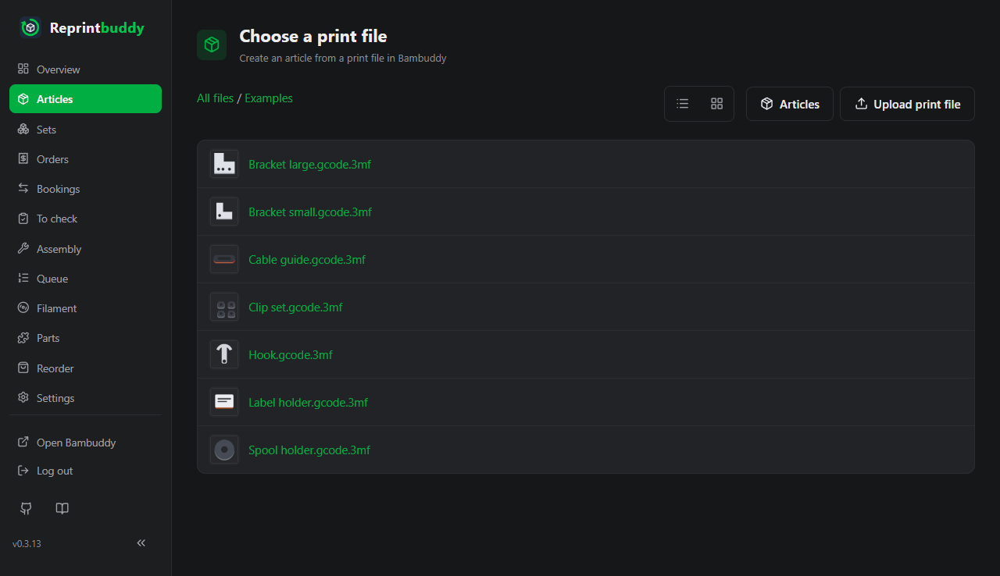
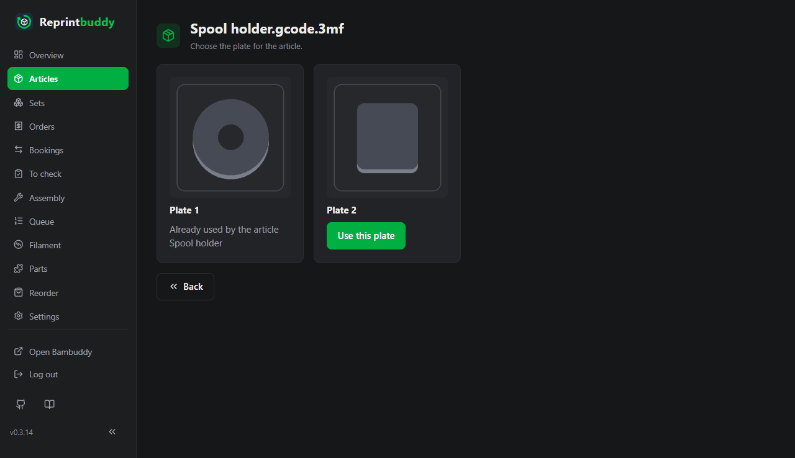
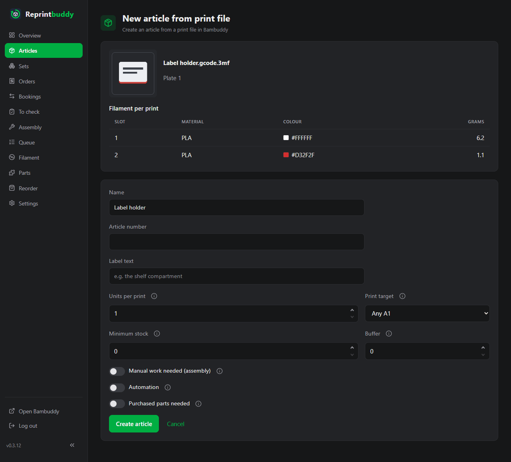
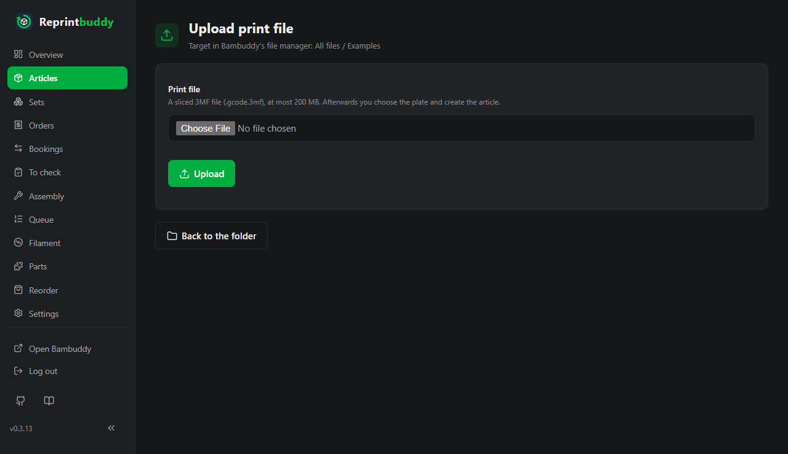
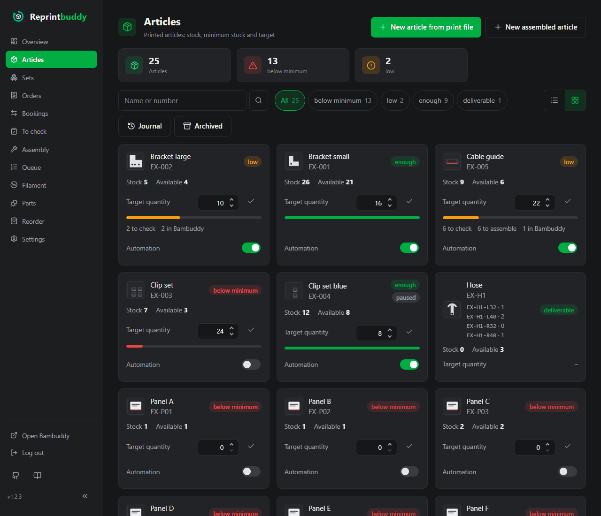
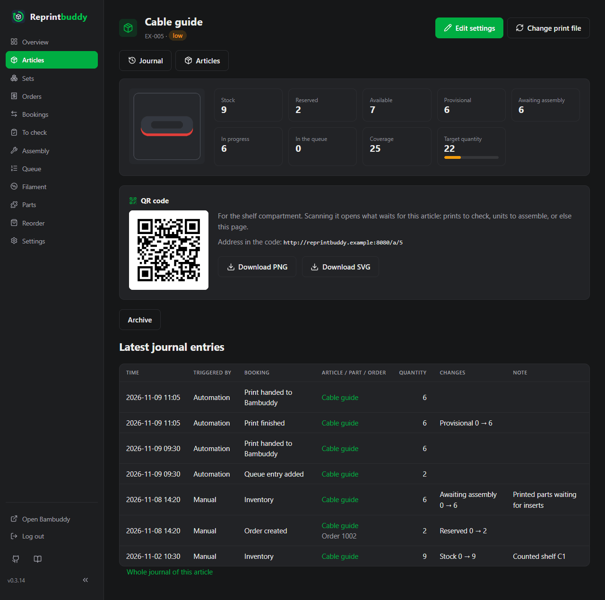

# Articles

An article is something you stock and sell, for example "Example article A". Each article is made from one plate of one sliced print file in Bambuddy; a product made of several printed parts is an [assembled article](assembled.md). Reprintbuddy keeps its numbers (stock, reserved, available and more), its minimum stock and buffer, and the settings the [automation](automation.md) needs to print it again.

## Create an article from a print file

You need a sliced print file in Bambuddy's file manager. Unsliced files cannot become an article: slice them first and put the sliced file (`.3mf` or `.gcode.3mf`) into Bambuddy, or [upload it from Reprintbuddy](#upload-a-print-file).

!!! warning "Use print files that lie directly in Bambuddy's file manager"
    Reprintbuddy works reliably only with print files that lie directly in Bambuddy's file manager. For files in a folder that is linked into Bambuddy from outside (an external folder), Bambuddy keeps no checksum and, when it reads the folder again, refreshes only the modification date, not the plates and the filament. A new version of such a file would go unnoticed. You can still choose such a file; the pages of the choice then show a warning. See [Limits](../help/limits.md).

1. Open *Articles* and click **New article from print file**.
2. On **Choose a print file**, browse Bambuddy's folders. The path above the list (starting with **All files**) takes you back up. Switch between **Tiles** and **List** as you like. Only sliced files are shown; a note counts the hidden unsliced files of the folder.
3. Click a file. On **Choose the plate for the article.** click **Use this plate** under the plate you want. A plate that already belongs to an article says so and cannot be taken twice.
4. Check the preview, the file name, the plate and the table **Filament per print** (slot, material, colour, grams), then fill in the form (see the table below) and click **Create article**.
5. The filament assignment opens next, see [Filament](filament.md). Tick the spool sorts of each slot and save, or click **Later** to go on without; the article then shows **Filament not assigned** until you do.

Creating an article is not a booking: a new article has stock 0. Enter units you already have under *Bookings* with an inventory booking.

One plate belongs to at most one active article, and an article has exactly one plate.

## Settings of an article

The same form opens under **Edit settings** on the article page. An info button next to many fields explains them.

| Field | Meaning | Default |
|---|---|---|
| **Name** | Free text, up to 200 characters. | The file name without its ending (`.gcode.3mf` or `.3mf`) |
| **Article number** | Optional, up to 64 characters. Must be unique among all articles and sets. | empty |
| **Label text** | Optional text for the [label](labels.md), for example the shelf compartment (up to 60 characters). | empty |
| **Units per print** | How many units one print of this plate yields, 1 to 1000. Reprintbuddy uses it to work out how many prints a reprint needs. | 1 |
| **Print target** | Where Bambuddy sends the print: **Any** followed by a printer model (any free printer of that model prints it), one particular printer, or **No print target**. A printer in maintenance mode is not offered anew. | The printer model the file was sliced for |
| **Minimum stock** | A reprint is due when the coverage falls below this number (see below). 0 to 1,000,000. | 0 |
| **Buffer** | A reprint fills up to minimum stock plus buffer. 0 to 1,000,000. | 0 |
| **Manual work needed (assembly)** | Good units first wait for assembly and count as stock only after **Book assembled**; the purchased parts are deducted then. See [To check and assembly](inspection.md). | off |
| **Sold alone** | Off: the article is a part only. It is not offered in the order form or in any set, only in [assembled articles](assembled.md); reprints, checks and stock work as for any article. | on |
| **Automation** | Whether the automation plans reprints of this article. It needs a print target and works only while the main switch is on too. | off |
| **Purchased parts needed** | Appears when you have created parts. Pick each part and the quantity per finished unit. | none |

The **target quantity** is minimum stock plus buffer. Minimum stock 0 and buffer 0 means: Reprintbuddy never reprints this article by itself.

## Upload a print file

Instead of choosing a file that is already in Bambuddy, you can upload one. On **Choose a print file**, click **Upload print file**. The file goes into the folder that is open (the top level counts too). To use another folder, go there first. Reprintbuddy does not create folders; do that in Bambuddy.

1. Click **Upload print file**, choose the file and click **Upload**.
2. Reprintbuddy checks the file, then sends it to Bambuddy. Afterwards you go on as after choosing an existing file: choose the plate and create the article. The article exists only after **Create article**; if you stop earlier, the file stays in Bambuddy and you can choose it later like any other.

What Reprintbuddy checks before it sends anything (a file once uploaded cannot be deleted again from Reprintbuddy):

- It is a sliced 3MF file (`.3mf` or `.gcode.3mf`): a zip that contains G-code. Reprintbuddy reads only its table of contents and unpacks nothing.
- It is at most 200 MB. This limit is fixed.
- The name follows Bambuddy's rules: no `< > : " / \ | ? *`, no control characters, no space or dot at the end, at most 255 bytes.
- No file of the same name is in the folder (upper and lower case do not matter). Then nothing is uploaded and the page offers **Create the article from the existing file**. Rename your file or use the existing one. A file is never overwritten or renamed automatically.

If Bambuddy already holds the same content under another name, the file is uploaded anyway and a notice names the existing file.

If the answer from Bambuddy gets lost, Reprintbuddy does not send the file again. It looks for the file in the folder: if it finds it, you go on; if not, an error tells you to look into Bambuddy's file manager before you try again.

You cannot upload into an external folder. The button is missing there, and an attempt is refused before anything is sent.

!!! note "Uploading needs two optional rights"
    Uploading needs **Upload Library** (`library:upload`) in the Bambuddy group `Reprintbuddy` and **Manage Library** at the API key. Both are optional. If one is missing, the page behind the button shows a hint with both rights instead of the form, because Reprintbuddy cannot tell which of the two is missing. A right of the group is added in Bambuddy and the key stays. Bambuddy cannot change the rights of an existing key, so a missing key right needs a new key, entered under *Settings → Bambuddy*; see [First setup](../start/setup.md). Everything else in Reprintbuddy works without these rights.

## The article list

*Articles* lists all active articles.

- Search by name or article number, filter by status with the buttons (they show the counts), and switch between **Tiles** and **List**. Without your choice, small screens show tiles and wide screens the list; the browser remembers your choice.
- Each row shows name and article number, the status, **Stock**, **Available**, the **Target quantity** with a bar that fills towards it, and the **Automation** switch. The note "N in Bambuddy" counts open prints of the article in Bambuddy. Icons at the end of a row open **Edit settings**, the **Journal** of the article and **Archive**.
- The buttons **Journal** and **Archived** lead to the whole journal and to the archive.

The status badge follows the first line that applies:

| Badge | When | Colour |
|---|---|---|
| **overbooked** | Available is below 0 | red |
| **below minimum** | Available and coverage are both below the minimum stock | red |
| **low** | Available is below the minimum stock, but coverage is not: a reprint is already planned, printing or waiting for check | yellow |
| **enough** | Available is at least the minimum stock | green |
| **paused** | The automation is paused for this article (shown in addition) | grey |

You can set the target quantity right in the list or on a tile. Type a number and press Enter or click the check button. The arrows of the field only change the number; nothing is saved until you press Enter or the button. Reprintbuddy sets the minimum stock to the new target minus the buffer, the buffer stays. A target below the buffer is refused. The same works for the switch **Automation** of an article; switching it on needs a print target.

## The article page

Click an article to open its page. The top shows the numbers:

| Number | Meaning |
|---|---|
| **Stock** | Checked units that are ready to sell, on the shelf or on the way there. Reprintbuddy does not tell the two apart. |
| **Reserved** | Units ordered by an open order and not shipped yet. |
| **Available** | Stock minus reserved. Only this can be sold. It can go below 0 (more ordered than in stock) and is then shown in red. |
| **Provisional** | Printed, but not checked yet. They wait on the list **To check**. |
| **Awaiting assembly** | Checked good, but the article needs manual work and purchased parts first. |
| **In progress** | Units in prints that Reprintbuddy has handed to Bambuddy and that are queued or printing there. |
| **In the queue** | Units of the entries in [Reprintbuddy's queue](queue.md), held entries included (prints times units per print). |
| **Coverage** | Available + in the queue + in progress + provisional + awaiting assembly. It counts everything that is on hand or already on its way. |
| **Target quantity** | Minimum stock plus buffer. |

The automation compares the coverage with the minimum stock, see [Automation](automation.md). Below the numbers you find, among others, a pause notice if there is one, the queue entries and open prints of the article, the QR code and the [label](labels.md), the settings, the filament table with the spool sort that is reordered per slot (**Filament not assigned** if nothing is ticked yet; **Tick spool sorts** leads to the assignment), the purchased parts, **Archive** and the latest journal entries.

## Change the print file

**Change print file** on the article page lets you choose another file, or upload a new one, and then a plate, exactly as when you create an article. Stock, minimum stock and all other settings stay. The old file stays in Bambuddy.

- A filament slot keeps its filament group if the new file has the same material and the same colour in it. For slots that changed, a notice names them and the filament page opens so that you tick them again (**Later** skips that).
- Entries in Reprintbuddy's queue that are not handed over yet print with the new file. What is already in Bambuddy stays as it is.
- The plate that the article holds itself can be chosen again; a plate of another article cannot.

## When the print file changes or disappears

With every regular query (see [Automation](automation.md)) Reprintbuddy compares the file of each active article with Bambuddy. If the file is gone, or its checksum or name has changed, the automation pauses for this article. The article page, the Overview and the [Queue](queue.md) show a notice with the way on:

- File changed: **Confirm print file** accepts the file as it is now. Reprintbuddy reads file, plate, filament need and preview anew; slots whose material or colour changed lose their filament group and you tick them again. Or use **Choose print file again** to pick another file.
- File missing: **Choose print file again**.

A pause caused by the file cannot be lifted with **Lift pause**; it ends when you confirm or choose a file. If Bambuddy cannot be asked, nothing is changed. This check is why print files should lie directly in Bambuddy's file manager, see the warning at the top.

## Archive instead of delete

Articles are never deleted, only archived. An archived article disappears from lists, choices, the automation, the queue and the reorder suggestions. Journal and past orders stay as they were, the stock stays stored, and the article gives up its file and plate so that a new article can use them.

Use **Archive** on the article page or the archive icon in the list. It works only when nothing is running:

- the article is in no open order,
- it has no provisional units and none awaiting assembly,
- it has no entry in Reprintbuddy's queue (remove them first),
- no print of it is still open in Bambuddy,
- it stands in no active [set](inspection.md#sets) (the message names the sets).

Otherwise Reprintbuddy says which of these stops it. An archived article cannot be edited.

To see archived articles, click **Archived**; **Show active** goes back. **Restore** brings an article back at any time. If its plate now belongs to another article, restoring is refused and you can **Choose another file** and then use **Restore with this plate**. An article that uses an archived part cannot be restored until that part is restored.
