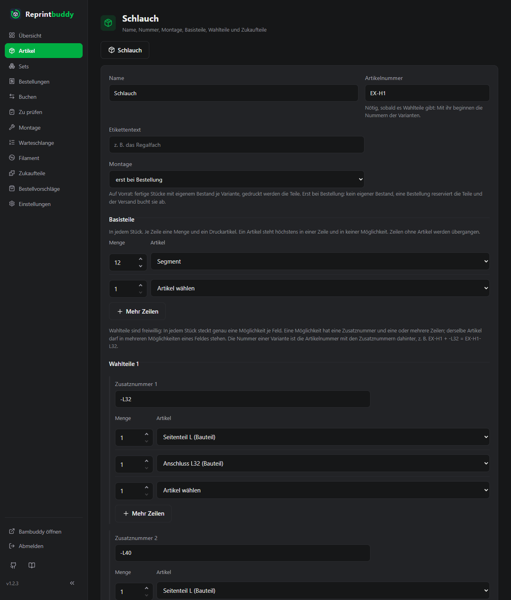
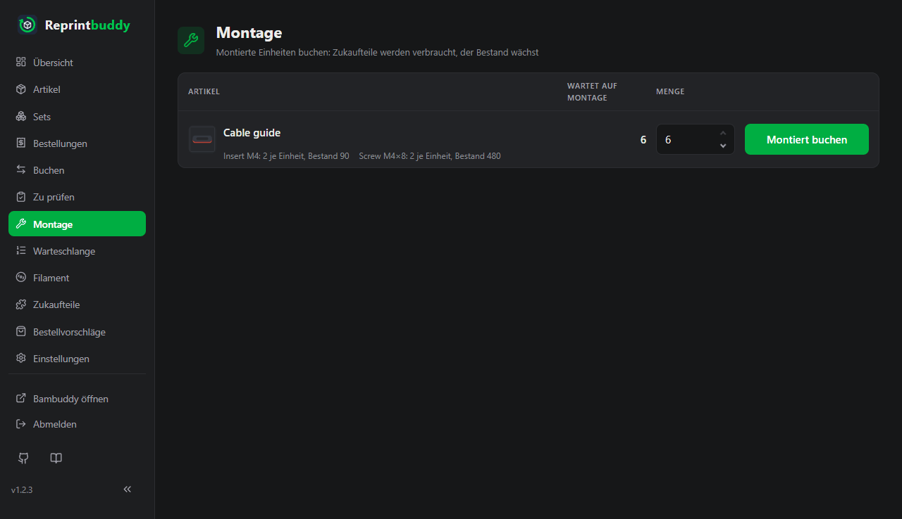

# Artikel aus Teilen

Manche Produkte sind nicht ein Druck, sondern mehrere: eine Box aus zehn Platten, ein Schlauch aus zwölf Segmenten und zwei Endteilen. In Reprintbuddy ist so ein Produkt ein **Artikel aus Teilen**. Er hat keine eigene Platte, sondern eine **Stückliste** aus Druckartikeln (seinen Teilen) und Zukaufteilen, und du montierst ihn daraus. Jedes Teil bleibt ein normaler Druckartikel: Es wird gedruckt, geprüft und nachgedruckt wie gewohnt.

Ein [Set](inspection.md#sets) ist etwas anderes: Es fasst nur einzeln erhältliche Artikel zusammen, montiert wird nichts. Ein Artikel aus Teilen wird montiert und als ein Produkt verkauft.

!!! note "Eine Platte, mehrere Teile"
    Liegen mehrere verschiedene Teile zusammen auf einer Platte, ist diese Platte ein Druckartikel, und ein Druck liefert einen Satz dieser Teile. Nur Teile auf verschiedenen Platten oder Dateien brauchen einen Artikel aus Teilen.

## Einzeln erhältlich

Jeder Druckartikel hat den Schalter **Einzeln erhältlich**, Vorgabe an. Ausgeschaltet ist der Artikel ein *Bauteil*: Er steht nicht im Bestellformular und in keinem Set, und die Artikelliste zeigt eine graue Plakette **Bauteil**. Nachdruck, Prüfung und Bestand laufen wie bei jedem Artikel. Die Seitenteile des Schlauchs sind Bauteile; das Segment gibt es als Ersatzteil auch einzeln.

## Artikel aus Teilen anlegen

**Neuer Artikel aus Teilen** auf der Seite Artikel öffnet das Formular.

- **Name**, **Artikelnummer** und **Etikettentext** wie bei jedem Artikel. Die Nummer ist nötig, sobald es Wahlteile gibt: Mit ihr beginnen die Nummern der Varianten.
- **Montage**: **auf Vorrat** (Vorgabe) oder **erst bei Bestellung**, siehe unten.
- **Basisteile**: in jedem Stück. Je Zeile eine Menge und ein Druckartikel. Ein Artikel steht höchstens in einer Zeile. **Mehr Zeilen** fügt Zeilen an.
- **Wahlteile 1** (freiwillig): Möglichkeiten, von denen in jedem Stück genau eine steckt. Jede Möglichkeit hat eine **Zusatznummer** und eine oder mehrere Zeilen mit Menge und Artikel. Derselbe Artikel darf in mehreren Möglichkeiten eines Feldes stehen; das Seitenteil L des Schlauchs steckt in `-L32` und in `-L40`. **Mehr Möglichkeiten** und **Mehr Zeilen** schaffen Platz. **Wahlteile 2 hinzufügen** öffnet ein zweites Feld derselben Art. Ein Artikel der Basisteile steht in keiner Möglichkeit, und kein Artikel steht in beiden Feldern.
- **Zukaufteile** wie im Artikelformular.
- Auf Vorrat und ohne Wahlteile: **Mindestbestand** und **Puffer**. Mit Wahlteilen stehen sie je Variante in einer Tabelle, die nach dem Speichern erscheint.

Jede Variante enthält aus Teilen und Zukaufteilen zusammen mindestens zwei Einheiten, darunter mindestens ein Teil: 12 × Segment geht, 1 × Halter + 2 Gewindeeinsätze geht, 1 × Halter allein ist der Halter selbst.

### Varianten und Nummern

Wie bei Sets ist jede Zusammenstellung der Möglichkeiten eine **Variante**, und ihre Nummer ist die Artikelnummer mit den Zusatznummern dahinter: der Schlauch `EX-H1` mit `-L32`, `-L40`, `-R32`, `-R40` hat die Varianten EX-H1-L32 … EX-H1-R40. Nummern sind über alle Artikel, Sets und Varianten eindeutig. Änderst du eine Zusatznummer oder die Teile einer Möglichkeit, behält die Variante ihren Bestand. Eine Variante mit Bestand, Reservierung oder in einer offenen Bestellung kann nicht wegfallen; die Meldung nennt sie.

## Auf Vorrat oder erst bei Bestellung

**Auf Vorrat**: Fertige Stücke liegen im Regal. Jede Variante hat Bestand, Reserviert, Verfügbar, Mindestbestand und Puffer. Montiert wird auf der Seite Montage, gedruckt werden nur die Teile.

**Erst bei Bestellung**: Es wird nichts vorab montiert. Der Artikel hat keinen Bestand; eine Bestellung reserviert seine Teile, und der Versand bucht Teile und Zukaufteile ab. Ein Verkauf ohne Bestellung auf der Seite Buchen macht dasselbe sofort.

## Verfügbarkeit

Die Artikelliste zeigt die Varianten unter dem Namen, jede mit Nummer und Verfügbar. Wie oft sich eine Variante montieren lässt, folgt aus dem **verfügbaren** Bestand ihrer Teile. **Zusammen höchstens** ist die größte Zahl, die sich in irgendeiner Mischung der Varianten gleichzeitig montieren lässt; ein Teil in mehreren Möglichkeiten zählt nur einmal.

Beispiel: Segment 60, Seitenteil L 3, Seitenteil R 1, Anschluss L32 2, L40 2, R32 0, R40 1. Dann EX-H1-L32 2, EX-H1-L40 2, EX-H1-R32 0, EX-H1-R40 1, und zusammen höchstens 4: links höchstens 3, weil es nur 3 Seitenteile L gibt, rechts 1. Die Segmente reichten für 5.

Ein Artikel erst bei Bestellung ist **lieferbar**, wenn sich mindestens ein Stück montieren lässt. Auf Vorrat hat jede Variante die Plaketten eines Artikels; **knapp** heißt hier, dass jedes Teil gedeckt ist und nur noch die Montage fehlt.

## Nachdruck der Teile

Fällt das Verfügbar einer Variante auf Vorrat unter ihren Mindestbestand, fehlt ihr die Zielmenge minus Verfügbar. Das, mal Menge, ist der **Bedarf aus Montage** jedes ihrer Teile, summiert über alle Varianten und Artikel. Die Automatik druckt ein Teil mit seinem Mindestbestand plus diesem Bedarf; siehe [Automatik](automation.md#bedarf-aus-montage). Bei einem Artikel erst bei Bestellung senken seine Reservierungen das Verfügbar der Teile und lösen so ihren Nachdruck aus.

## Montieren

Die Seite **Montage** hat einen Abschnitt **Aus Teilen**: jede Variante auf Vorrat unter ihrer Zielmenge, mit dem, was fehlt, wie oft sie sich montieren lässt und ihren Teilen. Vorbelegt ist das Kleinere von beiden. **Montieren** bucht die Variante hoch und nimmt jedes Teil nur aus seinem **verfügbaren** Bestand, so wird kein Teil verbaut, das für eine Bestellung reserviert ist. Fehlt ein Teil, wird nichts gebucht, und die Meldung nennt das Teil mit verfügbarer und gebrauchter Menge. Zukaufteile werden abgezogen wie bei der Montage von Druckartikeln: bis 0 mit Warnung.

Der Abschnitt **Für Bestellungen** zeigt die offenen Bestellungen mit Artikeln erst bei Bestellung, nur zur Ansicht. Die Artikelseite hat dasselbe **Montieren** je Variante, auch über die Zielmenge hinaus.

## Bestellen und Buchen

Das Bestellformular bietet einzeln erhältliche Druckartikel, jede Variante auf Vorrat mit ihrer Nummer und jede Variante erst bei Bestellung als eigenen Eintrag („Schlauch · EX-H1-L32 (Seitenteil L, Anschluss L32)“). Bauteile stehen nicht darin. Eine Bestellung behält Teile und Nummer vom Bestellzeitpunkt, auch wenn sich die Stückliste später ändert.

Auf der Seite **Buchen** nehmen Inventur und Verkauf eine Variante auf Vorrat; der Verkauf nimmt auch eine Variante erst bei Bestellung, die ihre Teile sofort abbucht. Einbuchen ohne Druck gibt es nur für Druckartikel.

## Umstellen und Archivieren

Ein Druckartikel wird zum Artikel aus Teilen, und zurück über die Wahl von Druckdatei und Platte wie bei **Druckdatei ändern**, nur wenn nichts läuft und sein Bestand 0 ist. Name, Nummer und Journal bleiben. Ein Druckartikel, der als Teil in einem Artikel aus Teilen steckt, bleibt Druckartikel und lässt sich nicht archivieren; nimm ihn zuerst aus der Stückliste.

Archivieren eines Artikels aus Teilen nimmt seine Varianten mit; ihre Nummern bleiben vergeben. Wiederherstellen holt sie zurück.
