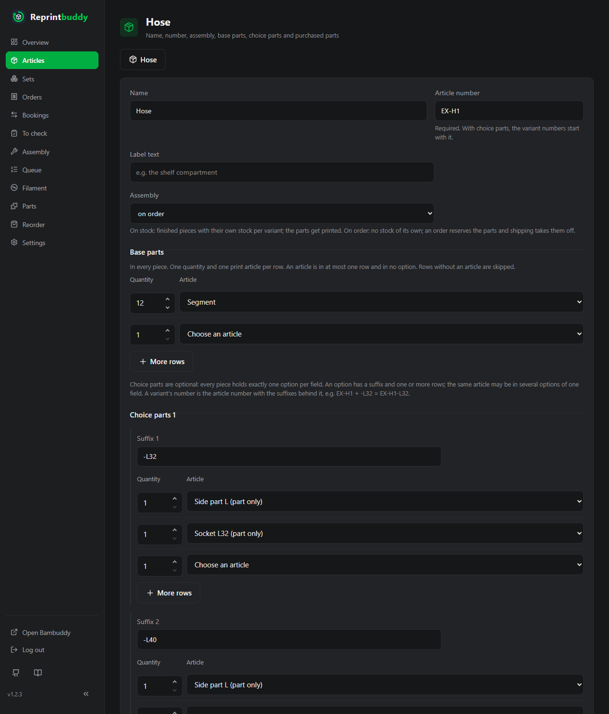
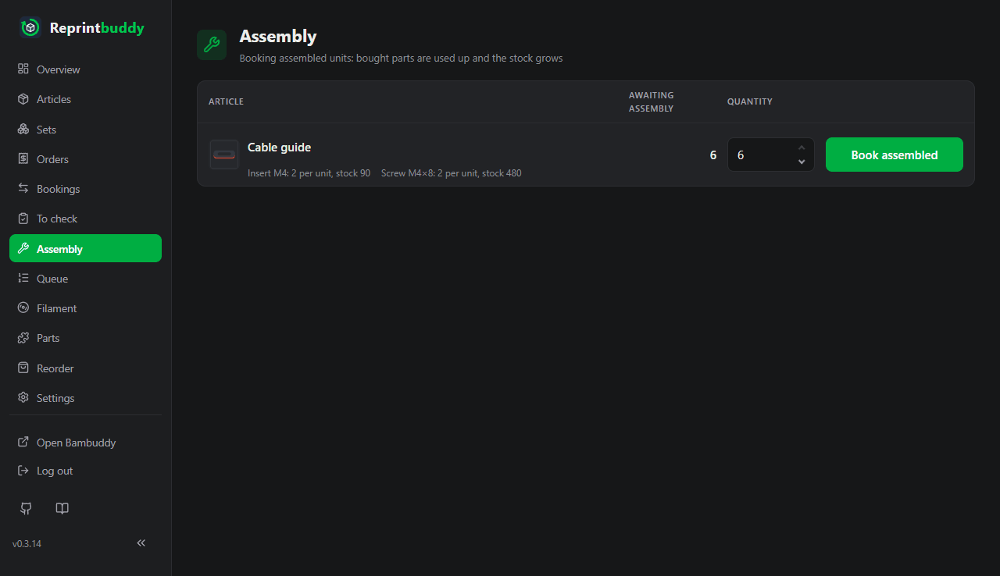

# Assembled articles

Some products are not one print but several: a storage box from ten panels, a hose from twelve segments and two end parts. In Reprintbuddy such a product is an **assembled article**. It has no plate of its own; it has a **parts list** of print articles (its parts) and purchased parts, and you assemble it from them. Each part stays a normal print article: it is printed, checked and reprinted as usual.

A [set](inspection.md#sets) is different: it only puts articles sold on their own together, nothing is assembled. An assembled article is assembled and sold as one product.

!!! note "One plate, several parts"
    If several different parts lie together on one plate, that plate is one print article, and one print gives one set of these parts. Only parts on different plates or files need an assembled article.

## Sold alone

Every print article has the switch **Sold alone**, on by default. Switched off, the article is a *part only*: it is not offered in the order form or in any set, and the article list shows a grey badge **part only**. Reprints, checks and stock work as for any article. The side parts of the hose are parts only; the segment can be sold alone as a spare part.

## Create an assembled article

**New assembled article** on the page Articles opens the form.

- **Name**, **Article number** and **Label text** as for any article. The number is required, as for any article; with choice parts the variant numbers start with it.
- **Assembly**: **on stock** (default) or **on order**, see below.
- **Base parts**: in every piece. One quantity and one print article per row. An article is in at most one row. **More rows** adds rows.
- **Choice parts 1** (optional): options of which every piece holds exactly one. Each option has a **suffix** and one or more rows of quantity and article. The same article may be in several options of one field; the side part L of the hose is in `-L32` and in `-L40`. **More options** and **More rows** add room. **Add choice parts 2** opens a second field of the same kind. An article in the base parts is in no option, and no article is in both fields.
- **Purchased parts** as on the article form.
- On stock and without choice parts: **Minimum stock** and **Buffer**. With choice parts they are set per variant in a table that appears after saving.

Every variant holds at least two units of parts and purchased parts together, at least one of them a part: 12 × segment works, 1 × holder + 2 thread inserts works, 1 × holder alone is the holder itself.

### Variants and numbers

As with sets, each combination of the options is a **variant**, and its number is the article number with the suffixes behind it: the hose `EX-H1` with `-L32`, `-L40`, `-R32`, `-R40` has the variants EX-H1-L32 … EX-H1-R40. Numbers are unique over all articles, sets and variants; case does not count. An article made of parts has at most 100 variants; saving refuses more and names the number. When you change a suffix or the parts of an option, the variant keeps its stock. A variant with stock, a reservation or in an open order cannot be removed, even when its number has changed since the order; the message names it.

## On stock or on order

**On stock**: finished pieces wait on the shelf. Each variant has stock, reserved, available, minimum stock and buffer. You assemble them on the assembly page, and only the parts get printed.

**On order**: nothing is assembled ahead. The article has no stock; an order reserves its parts, and shipping takes the parts and the purchased parts off. Shipping is its assembly: in the journal of each part the row reads **Built into** Hose · EX-H1-L32, with the order, as at the assembly on stock. A sale without an order on the page Bookings takes them off at once and stays a **Sale** in the journal.

## Availability

The article list shows the variants under the name, each with its number and available. How often a variant can be built comes from the **available** stock of its parts. **Together at most** is the largest number that can be built at the same time in any mix of the variants; a part that is in several options counts only once.

Example: segment 60, side part L 3, side part R 1, socket L32 2, L40 2, R32 0, R40 1. Then EX-H1-L32 2, EX-H1-L40 2, EX-H1-R32 0, EX-H1-R40 1, and together at most 4: on the left at most 3, because there are only 3 side parts L; on the right 1. The segments would last for 5.

An article on order is **deliverable** when at least one piece can be built. On stock each variant has the badges of an article; **low** means here that every part is covered and only the assembly is missing.

## Reprints for the parts

A variant on stock whose available falls below its minimum misses its target minus its available. That, times the quantity, is the **demand from assembly** of each of its parts, summed over all variants and articles. The automation prints a part with its minimum plus this demand; see [Automation](automation.md#demand-from-assembly). For an article on order, its reservations lower the available of the parts and so start their reprints.

## Assemble

The page **Assembly** has a section **From parts**: every variant on stock below its target, with what it misses, how often it can be built and its parts. The quantity starts at the smaller of the two. **Assemble** adds to the variant and takes each part off its **available** stock only, so a part reserved for an order is never built in. If a part is short, nothing is booked and the message names the part with available and needed quantity. Purchased parts are taken off as at the assembly of print articles: down to 0 with a warning.

The section **For orders** lists the open orders with articles built on order, only to look at. The article page has the same **Assemble** per variant, also beyond the target.

## Orders and bookings

The order form offers print articles sold alone, each variant on stock by its number, and each variant built on order once ("Hose · EX-H1-L32 (Side part L, Socket L32)"). Parts only are not offered. An order keeps the parts and the number of its time, even when the parts list changes later.

On the page **Bookings**, inventory and sale take a variant on stock; a sale also takes a variant built on order, which takes its parts off at once. The inventory of an assembled article counts its stock only; **Awaiting assembly** is not offered for it. Stock in without a print is only for print articles.

The **Journal** of an assembled article, from its page or from the article list, shows its own rows and those of all its variants.

## Switch and archive

A print article becomes an assembled article, and back by choosing a print file and plate as under **Change print file**, only while nothing runs and its stock is 0. Name, number and journal stay. A print article that is a part of an assembled article stays a print article and cannot be archived; take it out of the parts list first.

Archiving an assembled article takes its variants along; they keep their numbers. Restoring brings them back.
