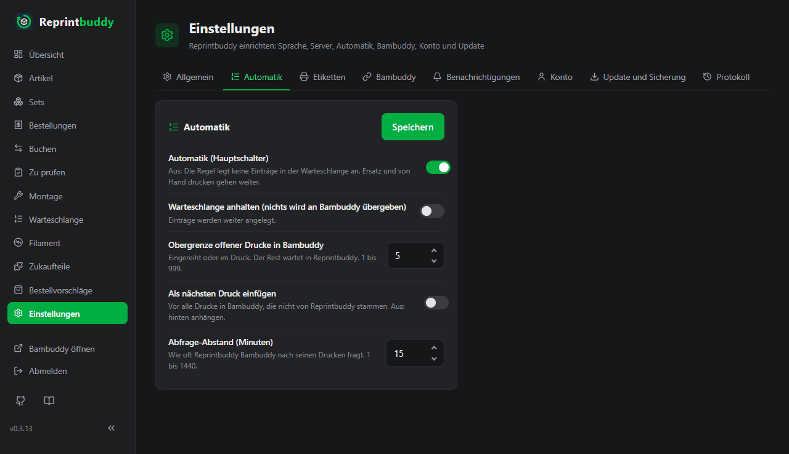
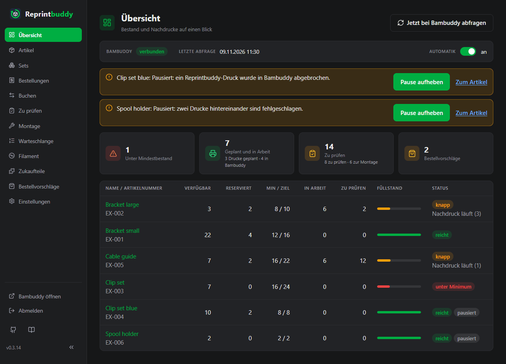

# Automatik

Die Automatik druckt Artikel für dich nach. Wird ein Artikel knapp, legt Reprintbuddy einen Eintrag in [seiner eigenen Warteschlange](queue.md) an und übergibt die Drucke einzeln an Bambuddys Warteschlange. Es steuert nie einen Drucker: Bambuddy bleibt dein Drucksystem.

!!! warning "Drucke starten ohne deine Freigabe"
    Reprintbuddy übergibt Drucke so, dass sie starten, sobald Bambuddy einen passenden Drucker frei hat. Jeder Druck bekommt die in Bambuddy eingestellten *Standard-Druckoptionen* (Bett-Nivellierung, Fluss-Kalibrierung und die übrigen); Reprintbuddy liest sie direkt vor jeder Übergabe und ändert an Bambuddys Einstellungen nichts. Hält Bambuddy einen Druck trotzdem zur Freigabe zurück, sagt das ein Hinweis (siehe unten). Ein Drucker, der nicht drucken soll, kommt in Bambuddy in den Wartungsmodus. Nach der Installation ist der Hauptschalter aus. Schalte ihn ein, wenn du die Anbindung geprüft hast, zum Beispiel zuerst mit einem Artikel.

## Die Regel

Für jeden Artikel, bei dem **Automatik** eingeschaltet ist und der nicht pausiert ist, rechnet Reprintbuddy die Deckung aus:

> **Deckung** = Verfügbar + In der Warteschlange + In Arbeit + Vorläufig + Wartet auf Montage

Die Zahlen sind die der [Artikelseite](articles.md#die-artikelseite). Einträge in Reprintbuddys Warteschlange (auch zurückgehaltene), Drucke in Bambuddy, Einheiten, die auf die Prüfung warten, und Einheiten, die auf Montage warten, zählen alle mit, damit Reprintbuddy nicht noch einmal druckt, was schon geplant oder gedruckt ist. Eine Reservierung senkt „Verfügbar“, deshalb kann eine neue Bestellung einen Nachdruck auslösen.

Liegt die Deckung **unter dem Mindestbestand**, legt Reprintbuddy einen Eintrag an, der die Deckung auf die **Zielmenge** (Mindestbestand plus Puffer) bringt:

> **Drucke** = aufgerundet ( (Zielmenge − Deckung) / Stück je Druck )

Beispiel: Mindestbestand 10, Puffer 5 (Zielmenge 15), 4 Stück je Druck.

| Verfügbar | In der Warteschlange | In Arbeit | Vorläufig | Wartet auf Montage | Deckung |
|---|---|---|---|---|---|
| 5 | 0 | 4 | 0 | 0 | 9 |

9 liegt unter 10. Bis zur Zielmenge fehlen 15 − 9 = 6 Stück, das sind 1,5 Drucke, also hat der Eintrag **2 Drucke**. Bei einer Deckung von 10 oder mehr geschieht nichts.

- Neue Einträge der Regel kommen ans Ende der Warteschlange.
- **Mindestbestand 0 und Puffer 0 drucken nie von selbst.**
- Ein Eintrag hat höchstens 1000 Drucke; der nächste Durchlauf legt den Rest an.
- Reprintbuddy prüft die Regel nach jeder Änderung, die du speicherst, und bei jeder regelmäßigen Abfrage. Es wartet nicht auf die nächste Abfrage.

## Bedarf aus Montage

Ein Teil eines [Artikels aus Teilen](assembled.md) auf Vorrat wird auch für diesen Artikel gedruckt. Für jede Variante, deren Verfügbar unter ihrem Mindestbestand liegt, ist die Fehlmenge bis zur Zielmenge mal Menge des Teils sein **Bedarf aus Montage**, summiert über alle Varianten und Artikel. Die Regel rechnet dann mit Mindestbestand + Bedarf und Zielmenge + Bedarf; Stück je Druck bleibt die des Teils.

Beispiel: Ein Clip (4 Stück je Druck, Mindestbestand 2, Puffer 2, Deckung 3) steckt 2-mal in einer Box (Mindestbestand 3, Puffer 2, Verfügbar 2) und 1-mal in einer Lampe (Mindestbestand 1, Verfügbar 1). Der Box fehlen 5 − 2 = 3, der Lampe nichts, der Bedarf ist also 6. Deckung 3 liegt unter 2 + 6, also hat der Eintrag aufgerundet((4 + 6 − 3) / 4) = **2 Drucke**. Nach der Montage von 3 Boxen ist der Bedarf 0 und die Deckung 11 − 6 = 5: Es wird nichts mehr gedruckt.

Artikel aus Teilen selbst werden nie gedruckt; Regel und Warteschlange gelten nur für Druckartikel. Bei einem Artikel erst bei Bestellung senken seine Reservierungen das Verfügbar der Teile und lösen so ihren Nachdruck aus.

## Schalter und Einstellungen

| Schalter oder Einstellung | Wo | Vorgabe |
|---|---|---|
| **Automatik (Hauptschalter)** | *Einstellungen → Automatik* und die Kopfzeile der [Übersicht](overview.md) | aus |
| **Automatik** je Artikel | Der Schalter in der Artikelliste und auf den Kacheln, und das Feld **Automatik** in den Einstellungen des Artikels | aus |
| **Warteschlange anhalten (nichts wird an Bambuddy übergeben)** | *Einstellungen → Automatik* | aus, die Warteschlange läuft |
| **Obergrenze offener Drucke in Bambuddy** | *Einstellungen → Automatik* | 10 (1 bis 999) |
| **Als nächsten Druck einfügen** | *Einstellungen → Automatik* | aus |
| **Abfrage-Abstand (Minuten)** | *Einstellungen → Automatik* | 15 (1 bis 1440) |

Mit **Speichern** auf der Karte werden alle fünf Werte zusammen gespeichert. Eine nicht erlaubte Zahl speichert nichts.

- **Automatik (Hauptschalter).** Aus: Die Regel legt keine Einträge an. Ersatz und von Hand drucken gehen weiter. Die Regel braucht diesen Schalter und den Schalter des Artikels.
- **Automatik je Artikel.** Zum Einschalten braucht der Artikel ein Druckziel. Ohne eines würde die Automatik ihn sofort pausieren.
- **Warteschlange anhalten.** Reprintbuddy übergibt nichts an Bambuddy, aber Einträge werden weiter in seiner Warteschlange angelegt. Ein Hinweis auf der Übersicht und der Warteschlange sagt das.
- **Obergrenze offener Drucke in Bambuddy.** Sie zählt die Drucke von Reprintbuddy, die in Bambuddy eingereiht sind oder drucken. Ist die Obergrenze erreicht, wartet der Rest in Reprintbuddy. Mit mehr Druckern in Produktion erhöhst du sie.
- **Als nächsten Druck einfügen.** An: Jeder Druck, den Reprintbuddy übergibt, kommt vor alle Drucke in Bambuddy, die nicht von Reprintbuddy stammen. Hinter seine eigenen wartenden Drucke, damit sie in Reprintbuddys Reihenfolge bleiben. Ein Druck, der schon läuft, wird nicht unterbrochen. Aus: Der Druck wird hinten angehängt.
- **Abfrage-Abstand (Minuten).** Wie oft Reprintbuddy Bambuddy nach seinen Drucken fragt. Änderst du ihn, kommt die nächste Abfrage sofort.

## Die regelmäßige Abfrage und der Live-Kanal

Reprintbuddy merkt sich die Bambuddy-Kennung jedes Eintrags, den es anlegt. Bei jeder regelmäßigen Abfrage fragt es Bambuddy nach den offenen Drucken, prüft die Druckdateien und Druckziele der Artikel, liest Bambuddys Warteschlange für die Seite Warteschlange und mit einer Anfrage für alle Drucker den Druckerzustand für den Druckplan der Übersicht, hält die täglichen Filamentgewichte fest, wendet die Regel an und übergibt Drucke. Mit **Jetzt bei Bambuddy abfragen** auf der Übersicht oder der Warteschlange fragst du sofort.

Außerdem hört Reprintbuddy auf Bambuddys **Live-Kanal**. Meldet Bambuddy, dass ein Druck begonnen oder geendet hat oder dass ein Eintrag der Warteschlange übernommen wurde oder fehlschlug, fragt Reprintbuddy sofort. Maßgeblich bleibt die regelmäßige Abfrage, die im eingestellten Abstand weiterläuft. Unter *Einstellungen → Bambuddy* zeigt die Karte **Live-Kanal** den Zustand: **Verbunden**, **Aus**, **Verbindet**, **Wartet** oder **Recht fehlt**. Für den Live-Kanal braucht die Bambuddy-Gruppe `websocket:connect` und der Schlüssel **Status lesen**; ein fehlendes Recht wird alle 15 Minuten neu versucht. Die Druckermeldungen des Live-Kanals (Fortschritt, Restzeit) lösen keine Abfrage aus; sie halten den Druckplan der Übersicht zwischen zwei Abfragen aktuell. Ohne Live-Kanal läuft alles über die regelmäßige Abfrage.

Was ein fertiger, fehlgeschlagener oder verschwundener Druck bewirkt:

- **Fertig:** Die Einheiten werden vorläufig und warten in der Liste **Zu prüfen**. Ein Platz unter der Obergrenze wird frei. Siehe [Zu prüfen und Montage](inspection.md).
- **Fehlgeschlagen:** Der Druck zählt nicht mehr als in Arbeit, und ein Ersatz über einen Druck kommt an den Anfang der Warteschlange. Zwei Fehlschläge hintereinander pausieren den Artikel. Ein fertiger Druck setzt die Zählung zurück.
- **In Bambuddy abgebrochen, übersprungen oder gelöscht:** Er zählt nicht mehr als in Arbeit, und die Automatik pausiert für diesen Artikel, damit sie nicht gegen das arbeitet, was du in Bambuddy getan hast. Ausgenommen sind Drucke, die Reprintbuddy nach einem Storno selbst gelöscht hat: Sie pausieren nichts (siehe [Was ein Storno zurücknimmt](inspection.md#was-ein-storno-zurucknimmt)).

Drucke, die du direkt in Bambuddy startest, kennt Reprintbuddy nicht. Buche sie unter *Buchen* mit **Einbuchen ohne Druck**.

## Ersatz für Ausschuss und Fehlschläge

Bestätigst du bei der Prüfung weniger gute Einheiten, als gedruckt wurden, legt Reprintbuddy sofort einen Ersatz-Eintrag an den Anfang der Warteschlange. Er enthält den Ausschuss, aufgerundet auf ganze Drucke, und ist mit **Ersatz für Ausschuss** gekennzeichnet. Ein fehlgeschlagener Druck bekommt einen Eintrag über einen Druck, gekennzeichnet mit **Ersatz für Fehlschlag**.

Ersatz entsteht immer, egal was Hauptschalter, Artikelschalter oder Mindestbestand sagen, und auch für Drucke von Hand. Übergeben wird er wie jeder Eintrag, also nicht bei pausiertem Artikel oder angehaltener Warteschlange.

## Pausen

Reprintbuddy pausiert die Automatik für einen Artikel, wenn sie sonst gegen dich oder auf falscher Grundlage arbeiten würde. Ein pausierter Artikel bekommt keine neuen Einträge aus der Regel, und seine vorhandenen Einträge werden bei der Übergabe übersprungen (sie bleiben in der Warteschlange und zählen zur Deckung). Ersatz entsteht weiterhin.

Eine Pause zeigt sich als Hinweis auf der Übersicht und der Warteschlange und auf der Artikelseite in der Karte **Automatik pausiert**. Jeder Hinweis zeigt den Weg weiter: **Pause aufheben**, oder einen Link dorthin, wo die Ursache behoben wird (**Datei bestätigen**, **Andere Datei wählen**, **Einstellungen bearbeiten**), und **Zum Artikel**. Das Aufheben setzt auch die Zählung der Fehlschläge zurück.

| Genannter Grund | Was passiert ist | Wie es weitergeht |
|---|---|---|
| ein Nachdruck-Eintrag wurde verringert oder gelöscht | Du hast die Drucke eines Eintrags der Regel verringert oder ihn gelöscht. Sonst legte die Regel ihn beim nächsten Durchlauf gleich wieder an. | **Pause aufheben**. Wer dauerhaft weniger will, senkt Mindestbestand oder Puffer. |
| ein Reprintbuddy-Druck wurde in Bambuddy abgebrochen | Ein Druck wurde in Bambuddy abgebrochen oder übersprungen. | **Pause aufheben**. |
| ein Reprintbuddy-Druck ist in Bambuddy verschwunden | Der Druck wurde in Bambuddy gelöscht oder der Verlauf geleert. | War er fertig, über **Einbuchen ohne Druck** buchen. Dann **Pause aufheben**. |
| zwei Drucke hintereinander sind fehlgeschlagen | Beide wurden ersetzt. | **Pause aufheben**. |
| die Druckdatei wurde in Bambuddy geändert | Prüfsumme oder Name weichen von dem ab, was Reprintbuddy kennt. | **Druckdatei bestätigen** oder **Druckdatei neu wählen**, siehe [Artikel](articles.md#wenn-sich-die-druckdatei-andert-oder-verschwindet). |
| die Druckdatei ist in Bambuddy nicht mehr da | Die Datei gibt es nicht mehr. | **Druckdatei neu wählen**. |
| der Artikel hat kein Druckziel | Der Artikel hat kein Ziel, oder sein Drucker oder Modell gibt es in Bambuddy nicht mehr. | Unter **Einstellungen ändern** ein Druckziel wählen, dann **Pause aufheben**. |
| eine Übergabe an Bambuddy ist unklar | Bambuddys Antwort auf einen Druck ging verloren, oder Reprintbuddy kann nicht sagen, welcher von mehreren Einträgen in Bambuddy es ist. Reprintbuddy sendet so einen Druck nie noch einmal und rät nicht. | In Bambuddys Warteschlange und Verlauf nachsehen und überzählige Einträge löschen. Lief der Druck, über **Einbuchen ohne Druck** buchen. Dann **Pause aufheben**. |

Einen Eintrag zurückhalten pausiert nichts; der Eintrag zählt weiter zur Deckung.

## Weitere Hinweise

Neben Pausen zeigen die Übersicht und die Warteschlange, was die Automatik am Arbeiten hindert. Rote Hinweise heißen: Bambuddy antwortet nicht oder lehnt ab, oder eine Übergabe ist unklar; gelbe sind Zustände, die du gewählt hast oder die auf dich warten.

- Bambuddy ist nicht eingerichtet, nicht erreichbar oder lehnt die Statusabfrage ab (ein Recht des Schlüssels fehlt). Es wird nichts übergeben und kein Bestand geändert.
- Bambuddy hat einen Druck eines Artikels abgelehnt. Er liegt wieder in Reprintbuddys Warteschlange, und die nächste regelmäßige Abfrage versucht es erneut.
- Dem gespeicherten Schlüssel fehlt ein Recht, das Reprintbuddy braucht (das Fenster **Bambuddy-Recht fehlt** oder nach **Später** die Warnzeile oben). Bis das Recht da ist, wird nichts übergeben; jede regelmäßige Abfrage prüft den Schlüssel erneut, siehe [Fehlende Rechte später](../start/setup.md#fehlende-rechte-spater).
- Drucke warten in Bambuddy auf Freigabe. Starte sie in Bambuddy. Damit spätere Drucke nicht warten, braucht die Gruppe des Schlüssel-Besitzers das Recht **Print Without Review** (`queue:start_unreviewed`) oder **Update All Queue** (`queue:update_all`).
- Die Warteschlange ist angehalten, oder die Obergrenze offener Drucke ist erreicht.
- Ein Artikel wartet auf einen freien Drucker, weil seine Drucker im Wartungsmodus sind. Er wird übersprungen, nicht pausiert.
- Ein Update läuft. Die Automatik wartet, bis es fertig ist.

Unter den Hinweisen nennt die Seite den Zeitpunkt der letzten erfolgreichen Abfrage bei Bambuddy.

## Was Reprintbuddy nie tut

- Es steuert nie einen Drucker; es startet, stoppt oder pausiert keinen Druck.
- Was in Bambuddy liegt, gehört Bambuddy. Reprintbuddy ändert übergebene Drucke nicht und sortiert vorhandene Einträge nie um. Zurück nimmt es nur eigene, noch nicht gestartete Drucke nach einem Storno (siehe [Was ein Storno zurücknimmt](inspection.md#was-ein-storno-zurucknimmt)). Umsortieren, Vorziehen und sonstiges Löschen in Bambuddys Warteschlange machst du nur in Bambuddy.
- Es ändert nichts an Bambuddys Druckoptionen: Jeder Druck bekommt die in Bambuddy eingestellten *Standard-Druckoptionen*. Kann Reprintbuddy sie nicht lesen, übergibt es nichts: Ist Bambuddy nicht erreichbar, bleibt der Druck für den nächsten Lauf in der Warteschlange; lehnt Bambuddy das Lesen ab (zum Beispiel fehlt das Recht *Read Settings*), kommt der Druck mit Bambuddys Meldung zurück.
