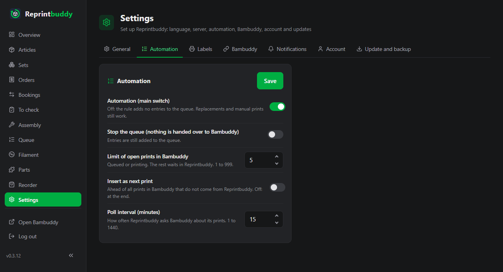
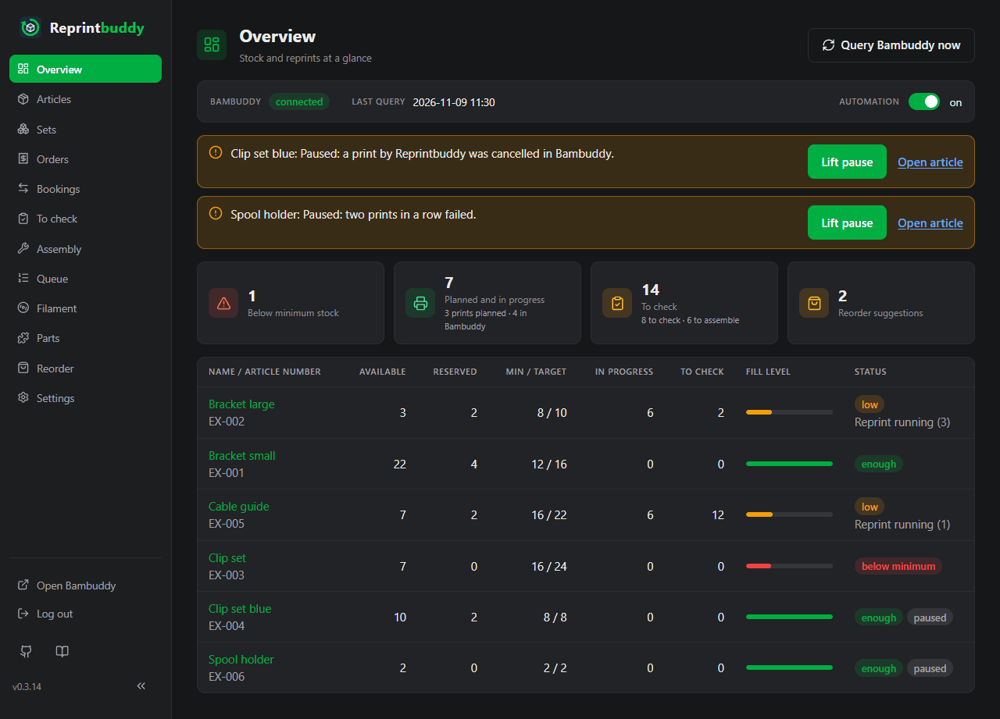

# Automation

The automation reprints articles for you. When an article runs low, Reprintbuddy puts an entry into [its own queue](queue.md) and hands the prints, one by one, to Bambuddy's queue. It never controls a printer: Bambuddy stays your print system.

!!! warning "Prints start without your approval"
    Reprintbuddy hands prints over so that they start as soon as Bambuddy has a matching printer free. It changes none of the print options; they stay on Bambuddy's defaults. If Bambuddy holds a print for approval anyway, a notice says so (see below). A printer that should not print goes into maintenance mode in Bambuddy. After the installation the main switch is off. Switch it on when you have checked the connection, for example with one article first.

## The rule

For every article that has **Automation** switched on and is not paused, Reprintbuddy works out the coverage:

> **Coverage** = Available + in the queue + in progress + provisional + awaiting assembly

The numbers are the ones on the [article page](articles.md#the-article-page). Entries in Reprintbuddy's queue (held ones too), prints in Bambuddy, units waiting for the check and units waiting for assembly all count, so Reprintbuddy does not print again what is already planned or printed. A reservation lowers Available, so a new order can start a reprint.

If the coverage is **below the minimum stock**, Reprintbuddy adds an entry that brings the coverage up to the **target quantity** (minimum stock plus buffer):

> **Prints** = round up ( (target quantity − coverage) / units per print )

Example: minimum stock 10, buffer 5 (target quantity 15), 4 units per print.

| Available | In the queue | In progress | Provisional | Awaiting assembly | Coverage |
|---|---|---|---|---|---|
| 5 | 0 | 4 | 0 | 0 | 9 |

9 is below 10. Missing to the target: 15 − 9 = 6 units, which is 1.5 prints, so the entry has **2 prints**. With a coverage of 10 or more nothing happens.

- New entries of the rule go to the end of the queue.
- **Minimum stock 0 and buffer 0 never print by themselves.**
- One entry holds at most 1000 prints; the next run adds the rest.
- Reprintbuddy checks the rule after every change you save and with every regular query. It does not wait for the next query.

## Switches and settings

| Switch or setting | Where | Default |
|---|---|---|
| **Automation (main switch)** | *Settings → Automation*, and the head line of the [Overview](overview.md) | off |
| **Automation** per article | The switch in the article list and tiles, and the field **Automation** in the article's settings | off |
| **Stop the queue (nothing is handed over to Bambuddy)** | *Settings → Automation* | off, the queue runs |
| **Limit of open prints in Bambuddy** | *Settings → Automation* | 10 (1 to 999) |
| **Insert as next print** | *Settings → Automation* | off |
| **Poll interval (minutes)** | *Settings → Automation* | 15 (1 to 1440) |

Click **Save** on the card to store all five values together. A number that is not allowed saves nothing.

- **Automation (main switch).** Off: the rule adds no entries. Replacements and manual prints still work. The rule needs this switch and the switch of the article.
- **Automation per article.** The article needs a print target to switch it on. Without one the automation would pause it at once.
- **Stop the queue.** Reprintbuddy hands nothing over to Bambuddy, but entries are still added to its queue. A notice on the Overview and the Queue says so.
- **Limit of open prints in Bambuddy.** Counts the prints of Reprintbuddy that are queued or printing in Bambuddy. When the limit is reached, the rest waits in Reprintbuddy. With more printers in production you raise it.
- **Insert as next print.** On: every print Reprintbuddy hands over goes ahead of all prints in Bambuddy that do not come from Reprintbuddy. Behind its own waiting prints, so they keep Reprintbuddy's order. A print that is already running is not interrupted. Off: the print is added at the end.
- **Poll interval (minutes).** How often Reprintbuddy asks Bambuddy about its prints. If you change it, the next query comes at once.

## The regular query and the live channel

Reprintbuddy remembers the Bambuddy id of every entry it creates. With every regular query it asks Bambuddy about the open prints, checks the print files and print targets of the articles, reads Bambuddy's queue for the Queue page, records the daily filament weights, applies the rule and hands over prints. Press **Query Bambuddy now** on the Overview or the Queue to ask at once.

Reprintbuddy also listens to Bambuddy's **live channel**. When Bambuddy reports that a print started or ended, or that a queue entry was taken or failed, Reprintbuddy asks at once. The regular query stays authoritative and runs at the set interval. Under *Settings → Bambuddy* the card **Live channel** shows the state: **Connected**, **Off**, **Connecting**, **Waiting** or **Right missing**. For the live channel the Bambuddy group needs `websocket:connect` and the key **Read Status**; a missing right is tried again every 15 minutes. Without the live channel everything runs through the regular query.

What a finished, failed or vanished print does:

- **Finished:** the units become provisional and wait on the list **To check**. A place under the limit is free again. See [To check and assembly](inspection.md).
- **Failed:** the print no longer counts as in progress, and a replacement of one print goes to the front of the queue. Two failures in a row pause the article. A finished print resets the count.
- **Cancelled, skipped or deleted in Bambuddy:** it no longer counts as in progress, and the automation pauses for this article, so that it does not work against what you did in Bambuddy.

Prints you start directly in Bambuddy are unknown to Reprintbuddy. Book them under *Bookings* with **Stock in without print**.

## Replacement for scrap and failures

If you confirm fewer good units at the check than were printed, Reprintbuddy puts a replacement entry at the front of the queue at once. It holds the scrap rounded up to whole prints and is marked **Replacement for scrap**. A failed print gets an entry of one print, marked **Replacement for a failed print**.

Replacements are always made, whatever the main switch, the article switch or the minimum stock say, and also for manual prints. They are handed over like every entry, so not while the article is paused or the queue is stopped.

## Pauses

Reprintbuddy pauses the automation for one article when it would otherwise work against you or on a wrong basis. A paused article gets no new entries from the rule, and its existing entries are skipped at the hand-over (they stay in the queue and count for the coverage). Replacements are still made.

A pause shows as a notice on the Overview and on the Queue, and on the article page in the card **Automation paused**. Each notice has the way on: **Lift pause**, or a link to where the cause is settled (**Confirm file**, **Choose another file**, **Edit settings**) and **Open article**. Lifting also resets the count of failures.

| Reason shown | What happened | How to go on |
|---|---|---|
| a reprint entry was reduced or deleted | You reduced the prints of an entry made by the rule, or deleted it. Otherwise the rule would put it back at the next run. | **Lift pause**. If you want fewer for good, lower the minimum stock or the buffer. |
| a print by Reprintbuddy was cancelled in Bambuddy | A print was cancelled or skipped in Bambuddy. | **Lift pause**. |
| a print by Reprintbuddy is gone from Bambuddy | The print was deleted in Bambuddy or its history was cleared. | If it finished, book it with **Stock in without print**. Then **Lift pause**. |
| two prints in a row failed | Both were replaced. | **Lift pause**. |
| the print file was changed in Bambuddy | Its checksum or name differs from what Reprintbuddy knows. | **Confirm print file** or **Choose print file again**, see [Articles](articles.md#when-the-print-file-changes-or-disappears). |
| the print file is gone from Bambuddy | The file no longer exists. | **Choose print file again**. |
| the article has no print target | The article has no target, or its printer or model no longer exists in Bambuddy. | Choose a target under **Edit settings**, then **Lift pause**. |
| a hand-over to Bambuddy is unclear | Bambuddy's answer to a print got lost, or Reprintbuddy cannot tell which of several entries in Bambuddy is it. Reprintbuddy never sends such a print again and does not guess. | Look into Bambuddy's queue and history and delete extra entries. If the print ran, book it with **Stock in without print**. Then **Lift pause**. |

Holding back an entry pauses nothing; the entry still counts for the coverage.

## Other notices

Besides pauses, the Overview and the Queue show what keeps the automation from working. Red notices mean Bambuddy does not answer or refuses, or a hand-over is unclear; yellow ones are states you chose or that wait for you.

- Bambuddy is not set up, cannot be reached, or refuses the status query (a right of the key is missing). Nothing is handed over and no stock changes.
- Bambuddy refused a print of an article. It is back in Reprintbuddy's queue and the next regular query tries again.
- Prints wait for approval in Bambuddy. Start them in Bambuddy. So that later prints do not wait, the group of the key's owner needs **Print Without Review** (`queue:start_unreviewed`) or **Update All Queue** (`queue:update_all`).
- The queue is stopped, or the limit of open prints is reached.
- An article waits for a free printer because its printers are in maintenance mode. It is skipped, not paused.
- An update is running. The automation waits until it is finished.

Below the notices the page names the time of the last successful query of Bambuddy.

## What Reprintbuddy never does

- It never controls a printer; it does not start, stop or pause a print.
- What lies in Bambuddy belongs to Bambuddy. Reprintbuddy does not take handed-over prints back, does not change them and never reorders entries that are already there. Reorder, bring forward or delete in Bambuddy's queue only in Bambuddy.
- It changes none of the print options.
