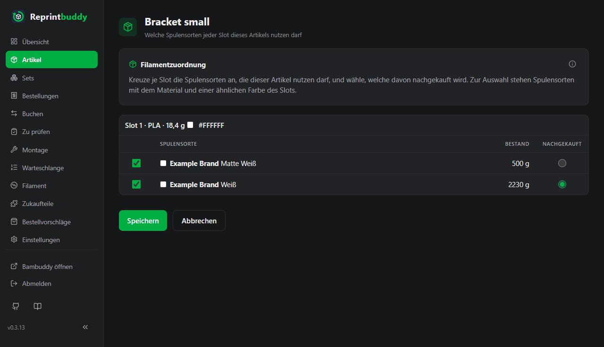
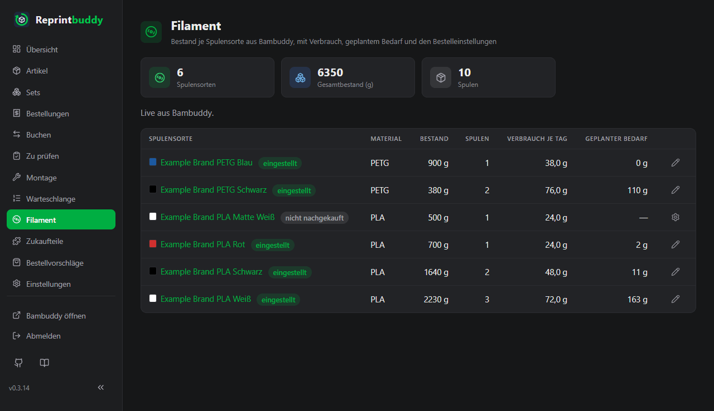

# Filament

Reprintbuddy beobachtet dein Filament, damit es rechtzeitig Bestellungen vorschlagen kann. Bambuddy führt das Filament; Reprintbuddy liest es nur. Diese Seite erklärt, was Spulensorten sind, wie du einem Artikel sagst, welches Filament er nutzen darf, und die Seite *Filament* mit den Bestelleinstellungen.

## Woher die Filamentdaten kommen

- Bambuddy führt das Filament, entweder mit seiner eigenen Spulenverwaltung oder im Spoolman-Modus. **Spoolman ist optional.** Reprintbuddy liest die Spulenliste über Bambuddy, aus der Betriebsart, die gerade läuft, und schreibt nie hinein. Mit Spoolman selbst spricht es nie. Dafür braucht die Bambuddy-Gruppe die Rechte aus der [Ersteinrichtung](../start/setup.md).
- Bambuddy gibt Spulen keine Kennung, die sie zusammenfasst. Eine **Spulensorte** sind deshalb alle Spulen mit gleicher Marke, gleichem Material, gleichem Untertyp und gleichem Farbwert. Der Farbname zählt nicht. Sorten werden nie zusammengelegt: zwei Spulen, deren Farbwerte sich leicht unterscheiden, sind zwei Sorten (du kannst für einen Artikel beide ankreuzen).
- Der **Bestand** einer Spulensorte ist die Summe der Restgewichte ihrer Spulen, die nicht archiviert sind, in Gramm.
- Bei jeder regelmäßigen Abfrage hält Reprintbuddy das Restgewicht jeder Spule für den Tag fest. Aus den letzten 30 Tagen errechnet es den **Verbrauch je Tag** einer Sorte.

## Einem Artikel sagen, welches Filament er nutzen darf

Ein Artikel nennt nicht eine einzelne Spule. Für jeden Filament-Slot seiner Druckdatei kreuzt du die Spulensorten an, die der Artikel nutzen darf. Zusammen sind sie die **Filamentgruppe** des Slots. Eine davon ist **Nachgekauft**: die Sorte, die wieder gekauft wird und für die Reprintbuddy Bestellungen vorschlägt.

Reprintbuddy öffnet die Zuordnung gleich nach dem Anlegen eines Artikels und nach **Druckdatei ändern**, wenn Slots neu angekreuzt werden müssen. Du kannst sie jederzeit von der Artikelseite aus mit **Spulensorten ankreuzen** öffnen.

1. Kreuze für jeden Slot (er steht als „Slot 1 · PLA · 12,5 g“ mit der Farbe der Datei da) in der Spalte **Nutzen** die Spulensorten dieses Artikels an. Jede Zeile zeigt Marke, Untertyp, Farbe und den aktuellen Bestand in Gramm.
2. Kreuzt du eine Sorte an, ist sie von selbst die nachgekaufte. Kreuzt du mehrere an, wähle den Knopf in der Spalte **Nachgekauft**.
3. Klicke auf **Speichern**. **Später** (oder **Abbrechen**, wenn du nicht vom Anlegen des Artikels kommst) verlässt die Seite ohne Speichern.

Welche Sorten zur Wahl stehen:

- Nur Sorten, die zum Slot passen: gleiches Material und ähnliche Farbe, mit einem Farbabstand (CIEDE2000) von höchstens ΔE 7. Eine transparente Farbe passt nur zu transparent. Marke und Untertyp müssen nicht übereinstimmen. Ein Slot ohne Material oder Farbe in der Datei bietet nichts an. Passt nichts, steht das beim Slot.
- Eine Sorte, die du früher angekreuzt hast, bleibt in der Liste, auch wenn sie nicht mehr passt.
- Vorausgewählt ist nichts, mit einer Ausnahme: bei einem **neuen** Artikel beginnt die Seite mit der Gruppe eines ähnlichen Artikels. Jeder Slot eines anderen aktiven Artikels mit gleichem Material und gleicher Farbe zählt; passen mehrere Artikel, gewinnt der zuletzt angelegte. Die Seite sagt „Vorschlag aus dem ähnlichen Artikel …“, und der Vorschlag gilt erst mit **Speichern**. Bis dahin gilt der Slot als nicht zugeordnet.

Ein Slot ohne angekreuzte Sorten zählt weder für Bestand noch für Bedarf, und der Artikel zeigt **Filament nicht zugeordnet**. Auch die Seite *Filament* listet diese Slots, mit einem Link zur Zuordnung. Das Drucken wird dadurch nicht verhindert.

Die Zuordnung steuert nur Reprintbuddys eigene Rechnung. Welche Spule Bambuddy beim Drucken nimmt, entscheidet Bambuddy. Der Bestand der nachgekauften Sorte ist die Summe aller Sorten, die in den Slots angekreuzt sind, in denen sie nachgekauft wird.

Die Zuordnung eines archivierten Artikels lässt sich nur ansehen. Nach **Druckdatei ändern** behält ein Slot seine Gruppe nur bei gleichem Material und gleicher Farbe, siehe [Artikel](articles.md#druckdatei-andern).

## Die Seite Filament

*Filament* listet die Spulensorten, die in mindestens einem aktiven Artikel angekreuzt sind.

| Spalte | Bedeutung |
|---|---|
| **Spulensorte** | Marke, Material, Untertyp und Farbe. Die Plakette sagt, ob die Sorte nachgekauft wird und ob ihre Einstellungen dann **eingestellt** oder **nicht eingestellt** sind; sonst **nicht nachgekauft**. |
| **Material** | Das Material der Sorte. |
| **Bestand** | Summe der Restgewichte in Gramm. |
| **Spulen** | Die Zahl der Spulen dieser Sorte. |
| **Verbrauch je Tag** | Gramm je Tag aus den letzten 30 Tagen, oder „noch kein Verlauf“, bis zwei verschiedene Tage festgehalten sind. |
| **Geplanter Bedarf** | Nur bei nachgekauften Sorten: die Gramm für die Drucke in Reprintbuddys Warteschlange und in Arbeit, dazu die Drucke, die bis zur Zielmenge der Artikel noch fehlen. |

Die Karten oben zählen Spulensorten, Gesamtbestand, Spulen und die nachgekauften Sorten **Ohne Einstellungen**. Ein Hinweis über der Tabelle sagt, ob der Bestand **Live aus Bambuddy.** kommt oder wie alt er ist. Sind es die zuletzt aufgezeichneten Zahlen, steht der Tag außerdem unter den Karten für Bestand und Spulen und im Kopf der Spalten **Bestand** und **Spulen**, als **Stand vom …**, damit niemand sie für Live-Zahlen hält. Unter der Tabelle nennt ein Hinweis Filament-Slots, die noch keine angekreuzte Spulensorte haben; jeder Eintrag führt zur Zuordnung.

## Bestelleinstellungen einer Spulensorte

Klicke auf eine Spulensorte (oder auf das Symbol **einstellen** oder **Einstellungen ändern**), um ihre **Bestelleinstellungen** zu öffnen. Sie zählen nur für Sorten, die in irgendeinem Artikel nachgekauft werden, und sie speisen die [Bestellvorschläge](reorder.md).

| Feld | Bedeutung | Vorgabe |
|---|---|---|
| **Lieferzeit (Tage)** | Tage von der Bestellung bis zum Eintreffen, 0 bis 365. | 0 |
| **Bestelleinheit (Gramm je Spule)** | Gramm, die eine Spule hat; in dieser Einheit wird die Sorte gekauft, 1 bis 100.000. Vorschläge rechnen immer in ganzen Spulen und runden auf. | 1000 |
| **Sicherheitspolster** und **Einheit des Sicherheitspolsters** | Die Reserve, die nach der Lieferzeit noch übrig sein soll, 0 bis 1.000.000, in **Tagen** Verbrauch oder in **Gramm**. | 0 Tage |
| **Mindestbestellmenge (Spulen)** | So viele Spulen muss eine Bestellung mindestens haben, 1 bis 1000. | 1 |
| **Lieferant** | Freier Text, bis 200 Zeichen. | leer |
| **Bestell-Link** | Adresse, die mit `http://` oder `https://` beginnen muss, bis 2000 Zeichen. | leer |

Ein Vorschlag erscheint, wenn der Bestand minus geplanter Bedarf minus Verbrauch in der Lieferzeit unter das Sicherheitspolster fällt. Eine nachgekaufte Sorte ohne Einstellungen rechnet mit den Vorgaben oben.

## Wenn Bambuddy nicht erreichbar ist

Die Seiten funktionieren weiter, und es wird nichts geraten.

- Die Seite *Filament* zeigt den Bestand des zuletzt festgehaltenen Tages, mit Datum. Wurde noch nichts festgehalten, sagt sie, dass der Bestand gerade nicht bekannt ist, und zeigt Striche.
- Die Filament-Zuordnung eines Artikels zeigt ebenfalls den Bestand des zuletzt festgehaltenen Tages; im Kopf der Spalte **Bestand** steht **Stand vom …**. Ohne Aufzeichnung zeigt sie die zuletzt bekannten Spulensorten ohne Bestand.
- Die Seite *Bestellvorschläge* rechnet die Filament-Vorschläge mit dem zuletzt festgehaltenen Bestand; jede Filament-Kachel sagt an ihrem Bestand **Stand vom …**. Ohne Aufzeichnung zeigt sie keine Filament-Vorschläge, nur die für Zukaufteile.
