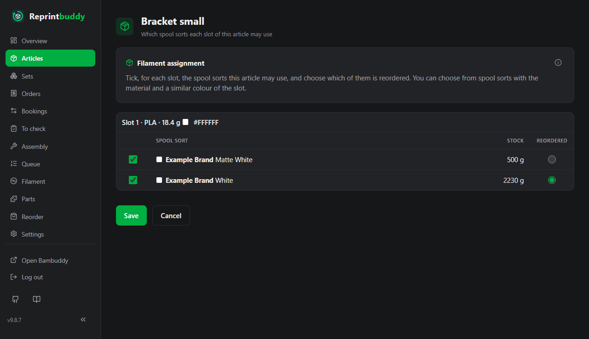
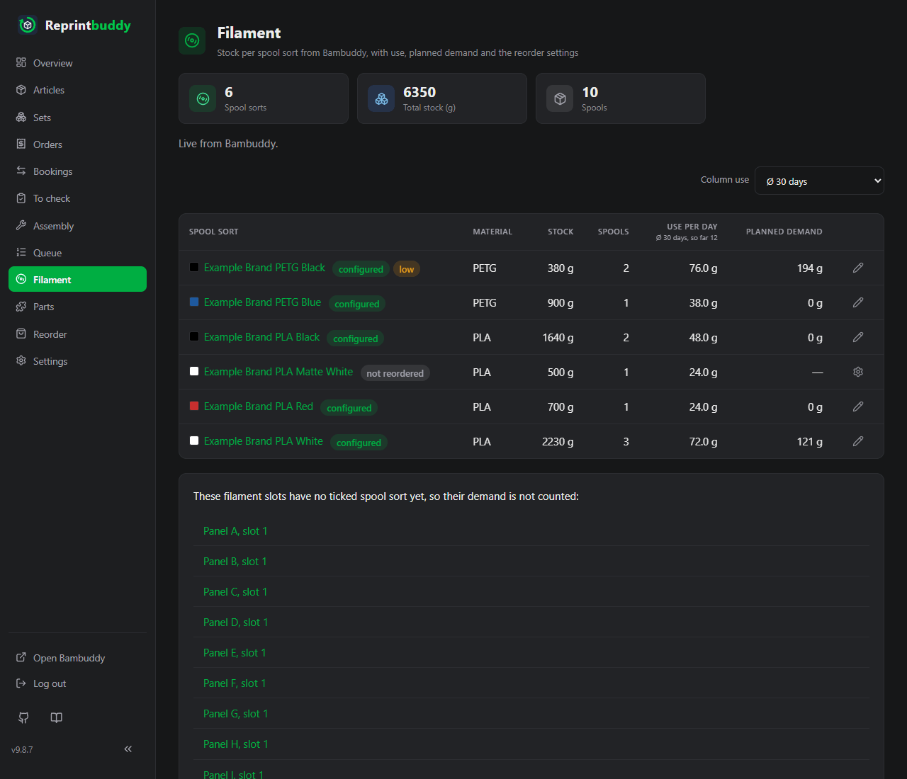
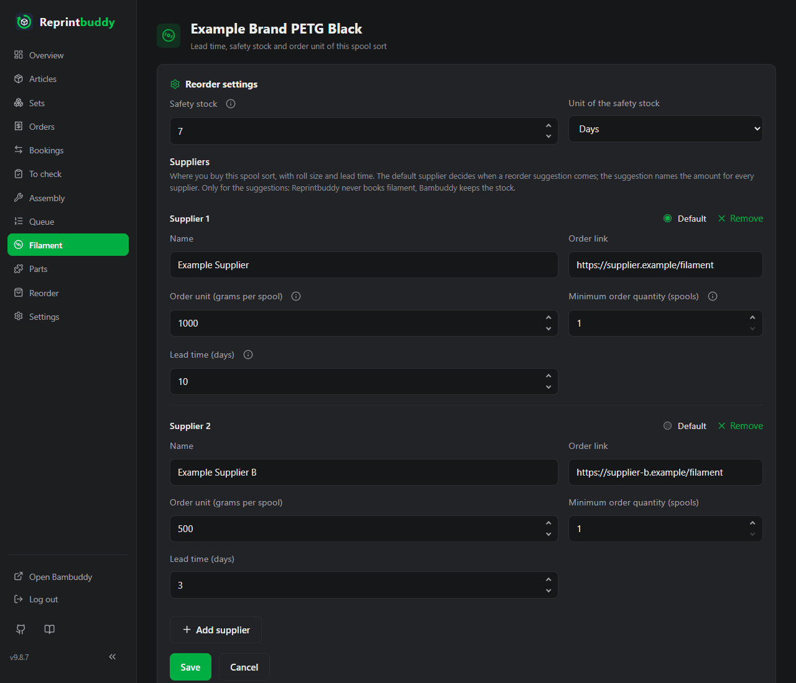

# Filament

Reprintbuddy watches your filament so that it can suggest orders in time. Bambuddy keeps the filament; Reprintbuddy only reads it. This page explains how spool sorts work, how you tell an article which filament it may use, and the *Filament* page with its reorder settings.

## Where the filament data comes from

- Bambuddy keeps the filament, either with its own spool management or in Spoolman mode. **Spoolman is optional.** Reprintbuddy reads the spool list through Bambuddy, from the mode that is running, and never writes to it. It never talks to Spoolman itself. For this the Bambuddy group needs the rights listed in [First setup](../start/setup.md).
- Bambuddy gives spools no identifier that groups them. A **spool sort** is therefore every spool with the same brand, material, subtype and colour value. The colour name does not count. Sorts are never merged: two spools whose colour values differ slightly are two sorts (you can tick both for an article).
- The **stock** of a spool sort is the sum of the remaining weights of its spools that are not archived, in grams.
- With every regular query Reprintbuddy records the remaining weight of each spool for the day. From the last 30 days it works out the **use per day** of a sort. Only decreases count; a new or refilled spool adds nothing. Days are calendar days in the time zone of the server; a new day begins at midnight there.
- When you archive a spool, its use keeps counting up to its last remaining weight, also on the day you archive it: a spool printed empty and archived at once does not lose its last use. From then on it no longer counts for the stock or the spools. A spool deleted in Bambuddy instead of archived loses its use of the current day.

## Tell an article which filament it may use

An article does not name one spool. For each filament slot of its print file you tick the spool sorts the article may use. Together they are the **filament group** of the slot. One of them is marked **Reordered**: the sort that is bought again, and the one Reprintbuddy suggests orders for.

Reprintbuddy opens the assignment right after you create an article, and after **Change print file** when slots need ticking again. You can also open it at any time from the article page with **Tick spool sorts**.

1. For each slot (shown as "Slot 1 · PLA · 12.5 g" with the colour of the file), tick the spool sorts of this article in the column **Use**. Each row shows brand, subtype, colour and the current stock in grams.
2. If you tick one sort, it is the reordered one by itself. If you tick several, choose the radio button in the column **Reordered**.
3. Click **Save**. **Later** (or **Cancel**, if you did not come from creating the article) leaves without saving.

Which sorts you can choose:

- Only sorts that fit the slot: the same material and a similar colour, with a colour distance (CIEDE2000) of at most ΔE 7. A transparent colour fits only transparent. Brand and subtype do not have to match. A slot with no material or colour in the file offers nothing. If nothing fits, the slot says so.
- A sort you ticked earlier stays in the list even if it no longer fits.
- Nothing is ticked in advance, with one exception: for a **new** article, the page starts from the group of a similar article. Any slot of another active article with the same material and colour counts; if several articles match, the one created last wins. The page says "Suggested from the similar article …" and the suggestion only counts once you click **Save**. Until then the slot is not assigned.

A slot without ticked sorts counts for neither stock nor demand, and the article shows **Filament not assigned**. The *Filament* page lists these slots too, with a link to the assignment. Printing is not blocked by this.

The assignment only steers Reprintbuddy's own calculation. Which spool Bambuddy takes when it prints is up to Bambuddy. The stock of the reordered sort is the sum of all sorts ticked in the slots where it is reordered.

An archived article's assignment is read-only. After you change an article's print file, a slot keeps its group only if material and colour are the same, see [Articles](articles.md#change-the-print-file).

## The Filament page

*Filament* lists the spool sorts that are ticked in at least one active article.

| Column | Meaning |
|---|---|
| **Spool sort** | Brand, material, subtype and colour. The badge says whether the sort is reordered and, if so, whether its settings are **configured** or **not configured**; otherwise **not reordered**. A yellow **low** stands next to it while the sort has a reorder suggestion (see [Reorder suggestions](reorder.md)); the tile **Filament** of the [Overview](overview.md) counts these sorts and names how many days the reordered sorts last. Use per day and reach rest on the last 30 days and become reliable only after some time of operation. |
| **Material** | The material of the sort. |
| **Stock** | Sum of the remaining weights in grams. |
| **Spools** | The number of spools of this sort. |
| **Use** | Switchable, see below. Default: grams used per day over the last 30 days (**Ø 30 days**), or "no history yet" until two different days are recorded. |
| **Planned demand** | Only for reordered sorts: the grams for the prints in Reprintbuddy's queue and in progress, plus the prints still missing up to the target quantity of the articles. |

### Switch the column Use

Above the table, under **Column use**, you choose what the column shows:

| Choice | Meaning |
|---|---|
| **Ø 30 days** | Grams per day on average over the last 30 days. The default and the base of the [reorder suggestions](reorder.md) and of the reach on the [Overview](overview.md). |
| **Ø 7 days** | Grams per day on average over the last 7 days. |
| **today**, **yesterday** | Grams used on that day. |
| **this week (week 47)** | Grams since Monday of this calendar week, today included. The number is the ISO calendar week; around New Year it may have begun in the old year (week 53 or week 1). |
| **this month (November)** | Grams since the first of this month. |
| **this year (2026)** | Grams since 1 January. |
| **total (since 2026-11-14)** | Grams since the first day of the record, which the choice names. The record is never deleted. |

The head of the column names the choice. For an average it adds over how many days it is taken while the record is shorter than the days of the choice, for example **Ø 30 days, so far 6**. A sort with fewer days than the others says its own in its row (**so far 3 days**). Everything is counted the same way: the decreases between two records of the same spool. A decrease belongs to the day of the later record; **today** is the decrease since yesterday's record, and **this week** begins with the decrease from Sunday to Monday. Week, month and year are calendar periods, not sliding windows. A choice needs records on two days of its period (for **today** from yesterday and today); otherwise it says "no history yet", even when the sort has been recorded for longer, for example after a day on which Bambuddy could not be reached. All days are days of the record in the time zone of the server (see [Settings](../operate/settings.md#what-is-not-on-this-page)); **today** begins at midnight there. A browser in another time zone than the server sees the days of the server: shortly after midnight on its clock the day may still be the previous one, or already the next. Days recorded up to version 1.2.2 are days in UTC and stay so; around midnight they may be off by a few hours.

Your browser remembers the choice for the next visit, each device its own. Without JavaScript the page shows **Ø 30 days** and no choice. The tile **Filament** of the Overview and the reorder suggestions always use **Ø 30 days**.

The cards on top count spool sorts, total stock, spools and the reordered sorts **Without settings**. A note above the table says whether the stock is **Live from Bambuddy.** or how old it is. When the numbers are the last recorded ones, the day also stands under the cards for stock and spools and in the head of the columns **Stock** and **Spools**, as **As of …**, so that nobody takes them for live numbers. Below the table, a note lists filament slots that have no ticked spool sort yet; each entry leads to its assignment.

## Reorder settings of a spool sort

Click a spool sort (or the icon **Configure** or **Edit settings**) to open its **Reorder settings**. They matter only for sorts that are reordered in some article, and they feed the [Reorder suggestions](reorder.md). They serve the suggestions only: Reprintbuddy never books filament, Bambuddy keeps the stock.

On top stand the fields of the sort itself:

| Field | Meaning | Default |
|---|---|---|
| **Safety stock** and **Unit of the safety stock** | The reserve that should still be left after the lead time, 0 to 1,000,000, in **Days** of use or in **Grams**. | 0 days |

Below, under **Suppliers**, one block per supplier, 1 to 10, the same as for a [purchased part](inspection.md#suppliers). One supplier is the **Default**: its lead time decides whether a suggestion appears; the suggestion then names the quantity for every supplier.

| Field | Meaning | Default |
|---|---|---|
| **Name** | Free text, up to 200 characters; may stay empty, the block is then called **Supplier 1**, **Supplier 2** and so on. While you type, names already used at spool sorts and purchased parts are offered. | empty |
| **Order link** | Address that must start with `http://` or `https://`, up to 2000 characters. | empty |
| **Order unit (grams per spool)** | Grams on one spool, the unit in which this supplier sells the sort, 1 to 100,000. Suggestions always count whole spools and round up. | 1000 |
| **Minimum order quantity (spools)** | The fewest spools one order may have, 1 to 1000. | 1 |
| **Lead time (days)** | Days from ordering to arrival, 0 to 365. | 0 |

**Add supplier** adds a block, the cross removes one; the last one stays. If you remove the default, choose another one before you save. Everything is saved together with **Save**.

A suggestion appears when the stock minus the planned demand minus the use during the default supplier's lead time falls below the safety stock. A sort that is reordered but has no reorder settings yet gets no suggestion; the cards count it under **Without settings**.

When you update from a version before 0.3.16, the settings each sort had become its only supplier and the default; suggestions stay the same. An order already on its way keeps the roll size it had.

## When Bambuddy cannot be reached

The pages keep working and nothing is guessed.

- The *Filament* page shows the stock of the last recorded day, with its date. If nothing was recorded yet, it says that the stock is not known right now and shows dashes.
- The filament assignment of an article shows the stock of the last recorded day too; the head of the column **Stock** says **As of …**. Without any record it shows the spool sorts known last, without stock.
- The *Reorder suggestions* page computes the filament suggestions from the last recorded stock; each filament tile says **As of …** at its stock. Without any record it shows no filament suggestions, only those for purchased parts.
- If the last query already found Bambuddy not reachable, these pages do not ask it again and show the recorded stock at once. Live numbers come back once a query reaches Bambuddy again.

The same recorded stock is shown while an [update or a restore](../operate/update-backup.md) runs. Then the pages change nothing: new spool sorts are added and arrived orders leave **On its way** at the next visit afterwards.
