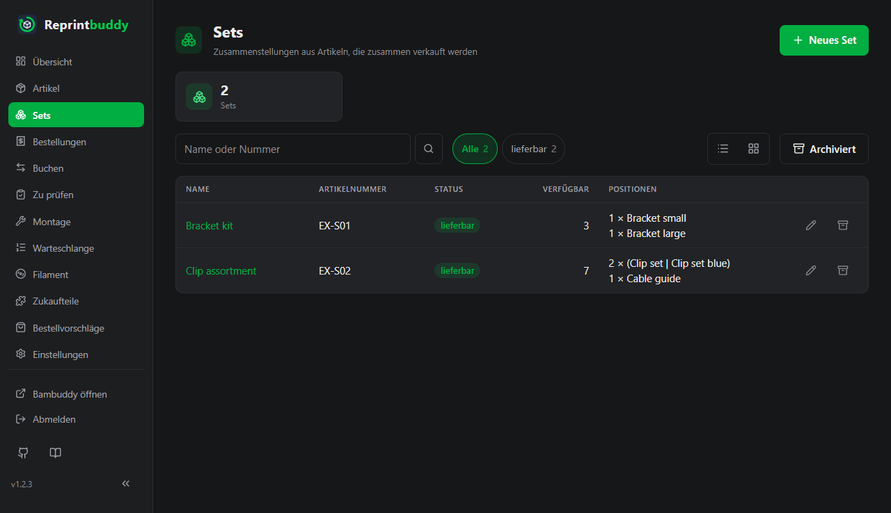
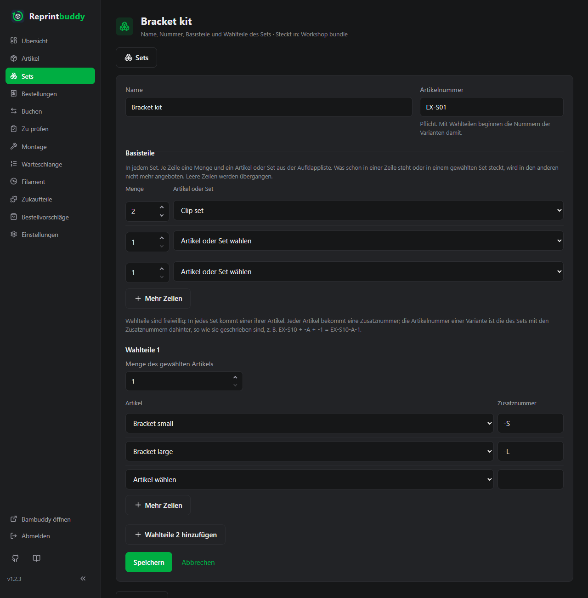

# Zu prüfen und Montage

Diese Seite begleitet ein gedrucktes Stück vom fertigen Druck bis ins Regal und zur Tür hinaus: du prüfst, was der Drucker gemacht hat, montierst es bei Handarbeit, buchst Bestandsänderungen von Hand, nimmst Bestellungen an und versendest sie. Alles, was du buchst, steht im Journal.

## Die Zahlen eines Artikels

Jeder Artikel hat diese Zähler. Sie ändern sich nur durch die unten beschriebenen Buchungen, nie durch Bearbeiten des Artikels.

| Zähler | Bedeutung |
|---|---|
| **Bestand** | Geprüfte Stücke, die verkaufsfertig sind, im Regal oder auf dem Weg dorthin. |
| **Reserviert** | Stücke in einer offenen Bestellung, die noch nicht versandt ist. |
| **Verfügbar** | **Bestand** minus **Reserviert**. Nur das kann verkauft werden. |
| **Vorläufig** | Stücke fertiger Drucke, die du noch nicht geprüft hast. |
| **Wartet auf Montage** | Geprüfte Stücke, die noch Handarbeit brauchen (siehe [Montage](#montage)). |

Reprintbuddy unterscheidet nicht, ob ein Stück im Regal liegt oder noch an der Druckplatte.

## Zu prüfen

Meldet Bambuddy einen Druck als fertig, bucht Reprintbuddy dessen Stücke als **Vorläufig** und legt eine Zeile in **Zu prüfen** an. Vorläufige Stücke lassen sich nicht verkaufen, zählen aber mit, wenn Reprintbuddy über einen Nachdruck entscheidet.

Jede Zeile zeigt den Artikel, wann der Druck fertig gemeldet wurde, und das **Soll**: die Zahl der Stücke, die der Druck liefern sollte. Bei Artikeln mit Handarbeit steht dazu die Plakette **Geht danach in die Montage**.

1. Zähle die guten Stücke des Drucks.
2. Trage die Stücke, die nicht gut sind, bei **Ausschuss** ein. Vorgabe ist 0, höchstens kannst du das Soll eintragen. Leer heißt 0; alles, was keine ganze Zahl von 0 bis zum Soll ist, wird mit einer Meldung abgelehnt, die diesen Bereich nennt.
3. Klicke auf **Bestätigen**.

Die guten Stücke sind das Soll minus Ausschuss. Sie werden **Bestand**, bei Handarbeit **Wartet auf Montage**. Der Ausschuss wird abgeschrieben, und Reprintbuddy stellt einen Ersatzdruck vorn in die Warteschlange, aufgerundet auf ganze Drucke. Der Ersatz kommt unabhängig vom Mindestbestand und auch dann, wenn die Automatik für den Artikel pausiert ist.

Mehrere Drucke bestätigst du auf einmal so:

- Hake die Zeilen an (das Kästchen im Tabellenkopf wählt alle) und klicke auf **Ausgewählte alle gut**. Der Knopf bleibt aus, solange nichts angehakt ist.
- Klicke auf **Alle gut**, um jede Zeile der Seite als ganz gut zu bestätigen.

Drucke, die inzwischen jemand anderes bestätigt hat, werden übersprungen; die Meldung nennt, wie viele.

Die Prüfung nimmt keine Notiz auf. Die Montage weiter unten auch nicht. Beide buchen mit einem Klick, und das Journal zeigt die Buchung ohne Notiz (alte Einträge behalten ihre).

### Nur ein Artikel

Die Liste kann nur einen Artikel zeigen. Dorthin führt der [QR-Code](labels.md) eines Artikels, wenn Drucke dieses Artikels auf die Prüfung warten. Ein Chip **Artikel: …** über der Liste zeigt den Filter; sein Kreuz hebt ihn auf. Mit Filter betreffen **Alle gut** und **Ausgewählte alle gut** nur die Drucke dieses Artikels.

!!! tip "Am Regal"
    Die Liste funktioniert am Handy. Scanne den QR-Code am Regalfach, zähle und bestätige.

## Montage

Die Seite **Montage** ist für Artikel, bei denen in den Einstellungen **Handarbeit nötig (Montage)** angehakt ist, und für [Artikel aus Teilen](assembled.md#montieren) (Abschnitte **Aus Teilen** und **Für Bestellungen**). Nach der Prüfung warten ihre guten Stücke hier, statt in den Bestand zu gehen. Die Liste zeigt je Artikel die wartenden Stücke, die nötigen Zukaufteile und wie viele davon du hast.

1. Erledige die Handarbeit.
2. Trage die montierten Stücke bei **Menge** ein. Vorgegeben sind alle wartenden Stücke.
3. Klicke auf **Montiert buchen**.

Die Stücke gehen von **Wartet auf Montage** in den **Bestand**, und die [Zukaufteile](#zukaufteile) werden abgezogen: Menge je Stück mal Zahl der montierten Stücke. Eine Teilezeile wird rot, wenn der Bestand nicht für alle wartenden Stücke reicht.

!!! note "Zu wenige Teile in den Büchern"
    Ist der Buchbestand eines Teils zu klein, wird die Buchung trotzdem angenommen, denn du hast die Teile ja in der Hand. Der Bestand des Teils wird auf 0 gesetzt, und eine Warnung nennt das Teil, wie viele im Bestand waren und wie viele nötig gewesen wären. Zähle die Teile danach mit einer Inventur-Buchung.

Stücke, die schon hier warten, bleiben buchbar, wenn du das Häkchen später abwählst. Artikel ohne Handarbeit überspringen diese Seite. Deren Zukaufteile werden abgezogen, wenn du die Prüfung mit guten Stücken bestätigst.

## Buchen

Die Seite **Buchen** enthält die Bestandsänderungen, die zu keinem Druck und keiner Bestellung gehören. Jede Buchung hat ein **Datum** und eine optionale **Notiz** mit bis zu 500 Zeichen. Das Datum ist heute, wenn du es nicht änderst; ein früherer Tag geht, etwa für eine Lieferung, die gestern kam, ein späterer nicht. Die Zahlen ändert die Buchung in jedem Fall sofort; das Datum sagt, wann sie im Journal und im Verbrauch der Zukaufteile zählt. Eine Inventur mit einem früheren Datum gilt für das Ende jenes Tages, in der Zeitzone, in der Reprintbuddy die Zeiten zeigt: Reprintbuddy rechnet die Differenz gegen den Stand von damals, jede Buchung jenes Tages steckt in der Zählung, Buchungen danach bleiben. Beispiel: Gestern Abend 10 gezählt, heute früh 2 verkauft – trag 10 mit gestrigem Datum ein, der Bestand ist dann 8. Ein Verkauf gestern Nachmittag ist schon in der Zählung enthalten. Gibt es nach dem Datum schon eine Inventur desselben Werts, lehnt Reprintbuddy ab, denn die spätere Zählung hat den Wert neu gesetzt. Abgelehnt wird auch, wenn eine Buchung danach mit der gezählten Menge unter 0 fiele; ein Verbrauch von Zukaufteilen danach zieht höchstens bis 0 ab, wie bei der Montage. Umgekehrt lehnt Reprintbuddy einen Verkauf, einen Zukaufteil-Eingang oder ein Einbuchen ab, dessen Datum vor einer Inventur des Bestands liegt, den die Buchung ändert: Die Zählung enthält sie schon. Die Meldung nennt den Artikel oder das Zukaufteil und den Tag der Zählung; war die Buchung nach der Zählung, wähle einen späteren Tag oder heute. Eine rückdatierte Zählung schließt ihren ganzen Tag ein, auch eine, die mit einer älteren Version rückdatiert wurde: Sie behält im Journal ihren Platz im Tag, für diese Prüfung gilt aber auch sie bis zum Ende des Tages. Auch der Anfangsbestand beim Anlegen eines Zukaufteils zählt als Inventur. Ein Einbuchen mit **Zukaufteile abziehen** wird auch abgelehnt, wenn eines dieser Zukaufteile später gezählt wurde; nimm das Häkchen weg, wenn die Teile schon in der Zählung stecken. Im Journal steht unter den Änderungen **am Buchungstag … → …**. Unter den Formularen zeigt die Seite die letzten 20 Buchungen.

| Formular | Wirkung |
|---|---|
| **Inventur / Korrektur (Artikel)** | Setzt den gewählten **Wert**, **Bestand** oder **Wartet auf Montage**, auf die **Gezählte Menge**; die Differenz wird gebucht. Auch für den Anfangsbestand. |
| **Inventur / Korrektur (Zukaufteil)** | Dasselbe für den Bestand eines Zukaufteils. |
| **Zukaufteil-Eingang** | Addiert die eingegangene Menge zu einem Zukaufteil. |
| **Verkauf ohne Bestellung** | Nimmt Stücke aus dem **Bestand**, zum Beispiel ein Stück, das direkt aus dem Regal verkauft wurde. |
| **Einbuchen ohne Druck** | Bucht Stücke in den **Bestand**, die außerhalb von Reprintbuddy gedruckt wurden, zum Beispiel von Hand in Bambuddy. |

**Einbuchen ohne Druck** hat ein Häkchen **Zukaufteile abziehen**, vorbelegt an. Es zieht für jedes Stück die Zukaufteile des Artikels vom Teilebestand ab. Wähle es ab, wenn die Teile schon abgezogen sind.

## Bestellungen

Eine Bestellung reserviert Bestand, bis du sie versendest oder stornierst. Reprintbuddy speichert keine Kundendaten.

Öffne die Seite **Bestellungen** und klicke auf **Neue Bestellung**.

1. Trage eine **Referenz** ein, freien Text wie die Bestellnummer. Sie ist Pflicht. Gib keine Adressen oder Kundendaten ein.
2. Prüfe das **Bestelldatum**; vorgegeben ist heute.
3. Trage bei Bedarf eine **Notiz** ein.
4. Wähle unter **Posten** je Zeile einen Artikel oder ein Set und trage die **Menge** ein. Ein [Set mit Wahlteilen](#sets) steht einmal je Variante in der Liste, mit ihrer Nummer und den gewählten Artikeln, zum Beispiel **Bracket kit · EX-S01-S (Bracket small)**: Wähle die Variante. Wahlteile, die ein inneres Set mitbringt, wählst du hier mit (siehe [Sets aus anderen Sets](#sets-aus-anderen-sets)). **Mehr Zeilen** fügt Zeilen hinzu.
5. Klicke auf **Bestellung anlegen**.

Die bestellten Stücke werden **Reserviert**, bei einem Set aus anderen Sets alle Artikel aller Ebenen. Die Bestellung einer Variante behält deren Nummer, wie sie beim Bestellen war, auch wenn sich das Set später ändert. Die Seite einer Bestellung zeigt unter einem Set erst die Artikel, die direkt darin stehen, dann eingerückt jedes innere Set mit Variantennummer und Menge, wie bestellt, und darunter seine Artikel; die Liste der Bestellungen zeigt nur den Kopf. **Verfügbar** kann unter null fallen, wenn du mehr bestellst, als du hast. Eine Bestellung lässt sich danach nicht ändern; storniere sie und lege sie neu an.

Die Liste zeigt offene Bestellungen mit dem Zustand **offen**, oder **versandbereit**, wenn jeder Artikel in der bestellten Menge im Bestand ist. Die Suche arbeitet auf der Referenz. **Versandte und stornierte Bestellungen** wechselt zu den abgeschlossenen, **Offene Bestellungen** zurück.

Öffne die Bestellung, um sie abzuschließen, mit einer optionalen **Notiz**:

- **Versand** gibt es nur, wenn die Bestellung versandbereit ist. Es nimmt die Stücke aus **Bestand** und **Reserviert**.
- **Storno** lässt dich mit **Ja, Bestellung stornieren** bestätigen und gibt dann die Reservierung frei. **Bestellung behalten** lässt sie offen.

Versand und Storno gelten immer für die ganze Bestellung, nie für einzelne Posten.

### Was ein Storno zurücknimmt

Eine Bestellung senkt **Verfügbar** und lässt so die [Regel](automation.md#die-regel) Nachdrucke planen. Stornierst du sie, nimmt Reprintbuddy zurück, was danach über der Zielmenge jedes Artikels der Bestellung geplant ist (bei einem Artikel aus Teilen: seiner Teile):

1. zuerst Drucke aus Einträgen mit der Herkunft **Mindestbestand** in [Reprintbuddys Warteschlange](queue.md#reprintbuddys-warteschlange), von unten, zurückgehaltene Einträge eingeschlossen;
2. dann Drucke dieser Herkunft, die Reprintbuddy an Bambuddy übergeben hat und die noch nicht gestartet sind, die zuletzt übergebenen zuerst. Sie werden aus Bambuddys Warteschlange gelöscht.

Zurück kommen nur ganze Drucke, nie so viele, dass die Deckung unter die Zielmenge fällt. Ersatzdrucke und von Hand angelegte Drucke bleiben, ebenso Drucke, die gerade drucken. Das gilt auch bei ausgeschalteter Automatik und bei pausiertem Artikel, und es pausiert nichts. Die Bestätigung sagt vorher, wie viele Drucke zurückkommen, die Meldung danach, wie viele zurückgekommen sind; das Journal des Artikels nennt sie mit der Bestellung.

Beispiel: Mindestbestand 2, Puffer 1, Bestand 3. Zwei Bestellungen über 2 und 3 Stück planen 5 Drucke. Der Storno der Bestellung über 3 nimmt 3 Drucke zurück; 2 bleiben für die andere Bestellung.

Ein Druck gilt als gestartet, sobald Bambuddy ihn an den Drucker schickt, auch wenn der Drucker noch aufheizt oder kalibriert. Einen solchen Druck kann Reprintbuddy nicht zurücknehmen, denn anhalten ließe er sich nur mit einem Druckerbefehl, und den gibt Reprintbuddy nie. Er wird gedruckt, geprüft und eingebucht wie jeder andere. Willst du ihn nicht, brich ihn in Bambuddy ab; dann pausiert der Artikel wie gewohnt (siehe [Pausen](automation.md#pausen)).

Das Löschen in Bambuddy braucht das empfohlene Recht **Delete Own Queue** in der Gruppe `Reprintbuddy` (siehe [Einrichtung](../start/setup.md)). Ohne es verkleinert ein Storno nur Reprintbuddys eigene Warteschlange, und ein Hinweis auf der Übersicht nennt die Drucke, die in Bambuddy bleiben. Ist Bambuddy nicht erreichbar, versucht Reprintbuddy es bei jedem Lauf wieder; ein Hinweis sagt, wie viele Drucke warten.

## Sets

Ein Set ist eine Zusammenstellung von Artikeln, die zusammen verkauft werden, mit Namen und Artikelnummer (Pflicht, sobald das Set Wahlteile hat). Es hat keinen eigenen Bestand.

**Basisteile** kommen in jedes Set: je Zeile eine **Menge** und ein **Artikel** oder ein anderes **Set** aus der Aufklappliste (Dropdown, Gruppen **Artikel** und **Sets**; siehe [Sets aus anderen Sets](#sets-aus-anderen-sets)). Was schon in einer Zeile steht oder in einem dort gewählten Set steckt, wird in den anderen nicht mehr angeboten; ein Artikel steht nur einmal in einem Set.

**Wahlteile** sind freiwillig: In jedes Set kommt einer ihrer Artikel, zum Beispiel die Größe einer Platte. **Wahlteile 1** nimmt beliebig viele Artikel auf, jeden mit einer **Zusatznummer**, dazu eine **Menge des gewählten Artikels**. **Wahlteile 2 hinzufügen** öffnet ein zweites Feld derselben Art, zum Beispiel für die Farbe. Jede Zusammenstellung ist eine **Variante**. Die Artikelnummer einer Variante ist die des Sets mit den Zusatznummern dahinter, so wie sie geschrieben sind: Set EX-S10 mit Wahlteilen 1 A `-A`, B `-B`, C `-C` und Wahlteilen 2 D `-1`, E `-2` hat die sechs Varianten EX-S10-A-1, EX-S10-A-2, EX-S10-B-1 … EX-S10-C-2; ohne Wahlteile 2 nur EX-S10-A, EX-S10-B und EX-S10-C. Den Trenner schreibst du selbst in die Zusatznummer.

Regeln beim Speichern:

- Ein Set mit Wahlteilen braucht eine Artikelnummer, auch wenn nur ein inneres Set sie mitbringt; die Zusatznummern eines Feldes unterscheiden sich.
- Jede Variante hat mindestens zwei verschiedene Artikel: zwei Basisteile, ein Basisteil und Wahlteile oder zwei Felder Wahlteile.
- Wahlteile 2 gehen nur zusammen mit Wahlteilen 1.
- Variantennummern sind höchstens 64 Zeichen lang und eindeutig: Kein Artikel, kein Set und keine andere Variante darf dieselbe Nummer haben, auch archivierte nicht.

**Verfügbarkeit.** Ein Set ohne Wahlteile ist so oft verfügbar, wie alle seine Artikel gleichzeitig verfügbar sind. Mit Wahlteilen ist jede Variante so oft verfügbar wie ein Set aus ihren Artikeln, und die Liste zeigt für das ganze Set als **Verfügbar**, wie viele Sets in beliebiger Mischung der Varianten gleichzeitig aus dem verfügbaren Bestand gehen. Beispiel: Basisteile, A, B und C je 1: jede Variante 1, zusammen 1. Basisteile 3, A 2, B 0, C 1: Variante A 2, B 0, C 1, zusammen 3. Ein Set ist **lieferbar**, wenn mindestens ein Set zusammenkommt, sonst **nicht lieferbar**.

Klicke unter **Sets** auf **Neues Set**. Das Formular beginnt mit je drei Zeilen Basisteile und Wahlteile 1; **Mehr Zeilen** fügt dem Abschnitt drei hinzu, **Wahlteile 2 hinzufügen** öffnet das zweite Feld. Leere Zeilen werden übergangen.

Die Bestellung eines Sets reserviert die einzelnen Artikel. Ein Artikel oder Set, das in einem aktiven Set steckt (als Basisteil, Wahlteil oder inneres Set), lässt sich nicht archivieren; die Meldung nennt die Sets. So steht jedes aktive Set mit allen Varianten im Bestellformular, und eine hereinkommende Bestellung lässt sich immer eintragen. Sets werden archiviert, nicht gelöscht; eine bestehende Bestellung behält die Artikel und die Variantennummer, mit denen sie angelegt wurde. Kleine und große Ausführungen sind getrennte Sets.

### Sets aus anderen Sets

Ein Set kann andere Sets enthalten, zum Beispiel ein **Komplett**-Set aus **Grundausstattung** und **Erweiterung**. Ein solches *inneres Set* steht nur unter den Basisteilen, mit Menge, nie unter den Wahlteilen. Die Aufklappliste der Basisteile zeigt es in der Gruppe **Sets**, jedes Set einmal, zum Beispiel **Grundausstattung · EX-GA**.

**Mitgebrachte Wahlteile.** Hat das innere Set Wahlteile, bringt es sie ins äußere Set mit; gewählt wird im Bestellformular. Die Wahlteile des äußeren Sets sind die mitgebrachten, in der Reihenfolge der Zeilen (und des inneren Sets), danach seine eigenen Wahlteile 1 und 2; ihre Zahl ist nicht begrenzt. Jede Variante nimmt aus jedem dieser Felder einen Artikel, ihre Nummer ist die Nummer des äußeren Sets mit den Zusatznummern in dieser Reihenfolge. Beispiel: Bad EX-A hat Wahlteile Platte `-P`, `-Q`, `-Z`; Strom hat keine; K1 (Nummer EX-K1) = 1 × Bad + 1 × Strom hat die Varianten EX-K1-P, EX-K1-Q und EX-K1-Z. Bad 2 = 1 × Bad + Wahlteile Ventil `-X`, `-Y`; K2 = 1 × Bad 2 + 1 × Strom hat sechs Varianten, zum Beispiel EX-K2-Q-Y. Ein äußeres Set, das Wahlteile mitgebracht bekommt, braucht deshalb eine eigene Nummer. Bei Menge 2 oder mehr bekommen alle Stück des inneren Sets dieselbe Wahl.

- Ein inneres Set darf selbst Sets enthalten, beliebig tief. Ein Set enthält nie sich selbst, auch nicht über Umwege; die Meldung nennt den Weg, etwa „Komplett → Grundausstattung → Komplett“.
- Kein Artikel kommt in einem Set doppelt vor, über alle Ebenen: Ein Artikel aus einem inneren Set, jede Möglichkeit seiner Wahlteile eingeschlossen, steht weder als Basisteil noch unter den Wahlteilen des äußeren Sets noch in einem zweiten inneren Set, und jedes innere Set steht nur einmal darin. Die Aufklappliste blendet aus, was einen Artikel doppelt ergäbe; ohne JavaScript lehnt das Speichern es ab und nennt den Artikel.
- Nicht angeboten werden das Set selbst, Sets, die es schon enthalten, archivierte und unvollständige Sets.
- Unter einer Zeile mit Set steht klein, was es enthält, zum Beispiel „enthält 2 × Halter, 1 × Anleitung, 1 × Platte klein / Platte groß“ (der letzte Teil: mitgebrachte Wahlteile). Steckt ein Set in anderen, nennt sein Formular sie oben unter **Steckt in**.
- Eine Zeile mit innerem Set zählt als eine, auch wenn es Wahlteile mitbringt: „2 × Grundausstattung“ allein ist kein Set, „Grundausstattung + Erweiterung“ oder „Grundausstattung + Halter“ schon.

**Verfügbarkeit.** Ein inneres Set zählt wie seine Artikel, die Mengen der Ebenen malgenommen. Beispiel: Grundausstattung = 2 × Halter + 1 × Anleitung, Erweiterung = 1 × Platte + 1 × Schraubensatz, Komplett = beide; verfügbar Halter 10, Anleitung 3, Platte 5, Schraubensatz 4: Grundausstattung 3, Erweiterung 4, Komplett 3. In der Liste steht ein inneres Set unter den Basisteilen mit Menge, Name, Nummer und der grauen Plakette **Set**; seine mitgebrachten Wahlteile erscheinen bei den Varianten des äußeren Sets.

**Ändern und Archivieren.** Änderungen an einem Set gelten sofort auch in den Sets, in denen es steckt, und für künftige Bestellungen; offene Bestellungen behalten ihre Artikel. Ändern sich die Wahlteile oder Zusatznummern eines inneren Sets, ändern sich die Varianten der Sets, in denen es steckt, mit. Abgelehnt wird, was in einem Set, in dem es steckt, einen Artikel doppelt ergäbe, dort eine schon vergebene Nummer ergäbe (die Meldung nennt sie) oder Wahlteile in ein Set ohne Nummer brächte; die Meldung nennt diese Sets, archivierte mit „(archiviert)“. Trag dort zuerst die Nummer ein. Ein Set, das in einem anderen aktiven Set steckt, lässt sich nicht archivieren; archiviere zuerst das äußere Set oder nimm es dort heraus.

!!! note "Sets aus einer früheren Version"
    In Version 0.4.3 stand ein inneres Set in einer fest gewählten Variante. Mit dem Update auf 0.4.4 bringt es stattdessen seine Wahlteile mit; das Protokoll nennt die Sets. Ein Set, dem jetzt die Nummer fehlt, zeigt **Nummer fehlt**, und eines, das jetzt eine Möglichkeit eines inneren Sets doppelt enthält, zeigt **fehlerhaft**; beide stehen erst nach dem Ändern im Bestellformular, und die Warnungen der [Übersicht](overview.md) nennen sie mit einem Link zum Set. Offene Bestellungen bleiben, wie sie sind.

    Bis Version 0.4.2 ließ sich ein Artikel archivieren, während er in einem Set stand. Ein solches Set bleibt mit allen Varianten im Bestellformular. Die Liste der Sets und die Warnungen der [Übersicht](overview.md) sagen **Set X enthält den archivierten Artikel Y – wiederherstellen oder herausnehmen.**, mit einem Link zum Set. Eine Bestellung reserviert auch Y; nachgedruckt wird Y erst, wenn du ihn wiederherstellst. Dieselbe Warnung nennt ein archiviertes Set, das mit einem wiederhergestellten Set wieder in einem aktiven Set steht.

!!! note "Sets aus einer früheren Version"
    Sets aus Version 0.3.17 oder früher baut das Update um: Eine Position mit einem Artikel wird ein Basisteil, die erste und zweite Position mit Wahl werden Wahlteile 1 und 2. Sie haben noch keine Zusatznummern; das Set zeigt deshalb **Zusatznummern fehlen** und lässt sich erst bestellen, wenn du sie einträgst (und eine Artikelnummer, falls es keine hat). Was das neue Formular nicht fassen kann, etwa eine dritte Position mit Wahl, entfällt; die Artikel, die nicht mehr wählbar sind, stehen unter **Einstellungen → Protokoll** ([Protokoll](../operate/log.md)). Bestellungen von vor dem Update bleiben, wie sie waren.

## Zukaufteile

Zukaufteile sind die Dinge, die du in Artikel einbaust, etwa Gewindeeinsätze oder Schrauben. Die Seite **Zukaufteile** listet sie mit Bestand, Mindestbestand, Bestelleinheit und Lieferant. Gezeigt wird der Standard-Lieferant; er ist ein Link auf seinen Bestell-Link und öffnet ihn in einem neuen Fenster. Hat das Teil weitere Lieferanten, steht ihre Zahl dahinter, zum Beispiel **+ 1 weitere**. Die Bestelleinheit ist die des Standard-Lieferanten. Mit **Neues Zukaufteil** legst du eines an.

| Feld | Bedeutung |
|---|---|
| **Name**, **Einheit** | Das Teil und seine Einheit. Die Einheit steht zuerst auf `pcs` (in der deutschen Oberfläche als Stk. angezeigt). |
| **Anfangsbestand** | Nur beim Anlegen. Danach ändert sich der Bestand nur durch Buchungen. |
| **Mindestbestand** | Darunter steht das Teil auf **unter Minimum**. |
| **Sicherheitspolster** und seine Einheit | Eine Reserve, als Verbrauch in Tagen oder als Menge. Sie gilt für das Teil, egal wo du kaufst. |
| **Lieferanten** | Wo du das Teil kaufst, siehe unten. |

### Lieferanten

Ein Teil hat einen bis zehn Lieferanten, etwa wenn ein Händler mal nicht liefern kann und ein anderer andere Packungen hat. Jeder Lieferant ist ein eigener Block mit diesen Feldern:

| Feld | Bedeutung |
|---|---|
| **Name** | Der Name des Lieferanten als Text, freiwillig. Ohne Namen heißt er **Lieferant 1**, **Lieferant 2** und so weiter. Beim Tippen schlägt das Feld Namen vor, die du schon verwendet hast. |
| **Bestell-Link** | Die Bestellseite; der Link muss mit `http://` oder `https://` beginnen. |
| **Bestelleinheit (Stück je Packung)** | So viele Stück kommen bei diesem Lieferanten in einer Packung. |
| **Mindestbestellmenge (Packungen)** | So viele Packungen muss eine Bestellung bei ihm mindestens haben. |
| **Lieferzeit (Tage)** | Tage von der Bestellung bis zum Eintreffen, 0 bis 365. |

Genau ein Lieferant ist **Standard**: Mit seiner Lieferzeit entscheidet Reprintbuddy, ob ein Bestellvorschlag kommt. Hat das Teil nur einen Lieferanten, ist er von selbst Standard. **Lieferant hinzufügen** hängt einen weiteren Block an, **Entfernen** nimmt einen weg; der letzte bleibt. Gespeichert wird alles zusammen mit **Speichern**. Entfernst du den Standard, wählst du vor dem Speichern einen anderen.

Ein Teil aus einer Version vor 0.3.15 hat nach dem Update genau einen Lieferanten, den Standard, mit seinen bisherigen Angaben.

Die Lieferanten speisen die [Bestellvorschläge](reorder.md). Welche Teile ein Artikel braucht und wie viele je Stück, trägst du im Artikel ein (siehe [Artikel](articles.md)).

Ein Teil wird abgezogen, wenn ein Stück Bestand wird: bei der Prüfung für Artikel ohne Handarbeit, bei der Montage für Artikel mit Handarbeit und mit **Einbuchen ohne Druck**, solange **Zukaufteile abziehen** angehakt ist. Teile, die nur beigelegt werden, etwa ein Inbusschlüssel, zählen genauso.

Ein Teil lässt sich nur archivieren, wenn kein aktiver Artikel es braucht. Archivierte Teile verschwinden aus allen Listen und lassen sich wiederherstellen.

## Journal

Jede Buchung steht im Journal mit Zeit, Auslöser (**Von Hand** oder **Automatik**), Artikel, Teil oder Bestellung, Menge, den Zählern davor und danach und der Notiz. Auch die Aktionen der Automatik stehen dort, etwa dass ein Eintrag der Warteschlange an Bambuddy übergeben wurde.

Du erreichst es mit dem Knopf **Journal** in der Artikelliste und auf einem Artikel, mit dem Verlaufssymbol in den Listen und mit **Ganzes Journal** auf der Seite Buchen. Die Seite zeigt 100 Einträge, die neuesten zuerst nach dem Tag, an dem sie zählen; eine zurückdatierte Buchung zeigt ihr Datum und darunter **gespeichert …** mit der Zeit, zu der sie eingegeben wurde; **Älter** und **Neuer** blättern. Ein Journal, das für einen Artikel oder ein Teil geöffnet wurde, zeigt nur dessen Einträge.

Einträge werden nie gelöscht oder geändert. Einen Fehler korrigierst du mit einer weiteren Buchung, zum Beispiel einer Inventur.

## Regeln

- **Bestand**, **Reserviert**, **Vorläufig** und **Wartet auf Montage** werden nie negativ. Reprintbuddy lehnt eine Buchung ab, die das bewirken würde, und nennt den Zähler.
- **Verfügbar** darf negativ werden, wenn mehr bestellt ist, als im Bestand liegt. Es wird dann rot angezeigt.
- Auch ein Zukaufteil wird nie negativ. Die einzige Ausnahme ist der Verbrauch von Teilen bei Montage oder Prüfung, der den Bestand auf 0 setzt und warnt, wie oben beschrieben.
- Eine Buchung gilt ganz oder gar nicht: Wird ein Teil abgelehnt, ändert sich nichts.
- Ein Formular, das zweimal abgeschickt wird, bucht nur einmal.
