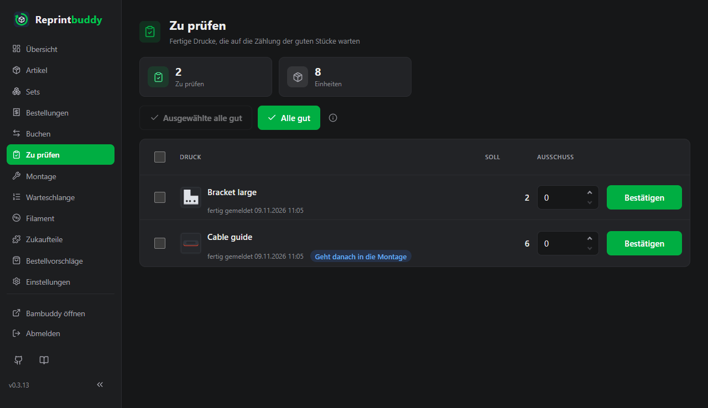
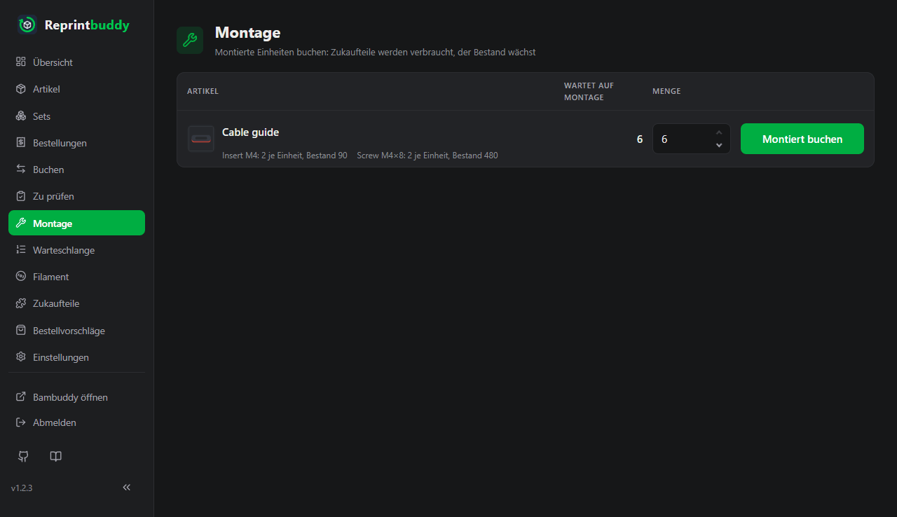
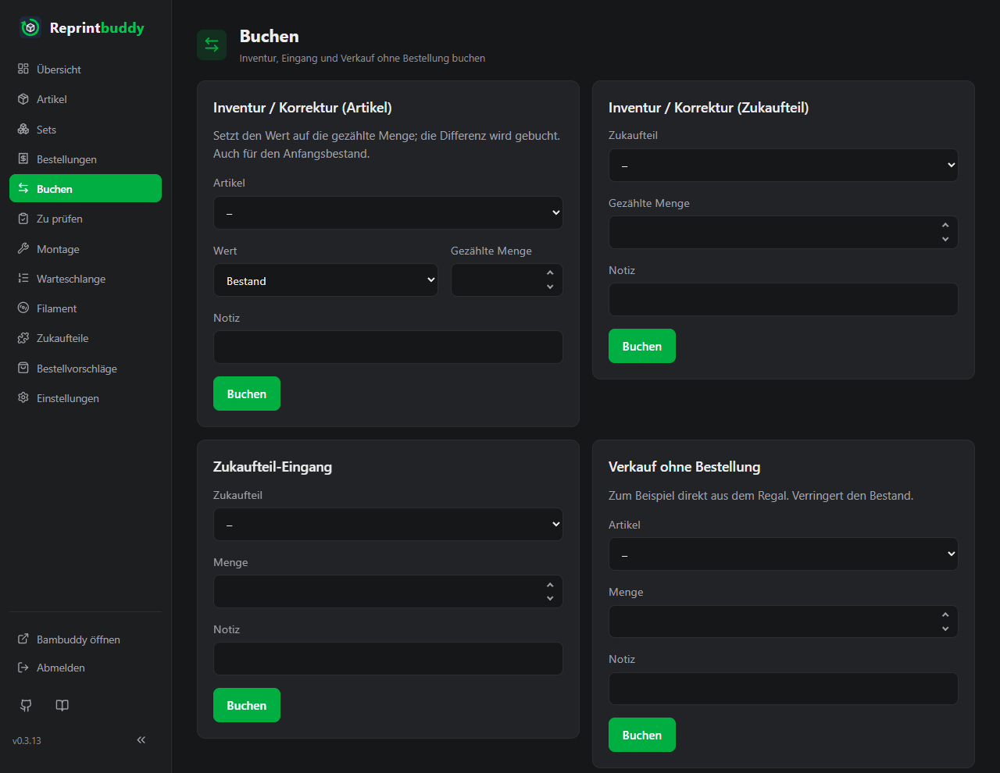
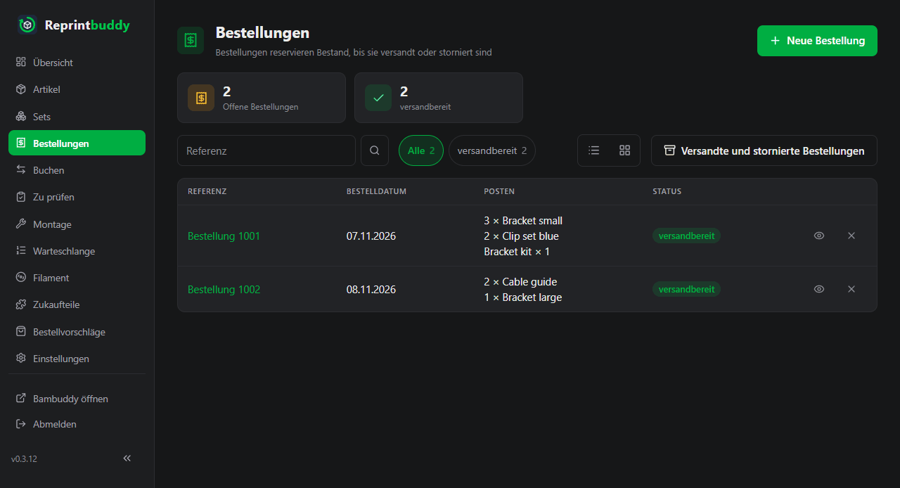

# Zu prüfen und Montage

Diese Seite begleitet ein gedrucktes Stück vom fertigen Druck bis ins Regal und zur Tür hinaus: du prüfst, was der Drucker gemacht hat, montierst es bei Handarbeit, buchst Bestandsänderungen von Hand, nimmst Bestellungen an und versendest sie. Alles, was du buchst, steht im Journal.

## Die Zahlen eines Artikels

Jeder Artikel hat diese Zähler. Sie ändern sich nur durch die unten beschriebenen Buchungen, nie durch Bearbeiten des Artikels.

| Zähler | Bedeutung |
|---|---|
| **Bestand** | Geprüfte Stücke, die verkaufsfertig sind, im Regal oder auf dem Weg dorthin. |
| **Reserviert** | Stücke in einer offenen Bestellung, die noch nicht versandt ist. |
| **Verfügbar** | **Bestand** minus **Reserviert**. Nur das kann verkauft werden. |
| **Vorläufig** | Stücke fertiger Drucke, die du noch nicht geprüft hast. |
| **Wartet auf Montage** | Geprüfte Stücke, die noch Handarbeit brauchen (siehe [Montage](#montage)). |

Reprintbuddy unterscheidet nicht, ob ein Stück im Regal liegt oder noch an der Druckplatte.

## Zu prüfen

Meldet Bambuddy einen Druck als fertig, bucht Reprintbuddy dessen Stücke als **Vorläufig** und legt eine Zeile in **Zu prüfen** an. Vorläufige Stücke lassen sich nicht verkaufen, zählen aber mit, wenn Reprintbuddy über einen Nachdruck entscheidet.

Jede Zeile zeigt den Artikel, wann der Druck fertig gemeldet wurde, und das **Soll**: die Zahl der Stücke, die der Druck liefern sollte. Bei Artikeln mit Handarbeit steht dazu die Plakette **Geht danach in die Montage**.

1. Zähle die guten Stücke des Drucks.
2. Trage die Stücke, die nicht gut sind, bei **Ausschuss** ein. Vorgabe ist 0, höchstens kannst du das Soll eintragen. Leer heißt 0; alles, was keine ganze Zahl von 0 bis zum Soll ist, wird mit einer Meldung abgelehnt, die diesen Bereich nennt.
3. Klicke auf **Bestätigen**.

Die guten Stücke sind das Soll minus Ausschuss. Sie werden **Bestand**, bei Handarbeit **Wartet auf Montage**. Der Ausschuss wird abgeschrieben, und Reprintbuddy stellt einen Ersatzdruck vorn in die Warteschlange, aufgerundet auf ganze Drucke. Der Ersatz kommt unabhängig vom Mindestbestand und auch dann, wenn die Automatik für den Artikel pausiert ist.

Mehrere Drucke bestätigst du auf einmal so:

- Hake die Zeilen an (das Kästchen im Tabellenkopf wählt alle) und klicke auf **Ausgewählte alle gut**. Der Knopf bleibt aus, solange nichts angehakt ist.
- Klicke auf **Alle gut**, um jede Zeile der Seite als ganz gut zu bestätigen.

Drucke, die inzwischen jemand anderes bestätigt hat, werden übersprungen; die Meldung nennt, wie viele.

Die Prüfung nimmt keine Notiz auf. Die Montage weiter unten auch nicht. Beide buchen mit einem Klick, und das Journal zeigt die Buchung ohne Notiz (alte Einträge behalten ihre).

### Nur ein Artikel

Die Liste kann nur einen Artikel zeigen. Dorthin führt der [QR-Code](labels.md) eines Artikels, wenn Drucke dieses Artikels auf die Prüfung warten. Ein Chip **Artikel: …** über der Liste zeigt den Filter; sein Kreuz hebt ihn auf. Mit Filter betreffen **Alle gut** und **Ausgewählte alle gut** nur die Drucke dieses Artikels.

!!! tip "Am Regal"
    Die Liste funktioniert am Handy. Scanne den QR-Code am Regalfach, zähle und bestätige.

## Montage

Die Seite **Montage** ist für Artikel, bei denen in den Einstellungen **Handarbeit nötig (Montage)** angehakt ist. Nach der Prüfung warten ihre guten Stücke hier, statt in den Bestand zu gehen. Die Liste zeigt je Artikel die wartenden Stücke, die nötigen Zukaufteile und wie viele davon du hast.

1. Erledige die Handarbeit.
2. Trage die montierten Stücke bei **Menge** ein. Vorgegeben sind alle wartenden Stücke.
3. Klicke auf **Montiert buchen**.

Die Stücke gehen von **Wartet auf Montage** in den **Bestand**, und die [Zukaufteile](#zukaufteile) werden abgezogen: Menge je Stück mal Zahl der montierten Stücke. Eine Teilezeile wird rot, wenn der Bestand nicht für alle wartenden Stücke reicht.

!!! note "Zu wenige Teile in den Büchern"
    Ist der Buchbestand eines Teils zu klein, wird die Buchung trotzdem angenommen, denn du hast die Teile ja in der Hand. Der Bestand des Teils wird auf 0 gesetzt, und eine Warnung nennt das Teil, wie viele im Bestand waren und wie viele nötig gewesen wären. Zähle die Teile danach mit einer Inventur-Buchung.

Stücke, die schon hier warten, bleiben buchbar, wenn du das Häkchen später abwählst. Artikel ohne Handarbeit überspringen diese Seite. Ihre Zukaufteile werden abgezogen, wenn du die Prüfung mit guten Stücken bestätigst.

## Buchen

Die Seite **Buchen** enthält die Bestandsänderungen, die zu keinem Druck und keiner Bestellung gehören. Jede Buchung hat ein **Datum** und eine optionale **Notiz** mit bis zu 500 Zeichen. Das Datum ist heute, wenn du es nicht änderst; ein früherer Tag geht, etwa für eine Lieferung, die gestern kam, ein späterer nicht. Die Zahlen ändert die Buchung in jedem Fall sofort; das Datum sagt, wann sie im Journal und im Verbrauch der Zukaufteile zählt. Eine Inventur mit einem früheren Datum gilt für jenen Tag: Reprintbuddy rechnet die Differenz gegen den Stand von damals, Buchungen danach bleiben. Beispiel: Gestern 10 gezählt, heute früh 2 verkauft – trag 10 mit gestrigem Datum ein, der Bestand ist dann 8. Gibt es nach dem Datum schon eine Inventur desselben Werts, lehnt Reprintbuddy ab, denn die spätere Zählung hat den Wert neu gesetzt. Im Journal steht unter den Änderungen **am Buchungstag … → …**. Unter den Formularen zeigt die Seite die letzten 20 Buchungen.

| Formular | Wirkung |
|---|---|
| **Inventur / Korrektur (Artikel)** | Setzt den gewählten **Wert**, **Bestand** oder **Wartet auf Montage**, auf die **Gezählte Menge**; die Differenz wird gebucht. Auch für den Anfangsbestand. |
| **Inventur / Korrektur (Zukaufteil)** | Dasselbe für den Bestand eines Zukaufteils. |
| **Zukaufteil-Eingang** | Addiert die eingegangene Menge zu einem Zukaufteil. |
| **Verkauf ohne Bestellung** | Nimmt Stücke aus dem **Bestand**, zum Beispiel ein Stück, das direkt aus dem Regal verkauft wurde. |
| **Einbuchen ohne Druck** | Bucht Stücke in den **Bestand**, die außerhalb von Reprintbuddy gedruckt wurden, zum Beispiel von Hand in Bambuddy. |

**Einbuchen ohne Druck** hat ein Häkchen **Zukaufteile abziehen**, vorbelegt an. Es zieht für jedes Stück die Zukaufteile des Artikels vom Teilebestand ab. Wähle es ab, wenn die Teile schon abgezogen sind.

## Bestellungen

Eine Bestellung reserviert Bestand, bis du sie versendest oder stornierst. Reprintbuddy speichert keine Kundendaten.

Öffne die Seite **Bestellungen** und klicke auf **Neue Bestellung**.

1. Trage eine **Referenz** ein, freien Text wie die Bestellnummer. Sie ist Pflicht. Gib keine Adressen oder Kundendaten ein.
2. Prüfe das **Bestelldatum**; vorgegeben ist heute.
3. Trage bei Bedarf eine **Notiz** ein.
4. Wähle unter **Posten** je Zeile einen Artikel oder ein Set und trage die **Menge** ein. **Mehr Zeilen** fügt Zeilen hinzu.
5. Wähle bei einem [Set mit Wahl](#sets) für jede Position mit Wahl den Artikel.
6. Klicke auf **Bestellung anlegen**.

Die bestellten Stücke werden **Reserviert**. **Verfügbar** kann unter null fallen, wenn du mehr bestellst, als du hast. Eine Bestellung lässt sich danach nicht ändern; storniere sie und lege sie neu an.

Die Liste zeigt offene Bestellungen mit dem Zustand **offen**, oder **versandbereit**, wenn jeder Artikel in der bestellten Menge im Bestand ist. Die Suche arbeitet auf der Referenz. **Versandte und stornierte Bestellungen** wechselt zu den abgeschlossenen, **Offene Bestellungen** zurück.

Öffne die Bestellung, um sie abzuschließen, mit einer optionalen **Notiz**:

- **Versand** gibt es nur, wenn die Bestellung versandbereit ist. Es nimmt die Stücke aus **Bestand** und **Reserviert**.
- **Storno** lässt dich mit **Ja, Bestellung stornieren** bestätigen und gibt dann die Reservierung frei. **Bestellung behalten** lässt sie offen.

Versand und Storno gelten immer für die ganze Bestellung, nie für einzelne Posten.

## Sets

Ein Set ist eine Zusammenstellung von Artikeln, die zusammen verkauft werden, mit Namen und optionaler Artikelnummer. Es hat keinen eigenen Bestand: Es ist so oft verfügbar, wie alle seine Positionen gleichzeitig verfügbar sind.

Eine Position hat eine Menge und einen oder mehrere Artikel. Bei einem Artikel ist die Position fest. Bei mehreren Artikeln wählst du bei der Bestellung einen aus. Ein Set ist **lieferbar**, wenn mindestens ein Set aus dem verfügbaren Bestand zusammenkommt, sonst **nicht lieferbar**.

Klicke unter **Sets** auf **Neues Set**, trage Name und Artikelnummer ein und fülle die Positionen: eine **Menge** und die **Artikel** (mit gedrückter Strg- oder Cmd-Taste mehrere wählen). Zeilen ohne Artikel werden übergangen; **Mehr Zeilen** fügt Zeilen hinzu. Ein Set braucht mindestens eine Position.

Die Bestellung eines Sets reserviert die einzelnen Artikel. Ein Set lässt sich nicht bestellen, wenn für eine Position kein aktiver Artikel mehr übrig ist. Sets werden archiviert, nicht gelöscht; eine bestehende Bestellung behält die Artikel, mit denen sie angelegt wurde.

## Zukaufteile

Zukaufteile sind die Dinge, die du in Artikel einbaust, etwa Gewindeeinsätze oder Schrauben. Die Seite **Zukaufteile** listet sie mit Bestand, Mindestbestand, Bestelleinheit und Lieferant. Der Lieferant ist ein Link auf den Bestell-Link und öffnet ihn in einem neuen Fenster. Mit **Neues Zukaufteil** legst du eines an.

| Feld | Bedeutung |
|---|---|
| **Name**, **Einheit** | Das Teil und seine Einheit. Die Einheit steht zuerst auf `pcs` (in der deutschen Oberfläche als Stk. angezeigt). |
| **Anfangsbestand** | Nur beim Anlegen. Danach ändert sich der Bestand nur durch Buchungen. |
| **Mindestbestand** | Darunter steht das Teil auf **unter Minimum**. |
| **Bestelleinheit (Stück je Packung)** | So viele Stück kommen in einer Packung. |
| **Mindestbestellmenge (Packungen)** | So viele Packungen muss eine Bestellung mindestens haben. |
| **Lieferzeit (Tage)** | Tage von der Bestellung bis zum Eintreffen, 0 bis 365. |
| **Sicherheitspolster** und seine Einheit | Eine Reserve, als Verbrauch in Tagen oder als Menge. |
| **Lieferant**, **Bestell-Link** | Der Lieferant als Text; der Link muss mit `http://` oder `https://` beginnen. |

Die Bestellfelder speisen die [Bestellvorschläge](reorder.md). Welche Teile ein Artikel braucht und wie viele je Stück, trägst du im Artikel ein (siehe [Artikel](articles.md)).

Ein Teil wird abgezogen, wenn ein Stück Bestand wird: bei der Prüfung für Artikel ohne Handarbeit, bei der Montage für Artikel mit Handarbeit und mit **Einbuchen ohne Druck**, solange **Zukaufteile abziehen** angehakt ist. Teile, die nur beigelegt werden, etwa ein Inbusschlüssel, zählen genauso.

Ein Teil lässt sich nur archivieren, wenn kein aktiver Artikel es braucht. Archivierte Teile verschwinden aus allen Listen und lassen sich wiederherstellen.

## Journal

Jede Buchung steht im Journal mit Zeit, Auslöser (**Von Hand** oder **Automatik**), Artikel, Teil oder Bestellung, Menge, den Zählern davor und danach und der Notiz. Auch die Aktionen der Automatik stehen dort, etwa dass ein Eintrag der Warteschlange an Bambuddy übergeben wurde.

Du erreichst es mit dem Knopf **Journal** in der Artikelliste und auf einem Artikel, mit dem Verlaufssymbol in den Listen und mit **Ganzes Journal** auf der Seite Buchen. Die Seite zeigt 100 Einträge, die neuesten zuerst nach dem Tag, an dem sie zählen; eine zurückdatierte Buchung zeigt ihr Datum und darunter **gespeichert …** mit der Zeit, zu der sie eingegeben wurde; **Älter** und **Neuer** blättern. Ein Journal, das für einen Artikel oder ein Teil geöffnet wurde, zeigt nur dessen Einträge.

Einträge werden nie gelöscht oder geändert. Einen Fehler korrigierst du mit einer weiteren Buchung, zum Beispiel einer Inventur.

## Regeln

- **Bestand**, **Reserviert**, **Vorläufig** und **Wartet auf Montage** werden nie negativ. Reprintbuddy lehnt eine Buchung ab, die das bewirken würde, und nennt den Zähler.
- **Verfügbar** darf negativ werden, wenn mehr bestellt ist, als im Bestand liegt. Es wird dann rot angezeigt.
- Auch ein Zukaufteil wird nie negativ. Die einzige Ausnahme ist der Verbrauch von Teilen bei Montage oder Prüfung, der den Bestand auf 0 setzt und warnt, wie oben beschrieben.
- Eine Buchung gilt ganz oder gar nicht: Wird ein Teil abgelehnt, ändert sich nichts.
- Ein Formular, das zweimal abgeschickt wird, bucht nur einmal.
