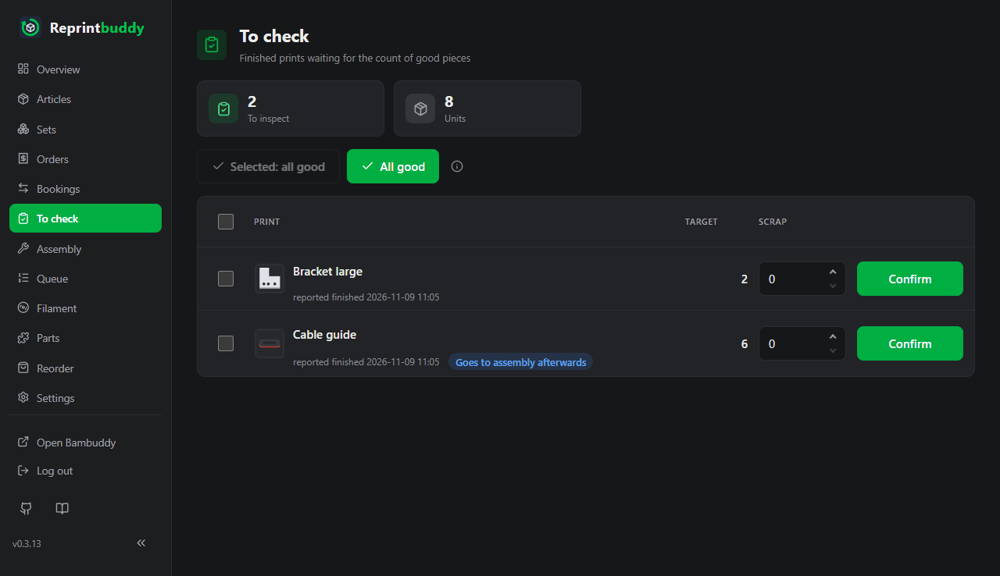
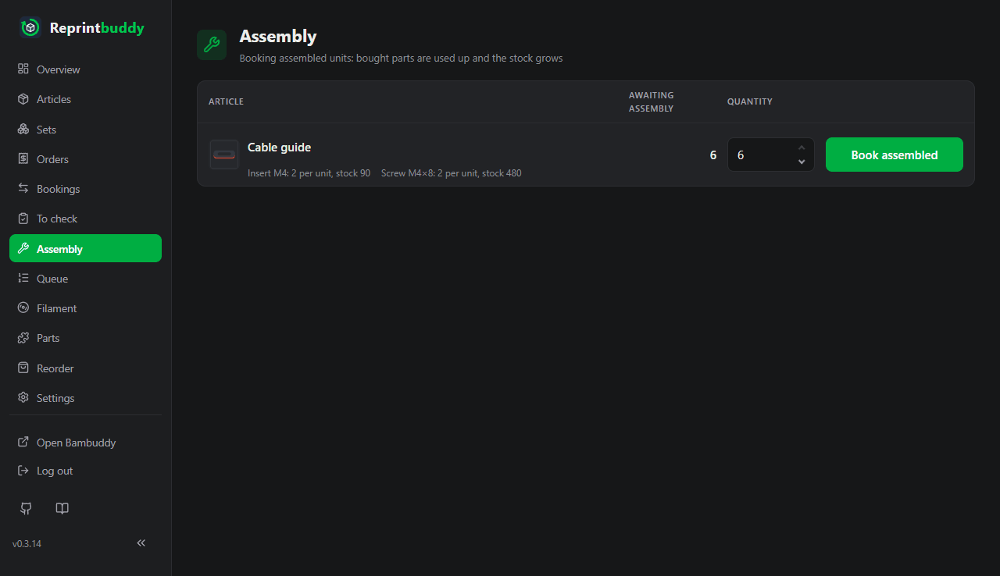
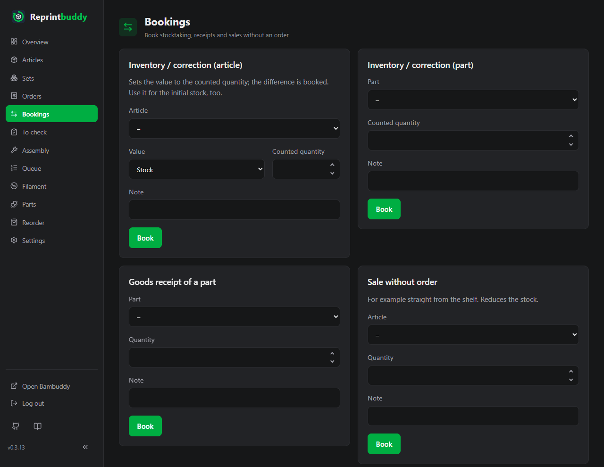
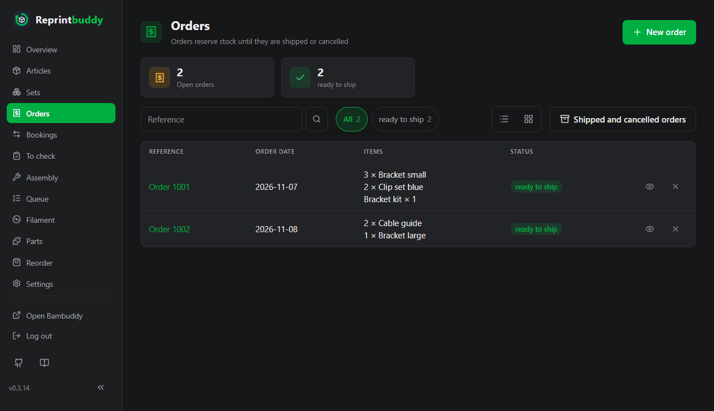
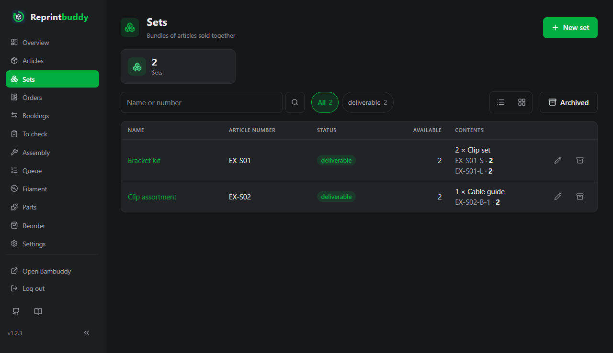
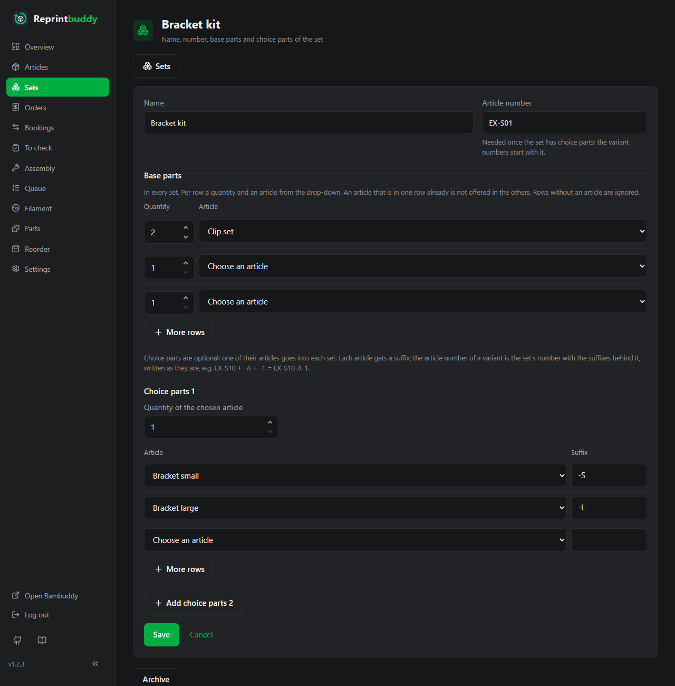

# To check and assembly

This page follows a printed piece from the finished print to the shelf and out of the door: you check what the printer made, assemble it if it needs hand work, book stock changes by hand, take orders and ship them. Everything you book lands in the journal.

## The numbers of an article

Every article carries these counters. They change only through the bookings described below, never by editing the article.

| Counter | Meaning |
|---|---|
| **Stock** | Checked pieces that are ready to sell, on the shelf or on the way there. |
| **Reserved** | Pieces that are in an open order and not shipped yet. |
| **Available** | **Stock** minus **Reserved**. Only this can be sold. |
| **Provisional** | Pieces of finished prints that you have not checked yet. |
| **Awaiting assembly** | Checked pieces that still need hand work (see [Assembly](#assembly)). |

Reprintbuddy does not tell apart a piece on the shelf from one still lying on the print plate.

## To check

When Bambuddy reports a print as finished, Reprintbuddy books its pieces as **Provisional** and adds one row to **To check**. Provisional pieces cannot be sold, but they count when Reprintbuddy decides whether to reprint.

Each row shows the article, when the print was reported finished, and the **Target**: the number of pieces the print should have made. A badge **Goes to assembly afterwards** appears for articles with hand work.

1. Count the good pieces of the print.
2. Enter the pieces that are not good in **Scrap**. The default is 0, the most you can enter is the target. Empty means 0; anything that is not a whole number from 0 to the target is refused with a message that names this range.
3. Press **Confirm**.

The good pieces are the target minus the scrap. They become **Stock**, or **Awaiting assembly** if the article needs hand work. The scrap is written off, and Reprintbuddy puts a replacement print at the front of the queue, rounded up to whole prints. The replacement comes whatever the minimum stock says, and also if the automation is paused for that article.

To confirm several prints at once:

- Tick the rows (the box in the table head ticks all of them) and press **Selected: all good**. The button stays off while nothing is ticked.
- Press **All good** to confirm every row on the page as fully good.

Prints that someone else confirmed in the meantime are skipped, and the message says how many.

The check takes no note. Neither does the assembly below. Both book with one click, and the journal shows the booking without a note (old entries keep theirs).

### Only one article

The list can show one article only. This is where the [QR code](labels.md) of an article leads when prints of that article wait for checking. A chip **Article: …** above the list shows the filter; its cross removes it. With the filter on, **All good** and **Selected: all good** touch only the prints of that article.

!!! tip "At the shelf"
    The list works on a phone. Scan the QR code on the shelf compartment, count, and confirm.

## Assembly

The page **Assembly** is for articles with **Manual work needed (assembly)** ticked in the article's settings, and for [assembled articles](assembled.md#assemble) (sections **From parts** and **For orders**). After checking, their good pieces wait here instead of going to stock. It lists each article with the pieces waiting, the bought parts it needs and how many of each you have.

1. Do the hand work.
2. Enter the pieces you assembled in **Quantity**. It starts with all waiting pieces.
3. Press **Book assembled**.

The pieces move from **Awaiting assembly** to **Stock**, and the [bought parts](#bought-parts) are deducted: the quantity per piece times the number assembled. A part line turns red when the stock does not cover all waiting pieces.

!!! note "Not enough parts in the books"
    If the book stock of a part is too low, the booking still goes through, because you have the parts in your hand. The part's stock is set to 0 and a warning names the part, how many were in stock and how many were needed. Count the parts afterwards with an inventory booking.

Pieces that already wait here stay bookable if you later untick the box. Articles without hand work skip this page. Their bought parts are deducted when you confirm the check with good pieces.

## Bookings

The page **Bookings** holds the stock changes that belong to no print and no order. Each booking has a **Date** and takes an optional **Note** of up to 500 characters. The date is today unless you change it; an earlier day is allowed, for example for a delivery that came yesterday, a later one is not. The booking changes the numbers at once either way; the date says when it counts in the journal and in the usage of bought parts. An inventory with an earlier date holds for the end of that day, in the time zone the times are shown in: Reprintbuddy takes the difference against the value of then, every booking of that day lies in the count, bookings after it stay. Example: you counted 10 yesterday evening and sold 2 this morning – enter 10 with yesterday's date, and the stock is 8. A sale yesterday afternoon is already in the count. If there is already an inventory of the same value after the date, Reprintbuddy refuses, because the later count set the value anew. It also refuses when a booking after it would go below 0 from the counted quantity; a use of bought parts after it takes off at most down to 0, as at assembly. The other way round, a sale, a receipt of bought parts or a stock in dated before an inventory of the stock it changes is refused: the count already holds it. The message names the item and the day of the count; if the booking came after the count, choose a later day or today. A count dated back takes in its whole day, also one dated back with an older version: it keeps its place within the day in the journal, but for this check it holds until the end of the day as well. The initial stock entered when a part is created counts as an inventory, too. A stock in with **Deduct parts** is refused as well when one of those parts was counted later; untick it if the parts are already in the count. In the journal the changes show **on the booking day … → …**. Below the forms the page shows the latest 20 bookings.

| Form | What it does |
|---|---|
| **Inventory / correction (article)** | Sets the **Value** you choose, **Stock** or **Awaiting assembly**, to the **Counted quantity**; the difference is booked. Use it for the starting stock, too. |
| **Inventory / correction (part)** | The same for the stock of a bought part. |
| **Goods receipt of a part** | Adds the received quantity to a bought part. |
| **Sale without order** | Takes pieces out of **Stock**, for example a piece sold straight from the shelf. |
| **Stock in without print** | Adds pieces to **Stock** that were printed outside Reprintbuddy, for example by hand in Bambuddy. |

**Stock in without print** has a box **Deduct parts**, ticked by default. It takes the bought parts of the article off the parts stock for every piece. Untick it when the parts were already deducted.

## Orders

An order reserves stock until you ship or cancel it. Reprintbuddy keeps no customer data.

Open the page **Orders** and press **New order**.

1. Enter a **Reference**, free text such as the order number. It is required. Do not enter addresses or customer data.
2. Check the **Order date**; it starts with today.
3. Add a **Note** if you like.
4. Under **Items**, pick an article or a set for each row and enter the **Quantity**. A [set with choice parts](#sets) is listed once per variant, with its number and the chosen articles, for example **Bracket kit · EX-S01-S (Bracket small)**: pick the variant. **More rows** adds rows.
5. Press **Place order**.

The ordered pieces become **Reserved**. An order of a variant keeps its number as it was when you ordered, even if the set changes later. **Available** may go below zero if you order more than you have. An order cannot be edited afterwards; cancel it and enter it again.

The list shows open orders with the state **open**, or **ready to ship** when every article is in stock in the ordered quantity. Search works on the reference. **Shipped and cancelled orders** switches to the closed ones, **Open orders** back.

Open the order to finish it, with an optional **Note**:

- **Ship** is offered only when the order is ready to ship. It takes the pieces out of **Stock** and **Reserved**.
- **Cancel order** asks you to confirm with **Yes, cancel the order** and then releases the reservation. **Keep the order** leaves it open.

Shipping and cancelling always apply to the whole order, never to single items.

## Sets

A set is a bundle of articles sold together, with a name and an article number (required once the set has choice parts). It has no stock of its own.

**Base parts** go into every set: per row a **Quantity** and an **Article**, chosen from a drop-down. An article that is in one row already is not offered in the others; an article is only once in a set.

**Choice parts** are optional: one of their articles goes into each set, for example the size of a plate. **Choice parts 1** holds any number of articles, each with a **Suffix**, and one **Quantity of the chosen article**. **Add choice parts 2** opens a second field of the same kind, for example the colour. Every combination is a **variant**. The article number of a variant is the set's number with the suffixes behind it, written as they are: set EX-S10 with choice parts 1 A `-A`, B `-B`, C `-C` and choice parts 2 D `-1`, E `-2` has the six variants EX-S10-A-1, EX-S10-A-2, EX-S10-B-1 … EX-S10-C-2; without choice parts 2 only EX-S10-A, EX-S10-B and EX-S10-C. Write the separator into the suffix yourself.

Rules when you save:

- A set with choice parts needs an article number; the suffixes in one field differ.
- Every variant has at least two different articles: two base parts, a base part and choice parts, or two fields of choice parts.
- Choice parts 2 only go with choice parts 1.
- Variant numbers are at most 64 characters long and unique: no article, set or other variant may have the same number, archived ones included.

**Availability.** A set without choice parts is available as often as all of its articles are available at the same time. With choice parts, each variant is available as often as a set of its own articles, and the list shows the whole set as **Available**: how many sets in any mix of the variants come from the available pieces at the same time. Example: base parts, A, B and C one each: every variant 1, together 1. Base parts 3, A 2, B 0, C 1: variant A 2, B 0, C 1, together 3. A set is **deliverable** when at least one set can be made, otherwise **not deliverable**.

Under **Sets** press **New set**. The form starts with three rows of base parts and of choice parts 1; **More rows** adds three to that part, and **Add choice parts 2** opens the second field. Rows without an article are ignored.

An order for a set reserves the single articles. A set cannot be ordered while one of its base parts is archived; a variant whose choice part is archived is not offered. Sets are archived, not deleted; an order that already exists keeps the articles and the variant number it was entered with. Small and large versions of a bundle are separate sets.

!!! note "Sets from an earlier version"
    Sets from version 0.3.17 or earlier are rebuilt by the update: a position with one article becomes a base part, the first and second position with a choice become choice parts 1 and 2. They have no suffixes yet, so the set shows **suffixes missing** and cannot be ordered until you add them (and an article number, if it has none). What the new form cannot hold, such as a third position with a choice, is dropped; the articles that can no longer be chosen are named under **Settings → Log** ([Log](../operate/log.md)). Orders entered before the update stay as they were.

## Bought parts

Bought parts are the items you build into articles, such as threaded inserts or screws. The page **Parts** lists them with their stock, minimum stock, order unit and supplier. It shows the default supplier, a link to its order link that opens in a new window. When the part has more suppliers, their number follows, for example **+ 1 more**. The order unit is the default supplier's. Press **New part** to add one.

| Field | Meaning |
|---|---|
| **Name**, **Unit** | The part and its unit. The unit starts as `pcs` (shown as Stk. in the German interface). |
| **Initial stock** | Only when you create the part. Later the stock changes only through bookings. |
| **Minimum stock** | Below it the part shows as **below minimum**. |
| **Safety margin** and its unit | A reserve, in days of usage or as a quantity. It belongs to the part, wherever you buy it. |
| **Suppliers** | Where you buy the part, see below. |

### Suppliers

A part has one to ten suppliers, for example when one shop cannot deliver and another sells other packs. Each supplier is a block of its own with these fields:

| Field | Meaning |
|---|---|
| **Name** | The supplier's name as text, optional. Without a name it is called **Supplier 1**, **Supplier 2** and so on. While you type, the field suggests names you have used before. |
| **Order link** | The order page; the link must start with `http://` or `https://`. |
| **Order unit (pieces per pack)** | How many pieces come in one pack from this supplier. |
| **Minimum order quantity (packs)** | The fewest packs one order from this supplier may have. |
| **Lead time (days)** | Days from ordering to arrival, 0 to 365. |

Exactly one supplier is the **Default**: its lead time decides whether Reprintbuddy suggests an order. A part with one supplier has it as the default without choosing. **Add supplier** adds another block, **Remove** takes one away; the last one stays. Everything is saved together with **Save**. If you remove the default, choose another one before saving.

A part from a version before 0.3.15 has exactly one supplier after the update, the default, with the values it had.

The suppliers feed the [reorder suggestions](reorder.md). Which parts an article needs, and how many per piece, you enter in the article (see [Articles](articles.md)).

A part is deducted when a piece becomes stock: at the check for articles without hand work, at assembly for articles with hand work, and with **Stock in without print** while **Deduct parts** is ticked. Parts that are only enclosed, such as a hex key, count the same.

A part can be archived only when no active article needs it. Archived parts leave all lists and can be restored.

## Journal

Every booking is written to the journal with the time, who triggered it (**Manual** or **Automation**), the article, part or order, the quantity, the counters before and after, and the note. The automation also writes its actions there, such as a queue entry being handed to Bambuddy.

You reach it with the **Journal** button on the article list and on an article, with the history icon in the lists, and with **Whole journal** on the Bookings page. The page shows 100 entries, newest first by the day they count; a booking dated back shows its date and, below it, **saved …** with the time it was entered; **Older** and **Newer** page through them. A journal opened for one article or part shows only its entries.

Entries are never deleted or changed. Correct a mistake with another booking, for example an inventory booking.

## Rules

- **Stock**, **Reserved**, **Provisional** and **Awaiting assembly** never go below zero. Reprintbuddy rejects a booking that would do this and says which counter it was.
- **Available** may go below zero when more is ordered than is in stock. It is shown in red.
- A bought part never goes below zero either. The only exception is the use of parts at assembly or check, which sets the stock to 0 and warns, as described above.
- A booking is all or nothing: if one part of it is rejected, nothing changes.
- A form that is sent twice books only once.
