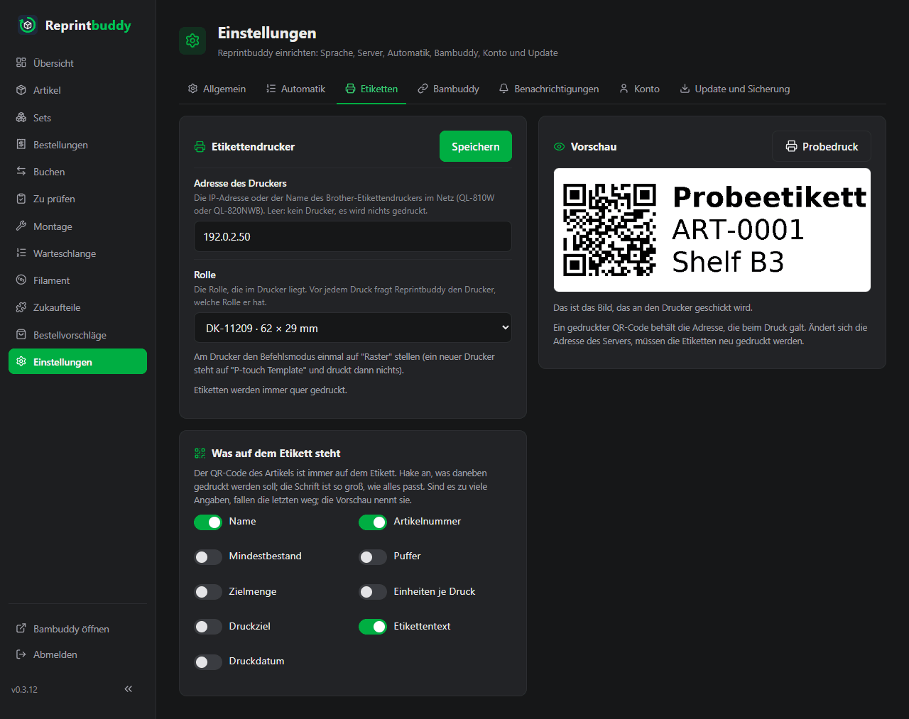
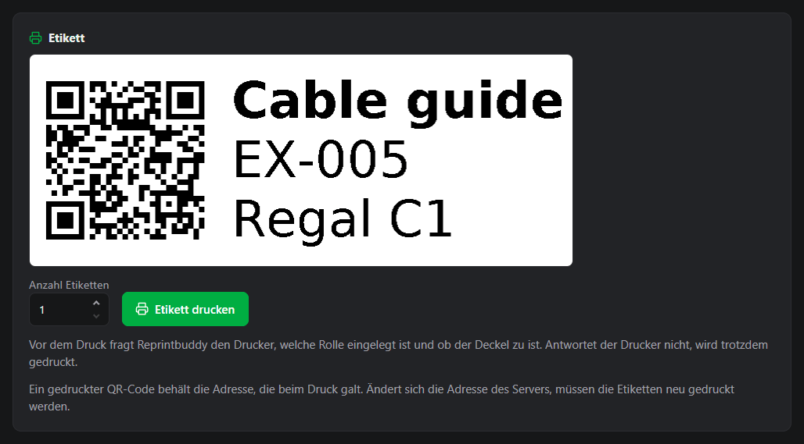

# Etiketten und QR-Codes

Jeder Artikel hat einen QR-Code. Klebe ihn aufs Regalfach: Wer ihn mit dem Handy scannt, sieht, was für diesen Artikel ansteht. Hast du einen Brother-Etikettendrucker im Netz, druckt Reprintbuddy den Code als Etikett.

## Der QR-Code eines Artikels

Ein Artikel hat einen Code, nicht einen je Druck. Du findest ihn auf der Seite des Artikels in der Karte **QR-Code**, zusammen mit der Adresse, die er trägt. **PNG herunterladen** und **SVG herunterladen** speichern das Bild.

Der Code enthält eine kurze, feste Adresse, zum Beispiel `http://<server-ip>:8080/a/12`, und sonst nichts. Was er öffnet, wird erst beim Scannen entschieden; ein gedruckter Code veraltet deshalb nie:

1. Warten Drucke des Artikels auf die Prüfung, öffnet er [Zu prüfen](inspection.md), gefiltert auf diesen Artikel.
2. Sonst, wenn Stücke des Artikels auf Montage warten, öffnet er **Montage**, gefiltert auf diesen Artikel.
3. Sonst öffnet er die Seite des Artikels.

Die Adresse liegt hinter der Anmeldung wie jede Seite. Wer einen Code ohne Anmeldung scannt, sieht zuerst die Anmeldeseite und landet danach beim Artikel.

### Welche Adresse im Code steht

Reprintbuddy ermittelt seine eigene Netzwerkadresse samt Port selbst und trägt sie in die Codes ein. Du gibst nichts ein. Dafür schickt es keinen Netzwerkverkehr los. Lauscht es auf einer bestimmten Adresse, gilt diese; sonst nimmt es die Adresse, über die die Anfrage hereinkam, oder die Adresse der Standardroute.

Nur für Sonderfälle, wenn du Reprintbuddy über einen Namen oder einen Proxy erreichst, kannst du eine andere Adresse eintragen:

1. Öffne *Einstellungen → Allgemein*, Karte **QR-Codes**.
2. Trage den Anfang der Adresse bei **Adresse für QR-Codes (nur für Sonderfälle)** ein, zum Beispiel `https://lager.example.com`. Sie muss mit `http://` oder `https://` beginnen und darf keinen Benutzernamen, kein `?` und kein `#` enthalten.
3. Klicke auf **Speichern**.

Die Zeile unter dem Feld zeigt, was die Codes tragen, solange es leer ist.

!!! warning "Ein gedruckter Code behält seine Adresse"
    Ein gedruckter QR-Code behält die Adresse, die beim Druck galt. Ändert sich die Adresse des Servers oder die Adresse, die du eingetragen hast, müssen die Etiketten neu gedruckt werden.

!!! note "Adresse nur für diesen Computer"
    Hat der Server keine eigene Netzwerkadresse, bleibt nur eine Loopback-Adresse übrig. Die Karte am Artikel warnt dann, dass die Adresse nur an diesem Computer funktioniert, nicht am Handy, und verweist auf die Einstellungen. Eine sehr lange Adresse macht die Punkte des Codes so fein, dass Handys ihn schlecht lesen; auch davor warnt die Vorschau des Etiketts.

## Etikettendrucker

Reprintbuddy druckt auf einem Brother QL-810W oder QL-820NWB in deinem Netz. Es schickt das Etikett an den Rohdaten-Port 9100 des Druckers und fragt seinen Zustand per SNMP ab (UDP-Port 161).

### Einrichten

1. Stelle am Drucker den Befehlsmodus einmal auf "Raster". Ein neuer Drucker steht auf "P-touch Template" und druckt dann nichts.
2. Lege die Rolle DK-11209 (62 × 29 mm, vorgestanzt) ein. Es ist die einzige Rolle, die Reprintbuddy kennt.
3. Öffne in Reprintbuddy *Einstellungen → Etiketten*.
4. Trage die IP-Adresse oder den Namen des Druckers bei **Adresse des Druckers** ein. Gib weder `http://` noch einen Port an und nicht die Adresse dieses Servers. Leer heißt: kein Drucker, es wird nichts gedruckt.
5. Prüfe die **Rolle**; es gibt nur die oben genannte.
6. Hake die Angaben fürs Etikett an (siehe unten) und klicke auf **Speichern**.

Etiketten werden immer quer gedruckt.

### Was auf dem Etikett steht

Der QR-Code des Artikels ist immer auf dem Etikett, links. Hake in der Karte **Was auf dem Etikett steht** an, was daneben gedruckt werden soll:

| Angabe | Zeigt |
|---|---|
| **Name** | Den Namen des Artikels, fett. |
| **Artikelnummer** | Die Artikelnummer. |
| **Mindestbestand** | Mit seinem Wort, zum Beispiel "Mindestbestand: 4". |
| **Puffer** | Mit seinem Wort. |
| **Zielmenge** | Mindestbestand plus Puffer, mit ihrem Wort. |
| **Einheiten je Druck** | Mit ihrem Wort. |
| **Druckziel** | Das Modell oder den Drucker, auf dem der Artikel gedruckt wird, mit seinem Wort. |
| **Etikettentext** | Den Etikettentext des Artikels, zum Beispiel das Regalfach. Den trägst du im Artikel ein. |
| **Druckdatum** | Das heutige Datum. |

Die Angaben stehen immer in dieser Reihenfolge, gleich in welcher du sie angehakt hast. Eine Angabe ohne Wert, etwa bei einem Artikel ohne Artikelnummer, ergibt keine Zeile. Zu Beginn sind **Name**, **Artikelnummer** und **Etikettentext** angehakt.

Die Schrift ist so groß, wie alles passt. Passen die Angaben nicht, fallen die letzten weg, und die Vorschau nennt sie. Eine zu lange Zeile wird mit "…" abgeschnitten, und die Vorschau sagt es. Die Vorschau warnt auch vor Zeichen, die die Schrift des Etiketts nicht kennt, vor Text, der von rechts nach links gelesen wird, und vor einem Code, der für Handys zu fein ist.

### Vorschau und Probedruck

Die Karte **Vorschau** zeigt das Etikett, wie es an den Drucker geht, mit Beispielwerten, und folgt deinen Häkchen sofort. **Probedruck** druckt ein Beispieletikett mit dem, was auf dem Bildschirm eingegeben und angehakt ist, ohne es zu speichern.

## Etikett drucken

1. Öffne den Artikel und gehe zur Karte **Etikett**. Sie zeigt das Etikett dieses Artikels, wie es jetzt gedruckt würde.
2. Trage die **Anzahl Etiketten** ein, von 1 bis 99.
3. Klicke auf **Etikett drucken**.

Ohne Druckeradresse steht in der Karte **Es ist kein Etikettendrucker eingerichtet.** mit einem Link zu den Einstellungen.

Vor dem ersten Etikett fragt Reprintbuddy den Drucker, welche Rolle eingelegt ist und wie es ihm geht. Es druckt nicht und nennt den Grund, wenn

- der Deckel offen ist,
- die Rolle zu Ende ist oder keine Rolle eingelegt ist,
- das Messer klemmt,
- der Drucker einen Fehler meldet,
- eine andere Rolle eingelegt ist als in den Einstellungen. Die Meldung nennt beide.

Antwortet der Drucker auf die Frage nicht, druckt Reprintbuddy trotzdem.

Weitere Hinweise:

- Es läuft immer nur ein Druck. Wer einen zweiten startet, erfährt, dass gerade ein Etikett gedruckt wird; gleich noch einmal versuchen.
- Ein Etikett wird nie von selbst ein zweites Mal gesendet. Bricht die Verbindung nach einigen Etiketten ab, nennt die Meldung, wie viele gesendet wurden. Sie werden vielleicht noch gedruckt, sieh also am Drucker nach, bevor du neu druckst.
- "Etikett an den Drucker gesendet" heißt, dass der Drucker den Auftrag übernommen hat. Ob das Etikett herauskommt, weiß nur der Drucker.
- Eine Serie vieler Etiketten hat eine Zeitgrenze von etwa zweieinhalb Minuten.
