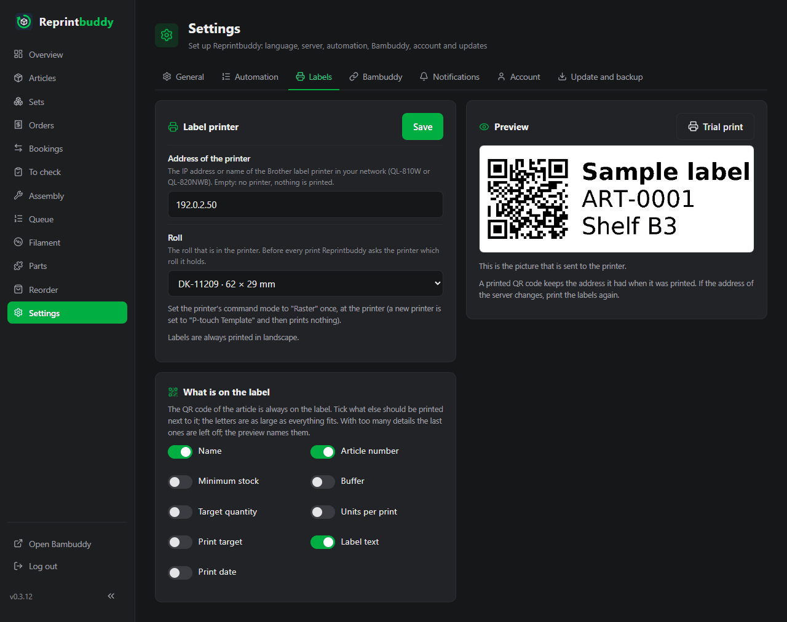
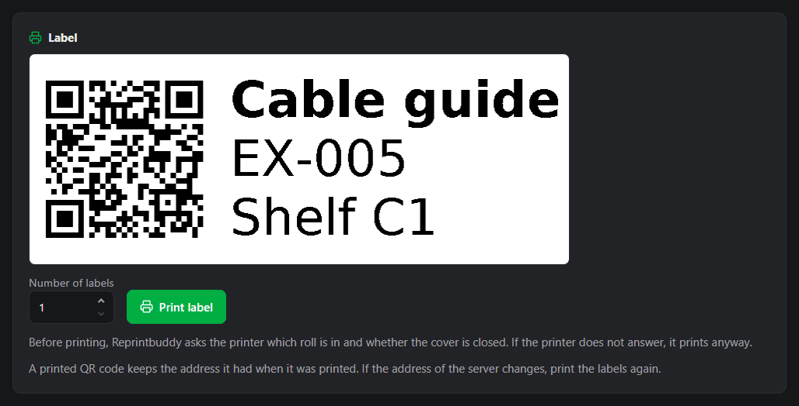

# Labels and QR codes

Every article has a QR code. Stick it on the shelf compartment: scanning it with a phone opens what waits for that article. If you own a Brother label printer on your network, Reprintbuddy prints the code as a label for you.

## The QR code of an article

An article has one code, not one per print. You find it on the article's page in the card **QR code**, together with the address it carries. **Download PNG** and **Download SVG** save the picture.

The code holds one short, fixed address, `http://<server-ip>:8080/a/12` for example, and nothing else. What it opens is decided when you scan it, so a printed code never goes stale:

1. If prints of the article wait for checking, it opens [To check](inspection.md) filtered on this article.
2. Otherwise, if pieces of the article wait for assembly, it opens **Assembly** filtered on this article.
3. Otherwise it opens the page of the article.

The address is behind the sign-in like every page. Whoever scans a code without being signed in gets the sign-in page first and lands on the article afterwards.

### Which address the code carries

Reprintbuddy finds its own network address and port itself and puts them into the codes. You enter nothing. It sends no network traffic to find out. If it listens on one specific address, that is the one; otherwise it takes the address the request came in on, or the address of the default route.

Only for special cases, when you reach Reprintbuddy through a name or a proxy, you can enter another address:

1. Open *Settings → General*, card **QR codes**.
2. Enter the start of the address in **Address for QR codes (special cases only)**, for example `https://stock.example.com`. It must start with `http://` or `https://` and contain no user name, `?` or `#`.
3. Press **Save**.

The line below the field shows what the codes carry while it is empty.

!!! warning "A printed code keeps its address"
    A printed QR code keeps the address it had when it was printed. If the address of the server changes, or the address you entered, print the labels again.

!!! note "Address only for this computer"
    If the server has no network address of its own, only a loopback address is left. The card on the article then warns that the address works only on this computer, not on a phone, and links to the settings. A very long address makes the dots of the code so fine that phones read it badly; the label preview warns about that, too.

## Label printer

Reprintbuddy prints on a Brother QL-810W or QL-820NWB in your network. It sends the label to the printer's raw port 9100 and asks for its state over SNMP (UDP port 161).

### Set up

1. At the printer, set the command mode to "Raster" once. A new printer is set to "P-touch Template" and then prints nothing.
2. Insert the roll DK-11209 (62 × 29 mm, die-cut). It is the only roll Reprintbuddy knows.
3. In Reprintbuddy open *Settings → Labels*.
4. Enter the IP address or the name of the printer in **Address of the printer**. Do not enter `http://` or a port, and not the address of this server. Empty means no printer: nothing is printed.
5. Check **Roll**; it offers only the one above.
6. Tick the details for the label (below) and press **Save**.

Labels are always printed in landscape.

### What is on the label

The QR code of the article is always on the label, on the left. Tick what else should be printed next to it, in the card **What is on the label**:

| Detail | Shows |
|---|---|
| **Name** | The name of the article, in bold. |
| **Article number** | The article number. |
| **Minimum stock** | With its word, for example "Minimum stock: 4". |
| **Buffer** | With its word. |
| **Target quantity** | Minimum stock plus buffer, with its word. |
| **Units per print** | With its word. |
| **Print target** | The model or printer the article prints on, with its word. |
| **Label text** | The label text of the article, for example the shelf compartment. You enter it in the article. |
| **Print date** | Today's date. |

The details always appear in this order, whichever order you ticked them. A detail without a value, for example an article without article number, gives no line. **Name**, **Article number** and **Label text** are ticked at the start.

The letters are as large as everything fits. If the details do not fit, the last ones are left off and the preview names them. A line that is too long is cut with "…", and the preview says so. The preview also warns about characters the label font does not have, about text that is read from right to left, and about a code that is too fine for phones.

### Preview and trial print

The card **Preview** shows the label as it goes to the printer, with sample values, and follows your ticks at once. **Trial print** prints one sample label with what is typed and ticked on the screen, without saving it.

## Print a label

1. Open the article and go to the card **Label**. It shows the label of this article as it would print now.
2. Enter the **Number of labels**, from 1 to 99.
3. Press **Print label**.

Without a printer address the card says **No label printer is set up.** and links to the settings.

Before the first label Reprintbuddy asks the printer which roll is in and how it is. It does not print, and says why, when:

- the cover is open,
- the roll is used up or there is no roll,
- the cutter is jammed,
- the printer reports an error,
- another roll is in than the one in the settings. The message names both.

If the printer does not answer the question, Reprintbuddy prints anyway.

Other things to know:

- One print runs at a time. A second one is told that a label is being printed right now; try again in a moment.
- A label is never sent twice by itself. If the connection breaks after some labels, the message says how many were sent. They may still be printing, so look at the printer before you print again.
- "Label sent to the printer" means the printer took the job. Whether the label came out, only the printer knows.
- A series of many labels has a time limit of about two and a half minutes.
