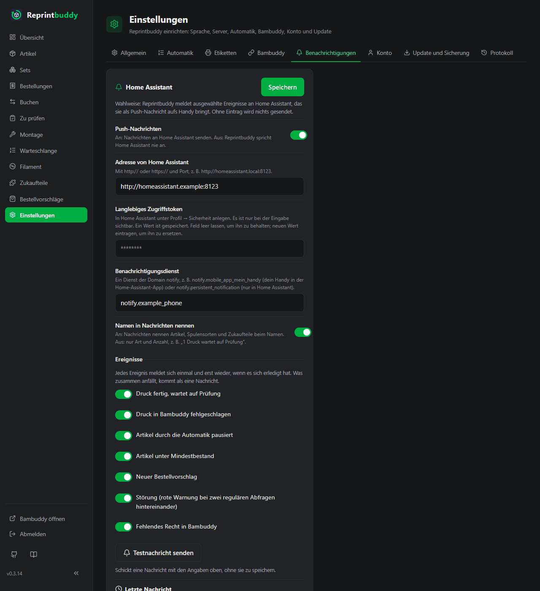

# Push-Nachrichten

Reprintbuddy kann Ereignisse an [Home Assistant](https://www.home-assistant.io/) melden, das sie über seine App als Push-Nachricht aufs Handy bringt: ein Druck wartet auf die Prüfung, ein Artikel wird knapp, etwas muss bestellt werden.

Das ist wahlweise. Ohne Eintrag wird nichts gesendet, und Home Assistant wird nie angesprochen. In Reprintbuddy läuft alles wie bisher; eine Nachricht kommt nur zu dem hinzu, was du in der Oberfläche siehst.

## Einrichten

Du brauchst ein laufendes Home Assistant, das Reprintbuddy erreichen kann, und die Home-Assistant-App auf deinem Handy.

1. Lege in Home Assistant einen eigenen Benutzer **ohne Admin-Recht** an (empfohlen), melde dich als dieser Benutzer an und erzeuge unter deinem Profil → *Sicherheit* ein *langlebiges Zugriffstoken*. Kopiere es: Home Assistant zeigt es nur einmal.
2. Finde den Benachrichtigungsdienst deines Handys. In Home Assistant ist es eine der Aktionen `notify.mobile_app_…` unter *Entwicklerwerkzeuge → Aktionen*, eine je Handy mit der App.
3. Öffne in Reprintbuddy *Einstellungen → Benachrichtigungen* und fülle die Karte **Home Assistant**:
    - Schalte **Push-Nachrichten** ein.
    - **Adresse von Home Assistant**: mit `http://` oder `https://` und Port, zum Beispiel `http://homeassistant.local:8123`.
    - **Langlebiges Zugriffstoken**: das Token aus Schritt 1.
    - **Benachrichtigungsdienst**: zum Beispiel `notify.mobile_app_mein_handy`.
    - Hake die gewünschten Ereignisse an (siehe unten).
    - Klicke auf **Testnachricht senden**. Dein Handy sollte eine Nachricht von Reprintbuddy zeigen.
    - Klicke auf **Speichern**.

Bei eingeschaltetem Schalter sind Adresse, Token und Dienst Pflicht.

!!! note "Erst testen, dann speichern"
    **Testnachricht senden** nimmt, was auf dem Bildschirm steht, und speichert nichts. Reprintbuddy schreibt ein eingetipptes Token nie zurück in die Seite; gib das Token deshalb nach dem Test noch einmal ein, bevor du auf **Speichern** klickst. Nach dem Speichern zeigt das Feld nur, dass ein Token gespeichert ist; lass es leer, um es zu behalten. Ein gespeichertes Token bleibt nur für dieselbe Adresse erhalten, samt Pfad (hinter einem Proxy kann ein anderer Pfad ein anderer Dienst sein): Änderst du die Adresse, gib das Token neu ein. Speicherst du bei ausgeschalteten Nachrichten mit einer neuen oder geleerten Adresse, wird das gespeicherte Token verworfen, und die Seite sagt es („Das gespeicherte Token ist verworfen, weil sich die Adresse geändert hat …“); zum Einschalten gib das Token neu ein.

!!! tip "Ein erster Test ohne Handy"
    Der Dienst `notify.persistent_notification` zeigt die Nachricht nur in Home Assistant selbst. Er eignet sich, um die Verbindung auszuprobieren.

## Was gemeldet wird

Sieben Ereignisse, jedes einzeln anhakbar. Zu Beginn sind alle an.

| Ereignis | Meldet |
|---|---|
| **Druck fertig, wartet auf Prüfung** | Je Druck einmal, mit Artikel und Stückzahl. Nur Drucke, die nach dem Einschalten der Nachrichten fertig wurden und nicht älter als 7 Tage sind. |
| **Druck in Bambuddy fehlgeschlagen** | Je Druck einmal. Ersatz kommt nach den Regeln unter [Automatik](automation.md#ersatz-fur-ausschuss-und-fehlschlage): bei einem Druck aus dem Mindestbestand nur, wenn die Zielmenge ihn braucht. |
| **Artikel durch die Automatik pausiert** | Den Artikel und den Grund, zum Beispiel "zwei Fehlschläge hintereinander", "in Bambuddy abgebrochen", "Druckdatei geändert" oder "kein Druckziel". Eine Pause, die du selbst auslöst, indem du einen Eintrag der Warteschlange verringerst, wird nicht gemeldet. |
| **Artikel unter Mindestbestand** | Einen Artikel im Zustand *unter Minimum* oder *überbucht*, gemessen, nachdem die Nachdruck-Regel gelaufen ist. *Knapp* (gelb) wird nicht gemeldet, weil der Nachdruck dann schon läuft. |
| **Neuer Bestellvorschlag** | Einen neuen Vorschlag für Filament oder ein Zukaufteil, siehe [Bestellvorschläge](reorder.md). |
| **Störung (rote Warnung bei zwei regulären Abfragen hintereinander)** | Eine rote Warnung der Übersicht, die zwei reguläre Abfragen lang besteht: Bambuddy nicht erreichbar, Bambuddy hat einen Druck oder die Abfrage abgelehnt, eine Übergabe bleibt unklar, Reprintbuddys eigener Bambuddy-Benutzer nicht gefunden, doppelte Einträge in Bambuddys Warteschlange, eine fehlgeschlagene Suche nach einer unklaren Übergabe. Die Warnung "Home Assistant nicht erreichbar" zählt nicht. |
| **Fehlendes Recht in Bambuddy** | Dem Schlüssel von Reprintbuddy fehlt in Bambuddy ein Recht; die Nachricht nennt die Rechte. |

Wähle ein Ereignis ab, um seine Nachrichten abzustellen. Hakst du es später wieder an, wird gemeldet, was dann gerade gilt, und zwar einmal. Drucke, die fertig wurden, während das Ereignis abgewählt war, werden endgültig übergangen.

### Keine Flut von Nachrichten

- Ein Druck wird einmal gemeldet.
- Die übrigen Ereignisse beschreiben einen Zustand. Jedes meldet sich einmal je Gegenstand, um den es geht, etwa einen Artikel, eine Spulensorte oder ein Zukaufteil. Eine neue Nachricht kommt erst, wenn sich der Anlass erledigt hat und dann wiederkommt. Erledigt heißt: die Pause ist aufgehoben; der Artikel ist nicht mehr rot; der Vorschlag wurde als bestellt markiert und ist eingetroffen, oder er ist bei bekanntem Bestand seit 7 Tagen weg (eine zurückgenommene Bestellung erledigt nichts); die Störung war bei einer Abfrage nicht mehr da; das Recht ist wieder vorhanden.
- Was in einem Durchlauf der Automatik zusammenkommt, geht als eine Nachricht je Ereignisart, zum Beispiel "2 Drucke warten auf Prüfung: A, B".
- Es gibt keine Entwarnung, keine Ruhezeiten und keine Tageszusammenfassung.
- Ein Neustart schickt nichts doppelt. Auch das [Wiederherstellen](../operate/update-backup.md#wiederherstellen) einer älteren Sicherung nicht, sofern die Nachrichten vorher und nachher eingeschaltet sind: Was vor dem Wiederherstellen gemeldet wurde, gilt als gemeldet. Auf eine Nachricht, die gerade unterwegs ist, wenn das Wiederherstellen beginnt, wartet es bis zu 10 Sekunden; nimmt Home Assistant sie an, gilt sie als gemeldet. Nur wenn Home Assistant länger braucht, kann sie noch einmal kommen. Ein [Update](../operate/update-backup.md#update-aus-der-oberflache), das du mit dem Knopf startest, wartet genauso, bevor es beginnt. Ein Update, das du auf der Kommandozeile eingibst (`reprintbuddy update`), wartet nicht: Eine Nachricht, die in dem Moment unterwegs ist, kann nach dem Update noch einmal kommen.

### Namen in Nachrichten

Ist **Namen in Nachrichten nennen** an (Vorgabe), nennen die Nachrichten Artikel, Spulensorten und Zukaufteile beim Namen. Ist es aus, sagen sie nur, was geschehen ist und wie oft, zum Beispiel "1 Druck wartet auf Prüfung." Die Nachricht zum fehlenden Recht nennt die Rechte in jedem Fall.

Die Nachrichten kommen in der Sprache der Oberfläche, mit festen Texten. Tippst du eine Nachricht an, öffnet sich die passende Seite von Reprintbuddy: **Zu prüfen**, der Artikel, die Bestellvorschläge oder die Übersicht. Der Link nutzt dieselbe Adresse wie die [QR-Codes](labels.md).

!!! warning "Titel und Text laufen über Google oder Apple"
    Titel und Text von Push-Nachrichten aufs Handy laufen über den Push-Dienst von Google bzw. Apple. Schalte **Namen in Nachrichten nennen** aus, wenn Artikelnamen nicht diesen Weg nehmen sollen.

## Das Ergebnis einer Nachricht

Der Abschnitt **Letzte Nachricht** in der Karte zeigt Zeit und Ergebnis der zuletzt gesendeten Nachricht, oder "Seit dem Start wurde keine Nachricht gesendet." Die Testnachricht zeigt ihr Ergebnis mit denselben Worten:

| Ergebnis | Bedeutung |
|---|---|
| von Home Assistant angenommen | Home Assistant hat die Nachricht übernommen. Ob das Handy sie bekommt, weiß nur Home Assistant. |
| Token abgelehnt (401) | Das Token ist falsch oder wurde widerrufen. Erzeuge ein neues. Hat eine reguläre Nachricht oder die Prüfung diese Antwort bekommen, hält Reprintbuddy an (siehe unten). |
| Dienst unbekannt oder Daten falsch (400) | Den Benachrichtigungsdienst gibt es nicht. Prüfe seinen Namen. |
| Absender gesperrt (403) | Home Assistant hat die Adresse von Reprintbuddy gesperrt. |
| Fehler in Home Assistant (5xx) | Home Assistant selbst hat versagt. |
| auf eine andere Adresse umgeleitet | Reprintbuddy folgt Umleitungen nicht. Trage die endgültige Adresse ein. |
| nicht erreichbar | Keine Verbindung. Prüfe die Adresse und ob Home Assistant läuft. |
| unklar | Keine Antwort in der Zeit. Home Assistant kann die Nachricht trotzdem senden. |
| von Home Assistant abgelehnt | Eine andere Antwort, die kein Erfolg ist. |

Reprintbuddy wartet bis zu 5 Sekunden auf die Verbindung und insgesamt 30 Sekunden und versucht es einmal je Durchlauf. Den Antworttext von Home Assistant zeigt es nie.

Geht eine Nachricht nicht durch, zeigt die Übersicht die Warnung "Home Assistant nicht erreichbar – die letzte Push-Nachricht ging nicht durch" mit dem Grund. Bestand und Drucken bleiben davon unberührt. Die Warnung verschwindet, wenn eine Nachricht angenommen wird, wenn die Prüfung von Reprintbuddy (siehe unten) bei einer regulären Abfrage gelingt oder wenn du die Nachrichten ausschaltest.

Ein Druck, der nicht gemeldet werden konnte (Ereignisse 1 und 2), wird später nicht nachgeholt. Ein Zustand, der noch besteht, wird beim nächsten Durchlauf erneut versucht. Deshalb kann eine Nachricht, deren Antwort unklar war, doppelt ankommen.

## Sicherheit

- Das Token ist ein sensibles Datum und handelt mit allen Rechten seines Benutzers. Deshalb wird ein eigener Benutzer ohne Admin-Recht empfohlen. Reprintbuddy zeigt das Token nur, solange du es eintippst, und lässt es aus Exporten heraus.
- Das Token geht nur an die gespeicherte Adresse, samt Pfad. Änderst du die Adresse, gibst du das Token neu ein; eine neue oder geleerte Adresse verwirft das gespeicherte Token.
- Umleitungen werden nicht verfolgt.
- Reprintbuddy ruft nur Dienste der Domain `notify` auf. `notify.send_message` wird nicht angenommen, weil es keinen Link kennt.
- HTTPS-Zertifikate werden geprüft, wie bei der Verbindung zu Bambuddy. Es gibt keinen Schalter, das abzuschalten.
- Reprintbuddy ruft `POST /api/services/notify/<Dienst>` auf und nach einer fehlgeschlagenen Nachricht `GET /api/`, um zu sehen, ob Home Assistant wieder antwortet. Sonst nichts.

!!! warning "Falsche Tokens können Reprintbuddy aussperren"
    Jeder Versuch mit einem falschen Token zählt in Home Assistant als Fehlanmeldung, und ist dort die IP-Sperre eingeschaltet, sperrt Home Assistant die Adresse von Reprintbuddy, bis du die Sperre dort aufhebst. Bekommt eine reguläre Nachricht oder die Prüfung, ob Home Assistant antwortet, **Token abgelehnt (401)**, hält Reprintbuddy deshalb sofort an: Es sendet nichts mehr und prüft auch nicht, ob Home Assistant antwortet, bis du die Karte erneut speicherst. Die Übersicht zeigt die Warnung „Home Assistant lehnt das Token ab – Reprintbuddy sendet nichts mehr, bis das Token unter Einstellungen → Benachrichtigungen neu eingetragen und gespeichert ist.“ Der Halt bleibt über einen Neustart und über ein Update erhalten. Korrigiere das Token unter *Einstellungen → Benachrichtigungen* und speichere (Speichern bei ausgeschalteten Nachrichten hebt den Halt ebenfalls auf). Drucke, die während des Halts fertig wurden, werden nicht nachgemeldet. Die Antwort **Absender gesperrt (403)** hält Reprintbuddy nicht an: Sie bleibt ein gewöhnlicher Fehler, der bei den nächsten Durchläufen erneut versucht wird.
