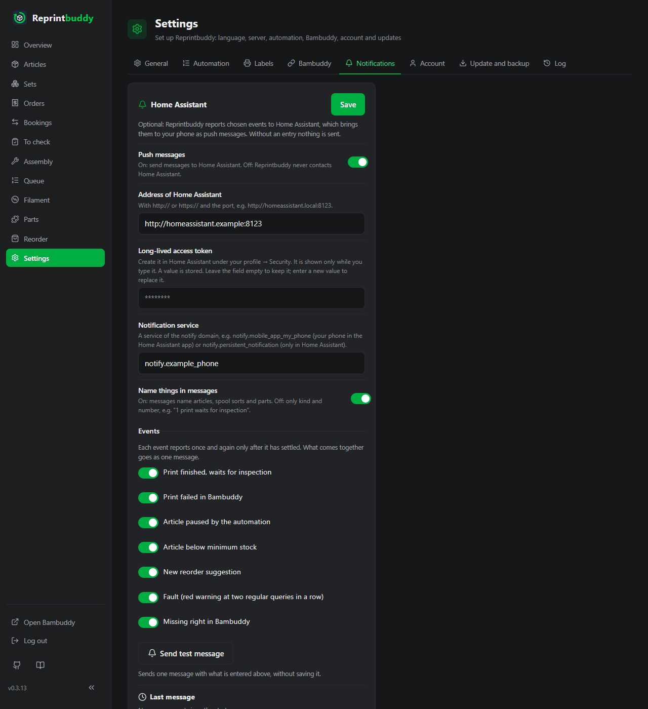

# Push messages

Reprintbuddy can report events to [Home Assistant](https://www.home-assistant.io/), which brings them to your phone as push messages through its app: a print waits for checking, an article ran low, something needs ordering.

This is optional. Without an entry nothing is sent and Home Assistant is never contacted. Everything in Reprintbuddy works as before; a message only comes on top of what you see in the interface.

## Set up

You need a running Home Assistant that Reprintbuddy can reach, with the Home Assistant app on your phone.

1. In Home Assistant, create a user of its own **without admin rights** (recommended), sign in as that user and create a *long-lived access token* under your profile → *Security*. Copy it: Home Assistant shows it only once.
2. Find the notification service of your phone. In Home Assistant it is one of the actions `notify.mobile_app_…` under *Developer tools → Actions*, one per phone with the app.
3. In Reprintbuddy open *Settings → Notifications* and fill the card **Home Assistant**:
    - Switch **Push messages** on.
    - **Address of Home Assistant**: with `http://` or `https://` and the port, for example `http://homeassistant.local:8123`.
    - **Long-lived access token**: the token from step 1.
    - **Notification service**: for example `notify.mobile_app_my_phone`.
    - Tick the events you want (see below).
    - Press **Send test message**. Your phone should show a message from Reprintbuddy.
    - Press **Save**.

With the switch on, address, token and service are all required.

!!! note "Test first, then save"
    **Send test message** uses what is typed on the screen and saves nothing. Reprintbuddy never writes a token you typed back into the page, so after the test enter the token once more before you press **Save**. After saving, the field only shows that a token is stored; leave it empty to keep it. A stored token is kept only for the same address, path included (behind a proxy another path can be another service): if you change the address, enter the token again. If you save with the messages switched off and a new or emptied address, the stored token is dropped and the page says so ("The stored token was dropped because the address changed …"); to switch the messages on again, enter the token again.

!!! tip "A first test without a phone"
    The service `notify.persistent_notification` shows the message only inside Home Assistant. It is good for trying the connection.

## What is reported

Seven events, each ticked on its own. All are on at the start.

| Event | Reports |
|---|---|
| **Print finished, waits for inspection** | Once for every print, with the article and the number of pieces. Only prints that finished after you switched messages on, and not older than 7 days. |
| **Print failed in Bambuddy** | Once for every print. The replacement is already queued. |
| **Article paused by the automation** | The article and the reason, for example "two failures in a row", "cancelled in Bambuddy", "print file changed" or "no print target". A pause you cause yourself by reducing a queue entry is not reported. |
| **Article below minimum stock** | An article in the state *below minimum* or *overbooked*, checked after the reprint rule has run. *Low* (yellow) is not reported, because the reprint is already under way. |
| **New reorder suggestion** | A new suggestion for filament or a bought part, see [Reorder suggestions](reorder.md). |
| **Fault (red warning at two regular queries in a row)** | A red warning of the overview that lasts for two regular queries: Bambuddy not reachable, Bambuddy refused a print or the query, a hand-over that stays unclear, Reprintbuddy's own Bambuddy user not found, duplicate entries in Bambuddy's queue, a failed search for an unclear hand-over. The warning "Home Assistant not reachable" does not count. |
| **Missing right in Bambuddy** | The key of Reprintbuddy lacks a right in Bambuddy; the message names the rights. |

Untick an event to stop its messages. If you tick it again later, what holds at that moment is reported once. Prints that finished while the event was unticked are passed over for good.

### No flood of messages

- A print is reported once.
- The other events describe a state. Each is reported once for every thing it concerns, such as an article, a spool sort or a part. A new message comes only after the cause has settled and then comes back. Settled means: the pause is lifted; the article is no longer red; the suggestion was marked as ordered and has arrived, or it has been gone for 7 days while the stock was known; the fault was gone at a query; the right is there again.
- Whatever comes together in one pass of the automation goes as one message for each kind of event, for example "2 prints wait for inspection: A, B".
- There are no all-clear messages, no quiet hours and no daily summary.
- A restart does not send anything twice. Neither does a [restore](../operate/update-backup.md#restore) of an older backup, as long as the messages are switched on both before and after it: what was reported before the restore counts as reported. Only a message that was on its way just when the restore began can arrive once more.

### Names in messages

With **Name things in messages** on (the default), messages name articles, spool sorts and parts. With it off, they say only what happened and how many, for example "1 print waits for inspection." The missing-right message names the rights either way.

Messages come in the language of the interface, with fixed texts. Tapping a message opens the matching page of Reprintbuddy: **To check**, the article, the reorder suggestions or the overview. The link uses the same address as the [QR codes](labels.md).

!!! warning "Titles and texts pass through Google or Apple"
    Titles and texts of push messages to a phone pass through the push service of Google or Apple. Switch off **Name things in messages** if article names should not travel that way.

## The result of a message

The card shows the time and result of the **Last message**, or "No message sent since the start." The test message shows its result in the same words:

| Result | Meaning |
|---|---|
| accepted by Home Assistant | Home Assistant took the message. Whether the phone got it, only Home Assistant knows. |
| token refused (401) | The token is wrong or was revoked. Create a new one. After a regular message or the check got this answer, Reprintbuddy stops (see below). |
| service unknown or data wrong (400) | The notification service does not exist. Check its name. |
| sender blocked (403) | Home Assistant has banned the address of Reprintbuddy. |
| error in Home Assistant (5xx) | Home Assistant itself failed. |
| redirected to another address | Reprintbuddy does not follow redirects. Enter the final address. |
| not reachable | No connection. Check the address and that Home Assistant runs. |
| unclear | No answer in time. Home Assistant may still send the message. |
| refused by Home Assistant | Another answer that is not a success. |

Reprintbuddy waits up to 5 seconds for the connection and 30 seconds in all, and tries once per pass. Home Assistant's own answer text is never shown.

When a message does not go through, the overview shows the warning "Home Assistant not reachable – the last push message did not go through", followed by the reason. Stock and printing go on as before. The warning disappears when a message is accepted, when Reprintbuddy's check (see below) succeeds at a regular query, or when you switch the messages off.

A print that could not be reported (events 1 and 2) is not reported later. A state that still holds is tried again at the next pass. Because of this, a message whose answer was unclear can arrive twice.

## Security

- The token is a sensitive value and acts with all the rights of its user. That is why a user of its own without admin rights is recommended. Reprintbuddy shows the token only while you type it and leaves it out of exports.
- The token goes only to the saved address, path included. If you change the address, you enter the token again; a new or emptied address drops the stored token.
- Redirects are not followed.
- Reprintbuddy calls only services of the domain `notify`. `notify.send_message` is not accepted, because it knows no link.
- HTTPS certificates are checked, as with the connection to Bambuddy. There is no switch to turn this off.
- Reprintbuddy calls `POST /api/services/notify/<service>` and, after a failed message, `GET /api/` to see whether Home Assistant answers again. Nothing else.

!!! warning "Wrong tokens can lock Reprintbuddy out"
    Every try with a wrong token counts as a failed login in Home Assistant, and if its IP ban is switched on, Home Assistant blocks the address of Reprintbuddy until you lift the ban there. If a regular message, or the check whether Home Assistant answers, gets **token refused (401)**, Reprintbuddy therefore stops at once: it sends nothing more and does not even check whether Home Assistant answers, until you save the card again. The overview shows the warning "Home Assistant refuses the token – Reprintbuddy sends nothing more until the token is entered again under Settings → Notifications and saved." The stop is kept over a restart and over an update. Correct the token under *Settings → Notifications* and save (saving with the messages switched off lifts the stop too). Prints that were finished during the stop are not reported afterwards. The answer **sender blocked (403)** does not stop Reprintbuddy: it stays an ordinary failure that is tried again at the next passes.
