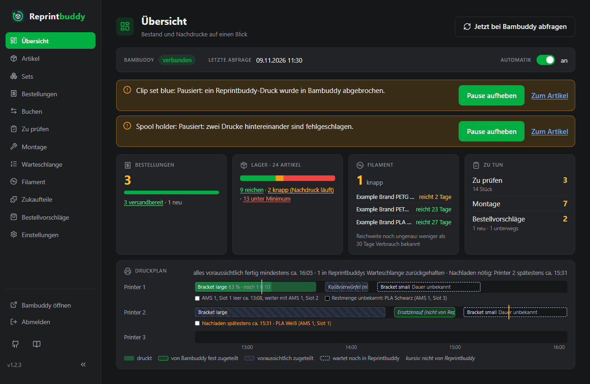
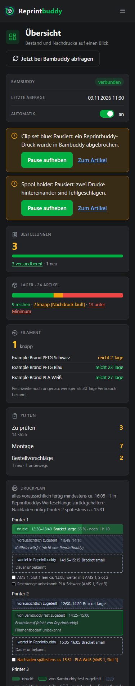

# Übersicht

Die **Übersicht** ist die Startseite. Sie zeigt auf einen Blick, ob Reprintbuddy arbeiten kann, wie es steht, was ansteht und was die Drucker machen: vier Kacheln mit kleinen Bildern, jede führt zu der Seite, auf der du es erledigst, und darunter ein Druckplan je Drucker. Keine Listen je Artikel. Wie jede Seite bleibt sie von selbst aktuell: Eine Buchung auf einem anderen Gerät, ein fertiger Druck in Bambuddy oder die Automatik zeigt sich hier nach wenigen Sekunden.

Von oben nach unten:

## Kopfzeile

| Teil | Bedeutung |
|---|---|
| **Bambuddy** | Der Zustand der Verbindung: **verbunden**, **nicht erreichbar** oder **Antwort abgelehnt** (rot), **nicht eingerichtet** oder **noch nicht abgefragt** (grau: Reprintbuddy hat Bambuddy seit dem Start noch nicht erreicht). |
| **Letzte Abfrage** | Wann Bambuddy zuletzt auf eine reguläre Abfrage geantwortet hat, oder **noch keine**. |
| **Automatik** | Der Hauptschalter der Automatik (siehe [Automatik](automation.md)). Es ist derselbe Schalter wie unter *Einstellungen → Automatik*; hier wirkt er sofort, ohne Speichern-Knopf. Aus: Die Regel legt keine Einträge in der Warteschlange an; Ersatz und von Hand drucken gehen weiter. |

**Jetzt bei Bambuddy abfragen** oben rechts fragt Bambuddy sofort, statt auf die nächste reguläre Abfrage zu warten.

## Warnungen

Unter der Kopfzeile stehen die Warnungen und die pausierten Artikel, jeweils als Karte mit dem Weg weiter (zum Beispiel **Pause aufheben**). Rot heißt: Bambuddy antwortet nicht oder lehnt ab, eine Übergabe ist unklar oder eine Push-Nachricht ging nicht durch; gelb ist ein Zustand, den du gewählt hast oder der auf dich wartet. Die Seite [Fehlersuche](../help/troubleshooting.md) nennt jede Warnung und was zu tun ist. Ohne Warnungen bleibt dieser Teil leer.

## Kacheln

Vier große Kacheln füllen die Breite der Seite, jede mit einer Zahl und einem kleinen Bild. Der Kopf einer Kachel führt zu ihrer Seite; ein unterstrichener Teil der kleinen Zeile führt zu einer gefilterten Liste, die genau das zeigt, was der Teil zählt. Eine Zahl ist gelb, wenn etwas ansteht, rot bei Artikeln unter ihrem Mindestbestand, grau bei 0. Eine Kachel mit 0 bleibt stehen, damit die Seite nicht springt. Die Balken sind nur ein Bild: Jeder Teil steht daneben in Worten.

| Kachel | Was sie zeigt | Führt zu |
|---|---|---|
| **Bestellungen** | Die offenen Bestellungen, versandbereite mitgezählt. Der Balken teilt sie in **versandbereit** (grün) und **wartet auf Ware** (gelb); jeder Teil führt zu den Bestellungen mit diesem Status. **n neu** sagt, wie viele hinzugekommen sind, seit du die Bestellungen zuletzt geöffnet hast. | Bestellungen |
| **Lager** | Alle Artikel mit Bestand, gezählt wie auf der Seite *Artikel*: einer je Artikel, ein Artikel aus Teilen auf Vorrat mit dem schlechtesten Zustand seiner Varianten. Artikel aus Teilen, die erst bei Bestellung montiert werden, zählen nicht (sie sind wie Sets lieferbar oder nicht). Der Balken zeigt **reicht** (grün), **knapp** – unter dem Minimum, aber der Nachdruck läuft schon (gelb) –, **unter Minimum** und **überbucht** (rot). Jede Zahl führt zu den Artikeln mit genau diesem Zustand; die Liste zeigt also so viele Zeilen, wie die Kachel zählt. | Artikel |
| **Filament** | Die Spulensorten, die **knapp** sind: Sie haben einen Bestellvorschlag, der nicht als bestellt markiert ist. Darunter die drei nachgekauften Sorten, die am kürzesten reichen, jede mit **reicht n Tage**: was da und unterwegs ist, weniger dem, was die geplanten Drucke brauchen, geteilt durch den Verbrauch je Tag der letzten 30 Tage. Ohne Verbrauch in dieser Zeit steht **kein Verbrauch** da. Solange der Spulenbestand unbekannt ist (Bambuddy nicht erreichbar und nichts aufgezeichnet), steht in der Kachel **Bestand unbekannt**. | Filament |
| **Zu tun** | Drei Zeilen, jede führt zu ihrer Seite: **Zu prüfen** (fertige Drucke, die auf die Prüfung warten, mit ihren Stück), **Montage** (Stück, die nach der Prüfung auf die Montage warten, plus Stück offener Bestellungen von Artikeln aus Teilen, die erst bei Bestellung montiert werden; Varianten auf Vorrat unter ihrer Zielmenge zählen nicht, den Vorrat aufzufüllen steht nicht an) und **Bestellvorschläge** (noch nicht als bestellt markiert, mit **n neu** und **n unterwegs**). | Zu prüfen, Montage, Bestellvorschläge |

!!! note "Reichweite und Vorhersagen brauchen etwas Zeit"
    Die Reichweite des Filaments beruht wie die Bestellvorschläge auf dem Verbrauch der letzten 30 Tage. Gleich nach der Installation kennt Reprintbuddy davon wenig; die Zahlen sind anfangs grob und werden erst nach einiger Zeit Betrieb einigermaßen zuverlässig. Solange für eine gezeigte Sorte weniger als 30 Tage Verbrauch bekannt sind, steht in der Kachel **Reichweite noch ungenau: weniger als 30 Tage Verbrauch bekannt**.

### Neu

**Neu** heißt: seit du die Seite **Bestellungen** bzw. **Bestellvorschläge** zuletzt geöffnet hast, egal auf welchem Gerät. Es gibt ein Konto; wer am Handy die Bestellungen öffnet, löscht „neu“ auch am PC. Eine Bestellung ist neu, wenn sie danach angelegt wurde; ein Vorschlag, wenn die Seite ihn damals nicht gezeigt hat. Der Blick auf die Übersicht löscht nichts, und eine Seite, die nur offen bleibt und sich selbst aktualisiert, auch nicht, ebenso wenig eine Seite, die Reprintbuddy von selbst neu lädt (nach einem Update oder Neustart, wenn das Nachladen eines Teils nicht klappte, oder nach einer Abmeldung): Es zählt nur, wenn du die Seite selbst öffnest, per Klick, Adresse oder Neuladen von Hand. Solange eine Seite noch nie geöffnet wurde, ist nichts neu.

## Druckplan

Unter den Kacheln zeigt der **Druckplan**, was jeder Drucker gerade macht und was voraussichtlich als Nächstes kommt: eine Spur je Drucker von Bambuddy, auf einer Zeitachse von jetzt bis zum Ende des letzten Drucks (mindestens 2, höchstens 24 Stunden). Der ganze Druckplan führt zur *Warteschlange*. Er zeigt nur an: Reprintbuddy teilt in Bambuddy nichts zu, welcher Drucker was druckt, entscheidet Bambuddy.

| Balken | Bedeutung |
|---|---|
| **Grün gefüllt** | Der Drucker druckt gerade, mit Fortschritt und Restzeit (zum Beispiel *63 % · noch 1 h 10*). |
| **Grün umrandet** | Ein Eintrag aus Bambuddys Warteschlange, den Bambuddy schon fest diesem Drucker zugeteilt hat, zum Beispiel einer, der in Bambuddy direkt auf einen Drucker eingereiht wurde. |
| **Gestrichelt** | Voraussichtlich zugeteilt: ein Eintrag für „beliebiger Drucker des Modells“. Reprintbuddy legt ihn so hin, wie Bambuddys Planer es täte – in der Reihenfolge von Bambuddys Warteschlange (kürzeste zuerst, wenn das in Bambuddy eingeschaltet ist), auf den passenden Drucker, der zuerst frei wird (gleiches Modell, nicht in Wartung, am Ort des Eintrags, wenn er einen nennt, mit einer Düse, die zur Datei passt, aufgesteckt oder im Düsenwechsler). Kennt Bambuddy die Düse der Datei oder des Druckers nicht, gilt sie als passend, wie in Bambuddy. Filament und Druckstunden der Drucker zählen dabei nicht; Bambuddy kann also einen anderen Drucker nehmen. |
| **Gepunktet** | Wartet noch in Reprintbuddy: ein Druck aus Reprintbuddys eigener Warteschlange, noch nicht an Bambuddy übergeben. Reprintbuddy legt ihn dorthin, wo die Übergabe ihn nehmen würde: sofort, solange weniger seiner Drucke in Bambuddy offen sind als die Obergrenze, sonst, wenn einer seiner offenen Drucke im Plan fertig wird. Dann steht er dort in Bambuddys Warteschlange, wo Reprintbuddy ihn einreiht (hinten, oder mit **Als nächsten Druck einfügen** gleich hinter Reprintbuddys eigene wartende Drucke, also vor die Drucke anderer dahinter, die bis dahin noch nicht gestartet sind; einen Ersatzdruck immer nach vorn, hinter den letzten Ersatzdruck von Reprintbuddy, der dort noch wartet), und wird verteilt wie jeder andere Eintrag. Die Zeit bis zur nächsten Abfrage zählt nicht mit. |
| *Kursiv* | Nicht von Reprintbuddy: Einträge und Drucke anderer Benutzer oder direkt in Bambuddy gestartet. Sie belegen den Drucker, deshalb stehen sie im Plan. |

Die Länge eines Balkens ist die Druckdauer der Datei, wie der Slicer sie geschätzt hat; zwischen zwei Drucken eines Druckers liegen 5 Minuten. Alle Zeiten sind geschätzt. Für einen Druck, der noch in Reprintbuddy wartet, kommen die Druckdauer seiner Platte und die Düse seiner Datei aus Bambuddys Dateimanager, gelesen bei der regulären Abfrage. Im seltenen Fall, dass Bambuddy keine Druckdauer kennt (eine Datei ohne Schätzung des Slicers, eine in Bambuddy gelöschte oder ein Druck, der seit der letzten Abfrage in Reprintbuddys Warteschlange kam), steht im Balken **Dauer unbekannt**, und er zählt eine Stunde.

Über den Spuren: **alles voraussichtlich fertig ca. …** (mit **mindestens**, wenn eine Dauer unbekannt war), Einträge, die in Bambuddy auf einen Start von Hand oder einen späteren Termin warten, Einträge ohne druckbereiten Drucker (auch wenn kein solcher Drucker eine passende Düse hat) und **Stand …**, wenn der Druckerzustand älter als 5 Minuten ist. Von Reprintbuddys eigener Warteschlange nennt sie nur, was nicht in den Spuren steht: **zurückgehaltene** Drucke (auch die eines pausierten Artikels), Drucke, die **auf einen Platz unter der Obergrenze warten**, weil Reprintbuddys offene Drucke im Plan nie fertig werden, und bei **angehaltener** Warteschlange alle ihre Drucke – eine angehaltene Warteschlange übergibt nichts, also wird keiner eingeplant. Ein Druck, dessen Artikel an einen Drucker in Wartung gebunden ist, steht als **wartet: …** in dessen Spur. Eine ausgeschaltete Automatik ändert daran nichts: Die Übergabe läuft weiter.

Ein Drucker, der **offline**, in **Wartung** oder im **Fehler** ist, bekommt nichts voraussichtlich zugeteilt; was Bambuddy ihm fest zugeteilt hat, steht als **wartet: …** in seiner Spur und zählt nicht für „alles fertig“ (**ohne Printer 3**). Ein Drucker, der **auf Platte freigeben wartet**, wird geplant, als würdest du die Platte jetzt freigeben. Ein **pausierter** Druck bleibt gefüllt mit seinem Fortschritt; seine Restzeit zählt ab jetzt.

### Filament in den Druckern

Unter jeder Spur steht, ob das Filament im Drucker für die Drucke der Spur reicht. Das ist nur Anzeige: Reprintbuddy bucht kein Filament und ändert in Bambuddy nichts.

- **Nachladen ca. 14:30 · PLA Schwarz (AMS 1, Slot 2)**, dazu ein Strich in der Spur: Etwa dann ist die Spule leer, gleichmäßig über den Druck geschätzt, in dem sie leer wird. **Nachladen jetzt**: Der Zeitpunkt ist schon vorbei. **spätestens**: Ein Druck davor hat einen unbekannten Filamentbedarf, es kann also früher sein.
- **nicht geladen: PETG Rot**: Ein Druck der Spur braucht eine Sorte, die in keinem Slot des Druckers steckt.

Die Farbe heißt wie auf der Seite *Filament*, wenn eine Spulensorte dasselbe Material, denselben Farbwert und einen Farbnamen hat; sonst steht der Farbwert, etwa #FF0000.
- **Restmenge unbekannt: …**: Bambuddy kennt für die Spule in diesem Slot keine Gramm (dem Slot ist in Bambuddy keine Spule zugewiesen). Die Prozentangabe des AMS nimmt Reprintbuddy nicht: Sie ist zu grob und fehlt bei Spulen ohne RFID.
- **Filamentbedarf unbekannt** an einem Balken: Der Bedarf des Drucks ist nicht bekannt (ein Druck aus Bambuddys Archiv oder eine gelöschte Datei).

Der Bedarf eines Drucks sind die Gramm je Slot seiner Druckdatei: bei eigenen Drucken aus der Datei des Artikels, bei Drucken anderer aus Bambuddys Dateimanager. Der laufende Druck zählt ganz, weil Bambuddy den Verbrauch erst am Druckende von der Spule abzieht. Der Vorrat sind die Gramm, die Bambuddy für die dem Slot zugewiesene Spule führt; ist die **Ersatzspule** (AMS Filament Backup) eingeschaltet, zählen geladene Slots mit gleichem Material und gleicher Farbe zusammen. Den Slot wählt Reprintbuddy so, wie Bambuddy es ohne Filament-Voreinstellung täte: gleiches Material und gleiche Farbe, sonst ähnliche Farbe, sonst gleiches Material. Je Spur steht jede Sorte nur einmal, an der Stelle, an der sie zuerst leer wird; höchstens drei Hinweise, dann **+ n**. Die Kopfzeile nennt zusätzlich **Nachladen nötig: Printer 2 ca. 15:30** für den frühesten Zeitpunkt aller Drucker (**und n weitere**) und wie viele Einträge Bambuddy beim Start wegen Filamentmangel angehalten hat.

Grenzen: Bambuddy wählt den Slot erst beim Start und schaut zuerst auf die Filament-Voreinstellung; es kann also einen anderen Slot nehmen. Die Düsenseite bei Druckern mit zwei Düsen, Bambuddys Filament-Regeln für Benutzergruppen und seine Einstellung „niedrigste Spule zuerst“ bildet Reprintbuddy nicht nach. Bei voraussichtlich zugeteilten Drucken gilt der Hinweis für den Drucker, den der Plan annimmt. Eine Benachrichtigung über Home Assistant gibt es dafür nicht.

Den Druckerzustand liest Reprintbuddy bei jeder regulären Abfrage mit einer Anfrage für alle Drucker und dazwischen aus den Druckermeldungen von Bambuddys Live-Kanal (siehe [Automatik](automation.md)). Der Plan folgt höchstens etwa einmal je Minute. Solange Bambuddy nicht erreichbar ist, steht dort **Druckerzustand unbekannt**.

Am Handy ist die Seite einspaltig: Die Kopfzeile wird zu Zeilen aus Bezeichnung und Wert, die Kacheln stehen untereinander, und jede Spur des Druckplans wird zu einer Liste mit Uhrzeiten und der Art jedes Balkens.

{ width="320" }

## Eine frische Installation

Gleich nach der Ersteinrichtung gibt es noch keine Artikel. Die Kacheln zeigen 0, und darunter sagt die Seite das und bietet **Neuer Artikel aus Druckdatei** an. Bis Reprintbuddy Bambuddy erreicht hat, steht in der Kopfzeile **noch nicht abgefragt** und im Druckplan **Druckerzustand unbekannt**.
