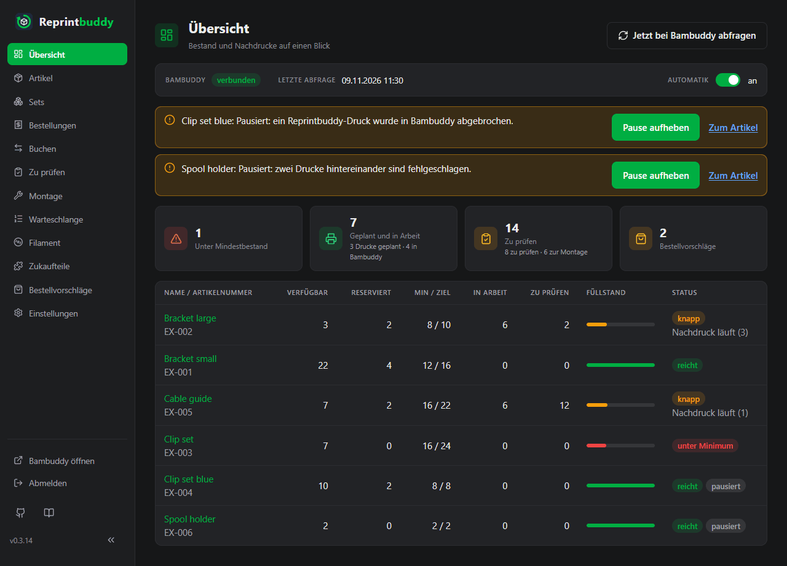

# Übersicht

Die **Übersicht** ist die Startseite. Sie zeigt auf einen Blick, ob Reprintbuddy arbeiten kann, wie es steht, was ansteht und was die Drucker machen: vier Kacheln mit kleinen Bildern, jede führt zu der Seite, auf der du es erledigst, und darunter ein Druckplan je Drucker. Keine Listen je Artikel. Wie jede Seite bleibt sie von selbst aktuell: Eine Buchung auf einem anderen Gerät, ein fertiger Druck in Bambuddy oder die Automatik zeigt sich hier nach wenigen Sekunden.

Von oben nach unten:

## Kopfzeile

| Teil | Bedeutung |
|---|---|
| **Bambuddy** | Der Zustand der Verbindung: **verbunden**, **nicht erreichbar** oder **Antwort abgelehnt** (rot), **nicht eingerichtet** oder **noch nicht abgefragt** (grau: Reprintbuddy hat Bambuddy seit dem Start noch nicht erreicht). |
| **Letzte Abfrage** | Wann Bambuddy zuletzt auf eine reguläre Abfrage geantwortet hat, oder **noch keine**. |
| **Automatik** | Der Hauptschalter der Automatik (siehe [Automatik](automation.md)). Es ist derselbe Schalter wie unter *Einstellungen → Automatik*; hier wirkt er sofort, ohne Speichern-Knopf. Aus: Die Regel legt keine Einträge in der Warteschlange an; Ersatz und von Hand drucken gehen weiter. |

**Jetzt bei Bambuddy abfragen** oben rechts fragt Bambuddy sofort, statt auf die nächste reguläre Abfrage zu warten.

## Warnungen

Unter der Kopfzeile stehen die Warnungen und die pausierten Artikel, jeweils als Karte mit dem Weg weiter (zum Beispiel **Pause aufheben**). Rot heißt: Bambuddy antwortet nicht oder lehnt ab, eine Übergabe ist unklar oder eine Push-Nachricht ging nicht durch; gelb ist ein Zustand, den du gewählt hast oder der auf dich wartet. Die Seite [Fehlersuche](../help/troubleshooting.md) nennt jede Warnung und was zu tun ist. Ohne Warnungen bleibt dieser Teil leer.

## Kacheln

Vier große Kacheln füllen die Breite der Seite, jede mit einer Zahl und einem kleinen Bild. Der Kopf einer Kachel führt zu ihrer Seite; ein unterstrichener Teil der kleinen Zeile führt zu einer gefilterten Liste, die genau das zeigt, was der Teil zählt. Eine Zahl ist gelb, wenn etwas ansteht, rot bei Artikeln unter ihrem Mindestbestand, grau bei 0. Eine Kachel mit 0 bleibt stehen, damit die Seite nicht springt. Die Balken sind nur ein Bild: Jeder Teil steht daneben in Worten.

| Kachel | Was sie zeigt | Führt zu |
|---|---|---|
| **Bestellungen** | Die offenen Bestellungen, versandbereite mitgezählt. Der Balken teilt sie in **versandbereit** (grün) und **wartet auf Ware** (gelb); jeder Teil führt zu den Bestellungen mit diesem Status. **n neu** sagt, wie viele hinzugekommen sind, seit du die Bestellungen zuletzt geöffnet hast. | Bestellungen |
| **Lager** | Alle Artikel mit Bestand, gezählt wie auf der Seite *Artikel*: einer je Artikel, ein Artikel aus Teilen auf Vorrat mit dem schlechtesten Zustand seiner Varianten. Artikel aus Teilen, die erst bei Bestellung montiert werden, zählen nicht (sie sind wie Sets lieferbar oder nicht). Der Balken zeigt **reicht** (grün), **knapp** – unter dem Minimum, aber der Nachdruck läuft schon (gelb) –, **unter Minimum** und **überbucht** (rot). Jede Zahl führt zu den Artikeln mit genau diesem Zustand; die Liste zeigt also so viele Zeilen, wie die Kachel zählt. | Artikel |
| **Filament** | Die Spulensorten, die **knapp** sind: Sie haben einen Bestellvorschlag, der nicht als bestellt markiert ist. Darunter die drei nachgekauften Sorten, die am kürzesten reichen, jede mit **reicht n Tage**: was da und unterwegs ist, weniger dem, was die geplanten Drucke brauchen, geteilt durch den Verbrauch je Tag der letzten 30 Tage. Ohne Verbrauch in dieser Zeit steht **kein Verbrauch** da. Solange der Spulenbestand unbekannt ist (Bambuddy nicht erreichbar und nichts aufgezeichnet), steht in der Kachel **Bestand unbekannt**. | Filament |
| **Zu tun** | Drei Zeilen, jede führt zu ihrer Seite: **Zu prüfen** (fertige Drucke, die auf die Prüfung warten, mit ihren Stück), **Montage** (Stück, die nach der Prüfung auf die Montage warten, plus Stück offener Bestellungen von Artikeln aus Teilen, die erst bei Bestellung montiert werden; Varianten auf Vorrat unter ihrer Zielmenge zählen nicht, den Vorrat aufzufüllen steht nicht an) und **Bestellvorschläge** (noch nicht als bestellt markiert, mit **n neu** und **n unterwegs**). | Zu prüfen, Montage, Bestellvorschläge |

!!! note "Reichweite und Vorhersagen brauchen etwas Zeit"
    Die Reichweite des Filaments beruht wie die Bestellvorschläge auf dem Verbrauch der letzten 30 Tage. Gleich nach der Installation kennt Reprintbuddy davon wenig; die Zahlen sind anfangs grob und werden erst nach einiger Zeit Betrieb einigermaßen zuverlässig. Solange für eine gezeigte Sorte weniger als 30 Tage Verbrauch bekannt sind, steht in der Kachel **Reichweite noch ungenau: weniger als 30 Tage Verbrauch bekannt**.

### Neu

**Neu** heißt: seit du die Seite **Bestellungen** bzw. **Bestellvorschläge** zuletzt geöffnet hast, egal auf welchem Gerät. Es gibt ein Konto; wer am Handy die Bestellungen öffnet, löscht „neu“ auch am PC. Eine Bestellung ist neu, wenn sie danach angelegt wurde; ein Vorschlag, wenn die Seite ihn damals nicht gezeigt hat. Der Blick auf die Übersicht löscht nichts, und eine Seite, die nur offen bleibt und sich selbst aktualisiert, auch nicht, ebenso wenig eine Seite, die Reprintbuddy von selbst neu lädt (nach einem Update oder Neustart, wenn das Nachladen eines Teils nicht klappte, oder nach einer Abmeldung): Es zählt nur, wenn du die Seite selbst öffnest, per Klick, Adresse oder Neuladen von Hand. Solange eine Seite noch nie geöffnet wurde, ist nichts neu.

## Druckplan

Unter den Kacheln zeigt der **Druckplan**, was jeder Drucker gerade macht und was voraussichtlich als Nächstes kommt: eine Spur je Drucker von Bambuddy, auf einer Zeitachse von jetzt bis zum Ende des letzten Drucks (mindestens 2, höchstens 24 Stunden). Der ganze Druckplan führt zur *Warteschlange*. Er zeigt nur an: Reprintbuddy teilt in Bambuddy nichts zu, welcher Drucker was druckt, entscheidet Bambuddy.

| Balken | Bedeutung |
|---|---|
| **Grün gefüllt** | Der Drucker druckt gerade, mit Fortschritt und Restzeit (zum Beispiel *63 % · noch 1 h 10*). |
| **Grün umrandet** | Ein Eintrag aus Bambuddys Warteschlange, den Bambuddy schon fest diesem Drucker zugeteilt hat, zum Beispiel einer, der in Bambuddy direkt auf einen Drucker eingereiht wurde. |
| **Gestrichelt** | Voraussichtlich zugeteilt: ein Eintrag für „beliebiger Drucker des Modells“. Reprintbuddy legt ihn so hin, wie Bambuddys Planer es täte – in der Reihenfolge von Bambuddys Warteschlange (kürzeste zuerst, wenn das in Bambuddy eingeschaltet ist), auf den passenden Drucker, der zuerst frei wird (gleiches Modell, nicht in Wartung, am Ort des Eintrags, wenn er einen nennt). Filament und Druckstunden der Drucker zählen dabei nicht; Bambuddy kann also einen anderen Drucker nehmen. |
| *Kursiv* | Nicht von Reprintbuddy: Einträge und Drucke anderer Benutzer oder direkt in Bambuddy gestartet. Sie belegen den Drucker, deshalb stehen sie im Plan. |

Die Länge eines Balkens ist die Druckdauer der Datei, wie der Slicer sie geschätzt hat; zwischen zwei Drucken eines Druckers liegen 5 Minuten. Alle Zeiten sind geschätzt. Im seltenen Fall, dass Bambuddy keine Druckdauer kennt (eine Datei ohne Schätzung des Slicers oder eine in Bambuddy gelöschte), steht im Balken **Dauer unbekannt**, und er zählt eine Stunde.

Über den Spuren: **alles voraussichtlich fertig ca. …** (mit **mindestens**, wenn eine Dauer unbekannt war), wie viele Drucke noch in Reprintbuddys eigener Warteschlange warten (sie stehen nicht in den Spuren: wann sie an Bambuddy gehen, hängt von der Obergrenze offener Drucke ab), Einträge, die in Bambuddy auf einen Start von Hand oder einen späteren Termin warten, Einträge ohne druckbereiten Drucker und **Stand …**, wenn der Druckerzustand älter als 5 Minuten ist.

Ein Drucker, der **offline**, in **Wartung** oder im **Fehler** ist, bekommt nichts voraussichtlich zugeteilt; was Bambuddy ihm fest zugeteilt hat, steht als **wartet: …** in seiner Spur und zählt nicht für „alles fertig“ (**ohne Printer 3**). Ein Drucker, der **auf Platte freigeben wartet**, wird geplant, als würdest du die Platte jetzt freigeben. Ein **pausierter** Druck bleibt gefüllt mit seinem Fortschritt; seine Restzeit zählt ab jetzt.

Den Druckerzustand liest Reprintbuddy bei jeder regulären Abfrage mit einer Anfrage für alle Drucker und dazwischen aus den Druckermeldungen von Bambuddys Live-Kanal (siehe [Automatik](automation.md)). Der Plan folgt höchstens etwa einmal je Minute. Solange Bambuddy nicht erreichbar ist, steht dort **Druckerzustand unbekannt**.

Am Handy ist die Seite einspaltig: Die Kopfzeile wird zu Zeilen aus Bezeichnung und Wert, die Kacheln stehen untereinander, und jede Spur des Druckplans wird zu einer Liste mit Uhrzeiten und der Art jedes Balkens.

## Eine frische Installation

Gleich nach der Ersteinrichtung gibt es noch keine Artikel. Die Kacheln zeigen 0, und darunter sagt die Seite das und bietet **Neuer Artikel aus Druckdatei** an. Bis Reprintbuddy Bambuddy erreicht hat, steht in der Kopfzeile **noch nicht abgefragt** und im Druckplan **Druckerzustand unbekannt**.
