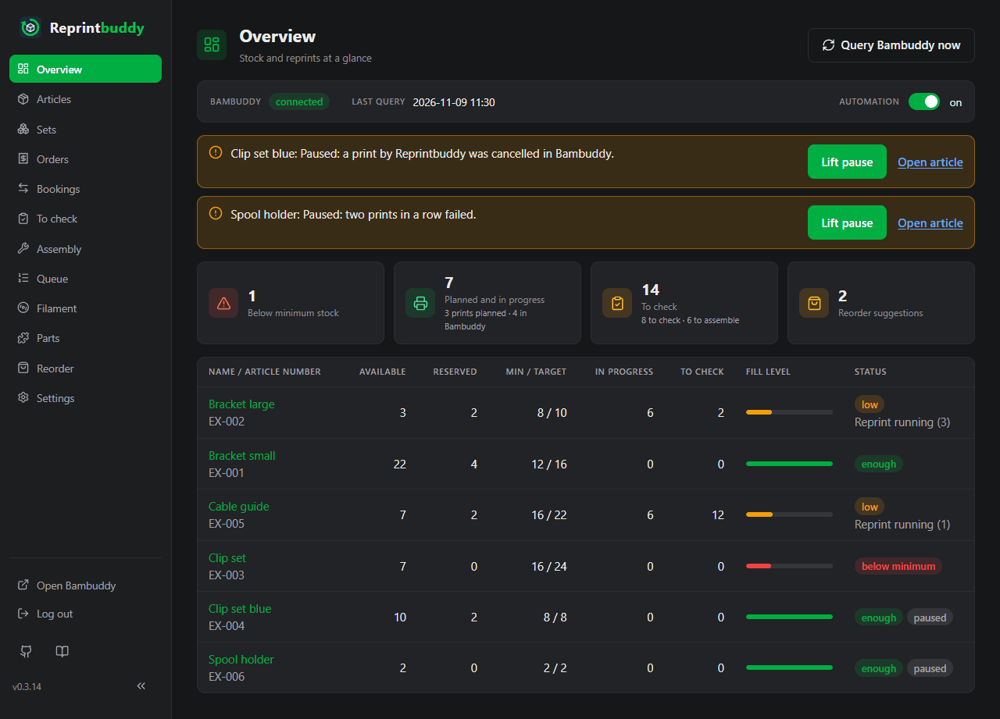

# Overview

The **Overview** is the start page. It shows at a glance whether Reprintbuddy can work, how things stand and what is due, and what the printers do: four tiles with small pictures, each leading to the page where you do it, and below them a print plan per printer. No lists per article. Like every page it stays up to date by itself: a booking on another device, a finished print in Bambuddy or the automation shows here within a few seconds.

From top to bottom:

## Head line

| Part | Meaning |
|---|---|
| **Bambuddy** | The state of the connection: **connected**, **not reachable** or **answer refused** (red), **not set up** or **not queried yet** (grey: Reprintbuddy has not reached Bambuddy since it started). |
| **Last query** | When Bambuddy last answered a regular query, or **none yet**. |
| **Automation** | The main switch of the automation (see [Automation](automation.md)). It is the same switch as under *Settings → Automation*; switching it here takes effect at once, without a save button. Off: the rule adds no entries to the queue; replacements and manual prints still work. |

**Query Bambuddy now** at the top right asks Bambuddy at once instead of waiting for the next regular query.

## Warnings

Below the head line stand the warnings and the paused articles, each as a card with the way on (for example **Lift pause**). Red means Bambuddy does not answer or refuses, a hand-over is unclear or a push message did not go through; yellow is a state you chose or that waits for you. The [Troubleshooting](../help/troubleshooting.md) page lists every warning and what to do. Without warnings this part is empty.

## Tiles

Four large tiles fill the width of the page, each with a number and a small picture. The head of a tile leads to its page; an underlined part of its small line leads to a filtered list that shows exactly what the part counts. A number is yellow when something is due, red for articles below their minimum, grey at 0. A tile with 0 stays where it is, so the page does not jump. The bars are only a picture: every part stands in words beside them.

| Tile | What it shows | Leads to |
|---|---|---|
| **Orders** | The open orders, ready to ship ones included. The bar splits them into **ready to ship** (green) and **waiting for stock** (yellow); each part leads to the orders with that status. **n new** says how many came in since you last opened the orders. | Orders |
| **Stock** | All articles with a stock, counted like the page *Articles*: one per article, an article made of parts on stock with the worst state of its variants. Articles made of parts that are built on order do not count (like sets they are deliverable or not). The bar shows **enough** (green), **low** – below the minimum, but the reprint is already running (yellow) – **below minimum** and **overbooked** (red). Each number leads to the articles with exactly that state, so the list shows as many rows as the tile counts. | Articles |
| **Filament** | The spool sorts that are **low**: they have a reorder suggestion that is not marked as ordered. Below, the three reordered sorts that last the shortest, each with **lasts n days**: what is there and on its way, less what the planned prints need, divided by the use per day of the last 30 days. Without use in that time the sort says **no usage**. While the spool stock is not known (Bambuddy not reachable and nothing recorded), the tile says **Stock unknown**. | Filament |
| **To do** | Three lines, each leading to its page: **To check** (finished prints waiting for the check, with the pieces in them), **Assembly** (pieces waiting for assembly after the check, plus pieces of open orders of articles made of parts that are built on order; variants on stock below their target do not count, filling up the stock is not due) and **Reorder suggestions** (not yet marked as ordered, with **n new** and **n on the way**). | To check, Assembly, Reorder suggestions |

!!! note "Reach and forecasts need some time"
    The reach of the filament, like the reorder suggestions, rests on the use of the last 30 days. Right after the installation Reprintbuddy knows little of it, so the numbers are rough at first and become reliable only after some time of operation. As long as less than 30 days of use are known for a sort shown, the tile says **Reach still rough: less than 30 days of usage known**.

### New

**New** means: since you last opened the page **Orders** or **Reorder suggestions**, on any device. There is one account, so opening the orders on the phone clears "new" on the PC as well. An order is new when it was created after that; a suggestion is new when the page did not show it then. Looking at the Overview clears nothing, and neither does a page that only stays open and updates itself, nor a page that Reprintbuddy loads again by itself (after an update or a restart, when updating a part of it failed, or after you were signed out): only opening the page yourself counts, by a click, its address or reloading it by hand. Until a page has been opened once, nothing is new.

## Print plan

Below the tiles, the **Print plan** shows what each printer does and what probably comes next: one lane per printer of Bambuddy, on a time axis from now to the end of the last print (at least 2, at most 24 hours). The whole plan leads to the *Queue*. It only shows: Reprintbuddy assigns nothing in Bambuddy, Bambuddy decides which printer prints what.

| Bar | Meaning |
|---|---|
| **Filled green** | The printer prints now, with progress and time left (for example *63 % · 1 h 10 left*). |
| **Outlined green** | An entry of Bambuddy's queue that Bambuddy has already assigned to this printer, for example one queued in Bambuddy directly on a printer. |
| **Dashed** | Probably assigned: an entry for "any printer of the model". Reprintbuddy places it the way Bambuddy's scheduler would – in the order of Bambuddy's queue (shortest first, if that is switched on in Bambuddy), on the matching printer that becomes free first (same model, not in maintenance, at the entry's location if it names one). Filament and the printers' hours are not taken into account, so Bambuddy may choose another printer. |
| *Italic* | Not from Reprintbuddy: entries and prints of other users or started in Bambuddy directly. They occupy the printer, so they are in the plan. |

The length of a bar is the print time of the file as the slicer estimated it; between two prints of a printer there are 5 minutes. All times are estimates. In the rare case that Bambuddy knows no print time (a file without the slicer's estimate, or one deleted in Bambuddy), the bar says **Duration unknown** and counts one hour.

Above the lanes: **all probably done at about …** (with **at the earliest** when a duration was unknown), how many prints still wait in Reprintbuddy's own queue (they are not in the lanes: when they go to Bambuddy depends on the limit of open prints), entries that wait in Bambuddy for a manual or later start, entries without a ready printer, and **as of …** when the printers' state is older than 5 minutes.

A printer that is **offline**, in **maintenance** or in an **error** gets nothing probably assigned; entries Bambuddy assigned to it stand as **waiting: …** in its lane and do not count for "all done" (**without Printer 3**). A printer **waiting for the plate to be cleared** is planned as if you cleared it now. A **paused** print stays filled with its progress; its time left counts from now.

The printers' state comes with every regular query, in one request for all printers, and in between with the printer messages of Bambuddy's live channel (see [Automation](automation.md)). The plan follows at most about once a minute. While Bambuddy cannot be reached it says **Printer state unknown**.

On a phone the page is one column: the head line becomes rows of label and value, the tiles stand one below the other, and each lane of the print plan becomes a list with times and the kind of each bar.

## A fresh installation

Right after the first setup there are no articles yet. The tiles show 0, and below them the page says so and offers **New article from print file**. Until Reprintbuddy has reached Bambuddy, the head line says **not queried yet** and the print plan **Printer state unknown**.
