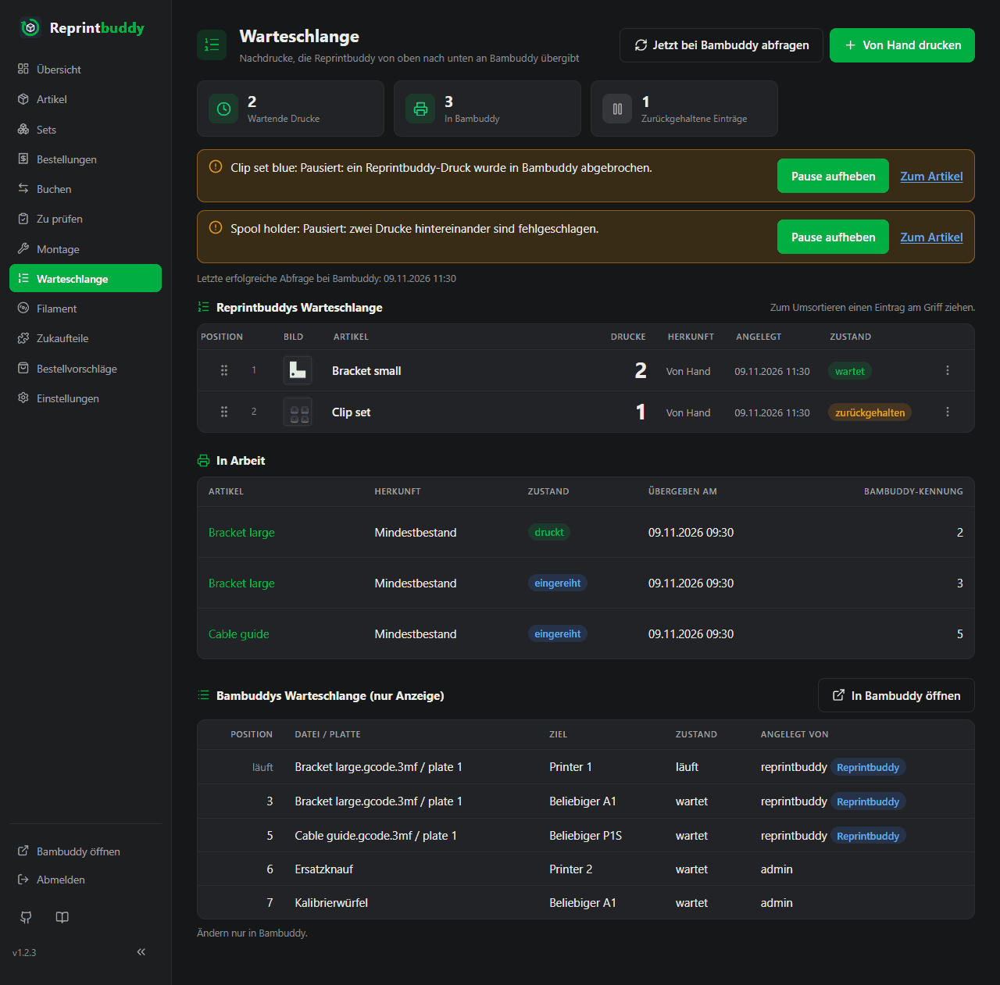

# Warteschlange

Die Seite *Warteschlange* zeigt, was Reprintbuddy drucken will und was schon bei Bambuddy ist. Oben steht Reprintbuddys eigene Warteschlange, die du ändern kannst. Darunter wird Bambuddys Warteschlange nur zum Ansehen gezeigt.

Oben auf der Seite:

- **Jetzt bei Bambuddy abfragen** fragt Bambuddy sofort nach seinen Drucken, siehe [Automatik](automation.md#die-regelmaige-abfrage-und-der-live-kanal).
- **Von Hand drucken** springt zum Formular für Drucke von Hand.
- Karten zählen **Wartende Drucke** (Drucke in Einträgen, die nicht zurückgehalten sind und deren Artikel nicht pausiert ist) und **In Bambuddy** (offene Drucke). **Zurückgehaltene Einträge** und **Pausierte Artikel** erscheinen nur, wenn es welche gibt.
- Hinweise der Automatik (Bambuddy nicht erreichbar, Warteschlange angehalten, Obergrenze erreicht, pausierte Artikel und mehr) mit dem Zeitpunkt der letzten erfolgreichen Abfrage bei Bambuddy. Es sind dieselben wie auf der Übersicht, siehe [Automatik](automation.md#pausen).

## Reprintbuddys Warteschlange

Jeder Nachdruck entsteht zuerst als Eintrag hier und wird von oben nach unten an Bambuddy übergeben. Ein Eintrag hat:

| Spalte | Bedeutung |
|---|---|
| **Position** | Die Stelle in der Warteschlange, mit dem Griff zum Ziehen. |
| **Artikel** | Der Artikel, mit seinem Bild. Der Name öffnet die Artikelseite. |
| **Drucke** | Wie viele Drucke der Eintrag noch enthält. |
| **Herkunft** | **Mindestbestand** (von der [Regel](automation.md#die-regel) angelegt), **Ersatz für Ausschuss**, **Ersatz für Fehlschlag** oder **Von Hand**. |
| **Angelegt** | Wann der Eintrag entstand. |
| **Zustand** | **wartet**, **zurückgehalten** oder **Artikel pausiert** (der Grund steht beim Darüberfahren). |

Wohin neue Einträge kommen: Einträge der Regel ans Ende. Ersatz an den Anfang, weil du ihn sofort willst. Einträge von Hand dorthin, wo du sie hinsetzt, vorgegeben ans Ende.

### Reihenfolge ändern

Ziehe einen Eintrag am Griff an eine neue Stelle, mit der Maus oder dem Finger. Die neue Reihenfolge wird beim Loslassen gespeichert; es gibt keinen Knopf. Oder öffne das Menü des Eintrags (die drei Punkte) und nimm **Ganz nach oben** oder **Ganz nach unten**. Das Menü geht auch ohne JavaScript. Ändern zwei Geräte gleichzeitig die Reihenfolge, gilt das zuletzt Gespeicherte.

### Zurückhalten, ändern, löschen

Das Menü eines Eintrags bietet:

- **Zurückhalten** verhindert, dass der Eintrag übergeben wird. **Freigeben** gibt ihn wieder frei. Ein zurückgehaltener Eintrag pausiert nichts und zählt weiter zur Deckung seines Artikels.
- Das Feld **Drucke** mit **Speichern** ändert die Zahl der Drucke, 1 bis 1000.
- **Löschen** entfernt den Eintrag.

!!! note "Verringern oder Löschen eines Regel-Eintrags pausiert den Artikel"
    Verringerst du die Drucke eines Eintrags mit der Herkunft **Mindestbestand** oder löschst du ihn, pausiert die Automatik für diesen Artikel und sagt das. Sonst legte die Regel den Eintrag beim nächsten Durchlauf einfach wieder an. Die Zahl erhöhen, zurückhalten und andere Einträge ändern pausiert nichts. Wer dauerhaft weniger Drucke will, senkt Mindestbestand oder Puffer des Artikels. Zum Weitermachen nimmst du **Pause aufheben**, siehe [Pausen](automation.md#pausen).

Wird eine Bestellung storniert, verkleinert Reprintbuddy selbst die Regel-Einträge, die nicht mehr gebraucht werden, und nimmt solche Drucke auch aus Bambuddy zurück, solange sie noch nicht gestartet sind. Das pausiert nichts; siehe [Was ein Storno zurücknimmt](inspection.md#was-ein-storno-zurucknimmt).

## Von Hand drucken

Die Karte **Von Hand drucken** legt selbst einen Eintrag an. Wähle den **Artikel**, die Zahl der **Drucke** (1 bis 1000) und die **Stelle in der Warteschlange**: **Am Ende**, **Am Anfang** oder vor einem der Einträge. Klicke dann auf **In die Warteschlange**.

Das geht auch bei ausgeschalteter Automatik und über die Zielmenge hinaus. Ein solcher Eintrag wird genauso übergeben, geprüft und eingebucht wie jeder andere. Der Knopf **Von Hand drucken** auf einer Artikelseite führt zu diesem Formular.

## Wie Drucke zu Bambuddy kommen

Reprintbuddy übergibt Einträge von oben nach unten, einen Druck nach dem anderen. Ein Eintrag über drei Drucke wird zu drei einzelnen Einträgen in Bambuddys Warteschlange und verschwindet aus Reprintbuddys Warteschlange, wenn sein letzter Druck übergeben ist. Jeder Druck geht mit Druckdatei, Platte und Druckziel des Artikels und startet ohne Freigabe; er bekommt die in Bambuddy eingestellten *Standard-Druckoptionen*. Wohin er in Bambuddys Warteschlange kommt, hängt von **Als nächsten Druck einfügen** ab, siehe [Automatik](automation.md#schalter-und-einstellungen).

Reprintbuddy übergibt nur, solange in Bambuddy weniger eigene Drucke offen sind als die **Obergrenze offener Drucke in Bambuddy**. Übersprungen werden zurückgehaltene Einträge, Einträge pausierter Artikel und Einträge von Artikeln, deren Drucker alle im Wartungsmodus sind. Nichts wird übergeben, solange die Warteschlange angehalten ist, Bambuddy nicht erreichbar ist oder die Abfrage ablehnt, eine Übergabe unklar ist oder ein Update läuft.

Geht Bambuddys Antwort auf einen Druck verloren, sendet Reprintbuddy ihn nicht noch einmal. Es sucht in Bambuddys Warteschlange einen Eintrag seines eigenen Benutzers mit gleicher Datei und Platte, angelegt nach dem Senden. Genau ein solcher Eintrag wird übernommen; bei keinem oder mehreren wird der Artikel pausiert, und ein Hinweis sagt das. Der Druck wird nie zweimal gesendet.

## In Arbeit

Der Abschnitt **In Arbeit** listet die Drucke, die übergeben und noch nicht fertig sind: **Artikel**, **Herkunft**, **Zustand**, **Übergeben am** und die **Bambuddy-Kennung**. Der Zustand ist **wird übergeben**, **unklar**, **eingereiht** oder **druckt**. Ein nach einem Storno zurückgenommener Druck verschwindet aus der Liste; auf der Seite des Artikels steht er als **zurückgenommen (Storno)**.

## Bambuddys Warteschlange

Der Abschnitt **Bambuddys Warteschlange (nur Anzeige)** zeigt die offenen Einträge in Bambuddy (wartend und im Druck) in Bambuddys Reihenfolge, mit **Position**, **Datei / Platte**, **Ziel**, **Zustand** und **Angelegt von**. Drucke, die Reprintbuddy übergeben hat, tragen die Markierung **Reprintbuddy**. **In Bambuddy öffnen** führt dich zu Bambuddy.

**Position** zeigt nur bei wartenden Einträgen eine Zahl. Ein laufender Druck zeigt dort seinen Zustand (*läuft*) statt der Position 0, die Bambuddy ihm gibt. Laufen oder warten vor deinen Einträgen Drucke, die nicht von Reprintbuddy stammen, sagt das ein kurzer Hinweis über der Liste.

Hier kannst du nichts ändern: Ändern nur in Bambuddy. Reprintbuddy sortiert Einträge, die schon in Bambuddy liegen, nicht um und nimmt übergebene Drucke nicht zurück. Lässt sich Bambuddy nicht abfragen, zeigt die Seite die letzte Liste mit ihrer Zeit oder sagt, dass die Warteschlange nicht angezeigt werden kann.

## Live-Aktualisierung

Jeder Teil der Seite folgt Änderungen von selbst: deine Eingaben an einem anderen Gerät, die Automatik und Bambuddy. Eine Änderung zeigt sich auf anderen offenen Seiten nach etwa zwei Sekunden. Während du einen Eintrag ziehst oder ein Menü offen hast, wird dieser Teil nicht unter deiner Hand ausgetauscht.
