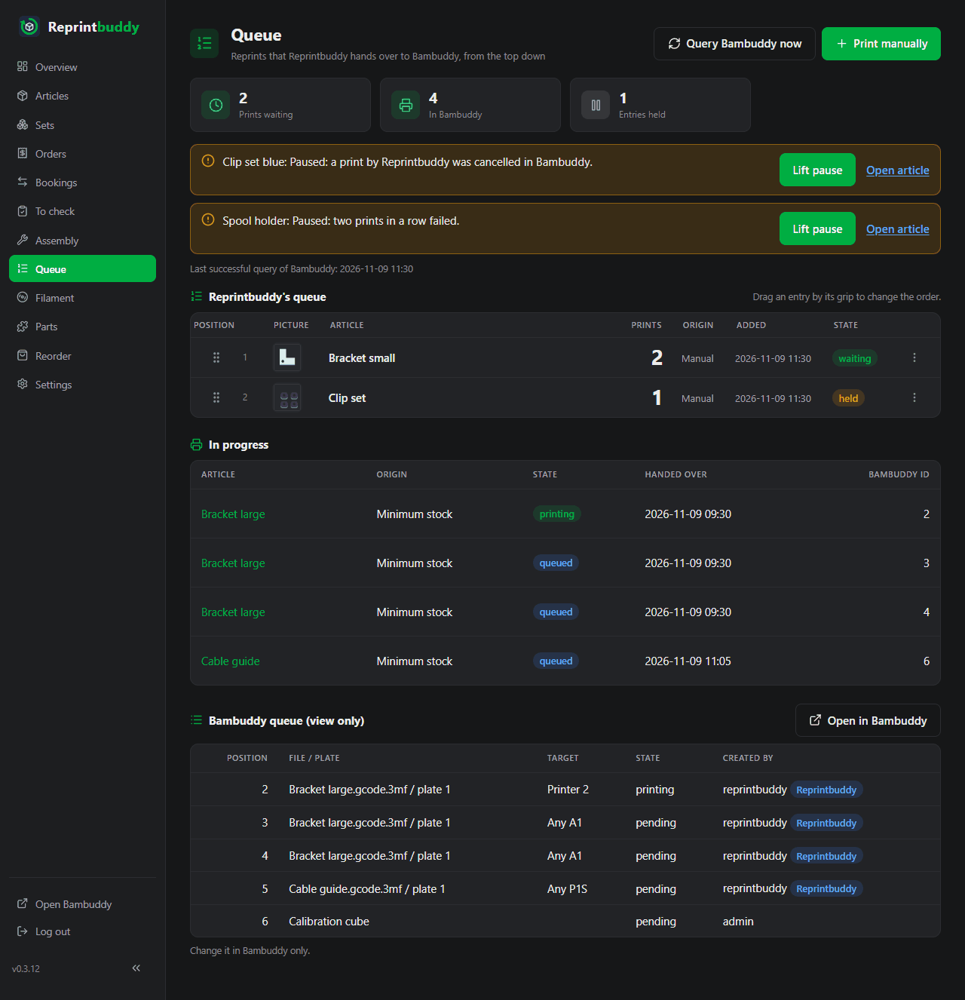

# Queue

The *Queue* page shows what Reprintbuddy plans to print and what is already with Bambuddy. At the top is Reprintbuddy's own queue, which you can change. Below it, Bambuddy's queue is shown for looking only.

At the top of the page:

- **Query Bambuddy now** asks Bambuddy about its prints at once, see [Automation](automation.md#the-regular-query-and-the-live-channel).
- **Print manually** jumps to the form for manual prints.
- Cards count **Prints waiting** (prints in entries that are not held and whose article is not paused) and **In Bambuddy** (open prints). **Entries held** and **Paused articles** appear only when there are any.
- Notices of the automation (Bambuddy not reachable, queue stopped, limit reached, paused articles and more) with the time of the last successful query of Bambuddy. They are the same as on the Overview, see [Automation](automation.md#pauses).

## Reprintbuddy's queue

Every reprint starts as an entry here and is handed over to Bambuddy from the top down. An entry has:

| Column | Meaning |
|---|---|
| **Position** | The place in the queue, with the grip for dragging. |
| **Article** | The article, with its picture. The name opens the article page. |
| **Prints** | How many prints the entry still holds. |
| **Origin** | **Minimum stock** (made by the [rule](automation.md#the-rule)), **Replacement for scrap**, **Replacement for a failed print** or **Manual**. |
| **Added** | When the entry was made. |
| **State** | **waiting**, **held**, or **article paused** (hover for the reason). |

Where new entries go: entries of the rule go to the end. Replacements go to the front, because you want them at once. Manual entries go where you put them, by default at the end.

### Change the order

Drag an entry by its grip to a new place, with the mouse or a finger. The new order is saved when you let go; there is no button. Or open the menu of the entry (the three dots) and use **To the top** or **To the bottom**. The menu works without JavaScript too. If two devices change the order at the same time, the last saved one wins.

### Hold, change, delete

The menu of an entry offers:

- **Hold** keeps the entry from being handed over. **Release** puts it back. A held entry pauses nothing and still counts for the coverage of its article.
- The field **Prints** with **Save** changes the number of prints, 1 to 1000.
- **Delete** removes the entry.

!!! note "Reducing or deleting an entry of the rule pauses the article"
    If you reduce the prints of an entry with the origin **Minimum stock**, or delete it, the automation pauses for that article and says so. Otherwise the rule would simply put the entry back at its next run. Raising the number, holding and changing other entries pause nothing. If you want fewer prints for good, lower the minimum stock or the buffer of the article. To go on, use **Lift pause**, see [Pauses](automation.md#pauses).

## Print manually

The card **Print manually** adds an entry yourself. Choose the **Article**, the number of **Prints** (1 to 1000) and the **Position in the queue**: **At the end**, **At the start** or before one of the entries. Then click **Add to the queue**.

This works with the automation switched off and beyond the target quantity. Such an entry is handed over, checked and booked like any other. The button **Print manually** on an article page leads to this form.

## How prints reach Bambuddy

Reprintbuddy hands entries over from the top down, one print at a time. An entry of three prints becomes three single entries in Bambuddy's queue, and it disappears from Reprintbuddy's queue when its last print is handed over. Each print goes with the article's print file, plate and print target and starts without approval; the print options are not changed. Where it lands in Bambuddy's queue depends on **Insert as next print**, see [Automation](automation.md#switches-and-settings).

Reprintbuddy hands over only while fewer prints of its own are open in Bambuddy than the **Limit of open prints in Bambuddy**. Skipped are held entries, entries of paused articles and entries of articles whose printers are all in maintenance mode. Nothing is handed over while the queue is stopped, Bambuddy cannot be reached or refuses the query, a hand-over is unclear, or an update is running.

If Bambuddy's answer to a print gets lost, Reprintbuddy does not send it again. It looks in Bambuddy's queue for an entry of its own user with the same file and plate, made after the sending. Exactly one such entry is taken over; with none or several, the article is paused and a notice says so. The print is never sent twice.

## In progress

The section **In progress** lists the prints that were handed over and are not finished: **Article**, **Origin**, **State**, **Handed over** and the **Bambuddy id**. The state is **being handed over**, **unclear**, **queued** or **printing**.

## Bambuddy's queue

The section **Bambuddy queue (view only)** shows the open entries in Bambuddy (waiting and printing) in Bambuddy's order, with **Position**, **File / plate**, **Target**, **State** and **Created by**. Prints that Reprintbuddy handed over carry the mark **Reprintbuddy**. **Open in Bambuddy** takes you to Bambuddy.

You cannot change anything here: change it in Bambuddy only. Reprintbuddy does not reorder entries that are already in Bambuddy and does not take handed-over prints back. If Bambuddy cannot be asked, the page shows the last list with its time, or says that the queue cannot be shown.

## Live updates

Every part of the page follows changes by itself: your input on another device, the automation, and Bambuddy. A change shows on other open pages after about two seconds. While you drag an entry or have a menu open, that part is not replaced under your hand.
