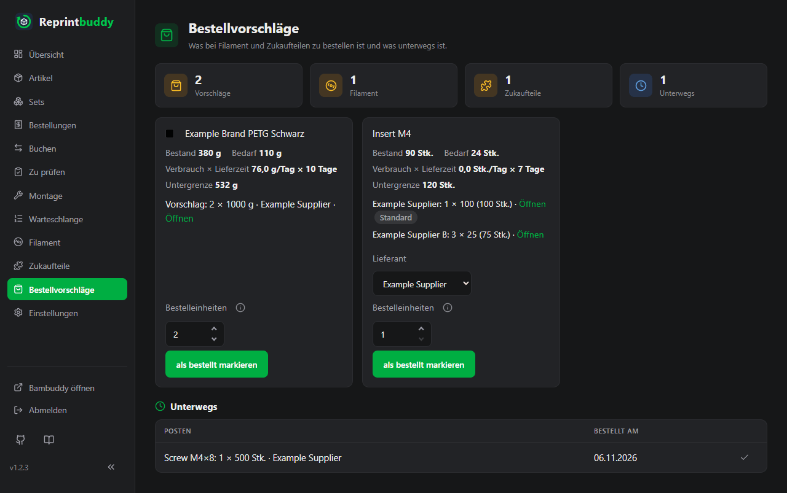

# Bestellvorschläge

Reprintbuddy behält dein Filament und deine Zukaufteile im Blick und sagt dir, was du bestellen sollst und wie viel, so früh, dass es ankommt, bevor etwas knapp wird. Es bestellt nie selbst etwas. Die Seite **Bestellvorschläge** listet, was zu kaufen ist und was schon unterwegs ist.

Die Karten oben zählen die offenen **Vorschläge**, aufgeteilt in **Filament** und **Zukaufteile**, und was **Unterwegs** ist.

## Was ein Vorschlag zeigt

Jeder Vorschlag ist eine Kachel mit dem Filament oder Zukaufteil, um das es geht, und seinen Zahlen:

| Zahl | Bedeutung |
|---|---|
| **Bestand** | Was du jetzt hast. |
| **Unterwegs** | Nur wenn etwas unterwegs ist: was du als bestellt markiert hast und noch nicht eingetroffen ist (siehe unten). |
| **Bedarf** | Was die geplanten Drucke und Montagen verbrauchen werden. |
| **Verbrauch × Lieferzeit** | Der Verbrauch je Tag der letzten 30 Tage, mal der Lieferzeit in Tagen. |
| **Untergrenze** | Die Reserve, die noch übrig sein soll. |

Unter den Zahlen steht der Vorschlag, zum Beispiel `1 × 50 (50 Stk.)`, dann der Lieferant und **Öffnen**, ein Link auf die Bestellseite, der in einem neuen Fenster aufgeht. Lieferant und Link stammen aus den Einstellungen des Zukaufteils oder des Filaments.

Hat ein Zukaufteil oder eine Spulensorte mehrere Lieferanten, steht statt dieser Zeile eine Zeile je Lieferant, der Standard-Lieferant zuerst und mit **Standard** gekennzeichnet. Jede Zeile nennt die Menge, die bei diesem Lieferanten passt, in seiner Bestelleinheit und gerechnet mit seiner Mindestbestellmenge und seiner Lieferzeit, dazu seinen Link. So siehst du auf einen Blick, wie viel du bei wem bestellen müsstest.

## Wann ein Vorschlag erscheint

Ein Vorschlag erscheint, wenn gilt:

> Bestand − Bedarf − Verbrauch je Tag × Lieferzeit < Untergrenze

In Worten: Nimm, was du hast, und ziehe ab, was die geplanten Drucke verbrauchen und was verbraucht wird, während die Bestellung unterwegs ist. Liegt der Rest unter der Untergrenze, ist es Zeit zu bestellen.

- **Bestand.** Bei einem Zukaufteil sein Bestand. Bei Filament das Restgewicht aller Spulensorten, die in den Slots angekreuzt sind, in denen es **Nachgekauft** ist (siehe [Filament](filament.md)). Was **unterwegs** ist, zählt wie Bestand: bei Filament, was du von einer der dort angekreuzten Spulensorten als bestellt markiert hast.
- **Bedarf.** Bei Filament die Gramm der Drucke in Reprintbuddys Warteschlange und in Arbeit, dazu die Drucke, die bis zur Zielmenge der Artikel noch fehlen. Bei einem Zukaufteil die Menge je Stück mal die Stücke, die auf Montage warten, eingereiht oder in Arbeit sind oder bis zur Zielmenge der Artikel, die das Teil brauchen, noch fehlen. Die Zielmenge eines Teils von [Artikeln aus Teilen](assembled.md) rechnet mit seinem Bedarf aus Montage; die Zukaufteile eines Artikels aus Teilen zählen mit den Stücken, die seinen Varianten auf Vorrat bis zur Zielmenge fehlen, bei Montage erst bei Bestellung mit den bestellten, noch nicht versandten Stücken.
- **Verbrauch je Tag.** Gemessen über die letzten 30 Tage. Bei Filament stammt er aus der täglichen Aufzeichnung des Restgewichts jeder Spule; nur Abnahmen zählen, eine neue Spule bringt also nichts. Bei weniger als zwei Tagen Aufzeichnung steht auf der Seite "noch kein Verlauf". Bei einem Zukaufteil stammt er aus den Buchungen, die das Teil vom Bestand abziehen: Montage, die Prüfung **gut** eines Artikels ohne Handarbeit und **Einbuchen ohne Druck** mit Häkchen **Zukaufteile abziehen**. Sie zählen nach ihrem Buchungsdatum, geteilt durch die Tage seit dem ersten Journal-Eintrag, höchstens 30.
- **Lieferzeit.** Tage von der Bestellung bis zum Eintreffen, aus den Einstellungen. Für die Frage, ob ein Vorschlag erscheint, zählt die Lieferzeit des Standard-Lieferanten.
- **Untergrenze.** Bei Filament das Sicherheitspolster. Bei einem Zukaufteil der größere Wert aus Sicherheitspolster und Mindestbestand; beide werden nicht addiert. Ein Sicherheitspolster in Tagen ist der Verbrauch dieser Tage.

Ein Zukaufteil unter seinem Mindestbestand bekommt also auch ohne Bedarf einen Vorschlag: Zu bestellen, wenn der Bestand schon weg ist, wäre zu spät.

**Beispiel.** Ein Zukaufteil wird in Packungen zu 50 gekauft und hat 40 Stück Bestand, einen Mindestbestand von 10, ein Sicherheitspolster von 3 Tagen und eine Lieferzeit von 7 Tagen. Sein Verbrauch ist 1 je Tag, und die geplanten Montagen brauchen 30. Dann gilt 40 − 30 − 1 × 7 = 3. Die Untergrenze ist der größere Wert aus 10 und 3 Tage × 1 je Tag, also 10. Da 3 unter 10 liegt, gibt es einen Vorschlag. Die Fehlmenge ist 10 + 30 + 7 − 40 = 7 Stück, der Vorschlag ist also eine Packung zu 50.

### Wie viel bestellen

Die vorgeschlagene Menge ist die kleinste Zahl ganzer Bestelleinheiten, die die Fehlmenge schließt, mindestens aber die Mindestbestellmenge. Ist die Mindestbestellmenge 2 Packungen zu 50, lautet der Vorschlag 100 Stück, auch wenn nur 7 fehlen. Die Menge steht in Bestelleinheiten und, bei Zukaufteilen, in Stück.

Bei mehreren Lieferanten rechnet Reprintbuddy diese Menge für jeden Lieferanten getrennt, mit dessen Lieferzeit, Bestelleinheit und Mindestbestellmenge. Fehlen zum Beispiel 16 Stück, steht beim Standard-Lieferanten mit Packungen zu 50 `1 × 50 (50 Stk.)` und bei einem zweiten mit Packungen zu 10 `2 × 10 (20 Stk.)`. Bei Filament geht das genauso in Rollen: Fehlen 1900 g, steht bei einem Lieferanten mit Rollen zu 1000 g `2 × 1000 g` und bei einem mit Rollen zu 500 g `4 × 500 g`.

### Was du eintragen musst

Vorschläge brauchen die Bestelleinstellungen, denn Reprintbuddy kann die Lieferzeit deines Lieferanten nicht erraten:

- Bei einem Zukaufteil: **Mindestbestand** und **Sicherheitspolster** am Teil, dazu je Lieferant **Bestelleinheit (Stück je Packung)**, **Mindestbestellmenge (Packungen)**, **Lieferzeit (Tage)**, Name und **Bestell-Link**, siehe [Zu prüfen und Montage](inspection.md#lieferanten).
- Bei Filament: die Bestelleinstellungen der Spulensorte auf der Seite Filament, mit dem Sicherheitspolster und je Lieferant denselben Feldern wie beim Zukaufteil, die Bestelleinheit in Gramm je Spule; siehe [Filament](filament.md#bestelleinstellungen-einer-spulensorte). Nur Spulensorten, die in mindestens einem Artikel als **Nachgekauft** gewählt sind und Bestelleinstellungen haben, bekommen Vorschläge.

!!! note "Ohne Spulenliste"
    Filament-Vorschläge brauchen den Filamentbestand. Ist Bambuddy nicht erreichbar, zeigt die Seite den zuletzt aufgezeichneten Bestand mit seinem Datum; jede Filament-Kachel sagt an ihrem Bestand **Stand vom …**. Gibt es gar keine Aufzeichnung, entfallen die Filament-Vorschläge, und es werden nur Zukaufteile gezeigt.

## Als bestellt markieren

Wenn du bestellt hast:

1. Hat das Zukaufteil oder die Spulensorte mehrere Lieferanten, wähle bei **Lieferant**, wo du bestellt hast. Vorgewählt ist der Standard. Wechselst du den Lieferanten, übernimmt das Feld **Bestelleinheiten** seine vorgeschlagene Menge, solange du dort nichts selbst eingetragen hast.
2. Prüfe die Zahl bei **Bestelleinheiten**. Sie ist mit der vorgeschlagenen Menge vorbelegt; du kannst 1 bis 1000 eintragen. Gemeint sind Packungen des gewählten Lieferanten.
3. Klicke auf **als bestellt markieren**.

Der Posten wandert in die Liste **Unterwegs**, mit der Menge, dem Lieferanten (einer ohne Namen als **Lieferant 2** usw.) und dem Datum unter **Bestellt am**. Die bestellte Menge ist Packungen mal Bestelleinheit des Lieferanten beim Markieren; änderst oder entfernst du den Lieferanten danach, bleibt sie, wie sie bestellt wurde. Je Teil bzw. Spulensorte ist höchstens eine Bestellung unterwegs. Wurden die Lieferanten auf einem anderen Gerät geändert, nachdem die Seite geladen war, wird nichts markiert: Lade die Seite neu und wähle noch einmal. Bis er eingetroffen ist, macht Reprintbuddy dafür keinen neuen Vorschlag. So lange zählt die bestellte Menge, abzüglich dessen, was davon schon eingetroffen ist, als unterwegs: Sie zählt wie Bestand überall, wo der Posten zählt, bei Filament auch im Vorschlag einer anderen Spulensorte, in deren Slots er angekreuzt ist. Eine solche Kachel zeigt die Zeile **Unterwegs**. Als eingetroffen zählt:

- Bei einem Zukaufteil die Buchungen **Zukaufteil-Eingang**, die nach deiner Markierung eingetragen wurden und deren Datum nicht vor dem Tag der Markierung liegt. Ein früher datierter Eingang gehört zu einer älteren Lieferung und zählt nicht. Den Eingang buchst du auf der Seite Buchen, siehe [Zu prüfen und Montage](inspection.md#buchen).
- Bei Filament die Nennmenge neuer Spulen dieser Sorte in Bambuddys Spulenliste, die nach deiner Markierung angelegt wurden (eine schon angebrochene neue Rolle zählt voll). Filament buchst du nie in Reprintbuddy ein: Bambuddy führt es, Reprintbuddy liest nur die Spulenliste. Ist Bambuddy nicht erreichbar, nimmt Reprintbuddy die zuletzt aufgezeichnete Liste.

Eine Teillieferung zeigt die Liste **Unterwegs** mit **davon eingetroffen …**, und nur der Rest zählt als unterwegs. Der Vorschlag endet von selbst, sobald das Eingetroffene die bestellte Menge erreicht.

Du kannst in der Liste auch selbst auf **eingetroffen** klicken, zum Beispiel bei einer Lieferung, die du nicht buchst. Bei Filament beendet das nur die Markierung; gebucht wird nichts.

## Bestellung zurücknehmen

Storniert der Händler eine Bestellung, klicke in der Liste **Unterwegs** daneben auf **zurücknehmen** (das Kreuz). Reprintbuddy fragt einmal nach und zeigt die Bestellung mit dem, was davon schon eingetroffen ist; **Zurücknehmen** bestätigt, **Bestellung behalten** lässt alles, wie es ist.

- Was noch nicht eingetroffen ist, zählt nicht mehr als unterwegs. Ist weiter Bedarf da, erscheint der Vorschlag sofort wieder, und du kannst ihn neu als bestellt markieren, auch bei einem anderen Lieferanten.
- Was schon eingetroffen ist, bleibt, wie es ist: gebuchte Eingänge eines Zukaufteils bleiben im Bestand, neue Spulen bleiben in Bambuddy. Zurücknehmen geht auch nach einer Teillieferung.
- Gebucht wird dabei nichts. Das [Protokoll](../operate/log.md) zeigt **Bestellung zurückgenommen** mit der bestellten Menge, dem Lieferanten und dem, was eingetroffen war; ein **eingetroffen** steht für diese Bestellung nicht da.
- Zurücknehmen kannst nur du, nie die Automatik. Rückgängig machen lässt es sich nicht; markiere den Posten stattdessen neu als bestellt.
- Eine Push-Nachricht zum Vorschlag, der wiederkommt, wird nicht erneut geschickt: Der Anlass gilt erst als erledigt, wenn eine Bestellung eingetroffen ist, siehe [Push-Nachrichten](notifications.md).

Push-Nachrichten können dich über neue Vorschläge informieren, siehe [Push-Nachrichten](notifications.md).
