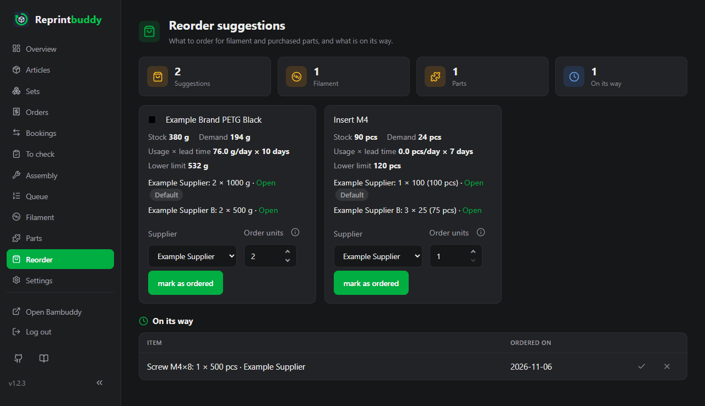

# Reorder suggestions

Reprintbuddy watches your filament and your bought parts and tells you what to order and how much, early enough that it arrives before you run short. It never orders anything itself. The page **Reorder suggestions** (*Reorder* in the menu) lists what to buy and what is already on its way.

The cards at the top count the open **Suggestions**, split into **Filament** and **Parts**, and what is **On its way**.

## What a suggestion shows

Each suggestion is a tile with the filament or part it is about and its figures:

| Figure | Meaning |
|---|---|
| **Stock** | What you have now. |
| **On its way** | Only when something is: what you marked as ordered and has not arrived yet (see below). |
| **Demand** | What the planned prints and builds will use up. |
| **Usage × lead time** | The usage per day of the last 30 days, multiplied by the lead time in days. |
| **Lower limit** | The reserve that should still be left. |

Below the figures stands the suggestion, for example `1 × 50 (50 pcs)`, then the supplier and **Open**, a link to the order page that opens in a new window. Supplier and link come from the settings of the part or the filament.

When a part has several suppliers, this line becomes one line per supplier, the default supplier first and marked **Default**. Each line gives the quantity that fits at that supplier, in its order unit, with its minimum order quantity and its lead time, and its link. So you see at a glance how much you would have to order where.

## When a suggestion appears

A suggestion appears when this holds:

> Stock − Demand − Usage per day × Lead time < Lower limit

In words: take what you have, subtract what the planned prints will use and what is used while the order is on its way. If what remains is below the lower limit, it is time to order.

- **Stock.** For a part, its stock. For filament, the remaining weight of all spool sorts ticked in the slots where it is **Reordered** (see [Filament](filament.md)). What is **on its way** counts like stock: for filament, what you marked as ordered of any spool sort ticked there.
- **Demand.** For filament, the grams of the prints in Reprintbuddy's queue and in progress, plus the prints still missing to reach the target quantity of the articles. For a part, the quantity per piece times the pieces that wait for assembly, are queued or in progress, or are still missing to the target quantity of the articles that need the part.
- **Usage per day.** Measured over the last 30 days. For filament it comes from the daily record of the remaining weight of each spool; only decreases count, so a new spool adds nothing. With less than two days of record the page says "no history yet". For a part it comes from the bookings that take the part off its stock: assembly, the check **good** of an article without hand work, and **Stock in without print** with **Deduct parts** ticked. They count by their booking date, divided by the days since the first journal entry, at most 30.
- **Lead time.** Days from ordering to arrival, from the settings. For a part, whether a suggestion appears depends on the lead time of its default supplier.
- **Lower limit.** For filament, the safety stock. For a part, the larger of its safety margin and its minimum stock; the two do not add up. A safety margin in days is the usage of that many days.

A part below its minimum stock therefore gets a suggestion even without any demand: ordering when the stock is already gone would be too late.

**Example.** A part is bought in packs of 50 and has a stock of 40, a minimum stock of 10, a safety margin of 3 days and a lead time of 7 days. Its usage is 1 per day and the planned builds need 30. Then 40 − 30 − 1 × 7 = 3. The lower limit is the larger of 10 and 3 days × 1 per day, so 10. Since 3 is below 10, there is a suggestion. The shortfall is 10 + 30 + 7 − 40 = 7 pieces, so the suggestion is one pack of 50.

### How much to order

The suggested quantity is the smallest number of whole order units that closes the shortfall, but at least the minimum order quantity. If the minimum order quantity is 2 packs of 50, the suggestion is 100 pieces even when 7 are missing. You see the quantity in order units and, for parts, in pieces.

With several suppliers Reprintbuddy works out this quantity for each supplier on its own, with its lead time, order unit and minimum order quantity. When 16 pieces are missing, for example, the default supplier with packs of 50 shows `1 × 50 (50 pcs)` and a second one with packs of 10 shows `2 × 10 (20 pcs)`.

### What you must enter

Suggestions need the order settings, because Reprintbuddy cannot guess your supplier's lead time:

- For a part: **Minimum stock** and **Safety margin** on the part, and per supplier **Order unit (pieces per pack)**, **Minimum order quantity (packs)**, **Lead time (days)**, name and **Order link**, see [To check and assembly](inspection.md#suppliers).
- For filament: the reorder settings of the spool sort on the Filament page, see [Filament](filament.md). Only spool sorts that are marked **Reordered** in at least one article get suggestions.

!!! note "Without the spool list"
    Filament suggestions need the filament stock. If Bambuddy cannot be reached, the page shows the last recorded stock with its date; each filament tile says **As of …** at its stock. With no record at all, filament suggestions are left out and only parts are shown.

## Mark as ordered

When you have ordered:

1. When the part has several suppliers, choose under **Supplier** where you ordered. The default is chosen to begin with. When you change the supplier, the field **Order units** takes its suggested quantity, as long as you have not typed a number there yourself.
2. Check the number in **Order units**. It starts with the suggested quantity; you can enter 1 to 1000. It counts packs of the chosen supplier.
3. Press **mark as ordered**.

The item moves to the list **On its way**, showing the quantity, for a part the supplier, and the date under **Ordered on**. The quantity on its way is the packs times the supplier's order unit at the time you marked it. If you change or remove the supplier on the part later, it stays as ordered. A part has at most one order on its way. Reprintbuddy makes no new suggestion for it until it has arrived. Until then the ordered quantity counts as on its way: it counts like stock wherever the item counts, for filament also in the suggestion of another spool sort whose slots tick it. Such a tile shows the line **On its way**. The suggestion ends by itself when the goods show up:

- A part: with the first **Goods receipt of a part** booking after you marked it. Book the receipt on the Bookings page, see [To check and assembly](inspection.md#bookings).
- Filament: as soon as Bambuddy's spool list shows new spools of that sort, created after your mark, that together weigh at least the ordered quantity.

You can also press **arrived** in the list yourself, for example for a delivery that you do not book.

Push messages can tell you about new suggestions, see [Push messages](notifications.md).
